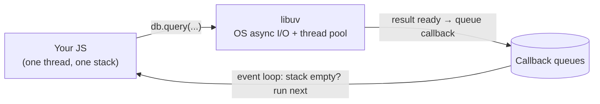
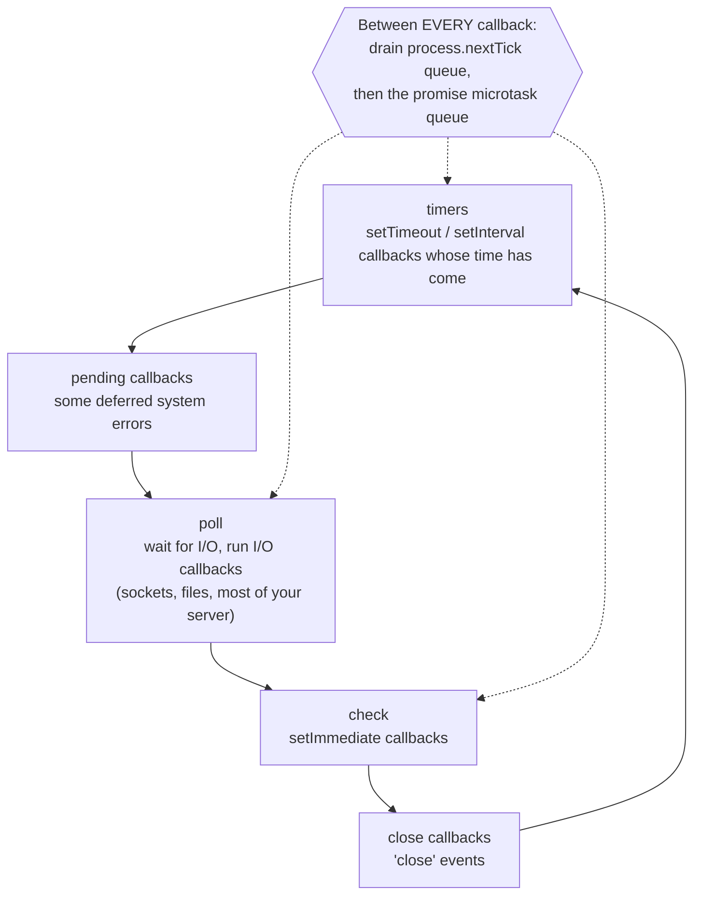
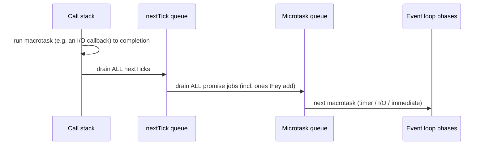
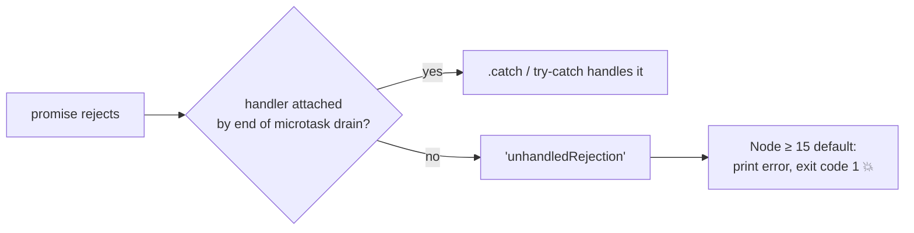
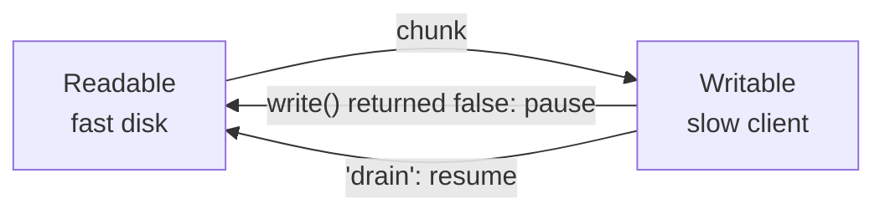

# 01 · The JavaScript Runtime

> Node runs your whole server on **one thread**. That's why a single Node process can juggle ten thousand connections, and also why one careless loop, one forgotten `await` or one unhandled rejection can take every one of those connections down at once. Knowing how the event loop actually schedules your code is what separates "it works on my laptop" from "it works under load".

**Time:** ~5h · **Challenge:** 🐛 Debug · **Prereqs:** [00 · Dev Environment](../00-dev-environment/README.md), basic JavaScript (functions, objects, arrays, classes) · **Services:** none

## What you'll learn

- The call stack, and what "single-threaded" really means for Node
- The event loop phases (timers, poll/I/O, check) and where your callbacks land
- Microtasks vs macrotasks: promise jobs, `queueMicrotask`, `process.nextTick`
- Why blocking the loop kills a server, and how to split CPU work
- Promises in depth: chaining, `Promise.all` / `allSettled` / `race` / `any`
- async/await pitfalls: sequential vs parallel awaits, forgotten awaits, `async` in `forEach`
- Error propagation and unhandled rejections
- Timeouts and cancellation with `AbortController`
- Streams and backpressure, and the `EventEmitter` pattern underneath them

> The challenge uses `.ts` files with light types so you can run it with `tsx` and Vitest. You don't need to know TypeScript yet: read type annotations as documentation. [Module 02](../02-typescript-fundamentals/README.md) teaches TypeScript properly.

---

## 1. One thread, one call stack

JavaScript executes on a single **call stack**. Calling a function pushes a frame; returning pops it. While a frame is running, **nothing else in your JavaScript can run**. There's no preemption: no other thread will interrupt your function halfway through to run a request handler.

```js
function total(orders) { return orders.reduce((s, o) => s + o.amountCents, 0); }
function handle(req) { return { total: total(req.orders) }; }
handle(request);
```

```
│ total     │  ← running
│ handle    │
│ (module)  │
└───────────┘
```

So how does one thread serve thousands of clients? Because a server spends almost all of its time **waiting**: for the network, for the database, for the disk. Node hands those waits to the operating system (and, for some things like file I/O and DNS, to a small internal thread pool in **libuv**, the C library under Node). When the OS says "your data has arrived", Node queues a callback. Your JavaScript only runs when there's actual work to do, and it runs one callback at a time, to completion.



Two consequences you'll rely on all the time:

1. **Run-to-completion.** Code between two `await`s (or inside one synchronous callback) is never interleaved with other JavaScript. `counter++` is never a data race in the way it is in Java or Go. This is why the challenge's `mapWithConcurrency` can share a `next++` index between "workers" without locks.
2. **But anything that crosses an `await` can interleave.** Between `const x = await a()` and the next line, any number of other callbacks may have run and changed shared state. That's where Node's concurrency bugs live (section 6).

## 2. The event loop, phase by phase

The event loop is the `while (there's work)` loop that picks the next callback to run. It goes around in **phases**, each with its own queue:



The three phases worth remembering:

| Phase | Runs | You schedule with |
|---|---|---|
| **timers** | expired timer callbacks | `setTimeout(fn, ms)`, `setInterval` |
| **poll** | I/O callbacks: incoming HTTP requests, socket data, DB results. If nothing is queued, the loop *waits here* for I/O (up to the next timer) | (the OS, via libuv) |
| **check** | `setImmediate` callbacks, right after poll | `setImmediate(fn)` |

Notes that save debugging time:

- **`setTimeout(fn, 0)` means "at least ~1ms from now, in a timers phase"**, not "immediately". Timers are a minimum delay, never a guarantee. A busy loop delays them.
- **`setImmediate` vs `setTimeout(0)`:** inside an I/O callback, `setImmediate` always runs first (check comes right after poll). From the main module the order depends on process timing. Don't rely on it.
- When the loop has nothing left (no pending timers, sockets, immediates), the process **exits**. A forgotten `setInterval` or open DB connection keeps a script alive forever. You saw this in module 00 with ioredis's reconnect loop.

## 3. Microtasks vs macrotasks

Each callback the loop runs from a phase queue is a **macrotask** (or just "task"). There's a second, higher-priority level: **microtasks**.

- **Promise jobs**: `.then`/`.catch`/`.finally` callbacks, and the continuation after every `await`.
- **`queueMicrotask(fn)`**: schedules a plain function as a microtask.
- **`process.nextTick(fn)`** (Node-only): its own queue, drained *before* promise microtasks.

The rule: **after every macrotask, Node drains the nextTick queue completely, then the microtask queue completely** (and if those schedule more microtasks, those run too) before moving on to the next macrotask.

```js
console.log("1 sync");
setTimeout(() => console.log("5 timeout"), 0);
setImmediate(() => console.log("6 immediate"));
Promise.resolve().then(() => console.log("4 promise"));
process.nextTick(() => console.log("3 nextTick"));
console.log("2 sync");
```

In a CommonJS script this prints 1, 2, 3, 4, then 5 and 6 (whose relative order, as above, isn't guaranteed from the main module). All synchronous code first, then nextTick, then promises, then the loop's phases.

> ⚠️ Inside an ES module's top-level code (which is what `"type": "module"` gives you), the module itself is evaluated as part of a promise job, so promise callbacks can run *before* `nextTick` callbacks there. The takeaway is not "memorize both orders" but **never write code whose correctness depends on nextTick-vs-promise order.**



### Why this matters: microtasks can starve the loop

Because the microtask queue is drained *completely* before the loop continues, a chain of microtasks that keeps adding microtasks blocks timers and I/O just as surely as a `while (true)`:

```js
async function crunch(items) {
  for (const chunk of chunks(items)) {
    process(chunk);
    await Promise.resolve(); // ❌ looks like a yield, isn't one
  }
}
```

`await Promise.resolve()` only lets *other microtasks* in. Incoming requests and timers are macrotasks, and they wait until the whole loop finishes. To actually give the event loop a turn you need a **macrotask boundary**:

```js
const yieldToLoop = () => new Promise((resolve) => setImmediate(resolve));
// or: import { setImmediate } from "node:timers/promises"; await setImmediate();
```

Keep this in mind for the challenge.

### What `process.nextTick` is actually for

`nextTick` runs "after the current synchronous code, before anything else". Node's own APIs use it to **defer emitting events until the caller has had a chance to attach listeners**:

```js
function connect() {
  const conn = new EventEmitter();
  process.nextTick(() => conn.emit("ready")); // ✅ caller attaches listeners first
  return conn;
}
const c = connect();
c.on("ready", () => console.log("ready!")); // attached before nextTick fires
```

If `connect` emitted `"ready"` synchronously, the event would fire while `connect()` is still running, before the caller's `.on(...)` line executes, and it would be lost. This is related to a classic API design rule: **a function that's sometimes asynchronous should always be asynchronous.** Mixing sync and async callbacks ("releasing Zalgo" in Node folklore) produces ordering bugs that only show up sometimes.

## 4. Blocking the loop

While your code runs, the loop can't do anything else. A request handler that spends 200ms of CPU on a big `JSON.parse`, a sort of a million items or a bad regex delays **every other request** on that process by 200ms. Health checks time out, the load balancer marks the instance unhealthy, and now the remaining instances get more traffic. That's how "one slow endpoint" becomes an outage.

```mermaid
gantt
  dateFormat X
  axisFormat %Lms
  section Blocking
  summarize 1M orders (sync)   :a1, 0, 400
  request B waits               :crit, 0, 400
  request B handled             :400, 410
  section Chunked
  chunk 1                       :b1, 0, 20
  request B handled             :20, 30
  chunk 2                       :30, 50
  chunk 3                       :50, 70
```



Typical loop-blockers in backends:

| Culprit | Fix |
|---|---|
| Large synchronous loops over data | Push the work into the database (`SUM`, `GROUP BY`), chunk it with `setImmediate`, or move it to a worker |
| `JSON.parse`/`JSON.stringify` of multi-MB payloads | Paginate, stream, or limit body size |
| `fs.readFileSync`, `crypto.pbkdf2Sync`, `zlib.gzipSync` | Use the async versions (they run in libuv's thread pool) |
| Catastrophic regex backtracking (`/(a+)+$/`) | Safer patterns, input length limits |
| CPU-heavy work (image resizing, PDF rendering) | `worker_threads`, or a separate job queue ([module 20](../20-background-jobs/README.md)) |

**Chunking** splits work into slices and yields a macrotask between them, so other callbacks interleave. It doesn't make the work faster (it's slightly slower), but it keeps the server responsive. **Worker threads** actually run JavaScript in parallel on other cores, at the cost of copying data between threads.

You can measure loop health with `perf_hooks.monitorEventLoopDelay()`. The challenge's demo script prints it, and production services export it as a metric ([module 24](../24-observability/README.md)).

## 5. Promises in depth

A promise is an object representing a value that will exist later. It's in one of three states: **pending**, then exactly once either **fulfilled** (with a value) or **rejected** (with a reason). Once settled, it never changes.

### Chaining

`.then` returns a **new** promise, resolved with whatever the callback returns. If the callback returns a promise, the chain waits for it. If it throws, the new promise rejects.

```js
fetchUser(id)
  .then((user) => fetchOrders(user.id)) // returns a promise → chain waits
  .then((orders) => orders.length)
  .catch((err) => { log(err); return 0; }) // handles a rejection from ANY step above
  .finally(() => metrics.inc("lookups")); // runs either way, passes the value through
```

`async`/`await` is syntax over exactly this. An `async` function always returns a promise; `return x` fulfills it, `throw e` rejects it; `await p` pauses the function until `p` settles, then resumes it as a microtask.

### The combinators

| Combinator | Settles when | Result | Use for |
|---|---|---|---|
| `Promise.all(ps)` | all fulfill, or **first rejection** | array of values, input order | independent work that all must succeed |
| `Promise.allSettled(ps)` | all settle | array of `{status, value \| reason}` | "do all of these, report which failed" |
| `Promise.race(ps)` | **first to settle** (either way) | that value/reason | timeouts (race against a timer) |
| `Promise.any(ps)` | first to **fulfill**; rejects only if all reject (`AggregateError`) | first success | redundant sources, fastest replica |

Two things people get wrong about `Promise.all`:

- It **doesn't cancel** the other promises when one rejects. They keep running; their results are just ignored. Cancellation needs an `AbortSignal` (section 8).
- It **doesn't limit concurrency**. `Promise.all(tenThousandIds.map(fetchCustomer))` fires 10,000 requests at once. Use a pool (like the challenge's `mapWithConcurrency`) to cap it.

## 6. async/await pitfalls

These are the bugs you'll see most often in real code reviews. All of them are in the challenge in some form.

### Sequential awaits that should be parallel

```js
// ❌ 2 round trips back to back: latency = a + b
const user = await fetchUser(id);
const orders = await fetchOrders(id);

// ✅ start both, then wait for both: latency = max(a, b)
const [user, orders] = await Promise.all([fetchUser(id), fetchOrders(id)]);
```

`await` means "stop here until this settles". If the second call doesn't need the first one's result, you've added latency for nothing. Under load, those milliseconds add up in your p95/p99.

When the second call *does* depend on the first (`fetchOrders(user.accountId)`), sequential is correct. Ask "does B need A's result?" each time.

### `async` callbacks in `forEach`

```js
// ❌ forEach ignores returned promises: this returns [] immediately
const results = [];
ids.forEach(async (id) => results.push(await load(id)));
return results;

// ✅ map to promises, then await them all
return Promise.all(ids.map((id) => load(id)));

// ✅ or, when order of execution matters, a plain for...of loop
for (const id of ids) results.push(await load(id));
```

`forEach`, `filter`, `some` and `reduce` don't know about promises. `forEach` calls your async function, gets a promise back, throws it away, and moves on. The function returns before any of the work is done, rejections from those promises are unhandled, and push order depends on which request finishes first.

### Forgotten `await` and fire-and-forget

```js
async function save(order) {
  db.insert(order); // ❌ forgot await: errors become unhandled rejections,
  return "ok";      //    and "ok" is returned before the insert happened
}
```

Sometimes you *want* fire-and-forget: sending an analytics event or writing an audit log shouldn't slow down the response. Then be explicit and **always attach a handler**:

```js
void audit.record(event).catch((err) => logger.error("audit failed", err));
```

The `void` tells readers (and linters like `@typescript-eslint/no-floating-promises`) "I'm deliberately not awaiting this".

### Check-then-act across an await (async race conditions)

Single-threaded doesn't mean race-free. Look at this cache:

```js
async function getRate(pair) {
  if (cache.has(pair)) return cache.get(pair);
  const rate = await api.fetchRate(pair); // ← other calls run while we wait here
  cache.set(pair, rate);
  return rate;
}
```

Two concurrent calls for the same pair both check the cache (empty), both call the API, both set it. With 50 concurrent requests that's 50 API calls instead of one, which is the "thundering herd" or "cache stampede". The fix is to cache the **promise** synchronously, before awaiting, so the second caller finds the in-flight request and shares it:

```js
function getRate(pair) {
  let p = cache.get(pair);
  if (!p) {
    p = api.fetchRate(pair);
    cache.set(pair, p);                       // set BEFORE any await
    p.catch(() => cache.delete(pair));        // don't cache failures forever
  }
  return p;
}
```

This "promise memoization" (also called request coalescing or single-flight) shows up in caches, connection pools and lazy initialization. You'll meet its distributed big brother in [module 18](../18-caching/README.md).

## 7. Errors and unhandled rejections

With `await`, errors propagate like synchronous exceptions: a rejected promise throws at the `await`, and `try/catch` catches it. Without `await`, a rejection travels down the promise chain until a `.catch` handles it, or until it reaches the end of the chain unhandled.



Since Node 15, an unhandled rejection **crashes the process** by default (`--unhandled-rejections=throw`). That's the right default: an ignored error means your program is in an unknown state. But it means one forgotten `.catch` on a fire-and-forget call can kill a server handling thousands of other requests.

Rules:

- Every promise is either **awaited**, **returned** to a caller who will handle it, or has a **`.catch`**.
- `process.on("unhandledRejection", ...)` is for **logging before you exit**, not for keeping a broken process alive. Same for `uncaughtException`. Let your orchestrator (Kubernetes, systemd) restart the process.
- Throwing inside a plain callback (`setTimeout(() => { throw e })`) is an `uncaughtException`: no promise is there to catch it. Wrap callback APIs in promises.
- Reject with `Error` objects, not strings. Errors carry stack traces; strings don't.
- An `EventEmitter` that emits `"error"` with no `"error"` listener **throws**. Always listen for `"error"` on streams, sockets and clients.

## 8. Timeouts and cancellation: `AbortController`

Every network call needs a deadline. Without one, a hung dependency holds your request (and its memory, sockets and DB connections) forever, and requests pile up until the process falls over. This is the most common way one slow service takes down the services that call it.

`AbortController` is the standard cancellation mechanism, shared by browsers and Node:

```js
const controller = new AbortController();
const { signal } = controller;

fetch(url, { signal });            // fetch listens to the signal
setTimeout(() => controller.abort(new Error("too slow")), 2000);

signal.aborted;                    // true after abort()
signal.reason;                     // what you passed to abort()
signal.addEventListener("abort", () => { /* clean up */ });

AbortSignal.timeout(2000);         // a signal that aborts itself after 2s
AbortSignal.any([a, b]);           // aborts when either does
```

Important subtlety: **aborting is a request, not a guarantee.** The signal only does something if the operation listens to it. `fetch`, `node:timers/promises`, `fs.readFile`, `events.once` and most modern APIs do. Your own code and many older libraries don't. So a robust timeout helper must do two things:

1. **Signal** the operation to stop (so well-behaved work stops consuming resources).
2. **Stop waiting** on its own when the deadline passes, by rejecting its promise whether or not the operation reacted. That's a race between the operation and a timer.

And it must **clear its timer** when the operation finishes first. A forgotten 30-second timer keeps the process alive and leaks memory under load. You'll implement exactly this in the challenge.

## 9. EventEmitter

Many Node core objects (HTTP servers, sockets, streams, child processes) are `EventEmitter`s: objects you subscribe to with `.on(event, listener)` and that call listeners with `.emit(event, ...args)`.

```js
import { EventEmitter, once } from "node:events";

const job = new EventEmitter();
job.on("progress", (p) => console.log(`${p.done}/${p.total}`));
job.once("done", () => console.log("finished"));
job.emit("progress", { done: 1, total: 3 });

const [result] = await once(job, "done"); // promise for the next "done" event
```

Things that surprise people:

- **`emit` is synchronous.** Listeners run immediately, inside the `emit` call, in registration order. An event emitted before a listener is attached is simply gone; there's no buffering.
- **`"error"` is special**: emitting it with no listener throws.
- More than 10 listeners for one event prints a `MaxListenersExceededWarning`. That's usually a leak (adding a listener per request without removing it).

Use events for things that happen **many times** (progress, data chunks, connections). For a single result, a promise is simpler.

## 10. Streams and backpressure (the basics)

A stream processes data piece by piece instead of loading everything into memory. Reading a 5GB file, proxying an upload, exporting a million rows as CSV: all streams.

| Type | Example |
|---|---|
| Readable | `fs.createReadStream`, an HTTP request body, a DB cursor |
| Writable | `fs.createWriteStream`, an HTTP response |
| Transform | gzip, CSV encoder, line splitter |

**Backpressure** is what happens when the producer is faster than the consumer, like reading from a fast disk and writing to a slow client. Without it, data piles up in memory until the process dies. Writable streams signal it: `write()` returns `false` when the internal buffer is full, and emits `"drain"` when it's ready for more.



You almost never manage this by hand. Use `pipeline`, which wires up backpressure, error propagation and cleanup for every stream in the chain:

```js
import { pipeline } from "node:stream/promises";
import { createReadStream, createWriteStream } from "node:fs";
import { createGzip } from "node:zlib";

await pipeline(createReadStream("orders.csv"), createGzip(), createWriteStream("orders.csv.gz"));
```

Readable streams are also **async iterables**, which is often the clearest way to consume them, and `await` inside the loop gives you backpressure for free:

```js
for await (const chunk of req) { await handle(chunk); }
```

More detail in [docs/streams-and-backpressure.md](docs/streams-and-backpressure.md).

## Common mistakes

- `array.forEach(async ...)` and expecting it to wait.
- Awaiting independent calls one after another.
- `Promise.all` over thousands of items with no concurrency limit.
- Fire-and-forget promises without `.catch` (unhandled rejection → crash).
- `await Promise.resolve()` (or `queueMicrotask`) as a "yield": it doesn't let I/O or timers run.
- Check-then-set caches across an `await` (duplicate work, stampedes).
- Network calls with no timeout; timeouts that rely on the callee honoring `AbortSignal`; timers that are never cleared.
- Emitting events synchronously in a constructor or factory, before the caller can subscribe.
- Using `process.on("unhandledRejection")` to swallow errors and keep running.
- Sync APIs (`readFileSync`, `pbkdf2Sync`) inside request handlers.

## In production

- **Event-loop lag is a first-class metric.** Teams alert on p99 loop delay; a spike usually means a CPU-heavy request or a blocking call slipped in. Profilers (`node --cpu-prof`, clinic.js, 0x) show the culprit as a wide flame.
- **Every outbound call has a timeout**, usually shorter than the caller's own timeout, so failures surface as clean errors instead of cascading hangs. With retries and circuit breakers this becomes a whole discipline ([module 29](../29-reliability-scaling/README.md)).
- **Bounded concurrency everywhere**: DB pools cap connections, HTTP agents cap sockets, batch jobs cap parallel requests. Unbounded `Promise.all` is a top cause of "we DDoSed our own dependency".
- **Request coalescing** (promise memoization) protects caches and upstreams from stampedes during traffic spikes and cold starts.
- **Crash on unhandled errors, restart fast.** Kubernetes restarts the pod; the load balancer routes around it. Graceful shutdown ([module 05](../05-express-basics/README.md) onward) drains in-flight requests first.
- **CPU-heavy work moves out of the request path**: into the database, a worker thread, or a background job queue.

## Check yourself

1. What does this print, and why? `setTimeout(() => console.log("A")); Promise.resolve().then(() => console.log("B")); console.log("C");`
   <details><summary>Answer</summary><code>C</code>, <code>B</code>, <code>A</code>. Synchronous code runs first; then the microtask queue (promise callback) is drained; the timer is a macrotask that runs in a later timers phase.</details>
2. Why doesn't `await Promise.resolve()` between chunks of CPU work keep a server responsive?
   <details><summary>Answer</summary>The continuation is a microtask, and the loop drains all microtasks before it handles any macrotask (I/O, timers). Incoming requests still wait. You need a macrotask boundary such as <code>setImmediate</code>.</details>
3. Two requests call `getUser(42)` at the same moment and the cache is empty. With a check-then-set cache, how many DB queries happen? How do you make it one?
   <details><summary>Answer</summary>Two: both see the empty cache before either finishes. Cache the in-flight promise synchronously (before awaiting) so the second caller reuses it, and evict it if it rejects.</details>
4. `Promise.all` vs `Promise.allSettled`: when would you pick each?
   <details><summary>Answer</summary><code>all</code> when every result is required and one failure should fail the whole operation (it rejects on the first rejection). <code>allSettled</code> when you want every outcome, e.g. a batch where you report which items failed.</details>
5. You call `controller.abort()` but the operation keeps running and your function still hangs. Why?
   <details><summary>Answer</summary>Abort only signals; the operation must listen to the signal. A robust timeout also races the operation against a timer and rejects on its own when the deadline passes.</details>

## Further reading

- Node.js docs, The Node.js Event Loop: https://nodejs.org/en/learn/asynchronous-work/event-loop-timers-and-nexttick
- Node.js docs, Don't Block the Event Loop: https://nodejs.org/en/learn/asynchronous-work/dont-block-the-event-loop
- Node.js API, Events: https://nodejs.org/api/events.html
- Node.js API, Stream: https://nodejs.org/api/stream.html
- Node.js API, Process (`unhandledRejection`, `nextTick`): https://nodejs.org/api/process.html
- MDN, Using promises: https://developer.mozilla.org/en-US/docs/Web/JavaScript/Guide/Using_promises
- MDN, AbortController: https://developer.mozilla.org/en-US/docs/Web/API/AbortController
- Deep dives in this module: [docs/event-loop-puzzles.md](docs/event-loop-puzzles.md) · [docs/async-cheatsheet.md](docs/async-cheatsheet.md) · [docs/streams-and-backpressure.md](docs/streams-and-backpressure.md)

## ➡️ Next: [the challenge](CHALLENGE.md)
