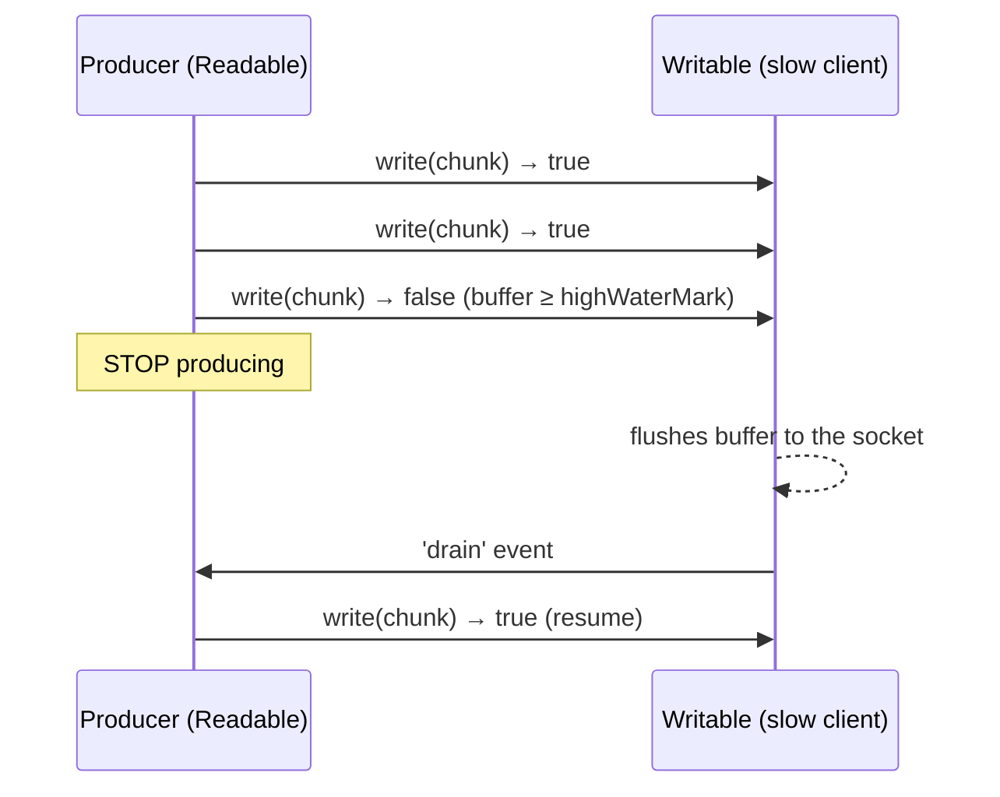

# Streams and backpressure

The lesson introduced streams. This page goes one level deeper: why backpressure exists, what it looks like when you get it wrong, and the handful of patterns you'll use in backend code.

## Why streams

Say you need to export 2 million orders as CSV over HTTP. The naive version:

```js
const rows = await db.query("SELECT * FROM orders");   // 2M rows in memory
res.end(rows.map(toCsvLine).join("\n"));               // + a giant string
```

Memory use is proportional to the data size. Two concurrent exports and the process runs out of memory. The client also sees nothing until everything is ready.

With streams, memory use is proportional to the **buffer size** (kilobytes), no matter how big the data is, and the first bytes go out immediately:

```js
import { pipeline } from "node:stream/promises";
await pipeline(db.queryStream("SELECT * FROM orders"), toCsv(), res);
```

## The four kinds

| Kind | You read / write | Examples |
|---|---|---|
| **Readable** | read chunks from it | `fs.createReadStream`, `req` (incoming request body), DB cursors, `process.stdin` |
| **Writable** | write chunks to it | `fs.createWriteStream`, `res` (outgoing response), `process.stdout` |
| **Duplex** | both, independently | TCP sockets |
| **Transform** | write in, read transformed out | `zlib.createGzip()`, CSV encoders, line splitters |

By default chunks are `Buffer`s (bytes). In **object mode**, chunks can be any JS value: rows, events, records.

## Backpressure, concretely

Every stream has an internal buffer with a limit, the `highWaterMark` (16KB for byte streams, 16 objects in object mode). Backpressure is the protocol for "slow down, my buffer is full":



If you ignore the `false` and keep writing, nothing errors: the data just piles up in memory. That's what makes backpressure bugs dangerous. They only show up with slow clients or big data, usually in production.

### Getting it wrong vs right, by hand

```js
// ❌ ignores backpressure: buffers everything if the client is slow
for (const row of rows) res.write(toCsvLine(row));
res.end();

// ✅ respects it
import { once } from "node:events";
for (const row of rows) {
  if (!res.write(toCsvLine(row))) await once(res, "drain");
}
res.end();
```

You'll rarely write the second version yourself, because `pipeline` does it for you.

## `pipeline`: the default tool

```js
import { pipeline } from "node:stream/promises";

await pipeline(source, transform1, transform2, destination);
```

`pipeline`:

- connects each stream to the next **with backpressure**,
- **propagates errors** from any stage and rejects the promise,
- **destroys every stream** in the chain on error (no leaked file handles or sockets),
- accepts an `{ signal }` option for cancellation.

The older `a.pipe(b).pipe(c)` does backpressure but **not** error propagation or cleanup. An error in `b` leaves `a` and `c` open. Prefer `pipeline` in new code.

## Async iteration and generators

Readable streams are async iterables, and `pipeline` accepts async generator functions as transforms. Together, that's often the most readable way to write stream code:

```js
import { pipeline } from "node:stream/promises";
import { createReadStream, createWriteStream } from "node:fs";
import { createInterface } from "node:readline";

await pipeline(
  createReadStream("orders.ndjson"),
  async function* (source) {
    // split into lines, parse, filter, re-serialize
    const lines = createInterface({ input: source, crlfDelay: Infinity });
    for await (const line of lines) {
      const order = JSON.parse(line);
      if (order.amountCents > 10_000) yield `${order.id},${order.amountCents}\n`;
    }
  },
  createWriteStream("big-orders.csv"),
);
```

Backpressure works automatically: the generator is suspended at `yield` until the next stage wants more data, and `for await` only pulls the next line when the loop body finishes.

## Streams and the event loop

Streams are also a tool against **blocking**. Processing a 500MB JSON file with `JSON.parse(fs.readFileSync(...))` blocks the loop for seconds and needs gigabytes of memory. Processing it as a stream of NDJSON lines does a little work per chunk, and the loop serves other requests between chunks. It's the same idea as the chunked `summarizeOrders` in the challenge, with the chunking done by the I/O layer.

## Common mistakes

- Ignoring `write()`'s return value in hand-written loops.
- Using `.pipe()` and leaking streams on errors; use `pipeline`.
- No `"error"` listener on a stream used outside `pipeline`: an error event with no listener crashes the process.
- Collecting a whole stream into an array "just to sort it", which defeats the purpose. Sort in the database instead.
- Mixing `on("data")` (flowing mode) with `for await` on the same stream.
- Forgetting that HTTP `req` is a stream: reading the body twice doesn't work, and an unread body keeps the socket busy.

## Where you'll meet streams later

- **Module 03**: reading request bodies with a size limit from `node:http` (`req` is a Readable).
- **Module 13**: streaming large query results with Postgres cursors.
- **Module 28**: real-time pushes (SSE / WebSockets) are long-lived writable streams.
- **Module 32**: Kafka consumers are conceptually streams with backpressure (pausing partitions).
