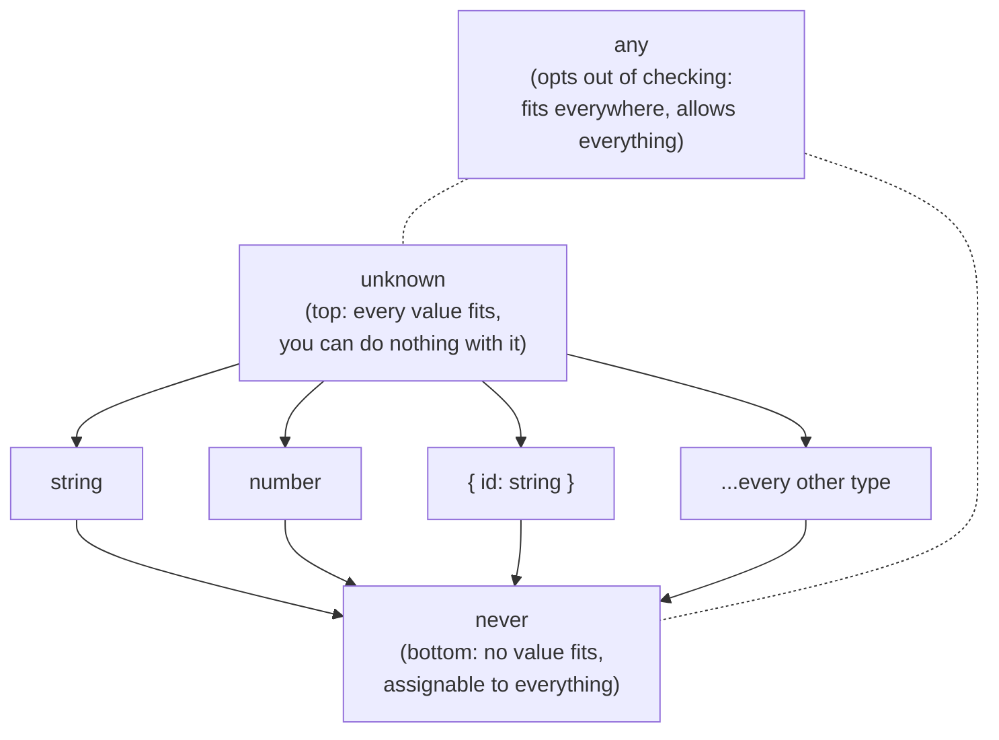
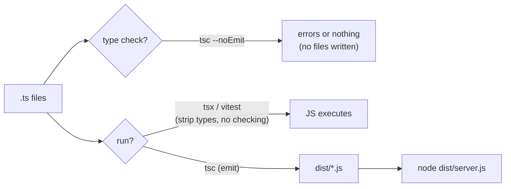

# 02 · TypeScript Fundamentals

> Every module after this one is written in strict TypeScript. The compiler becomes the cheapest code reviewer you'll ever have: it reads every line, on every save, and it never gets tired of asking "what if this is `undefined`?"

**Time:** ~6h · **Challenge:** 🧩 Scaffold · **Prereqs:** [01 · The JavaScript Runtime](../01-js-runtime/README.md) · **Services:** none

## What you'll learn

- What TypeScript actually is (a type checker that disappears at runtime) and why backend teams use it
- How `tsconfig.json` works, and what `strict` and `noUncheckedIndexedAccess` buy you
- **Structural typing**: why TypeScript cares about shape, not names
- Primitives, arrays, tuples, object types, optional and `readonly` properties, `interface` vs `type`
- **Unions and narrowing**: `typeof`, `in`, `instanceof`, discriminated unions, type predicates
- `unknown` vs `any` vs `never`, and exhaustiveness checks that catch the "forgot a case" bug
- Function types, overloads, and **generics** with constraints
- Literal types, `as const`, and why most teams prefer union literals over `enum`
- ES modules in Node: `NodeNext`, the `.js` extension rule, `verbatimModuleSyntax`
- How to run TypeScript (`tsc`, `tsx`, Vitest) and how to read a scary compiler error

---

## 1. What TypeScript is (and isn't)

TypeScript is JavaScript plus a **static type checker**. You write `.ts` files with type annotations. Before your code runs, something strips the types away and what's left is plain JavaScript:

```ts
// what you write
function greet(name: string): string {
  return `hi ${name}`;
}

// what runs (types erased)
function greet(name) {
  return `hi ${name}`;
}
```

That one fact explains most of TypeScript's behavior:

- **Types don't exist at runtime.** You can't ask "is this value a `User`?" with `instanceof User` if `User` is an interface. There is nothing left to ask. Runtime checks (`typeof`, `in`, `Array.isArray`, a validation library) are separate code that you write.
- **Types are only as true as your boundaries.** `JSON.parse` returns whatever came over the wire. If you tell the compiler "this is a `User`", it believes you. Data entering your program (HTTP bodies, env vars, files, database rows) has to be *checked*, not *declared*. You'll practice this in the challenge's `parseConfig` and build on it with zod in [module 07](../07-validation-errors-config/README.md).
- **TypeScript never changes behavior.** If your JS has a bug, the TS version has the same bug, unless the type checker points it out first. That's the whole value: find bugs while typing instead of in production logs.

### Why backend teams care

In a frontend, a type error usually means a broken button. In a backend it means a 500 for every user, a corrupted row, or money charged twice. The common production bugs in a Node service look like this:

| Bug | How TypeScript catches it |
|---|---|
| `Cannot read properties of undefined (reading 'email')` | `strict` makes `undefined` part of the type, so you must handle it |
| A new enum value ("refunded") isn't handled in a `switch` | exhaustiveness check with `never` fails the build |
| Arguments swapped: `transfer(toId, fromId)` | branded types ([module 08](../08-typescript-for-backends/README.md)) |
| A typo: `user.emial` | property doesn't exist on the type |
| A refactor renamed a field; three call sites didn't get the memo | every call site turns red |

Refactoring is the underrated one. On a big codebase, "rename this field and fix everything the compiler complains about" is a 10-minute task. In plain JS it's an afternoon of grep and hoping.

## 2. `tsconfig.json` and strict mode

`tsconfig.json` tells the compiler which files to check and how strictly. Here's the one every module in this repo uses, with the important lines explained:

```jsonc
{
  "compilerOptions": {
    "target": "ES2023",              // which JS syntax to emit (Node 22 supports all of ES2023)
    "module": "NodeNext",            // follow Node's real ESM/CJS rules (section 9)
    "moduleResolution": "NodeNext",
    "types": ["node"],               // load @types/node: process, Buffer, node:* modules
    "strict": true,                  // turn on the whole family of strict checks
    "noUncheckedIndexedAccess": true,// arr[i] and record[key] might be undefined
    "noFallthroughCasesInSwitch": true,
    "verbatimModuleSyntax": true,    // type-only imports must say `type` (section 9)
    "isolatedModules": true,         // every file can be compiled on its own (tsx/esbuild need this)
    "skipLibCheck": true             // don't type-check node_modules' .d.ts files (speed)
  },
  "include": ["src", "test"]
}
```

`strict: true` is a bundle of flags. The two that matter most:

- **`strictNullChecks`**: `null` and `undefined` are no longer secretly members of every type. `string` means a string. If something might be missing, the type says `string | undefined` and the compiler makes you deal with it.
- **`noImplicitAny`**: if TypeScript can't infer a type (usually a function parameter), it's an error instead of silently becoming `any`.

`noUncheckedIndexedAccess` isn't part of `strict`, but it should be:

```ts
const ports = [5433, 6380];
const p = ports[5];       // without the flag: number (a lie)
                          // with the flag:    number | undefined (the truth)
p.toFixed();              // ❌ 'p' is possibly 'undefined'

const env: Record<string, string> = { HOME: "/root" };
env.DATABSE_URL.length;   // ❌ with the flag, this typo is caught as possibly undefined
```

> 💡 Turning strictness on later is painful: a large codebase can produce thousands of errors at once. Start strict on day one. Every module in this repo does.

## 3. Structural typing: shape, not names

In Java or C#, a `Dog` is only a `Dog` if its class says so. TypeScript compares **shapes**. If a value has the properties a type requires, it fits:

```ts
interface HasEmail {
  email: string;
}

function sendWelcome(to: HasEmail) { /* ... */ }

const user = { id: "u1", email: "ada@example.com", isAdmin: false };
sendWelcome(user); // ✅ user has an `email: string`, so it fits. Extra properties are fine.
```

This is sometimes called "duck typing, checked at compile time". It's very convenient: you can describe just the slice of an object a function needs, and any object with that slice works. It's also why test fakes are easy to write in TypeScript. A fake repository just needs the same methods; it never has to extend anything ([module 06](../06-layered-architecture/README.md) uses this constantly).

One exception catches people out: **excess property checks**. When you pass an object *literal* directly, TypeScript flags unknown properties, because that's almost always a typo:

```ts
sendWelcome({ email: "a@b.c", emial: "oops" }); // ❌ Object literal may only specify known properties
```

Assign the same object to a variable first and the check doesn't apply. That's structural typing working as designed: only fresh literals get the extra scrutiny.

## 4. The building blocks

```ts
// primitives
let name: string = "Ada";
let age: number = 36;            // there is one number type: ints and floats alike
let active: boolean = true;
let id: bigint = 9007199254740993n;
let nothing: null = null;
let missing: undefined = undefined;

// arrays: two spellings, same meaning
const tags: string[] = ["a", "b"];
const ids: Array<number> = [1, 2];

// tuples: fixed length, each position has its own type
const entry: [string, number] = ["port", 8080];
const [key, value] = entry;      // key: string, value: number

// object types, optional and readonly properties
type User = {
  readonly id: string;           // can't be reassigned after creation
  email: string;
  nickname?: string;             // may be absent: type is string | undefined
};
```

Most of the time you don't write these annotations at all. TypeScript **infers** types from values: `const port = 8080` is a `number`. The rule of thumb is to annotate *boundaries* (function parameters, return types of exported functions, public APIs) and let inference handle everything inside.

### `readonly` is a compile-time promise

`readonly` stops *your code* from reassigning a property. It does nothing at runtime: the object can still be mutated by code that sees it under a different type. To actually stop mutation at runtime, you need `Object.freeze`, which the challenge's `deepFreeze` combines with a `DeepReadonly` type. For arrays, `readonly string[]` (or `ReadonlyArray<string>`) removes `push`, `splice` and friends from the type.

A good habit: function parameters you don't mutate should be `readonly T[]`. Callers can then pass both mutable and readonly arrays, and the signature documents "I won't touch your array".

### `interface` vs `type`

Both describe object shapes and are interchangeable for most purposes:

```ts
interface Point { x: number; y: number }
type Point2 = { x: number; y: number };
```

| | `interface` | `type` |
|---|---|---|
| Object shapes | ✅ | ✅ |
| Unions, tuples, primitives, mapped types | ❌ | ✅ (`type Id = string \| number`) |
| `extends` another type | `interface B extends A {}` | `type B = A & { ... }` |
| Declaration merging (two declarations combine) | ✅ (used to extend library types, [module 08](../08-typescript-for-backends/README.md)) | ❌ |
| Error messages | shows the name | sometimes expands the whole structure |

A pragmatic rule many teams use: **`interface` for object shapes, `type` for everything else** (unions, function types, aliases). Consistency within a codebase matters more than which one you pick.

## 5. Unions and narrowing

A **union** type says "one of these":

```ts
type Id = string | number;
type Status = "pending" | "paid" | "refunded"; // a union of literal types
```

You can only use what *all* members have in common. To do more, you **narrow**: write a runtime check that the compiler understands, and inside that branch the type is more specific.

```ts
function format(id: string | number): string {
  if (typeof id === "number") {
    return id.toFixed(0);        // here id: number
  }
  return id.toUpperCase();       // here id: string (the only option left)
}
```

The narrowing tools:

| Check | Narrows by | Example |
|---|---|---|
| `typeof x === "string"` | primitive kind | `string`, `number`, `boolean`, `bigint`, `symbol`, `undefined`, `function`, `object` |
| `x === null`, `x !== undefined`, truthiness | specific values | `if (user)` removes `null`/`undefined` (careful: also `0` and `""`) |
| `"radius" in shape` | property existence | object unions without a shared tag |
| `err instanceof HttpError` | class | only works for classes, not interfaces |
| `Array.isArray(x)` | arrays | `unknown` → `any[]` (see the trap below) |
| `shape.kind === "circle"` | discriminant | the most important one; next section |
| `isLogLevel(x)` | your own type predicate | `function isLogLevel(x: unknown): x is LogLevel` |

### Discriminated unions

Give each member of a union a common property with a different **literal** value, and checking that property narrows to exactly one member:

```ts
type PaymentEvent =
  | { type: "authorized"; amountCents: number }
  | { type: "captured"; amountCents: number; capturedAt: Date }
  | { type: "failed"; reason: string };

function describe(e: PaymentEvent): string {
  switch (e.type) {
    case "authorized": return `authorized ${e.amountCents}`;
    case "captured":   return `captured at ${e.capturedAt.toISOString()}`;
    case "failed":     return `failed: ${e.reason}`;   // e.reason only exists here
  }
}
```

This pattern is everywhere in backend code: event payloads, state machines (`order.status`), API results, message types on a queue. It replaces class hierarchies with plain data that serializes to JSON naturally. Learn to reach for it.

### Type predicates: teaching the compiler your own checks

Sometimes the check is too complex for the compiler to follow. Wrap it in a function whose return type is `value is T`:

```ts
const LOG_LEVELS = ["debug", "info", "warn", "error"] as const;
type LogLevel = (typeof LOG_LEVELS)[number];

function isLogLevel(value: unknown): value is LogLevel {
  return typeof value === "string" && (LOG_LEVELS as readonly string[]).includes(value);
}

const raw: unknown = process.env.LOG_LEVEL;
if (isLogLevel(raw)) {
  raw; // LogLevel
}
```

The compiler **trusts** a predicate. If the body is wrong (say it returns `true` for `"verbose"`), the types lie. Keep predicates small and test them.

## 6. `unknown`, `any` and `never`

These three are the edges of the type system:



- **`unknown`** means "I don't know what this is yet". Anything can be assigned *to* it, but you can't do anything *with* it until you narrow. It's the right type for untrusted input: `JSON.parse` output, `catch (e)` variables, request bodies.
- **`any`** turns the checker off for that value, and it's contagious: `const x: any = ...; const y = x.foo.bar;` gives you `y: any` too, with zero checking. It's an escape hatch from the JS migration days. In this repo `any` is banned in `src/`, and the challenge has a test that greps for it.
- **`never`** is the type with no values. A function that always throws returns `never`. A variable narrowed until no options remain is `never`. That's useful.

```ts
// unknown forces you to check
function handle(body: unknown) {
  body.email;                                   // ❌ 'body' is of type 'unknown'
  if (typeof body === "object" && body !== null && "email" in body) {
    body.email;                                  // ✅ (type: unknown, still needs checking)
  }
}
```

> ⚠️ **`any` sneaks in.** `JSON.parse` returns `any`. So do `Array.isArray(x)` on an `unknown` (it narrows to `any[]`) and `res.json()` from `fetch`. Annotate the result as `unknown` right away: `const data: unknown = JSON.parse(text)`.

### Exhaustiveness checks with `never`

Here's the trick that justifies `never`'s existence. If you handle every member of a union, whatever's left in the `default` branch has type `never`. Pass it to a function that only accepts `never`:

```ts
function assertNever(value: never): never {
  throw new Error(`Unexpected value: ${JSON.stringify(value)}`);
}

function area(shape: Shape): number {
  switch (shape.kind) {
    case "circle":    return Math.PI * shape.radius ** 2;
    case "rectangle": return shape.width * shape.height;
    default:          return assertNever(shape);
  }
}
```

Now a teammate adds `Triangle` to `Shape`. The `default` branch receives a `Triangle`, which isn't `never`, and **the build fails** at exactly the line that needs updating:

```
Argument of type 'Triangle' is not assignable to parameter of type 'never'.
```

The legacy JavaScript in the challenge shipped precisely this bug (triangle areas came out as `undefined`, then `NaN` on an invoice). With `assertNever`, it can't compile. The runtime `throw` still matters: data from outside (a message queue, an old client) can carry a `kind` your types don't know about.

## 7. Functions, overloads and generics

### Function types

```ts
type Handler = (payload: string) => void;           // a function type
const log: Handler = (p) => console.log(p);          // p inferred as string

function retry(fn: () => Promise<void>, attempts = 3): Promise<void> { /* ... */ }
function connect(url: string, opts?: { timeoutMs?: number }) { /* ... */ }
```

Annotate return types on exported functions. It documents intent, gives better error messages (the error shows up in the function, not at some distant caller), and stops an accidental change in the body from silently changing your API.

### Overloads

Sometimes the return type depends on which kind of argument was passed. Overloads list several signatures above one implementation:

```ts
function first<T>(items: readonly [T, ...T[]]): T;          // non-empty tuple → definitely T
function first<T>(items: readonly T[]): T | undefined;      // any array → maybe undefined
function first<T>(items: readonly T[]): T | undefined {     // implementation (not callable directly)
  return items[0];
}
```

Callers see only the overload signatures, checked top to bottom, so put the most specific one first. Before writing overloads, check whether a union parameter or a generic would do: overloads are the right tool only when the input-to-output relationship really differs per case.

### Generics: types as parameters

A generic function works for many types while keeping the link between input and output:

```ts
function identityBad(x: unknown): unknown { return x; }  // loses the type
function identity<T>(x: T): T { return x; }              // keeps it

const n = identity(42);      // T inferred as number → n: number
```

You almost never pass type arguments explicitly. TypeScript infers `T` from the arguments. Generics get interesting with **constraints** (`extends`), which say what `T` must at least be:

```ts
// K must be one of T's keys, so obj[key] is valid and typed as T[K]
function getProp<T, K extends keyof T>(obj: T, key: K): T[K] {
  return obj[key];
}

const user = { id: "u1", age: 36 };
getProp(user, "age");    // number
getProp(user, "agee");   // ❌ Argument of type '"agee"' is not assignable to parameter of type '"id" | "age"'
```

Three pieces of syntax are doing the work there, and you'll see them constantly:

| Syntax | Meaning | Example result |
|---|---|---|
| `keyof T` | union of T's property names | `"id" \| "age"` |
| `T[K]` | the type of property K on T (indexed access) | `T["age"]` → `number` |
| `K extends keyof T` | constraint: K must be one of those names | rejects `"agee"` |

Generic **classes** work the same way. A typed event bus maps event names to payload types, and every method is generic over the event name so the name picks the payload:

```ts
class EventBus<Events extends Record<string, unknown>> {
  on<K extends keyof Events>(event: K, handler: (payload: Events[K]) => void): () => void { /* ... */ }
  emit<K extends keyof Events>(event: K, payload: Events[K]): void { /* ... */ }
}
```

That's exactly TODO 6 in the challenge.

> 💡 A good generic has a type parameter that appears **at least twice** (input and output, or two inputs). `function parse<T>(json: string): T` uses `T` once. It's an `as` cast in disguise, because nothing checks that the JSON really is a `T`.

### Built-in utility types

TypeScript ships helpers that transform types. You'll use these daily:

| Utility | Does | Example |
|---|---|---|
| `Partial<T>` | all properties optional | patch payloads |
| `Required<T>` | all properties required | after applying defaults |
| `Readonly<T>` | all properties readonly (one level) | |
| `Pick<T, K>` / `Omit<T, K>` | keep / drop some properties | `Omit<User, "passwordHash">` for API output |
| `Record<K, V>` | object with keys K and values V | `Record<string, number>` |
| `ReturnType<F>` / `Parameters<F>` | extract from a function type | |
| `Awaited<P>` | unwrap a Promise type | |

How they're built (mapped and conditional types) is [module 08](../08-typescript-for-backends/README.md) material.

## 8. Literal types, `as const` and enums

A **literal type** is a type with exactly one value: `"circle"`, `42`, `true`. Unions of literals model closed sets of options better than plain `string`:

```ts
let level: "debug" | "info" | "warn" | "error" = "info";
level = "verbose"; // ❌
```

TypeScript **widens** literals when it thinks you'll reassign: `let x = "info"` is a `string`, `const x = "info"` is `"info"`. For arrays and objects even `const` widens the contents, because the contents can change. **`as const`** stops widening and makes everything readonly:

```ts
const LEVELS = ["debug", "info"];            // string[]
const LEVELS2 = ["debug", "info"] as const;  // readonly ["debug", "info"]

type Level = (typeof LEVELS2)[number];       // "debug" | "info"
```

That last line is a pattern worth memorizing: **a runtime list and its type from one source**. You can loop over `LEVELS2` to validate input and use `Level` in signatures. Add a level in one place and both update.

### Why most teams skip `enum`

TypeScript has an `enum` keyword:

```ts
enum Status { Pending = "pending", Paid = "paid" }
```

It's one of the few TypeScript features that **generates runtime code**, which means it doesn't play well with tools that only strip types (Node's built-in type stripping, and the `erasableSyntaxOnly` compiler flag, reject it). Numeric enums also accept any number (`const s: Direction = 42` compiles). A union of string literals plus an `as const` array does the same job with plain JavaScript values, serializes naturally to JSON and to Postgres, and has no surprises. You'll still see enums in older codebases; recognize them and prefer unions in new code.

## 9. Modules: ESM in Node

Node supports two module systems: CommonJS (`require`, `module.exports`) and ES modules (`import`/`export`). Every project in this repo is ESM (`"type": "module"` in package.json). With `"module": "NodeNext"`, TypeScript follows Node's actual rules, which leads to the rule that surprises everyone:

**Import paths use the `.js` extension, even though the file on disk is `.ts`.**

```ts
import { groupBy } from "./groupBy.js";   // ✅ the file is groupBy.ts
import { groupBy } from "./groupBy";      // ❌ Relative import paths need explicit file extensions
```

Why? TypeScript doesn't rewrite import paths. After compilation, `groupBy.ts` becomes `groupBy.js`, and Node's ESM loader requires the exact filename (no extension guessing like CommonJS had). So you write the path that will be correct at runtime. TypeScript knows to look for `groupBy.ts` when it sees `./groupBy.js`. `tsx` and Vitest understand the same convention.

**`verbatimModuleSyntax`** makes type-only imports explicit:

```ts
import { type Result, ok } from "./result.js";   // Result is a type, ok is a value
import type { AppConfig } from "./config.js";    // the whole import is erased
```

The rule is simple: anything marked `type` is deleted, everything else stays exactly as written. Tools that compile one file at a time (tsx, esbuild, Vitest) can't look at other files to work out whether an import is "only a type", so this flag makes you say it. The compiler tells you when you forget.

## 10. Running TypeScript

There are two separate jobs, and different tools do each:



| Tool | Checks types? | Runs code? | Used for |
|---|---|---|---|
| `tsc --noEmit` | ✅ | ❌ | CI and `npm run typecheck`: the only real type check |
| `tsc` (with `outDir`) | ✅ | writes `.js` | building for production |
| `tsx file.ts` | ❌ | ✅ | dev server (`tsx watch`), scripts |
| `vitest` | ❌ | ✅ | tests |

The important bit: **`tsx` and Vitest do not type-check.** They strip types and run. Your tests can pass while the compiler would reject the code. That's why every module has `npm run typecheck`, why CI runs it, and why this module's test suite runs `tsc --noEmit` as one of its tests.

### Type-level tests

How do you test that a *type* is right? Two tools, both used in this challenge:

```ts
import { expectTypeOf } from "vitest";

// fails to compile unless the types match exactly
expectTypeOf(groupBy(users, (u) => u.role)).toEqualTypeOf<Partial<Record<"admin" | "member", User[]>>>();

// @ts-expect-error  ← fails to compile if the next line does NOT have a type error
bus.emit("user:craeted", payload);
```

`@ts-expect-error` is how you test that bad code is *rejected*. It's the type-level version of `expect(() => ...).toThrow()`. (Its cousin `@ts-ignore` just silences errors and should basically never appear in `src/`.)

## 11. Reading compiler errors

TypeScript errors look intimidating because they print the whole chain of reasoning. Read them **bottom-up**: the last line is usually the specific mismatch, and the lines above explain how the compiler got there.

```
src/eventBus.ts(14,23): error TS2345: Argument of type '{ orderId: string; cents: string; }'
  is not assignable to parameter of type '{ orderId: string; cents: number; }'.
    Types of property 'cents' are incompatible.
      Type 'string' is not assignable to type 'number'.
```

Bottom line: `cents` is a string where a number is expected. Done. Some error codes worth recognizing:

| Code | Means | Usually |
|---|---|---|
| TS2322 / TS2345 | not assignable / wrong argument type | read the last line of the chain |
| TS18048 / TS2532 | possibly `undefined` | handle the missing case or narrow |
| TS18046 | `x` is of type `unknown` | narrow before use |
| TS2339 | property doesn't exist on type | typo, or you haven't narrowed a union |
| TS7006 | parameter implicitly has an `any` type | add an annotation |
| TS2578 | unused `@ts-expect-error` | the line you expected to fail compiles fine |
| TS2366 | function lacks ending return statement | a code path returns nothing |

[docs/reading-ts-errors.md](docs/reading-ts-errors.md) walks through several real, ugly errors line by line.

## Common mistakes

- Using `as` to make an error go away. `const user = body as User` doesn't check anything; it only silences the compiler. Narrow or validate instead. When an assertion is genuinely needed, keep it narrow and leave a comment saying why it's safe.
- Reaching for `any` when stuck. Use `unknown` and narrow, or ask what the type really is.
- Trusting `JSON.parse`, `fetch().json()` and `Array.isArray` on `unknown`: all three hand you `any`.
- Truthiness checks on values that can legitimately be `0` or `""`: `if (port)` rejects port `0`, `if (name)` rejects the empty string. Compare against `undefined` explicitly when that matters.
- Typing a function's return as `Record<K, V>` when some keys may be absent. Use `Partial<Record<K, V>>` and handle the missing case.
- Forgetting the `.js` extension on relative imports, or writing `.ts`.
- Assuming tests passing means types are fine. `tsx` and Vitest don't type-check; run `npm run typecheck`.
- Writing a `switch` over a union with no exhaustiveness check, so new members silently fall through.
- Exporting functions without return type annotations, so a change in the body quietly changes the public API.

## In production

- **Strict on day one.** Teams that migrate a big JS codebase to TypeScript usually go file by file with `allowJs` and loose settings, then tighten flags one at a time. It takes months. Starting strict costs nothing.
- **CI runs `tsc --noEmit`** as a required check, next to tests and lint. A type error blocks the merge exactly like a failing test.
- **Types end at the boundary.** Every serious codebase validates external input at runtime: HTTP bodies, env vars, queue messages, third-party API responses. TypeScript can't do that for you. Libraries like zod let you write the schema once and derive the type from it ([module 07](../07-validation-errors-config/README.md)).
- **Lint rules back up the compiler.** typescript-eslint's `no-explicit-any`, `no-floating-promises` (catches the forgotten `await` from [module 01](../01-js-runtime/README.md)) and `switch-exhaustiveness-check` are common in company configs.
- **Shared types across services** (an events package, generated API clients from OpenAPI) turn a contract change into a compile error in every consumer instead of a 3 a.m. incident.

## Check yourself

1. Why can't you write `if (value instanceof User)` when `User` is an `interface`?
   <details><summary>Answer</summary>Interfaces are erased at compile time. At runtime there's no <code>User</code> object to compare against. You check the shape instead (<code>typeof</code>, <code>in</code>, a type predicate or a validation library), or use a class if you really need <code>instanceof</code>.</details>
2. What's the difference between `unknown` and `any` when you receive a value from `JSON.parse`?
   <details><summary>Answer</summary>With <code>any</code> you can do anything with it and nothing is checked. With <code>unknown</code> you can do nothing until you narrow it with runtime checks, so the compiler forces you to validate. <code>JSON.parse</code> returns <code>any</code>, so annotate the result as <code>unknown</code>.</details>
3. How does `assertNever` turn "forgot a case in a switch" into a build error?
   <details><summary>Answer</summary>After every union member is handled, the value in <code>default</code> has type <code>never</code>. <code>assertNever</code> only accepts <code>never</code>. If a new member is added and not handled, the leftover type is that member, which isn't assignable to <code>never</code>, so the call fails to compile.</details>
4. With `noUncheckedIndexedAccess`, what's the type of `items[0]` when `items: string[]`? And when `items: [string, string]`?
   <details><summary>Answer</summary><code>string | undefined</code> for the array (it might be empty), <code>string</code> for the tuple (its length is known).</details>
5. Why does `import { x } from "./x.js"` work when only `x.ts` exists?
   <details><summary>Answer</summary>With <code>NodeNext</code>, you write the path that will be correct at runtime after compilation (<code>x.js</code>). TypeScript maps it back to <code>x.ts</code> for type checking, and tsx/Vitest resolve it the same way.</details>

## Further reading

- The TypeScript Handbook: https://www.typescriptlang.org/docs/handbook/intro.html
- Narrowing: https://www.typescriptlang.org/docs/handbook/2/narrowing.html
- Generics: https://www.typescriptlang.org/docs/handbook/2/generics.html
- TSConfig reference: https://www.typescriptlang.org/tsconfig/
- Modules reference (ESM, NodeNext): https://www.typescriptlang.org/docs/handbook/modules/reference.html
- Vitest, testing types: https://vitest.dev/guide/testing-types.html
- Deep dives in this module: [docs/typescript-cheatsheet.md](docs/typescript-cheatsheet.md) · [docs/reading-ts-errors.md](docs/reading-ts-errors.md) · [docs/esm-in-node.md](docs/esm-in-node.md)
- Repo cheat sheet: [../docs/cheatsheets/typescript.md](../docs/cheatsheets/typescript.md)

## ➡️ Next: [the challenge](CHALLENGE.md)
