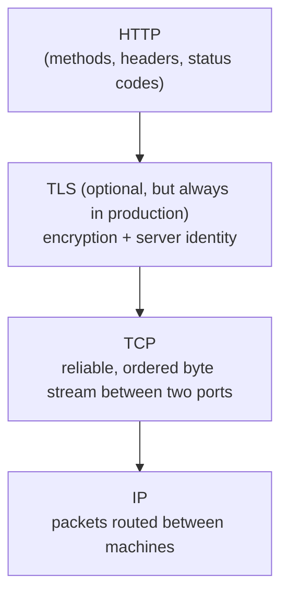
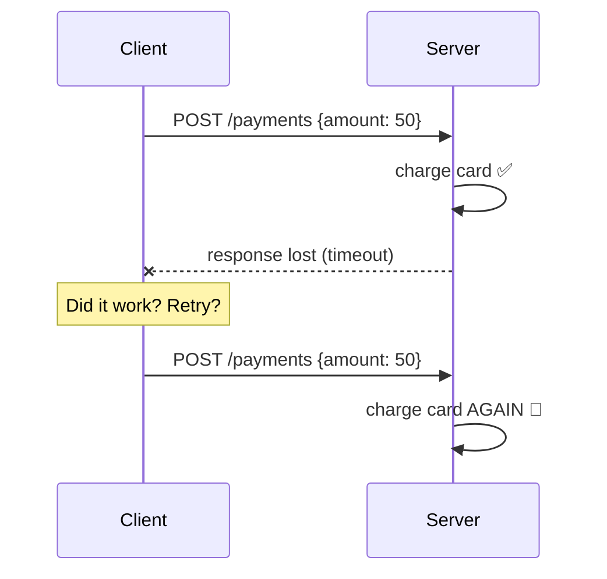
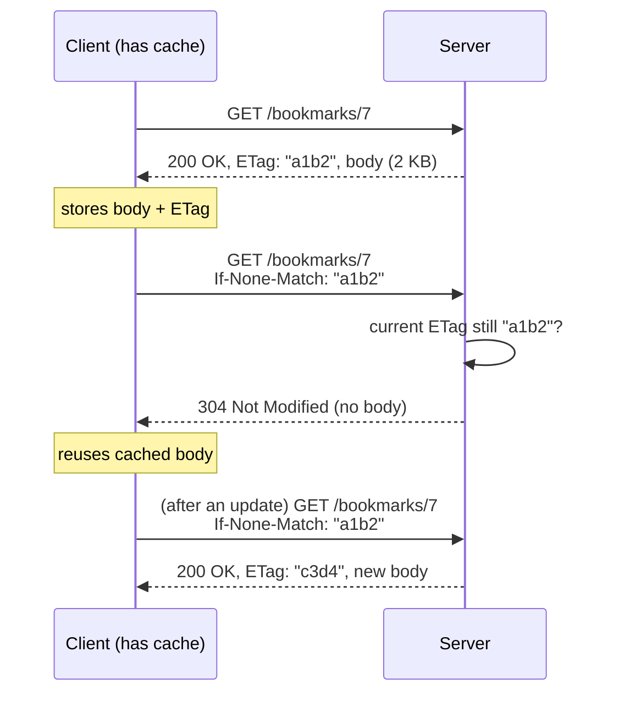
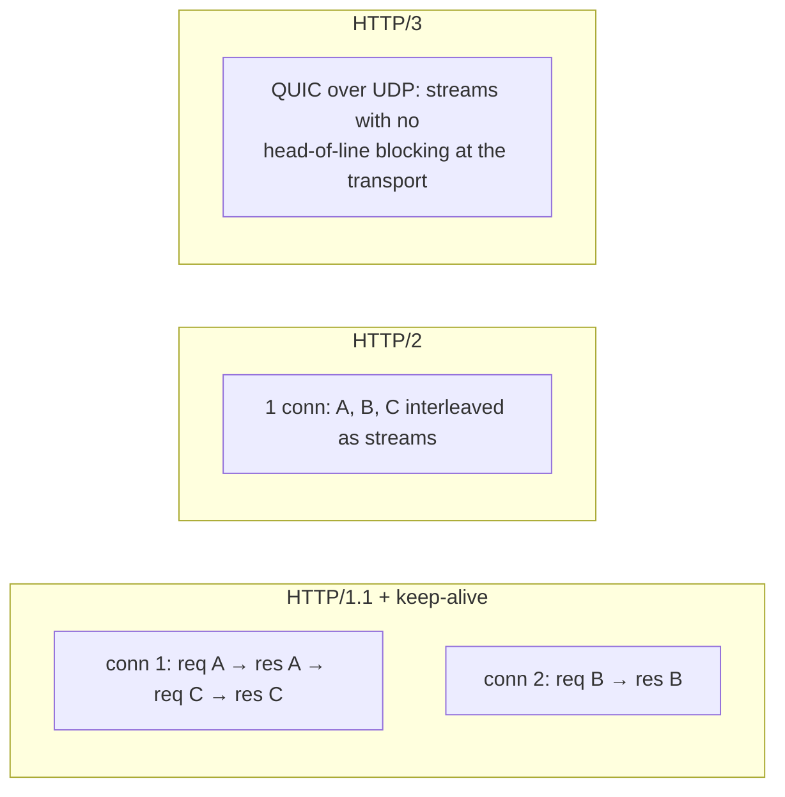

# 03 · HTTP Fundamentals

> Every API you build, every service you call, every load balancer, cache and gateway you'll configure speaks HTTP. Frameworks hide it until something breaks, and then the engineer who can read raw headers finds the bug in five minutes.

**Time:** ~5h · **Challenge:** 🛠️ Build · **Prereqs:** [02 · TypeScript Fundamentals](../02-typescript-fundamentals/README.md) · **Services:** none

## What you'll learn

- What actually travels over the wire: TCP connections, and HTTP messages on top of them
- The anatomy of a request and a response, byte by byte
- Methods and their guarantees: **safe** and **idempotent**, and why retries depend on them
- Status code families and how to pick the right code
- The headers that matter for backend work: `Content-Type`, `Accept`, `Cache-Control`, `ETag`, `Authorization`, `Allow`, CORS
- Bodies, content negotiation, URLs and query strings
- Statelessness, cookies, and why servers forget you between requests
- Connections: keep-alive in HTTP/1.1, multiplexing in HTTP/2, QUIC in HTTP/3, and TLS at a high level
- `curl` as your everyday debugging tool
- How to write a server with nothing but `node:http`, which is what you'll do in the challenge

---

## 1. Client, server, and the layers underneath

HTTP is a **request/response** protocol: a client sends a request, a server sends back exactly one response. The client is usually a browser, a mobile app, `curl`, or another backend service. Your backend is very often a client too, when it calls a payment provider or another internal service.

HTTP doesn't move bytes across the network itself. It rides on lower layers:



- **IP** gets packets from one machine to another, with no promises: packets can be lost, duplicated or reordered.
- **TCP** builds a reliable, ordered *stream of bytes* on top. Opening a TCP connection costs a round trip (the three-way handshake: SYN, SYN-ACK, ACK) before any data flows.
- **TLS** encrypts that stream and proves the server is who it claims to be. It adds another round trip or two at connection start.
- **HTTP** defines what the bytes *mean*: this is a GET for `/bookmarks`, this is a 404.

Why should a backend engineer care about the lower layers? Because **connection setup is expensive**. A request to a server on another continent might spend 150 ms on each round trip. TCP handshake + TLS handshake + the request itself is three or four round trips before the first byte of your response arrives. That's why connection reuse (keep-alive, connection pools) matters so much, and why you'll see "pool exhausted" incidents in [module 13](../13-node-postgres/README.md) and [module 29](../29-reliability-scaling/README.md).

## 2. Anatomy of a message

HTTP/1.1 is a text protocol. Here's a real request, exactly as it goes over the TCP connection (`\r\n` line endings, shown as new lines):

```http
POST /bookmarks?source=cli HTTP/1.1
Host: api.example.com
User-Agent: curl/8.5.0
Accept: application/json
Content-Type: application/json
Content-Length: 46

{"url":"https://nodejs.org","tags":["node"]}
```

And the response:

```http
HTTP/1.1 201 Created
Content-Type: application/json; charset=utf-8
Content-Length: 158
Location: /bookmarks/7c0e...
Date: Tue, 24 Nov 2026 10:00:00 GMT
Connection: keep-alive

{"data":{"id":"7c0e...","url":"https://nodejs.org", ...}}
```

The structure is always the same:

| Part | Request | Response |
|---|---|---|
| Start line | `METHOD /path?query HTTP/1.1` | `HTTP/1.1 STATUS Reason` |
| Headers | `Name: value` lines, case-insensitive names | same |
| Blank line | ends the headers | same |
| Body | optional; length given by `Content-Length` or chunked encoding | same |

Two details that bite people:

- **The body's length must be known.** Either `Content-Length: 46` says how many bytes follow, or `Transfer-Encoding: chunked` sends the body in pieces, each prefixed by its size, ending with a zero-size chunk. Without one of these, the receiver can't tell where this message ends and the next begins on a reused connection.
- **Header names are case-insensitive.** `content-type`, `Content-Type` and `CONTENT-TYPE` are the same header. Node lowercases them all in `req.headers`. HTTP/2 requires lowercase on the wire.

> 💡 Run `curl -v https://example.com` and look at the lines starting with `>` (what curl sent) and `<` (what came back). That's this section, live.

## 3. Methods: safe and idempotent

The method says what the client wants to do with the resource at that URL. Two properties of methods are the ones that matter in practice:

- **Safe**: the request doesn't change anything on the server (it's read-only from the client's point of view). Crawlers, prefetchers and caches assume safe methods can be sent freely.
- **Idempotent**: sending the same request once or ten times leaves the server in the same state. That means a client (or a proxy, or a retry library) can **retry it after a timeout** without fear.

| Method | Purpose | Safe | Idempotent | Has body |
|---|---|---|---|---|
| `GET` | read a resource | ✅ | ✅ | no |
| `HEAD` | like GET, headers only | ✅ | ✅ | no |
| `OPTIONS` | what's allowed here? (CORS preflight) | ✅ | ✅ | rarely |
| `POST` | create a resource / trigger a process | ❌ | ❌ | yes |
| `PUT` | create or **replace** the resource at this URL | ❌ | ✅ | yes |
| `PATCH` | partially modify | ❌ | ❌ (can be designed to be) | yes |
| `DELETE` | remove | ❌ | ✅ | rarely |

Idempotency is about **server state**, not the response. Deleting the same bookmark twice gives `204` then `404`, but the end state (bookmark gone) is the same. `PUT /bookmarks/7` with the same body twice leaves the same bookmark. `POST /bookmarks` twice creates **two** bookmarks.

### Why this matters: retries



The client can't tell "the request never arrived" from "the request worked but the response was lost". For GET, PUT and DELETE, retrying is safe. For POST, a blind retry can double-charge. The standard fix is an **idempotency key** header that lets the server recognize the retry. You'll implement it in [module 15](../15-transactions-concurrency/README.md) and [module 23](../23-api-design/README.md). For now, remember: **never retry a POST automatically unless the API supports idempotency keys.**

### HEAD

`HEAD` returns exactly the headers a `GET` would, with no body. Clients use it to check whether something exists, how big it is (`Content-Length`) or whether it changed (`ETag`) without downloading it. A correct server answers HEAD on every GET route, and the challenge's router does this automatically.

## 4. Status codes

The status code is the first thing every client, proxy and monitoring system looks at. Get it right and retries, caches and dashboards work for free.

| Family | Meaning | Who should act |
|---|---|---|
| **1xx** | informational (rare in APIs) | |
| **2xx** | success | |
| **3xx** | redirect, or "use your cached copy" | client follows / uses cache |
| **4xx** | **the client** did something wrong | client must change the request; retrying the same request won't help |
| **5xx** | **the server** failed | client may retry later; you get paged |

The ones you'll use constantly:

| Code | When |
|---|---|
| `200 OK` | success with a body |
| `201 Created` | POST created something; include `Location: /things/123` |
| `204 No Content` | success, nothing to say (typical DELETE); **must not** have a body |
| `304 Not Modified` | conditional GET: your cached copy is still good; no body |
| `400 Bad Request` | malformed or invalid input |
| `401 Unauthorized` | not authenticated (no/invalid credentials). Confusingly named |
| `403 Forbidden` | authenticated, but not allowed |
| `404 Not Found` | no such resource (or you're hiding that it exists) |
| `405 Method Not Allowed` | resource exists, method doesn't; **must** include an `Allow` header |
| `409 Conflict` | state conflict: duplicate, version mismatch |
| `413 Content Too Large` | body too big |
| `415 Unsupported Media Type` | body's `Content-Type` isn't one you accept |
| `422 Unprocessable Content` | well-formed but semantically invalid (some APIs use this instead of 400) |
| `429 Too Many Requests` | rate limited; send `Retry-After` |
| `500 Internal Server Error` | a bug or unexpected failure |
| `502 / 503 / 504` | bad gateway / unavailable / gateway timeout, usually from proxies and load balancers |

The 4xx/5xx split isn't cosmetic. Monitoring alerts on the **5xx rate** because those are your fault. If you return 500 for a client's malformed JSON, you page yourself at 3 a.m. for someone else's typo. If you return 400 for a database outage, your alerts never fire. The full list with decision guidance is in [docs/status-codes.md](docs/status-codes.md).

## 5. Headers that matter

Headers carry metadata about the message. There are hundreds; these are the ones you'll handle in backend code.

### Content-Type and Accept

`Content-Type` says what format the **body** is in. `Accept` says what formats the client **wants back**.

```http
Content-Type: application/json; charset=utf-8
Accept: application/json
```

The media type is the part before `;`. Anything after is parameters (`charset`, `boundary` for file uploads). So when checking, split on `;`, trim, and compare case-insensitively. Don't compare the whole string, or `application/json; charset=utf-8` gets rejected.

A server that requires JSON should answer **415** when the `Content-Type` is something else. This isn't pedantry: an HTML form can POST `text/plain` cross-origin without any CORS preflight, so strictly requiring `application/json` is also a cheap defense against some cross-site request forgery tricks (more in [module 25](../25-security/README.md)).

**Content negotiation** is the server choosing a representation based on `Accept` (JSON vs CSV, or a language with `Accept-Language`). Most JSON APIs only offer one format and ignore `Accept`, which is fine. Strictly, if a client sends `Accept: text/csv` and you can only do JSON, the right answer is `406 Not Acceptable`.

### Authorization

```http
Authorization: Bearer eyJhbGciOi...
Authorization: Basic dXNlcjpwYXNz        (base64 of user:pass, NOT encryption)
```

Credentials go in headers, never in URLs: URLs end up in access logs, browser history and `Referer` headers. [Module 22](../22-auth/README.md) is all about this.

### Location, Allow, Retry-After

- `Location` on a `201` points at the new resource; on a `3xx` it's where to go.
- `Allow: GET, HEAD, POST` on a `405` lists what *is* allowed.
- `Retry-After: 30` on `429`/`503` tells clients when to come back.

### Caching: Cache-Control and ETag

Caching is the biggest performance lever in HTTP, and it's controlled by response headers:

```http
Cache-Control: no-store              never store this (secrets, personal data)
Cache-Control: no-cache              you may store it, but check with me before every reuse
Cache-Control: private, max-age=60   only the user's own browser may cache it, for 60 s
Cache-Control: public, max-age=31536000, immutable    cache forever (versioned static files)
```

`no-cache` doesn't mean "don't cache". It means "**revalidate** before using". Revalidation is where **ETags** come in:



An ETag is an opaque fingerprint of one version of a resource, often a hash of the body. The client echoes it back in `If-None-Match`. If it still matches, the server sends `304` with no body, saving bandwidth and serialization time. A `W/` prefix marks a **weak** ETag ("semantically equivalent", say the same data with different whitespace), and `If-None-Match` compares weakly, so `W/"a1b2"` matches `"a1b2"`.

ETags have a second job you'll use in [module 23](../23-api-design/README.md): **optimistic concurrency**. A client sends `If-Match: "a1b2"` on a PUT, and the server rejects it with `412 Precondition Failed` if someone else changed the resource in the meantime. No lost updates. [docs/caching-and-conditional-requests.md](docs/caching-and-conditional-requests.md) covers both in depth.

### CORS, briefly

Browsers stop JavaScript on `https://app.example.com` from reading responses from `https://api.example.com` unless the API opts in with headers like `Access-Control-Allow-Origin: https://app.example.com`. For "non-simple" requests (JSON bodies, custom headers, PUT/DELETE) the browser first sends an `OPTIONS` **preflight** asking permission.

Two things to remember now:

1. **CORS is enforced by browsers only.** `curl` and other servers ignore it completely. It protects users' browsers, not your API. It is not authentication.
2. Reflecting any `Origin` back while allowing credentials is a classic vulnerability. [Module 25](../25-security/README.md) does CORS properly.

## 6. URLs and query strings

```
https://api.example.com:8443/bookmarks/7c0e?tag=node&tag=http&q=caf%C3%A9#notes
└─┬─┘   └──────┬──────┘ └┬─┘└──────┬──────┘ └────────────┬────────────┘ └─┬─┘
scheme       host      port      path                 query           fragment
```

- The **fragment** (`#notes`) never reaches the server. Browsers keep it.
- In Node, `req.url` is only the **path + query** (`/bookmarks/7c0e?tag=node`). To parse it, give `URL` a dummy base: `new URL(req.url, "http://localhost")`.
- Query values are **strings**, always. `?limit=10` is `"10"`, and you convert and validate it. Keys can repeat: `url.searchParams.getAll("tag")` gives `["node", "http"]`.
- Special characters are **percent-encoded**: `é` → `%C3%A9`, space → `%20` (or `+` in query strings). Path parameters must be decoded with `decodeURIComponent`, which **throws** on malformed input like `%E0%A4%A`. Unhandled, that's a 500 any client can trigger.

## 7. Statelessness and cookies

HTTP is **stateless**: each request must carry everything the server needs to process it. The server doesn't remember that this client sent a request a second ago. That sounds limiting, but it's what makes HTTP servers easy to scale: any of 50 identical servers behind a load balancer can handle any request.

When you *do* need continuity (a logged-in user), the client re-sends a credential every time, as an `Authorization` header or a **cookie**:

```http
HTTP/1.1 200 OK
Set-Cookie: sid=9f8a...; HttpOnly; Secure; SameSite=Lax; Path=/; Max-Age=86400
```

After that, the browser automatically attaches `Cookie: sid=9f8a...` to every request to that site. The server looks the session up (in Redis, say) on each request. The flags matter a lot for security (`HttpOnly`: JavaScript can't read it; `Secure`: HTTPS only; `SameSite`: limits cross-site sending). [Module 22](../22-auth/README.md) goes deep.

The design rule for your services: **keep application servers stateless.** Put session data, caches and uploads in shared stores (Postgres, Redis, object storage), not in a server's memory, so you can add, remove and restart instances freely.

## 8. Connections: HTTP/1.1, HTTP/2, HTTP/3



- **HTTP/1.0** opened a new TCP connection per request. Very expensive.
- **HTTP/1.1** made connections persistent by default (**keep-alive**): many requests one after another on one connection. But each connection handles one request at a time, so browsers open ~6 connections per host to parallelize. `Connection: close` asks to end the connection after this response.
- **HTTP/2** is binary and **multiplexes**: many requests in flight at once on one connection, as interleaved streams, with compressed headers. Semantics (methods, headers, status codes) are unchanged. Your Node code looks the same.
- **HTTP/3** runs over **QUIC** (on UDP) instead of TCP. A lost packet only stalls the stream it belongs to, and connection setup is faster. Again, the same semantics.

In practice, your Node service usually speaks plain HTTP/1.1 to a load balancer or reverse proxy (nginx, Envoy, a cloud load balancer), and that proxy speaks HTTP/2 or HTTP/3 with the internet. Keep-alive between services still matters a lot: Node's `fetch` (undici) and database drivers keep connection pools for exactly this reason.

## 9. TLS in one page

HTTPS is HTTP inside a TLS connection. TLS gives you:

1. **Confidentiality**: nobody on the network path can read the traffic.
2. **Integrity**: nobody can modify it undetected.
3. **Authentication**: the server proves its identity with a **certificate** for its domain, signed by a certificate authority your OS trusts.

During the handshake, client and server agree on keys (TLS 1.3 needs one round trip). The client checks the certificate: is it for this hostname? Is it signed by a trusted CA? Has it expired? Expired certificates are a classic outage cause, which is why automated renewal (Let's Encrypt, cloud certificate managers) is standard.

Where TLS ends ("**TLS termination**") is an architecture decision. Commonly the load balancer terminates TLS, and traffic inside the private network is plain HTTP, or re-encrypted with **mTLS** (both sides present certificates) in zero-trust setups and service meshes. Your Node app usually doesn't handle certificates itself, but it must know it's behind a proxy (for example to trust `X-Forwarded-Proto` and `X-Forwarded-For` only from that proxy).

## 10. curl: your HTTP Swiss Army knife

```bash
curl -i localhost:3000/bookmarks                       # -i: include response headers
curl -v localhost:3000/bookmarks                       # -v: everything, including request headers
curl -I localhost:3000/bookmarks/ID                    # -I: HEAD request
curl -X DELETE localhost:3000/bookmarks/ID             # -X: method
curl -i localhost:3000/bookmarks \
  -H 'content-type: application/json' \
  -d '{"url":"https://nodejs.org","tags":["node"]}'    # -d implies POST
curl -i localhost:3000/bookmarks/ID -H 'if-none-match: "abc"'
curl -s localhost:3000/bookmarks | jq '.data[].url'    # -s: silent, pipe JSON into jq
curl -w '%{http_code} %{time_total}s\n' -o /dev/null -s localhost:3000/health
```

More in [docs/curl-cheatsheet.md](docs/curl-cheatsheet.md). Get comfortable with `-i` and `-v`: "what did the server actually send?" is the first question in almost every HTTP debugging session.

### Browsers vs servers as clients

A browser adds a lot you didn't ask for: cookies, `Origin` and `Referer` headers, CORS enforcement, caching, automatic redirects, and it hides many response headers from JavaScript unless CORS exposes them. A server-side client (`fetch` in Node, `curl`) sends only what you tell it, ignores CORS, and doesn't cache by default. When "it works in curl but not in the browser", the answer is almost always CORS, cookies or caching.

## 11. A server with nothing but `node:http`

Here's the core of what Express wraps:

```ts
import http from "node:http";

const server = http.createServer(async (req, res) => {
  // req: IncomingMessage, a readable stream of the body + method, url, headers
  // res: ServerResponse, a writable stream for the response
  const url = new URL(req.url ?? "/", "http://localhost");

  if (req.method === "GET" && url.pathname === "/health") {
    const body = JSON.stringify({ status: "ok" });
    res.writeHead(200, {
      "Content-Type": "application/json; charset=utf-8",
      "Content-Length": Buffer.byteLength(body), // bytes, not characters!
    });
    res.end(body);
    return;
  }

  res.writeHead(404, { "Content-Type": "application/json; charset=utf-8" });
  res.end(JSON.stringify({ error: { code: "ROUTE_NOT_FOUND", message: "Not found" } }));
});

server.listen(3000);
```

Things to notice:

- **The body is a stream.** Node doesn't buffer it for you. You read it chunk by chunk (`for await (const chunk of req)`), and nothing stops a client from sending 2 GB unless you count bytes and stop. That's the challenge's 413.
- **`Content-Length` is in bytes.** `"é".length` is 1, but it's 2 bytes in UTF-8. Use `Buffer.byteLength`.
- **Headers go first.** Once `writeHead` or the first `write` happens, the status and headers are on the wire. You can't change them after (`res.headersSent`).
- **One request, one response.** Every code path must end in exactly one `res.end()`. If a handler throws and nothing catches it, the request hangs until the client times out. Wrap the whole handler in `try/catch` and turn errors into responses in one place.
- **Node knows some rules for you**: it drops the body for `HEAD` requests and for `204`/`304` responses, and it handles keep-alive and chunked encoding.

`server.listen(0)` asks the OS for any free port. Tests use this to run in parallel without port clashes, then read the real port from `server.address()`.

## Common mistakes

- Returning `200` with `{ "error": ... }` in the body. Clients, proxies and monitoring all look at the status code.
- Returning `500` for client mistakes (bad JSON, unknown route), or `4xx` for your own failures.
- Comparing `Content-Type` with `===` against `application/json` and rejecting `application/json; charset=utf-8`.
- Computing `Content-Length` with `string.length` instead of bytes.
- Buffering request bodies with no size limit.
- Trusting `Content-Length` alone for the size check. Chunked requests don't have one, and the header can lie.
- Forgetting `Allow` on `405`, or forgetting that `HEAD` should work wherever `GET` does.
- Sending a body with `204` or `304`.
- Letting `decodeURIComponent` throw on a malformed path, turning garbage input into a 500.
- Automatically retrying non-idempotent requests (POST) after a timeout.
- Putting credentials or personal data in URLs.
- Thinking CORS protects your API from non-browser clients.

## In production

- **Reverse proxies and load balancers** sit in front of almost every service. They terminate TLS, enforce body size and timeout limits, add `X-Forwarded-For`/`X-Request-Id`, and convert HTTP/2 to HTTP/1.1. Knowing what they do explains a lot of "the app never saw that request" mysteries (often a 413 or 504 generated by the proxy itself).
- **CDNs** cache responses based on `Cache-Control`, `ETag` and `Vary`. A wrong `Cache-Control: public` on a personalized response can serve one user's data to another: a real, recurring class of incident.
- **Timeouts everywhere**: clients, proxies and servers all have them, and they need to be ordered (client timeout > proxy timeout > server timeout) or you get confusing 502/504 errors.
- **Status code metrics** (rate of 5xx, p99 latency per route) are the first dashboard anyone opens during an incident ([module 24](../24-observability/README.md)).
- Almost nobody writes `node:http` routers at work. You'll use Express from the next module on. But every framework does exactly what you build in this challenge, and when something weird happens at the protocol level, this is the layer you'll be debugging.

## Check yourself

1. A client times out on `DELETE /bookmarks/7` and doesn't know if it worked. Is it safe to retry? What about `POST /bookmarks`?
   <details><summary>Answer</summary>DELETE is idempotent: retrying leaves the same final state (it may get a 404 the second time, which is fine). POST isn't: a retry may create a duplicate, unless the API supports an idempotency key.</details>
2. What's the difference between `401` and `403`?
   <details><summary>Answer</summary>401: you're not authenticated (missing/invalid credentials). 403: we know who you are, and you're not allowed.</details>
3. What does `Cache-Control: no-cache` mean?
   <details><summary>Answer</summary>The response may be stored, but must be revalidated with the server (for example via <code>If-None-Match</code> + ETag) before every reuse. <code>no-store</code> is the one that forbids storing.</details>
4. Why isn't checking the `Content-Length` header enough to enforce a body size limit?
   <details><summary>Answer</summary>Chunked requests don't send one, and a client can lie. You must count bytes as they arrive and stop once past the limit.</details>
5. Your API works with curl but fails from the React app with a network error. What's the first thing you check?
   <details><summary>Answer</summary>CORS: the browser's preflight or the missing <code>Access-Control-Allow-Origin</code> header. Open the browser devtools network tab and look at the OPTIONS request and the console error.</details>

## Further reading

- MDN, An overview of HTTP: https://developer.mozilla.org/en-US/docs/Web/HTTP/Overview
- MDN, HTTP response status codes: https://developer.mozilla.org/en-US/docs/Web/HTTP/Status
- MDN, HTTP caching: https://developer.mozilla.org/en-US/docs/Web/HTTP/Caching
- MDN, Cross-Origin Resource Sharing: https://developer.mozilla.org/en-US/docs/Web/HTTP/CORS
- RFC 9110, HTTP Semantics: https://www.rfc-editor.org/rfc/rfc9110
- Node.js `http` module: https://nodejs.org/api/http.html
- curl manual: https://curl.se/docs/manpage.html
- Deep dives in this module: [docs/status-codes.md](docs/status-codes.md) · [docs/caching-and-conditional-requests.md](docs/caching-and-conditional-requests.md) · [docs/curl-cheatsheet.md](docs/curl-cheatsheet.md)
- Repo cheat sheet: [../docs/cheatsheets/http.md](../docs/cheatsheets/http.md)

## ➡️ Next: [the challenge](CHALLENGE.md)
