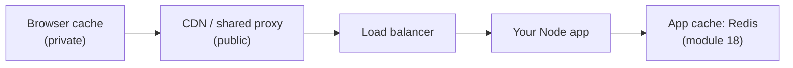
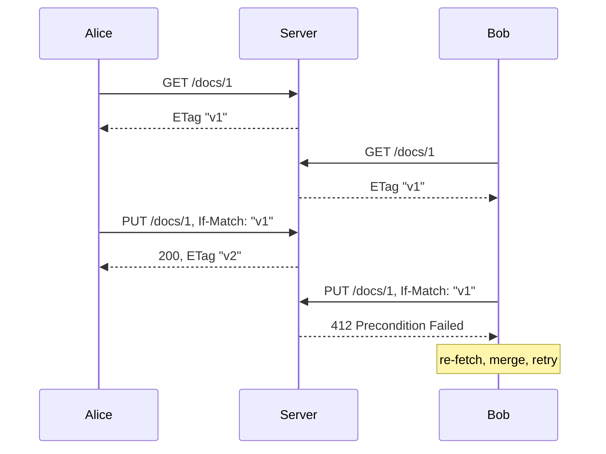

# Caching and conditional requests

HTTP has a built-in caching system that browsers, CDNs and proxies all understand. Used well, it removes load from your servers for free. Used badly, it serves stale or, worse, *someone else's* data.

## Where caches live



HTTP caching headers control the first two. Application caching inside your service ([module 18](../../18-caching/README.md)) is a separate, complementary tool.

## Cache-Control directives

| Directive | Meaning |
|---|---|
| `no-store` | Don't store at all. Use for secrets and personal data you never want on disk. |
| `no-cache` | Store, but revalidate with the server before each reuse. |
| `private` | Only the end user's browser may store it, not shared caches (CDNs). |
| `public` | Shared caches may store it, even if the request had `Authorization`. |
| `max-age=N` | Fresh for N seconds; reuse without asking the server. |
| `s-maxage=N` | Like `max-age`, but only for shared caches. |
| `must-revalidate` | Once stale, never use without revalidating (even if the server is down). |
| `immutable` | The content at this URL never changes (fingerprinted assets like `app.3f9a1.js`). |
| `stale-while-revalidate=N` | May serve stale for N s while refreshing in the background. |

Typical choices:

| Response | Header |
|---|---|
| A user's account page / API data | `private, no-cache` (or `no-store` if sensitive) |
| A public product listing | `public, max-age=60` |
| Versioned static assets | `public, max-age=31536000, immutable` |
| Login responses, tokens | `no-store` |

> ⚠️ `Vary` tells caches which request headers change the response (`Vary: Accept-Encoding`, `Vary: Authorization`). Forget it, and a shared cache can serve a gzip body to a client that can't read it, or user A's data to user B.

## Freshness vs validation

A cached response is either **fresh** (within `max-age`, reuse with no network) or **stale** (must be **revalidated**). Revalidation is a *conditional request*: "I have version X; send the body only if it changed."

There are two validators:

| Validator | Response header | Request header | Precision |
|---|---|---|---|
| Entity tag | `ETag: "a1b2"` | `If-None-Match: "a1b2"` | any change you choose to fingerprint |
| Timestamp | `Last-Modified: <date>` | `If-Modified-Since: <date>` | one-second resolution |

ETags are preferred: they don't have the one-second problem and don't depend on clocks.

## ETags in detail

- Syntax: a quoted string. `"abc"` is **strong** (byte-for-byte identical). `W/"abc"` is **weak** (semantically equivalent).
- How to generate: hash the serialized body (what the challenge does), or use a version number / `updated_at` from the database (cheaper: no need to serialize first).
- `If-None-Match` uses **weak comparison**: ignore `W/` on both sides. It may contain a list (`"a", "b"`) or `*`.
- On a match for GET/HEAD → `304 Not Modified`, no body, but send the `ETag` (and `Cache-Control`) again.

Hashing the body is simple and always correct, but you still pay for the database query and serialization; you only save bandwidth. Version-based ETags let you skip work earlier. Both are valid; the trade-off is CPU vs simplicity.

## Conditional writes: optimistic concurrency

The same validators protect against **lost updates**:



Without `If-Match`, Bob's PUT silently overwrites Alice's change. You'll implement this in [module 23](../../23-api-design/README.md), and the database-level equivalent (a `version` column) in [module 15](../../15-transactions-concurrency/README.md).

## Precedence rules worth knowing

- If both `If-None-Match` and `If-Modified-Since` are present, `If-None-Match` wins.
- `304` responses must not include a body. Node drops it for you if you try.
- A cache will not store responses to `POST` for reuse by default. Caching is a GET/HEAD thing in practice.

## Testing with curl

```bash
curl -i localhost:3000/bookmarks/ID                                  # note the ETag
curl -i localhost:3000/bookmarks/ID -H 'if-none-match: "PASTE"'      # 304
curl -i localhost:3000/bookmarks/ID -H 'if-none-match: W/"PASTE"'    # still 304 (weak compare)
curl -i localhost:3000/bookmarks/ID -H 'if-none-match: *'            # 304
```
