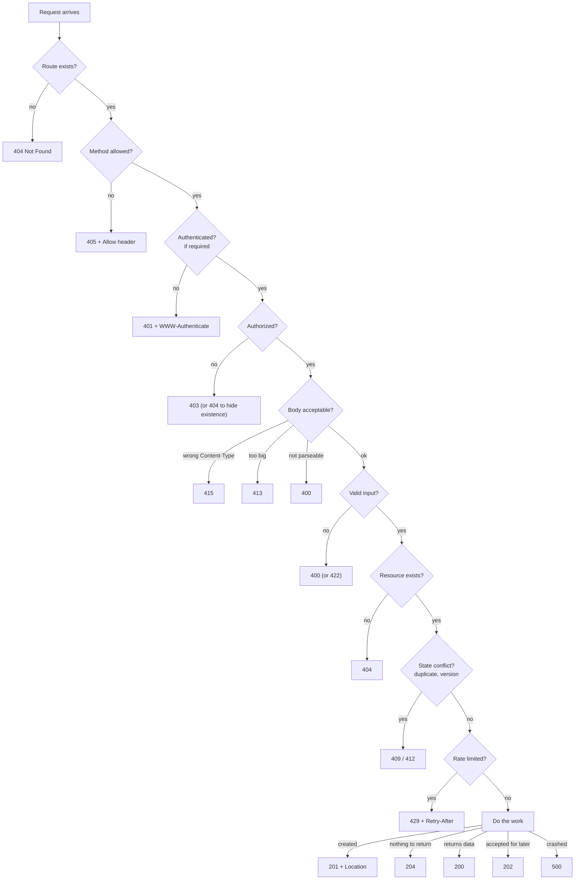

# Status code cheat sheet (for API developers)

The status code is a contract with every client, proxy, cache, retry library and dashboard between you and your users. Pick deliberately.

## Decision flow

## 2xx: success

| Code | Use for | Notes |
|---|---|---|
| 200 OK | successful GET, PUT/PATCH returning the resource, actions with a result | the default |
| 201 Created | POST (or PUT) that created something | include `Location` |
| 202 Accepted | work queued for later (background job) | return a job id / status URL ([module 20](../../20-background-jobs/README.md)) |
| 204 No Content | DELETE, or an update with nothing to return | **no body**, not even `{}` |
| 206 Partial Content | `Range` requests (video, resumable downloads) | |

## 3xx: redirection and caching

| Code | Use for | Notes |
|---|---|---|
| 301 Moved Permanently | URL changed forever | clients/browsers may change POST to GET |
| 302 Found | temporary redirect | same caveat |
| 303 See Other | "the result is over there, GET it" (after a POST) | |
| 307 / 308 | temporary / permanent redirect, **method preserved** | prefer these for APIs |
| 304 Not Modified | conditional GET: cached copy still valid | **no body**; echo the `ETag` |

## 4xx: client errors (the client must change something)

| Code | Use for | Notes |
|---|---|---|
| 400 Bad Request | malformed JSON, invalid fields, bad query params | include field details |
| 401 Unauthorized | missing/invalid/expired credentials | really means "unauthenticated" |
| 403 Forbidden | authenticated but not permitted | |
| 404 Not Found | no such route or resource | also used to avoid revealing that a resource exists |
| 405 Method Not Allowed | path exists, method doesn't | **must** send `Allow` |
| 406 Not Acceptable | can't produce any format in `Accept` | most JSON APIs skip this |
| 409 Conflict | duplicate unique value, invalid state transition | |
| 410 Gone | existed, deliberately removed | deprecated endpoints |
| 412 Precondition Failed | `If-Match` didn't match (optimistic concurrency) | [module 23](../../23-api-design/README.md) |
| 413 Content Too Large | body over the limit | proxies generate this too |
| 415 Unsupported Media Type | body `Content-Type` not accepted | |
| 422 Unprocessable Content | syntactically fine, semantically invalid | some teams use 400 for everything; pick one convention |
| 428 Precondition Required | server demands `If-Match` | prevents blind overwrites |
| 429 Too Many Requests | rate limited | send `Retry-After` ([module 19](../../19-rate-limiting/README.md)) |

## 5xx: server errors (your fault; alert on these)

| Code | Use for | Notes |
|---|---|---|
| 500 Internal Server Error | unexpected exception | generic message; log the details |
| 501 Not Implemented | method not supported at all by the server | rare |
| 502 Bad Gateway | proxy got an invalid response from upstream | usually your app crashed or closed the connection |
| 503 Service Unavailable | overloaded, in maintenance, not ready | `Retry-After`; readiness probes ([module 24](../../24-observability/README.md)) |
| 504 Gateway Timeout | proxy gave up waiting for upstream | your handler was too slow |

## Which errors are retryable?

| Retry? | Codes |
|---|---|
| Yes, with backoff | 408, 429 (respect `Retry-After`), 502, 503, 504 |
| Maybe (only idempotent requests) | 500, network errors, timeouts |
| No, fix the request | every other 4xx |

## Debates you'll hear

- **400 vs 422 for validation errors.** Both are defensible. Pick one and use it everywhere. This repo uses 400 for validation and 422 for business-rule violations in later modules.
- **404 vs 403 for "not yours".** Returning 404 for another user's resource avoids confirming that the id exists (prevents enumeration). Most APIs do this.
- **200 with an empty list vs 404 for a search with no results.** 200 + `[]`. The collection exists; it's just empty.
- **DELETE of something already deleted.** 404 is fine and still idempotent (the state is the same). Some APIs return 204 both times for simplicity.
