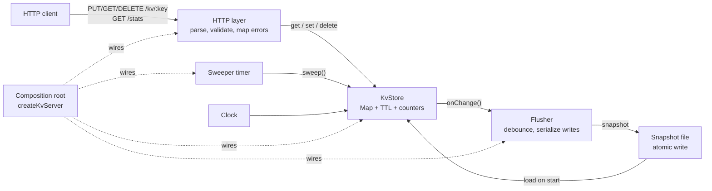
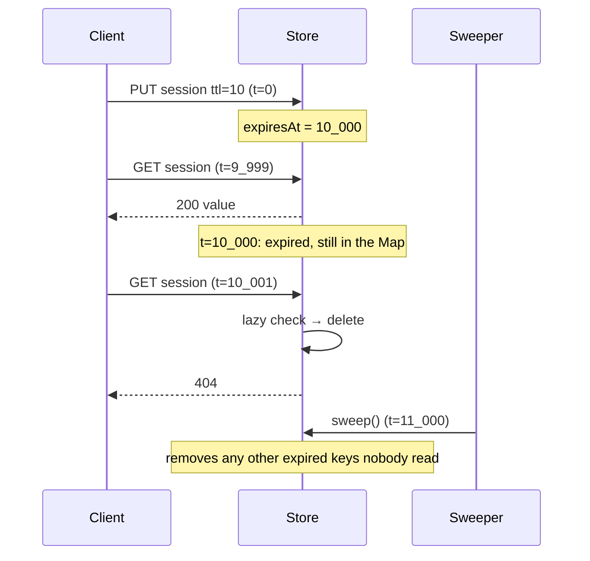
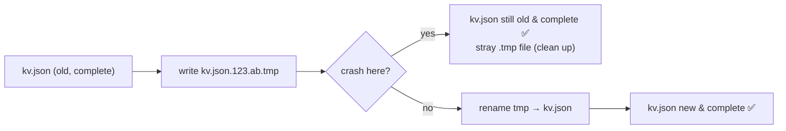
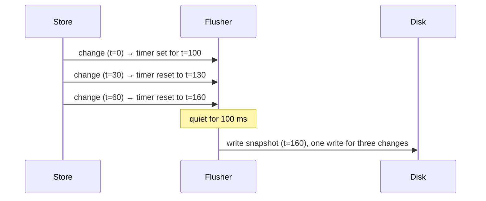
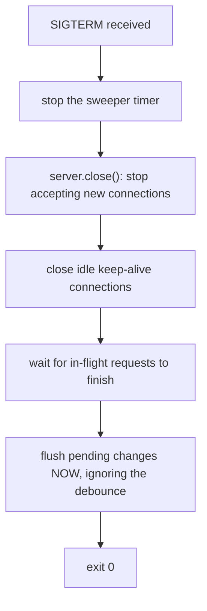

# 04 · Checkpoint: Foundations

> Up to now every challenge told you which file to open. Real tickets don't. This checkpoint gives you a spec and a test suite and nothing else: you decide the structure. It's also a small, honest model of the systems you'll operate later, since Redis, etcd and every database face the same questions about expiry, durability and shutdown.

**Time:** ~5h · **Challenge:** 🛠️ Build (no scaffold) · **Prereqs:** [01](../01-js-runtime/README.md) · [02](../02-typescript-fundamentals/README.md) · [03](../03-http-fundamentals/README.md) · **Services:** none

## What you'll learn

- How to turn a spec into a design before writing code: components, boundaries, data flow
- **Separation of concerns** in a small system: core logic, persistence and HTTP as independent layers
- Two ways to expire data (**lazy** and **active**) and why real stores use both
- **Durability**: what "saved" really means, and how *write-temp-then-rename* makes file writes atomic
- **Debouncing** writes, and the throughput vs data-loss trade-off it creates
- **Graceful shutdown**: the order of operations that loses no data
- Making time and the filesystem **testable**: injected clocks and temp directories

This module pulls together the event loop and timers (01), strict types and `unknown` narrowing (02), and raw `node:http` (03). If one of those feels shaky, revisit it first.

---

## 1. From spec to design

The challenge asks for **kv-lite**: an HTTP key-value store. Before touching code, a senior engineer would sketch something like this on a whiteboard:



Each box has **one reason to change**:

| Component | Knows about | Doesn't know about |
|---|---|---|
| `KvStore` | keys, values, TTLs, counters, "now" | HTTP, files, timers |
| Persistence (snapshot + flusher) | file format, atomic writes, when to write | HTTP, TTL rules |
| HTTP layer | URLs, status codes, headers, body limits | how data is stored or saved |
| Composition root (`createKvServer`) | how the pieces connect, startup and shutdown order | the details inside each piece |

Why bother in a 300-line project? Because each piece becomes testable on its own, and because the questions you'll be asked in review ("what if the disk is full?", "what if two writes overlap?") each have exactly one place to answer them. This is the same idea [module 06](../06-layered-architecture/README.md) formalizes as layered architecture. Here you get to discover it from a blank page.

> 💡 A useful test of a boundary: could you replace one side without touching the other? Swap the JSON file for SQLite: only persistence changes. Swap `node:http` for Express: only the HTTP layer changes. If a change ripples across layers, the boundary is in the wrong place.

### Dependencies point inward

The store is the core. It must not import the HTTP layer or the filesystem. But persistence needs to know *when* the store changed. The trick is to invert the dependency: the store accepts a callback (`onChange`) and calls it on every mutation, without knowing what's on the other end.

```ts
// the store only knows "someone wants to hear about changes"
const store = new KvStore(clock, () => flusher.schedule(), initialEntries);
```

That's dependency injection without a framework: pass in functions and objects instead of importing concrete things.

## 2. Expiring data: lazy and active

A TTL ("time to live") says a key stops existing after N seconds. Storing an **absolute** expiry timestamp (`expiresAt = now + ttl * 1000`) is better than storing the TTL itself: it survives restarts unchanged and needs no countdown.

There are two ways to actually get rid of expired keys:

**Lazy expiry**: check on access. When someone reads a key, compare `expiresAt` with now. If it has passed, delete it and answer "not found".

- ✅ Perfectly accurate for reads, costs nothing for keys nobody touches.
- ❌ A key that's never read again stays in memory forever. Write a million session keys that are never read again and you have a memory leak.

**Active expiry**: a periodic sweep. Every N milliseconds, scan for expired keys and delete them.

- ✅ Bounds how long dead data occupies memory.
- ❌ A full scan is O(n) and blocks the event loop while it runs ([module 01](../01-js-runtime/README.md)). A key can still be readable between expiring and the next sweep, unless reads also check.

Real systems combine both. Redis checks lazily on every access *and* runs a background job that samples random keys with TTLs, deleting the expired ones and repeating if many were expired. Sampling keeps each cycle cheap even with millions of keys. kv-lite uses a full scan, which is fine at its size, and you should be able to explain when it stops being fine.



Notice that "expired" and "removed from memory" are different moments. Your API must hide that difference: an expired-but-unswept key must look exactly like a missing key everywhere (GET, DELETE, the `keys` count in `/stats`, and the snapshot written to disk).

## 3. Persistence: what "saved" really means

An in-memory store loses everything on restart. kv-lite keeps a **snapshot**: the whole dataset as one JSON file, loaded at startup and rewritten after changes.

### The naive write is dangerous

```ts
await writeFile("kv.json", JSON.stringify(data)); // ❌
```

`writeFile` truncates the file and then writes. If the process crashes, gets `SIGKILL`ed or the machine loses power in the middle, you're left with an empty or half-written file. On the next start, `JSON.parse` fails and *all* your data is gone, not just the last change.

### Write-temp-then-rename

```ts
const tmp = `${file}.${process.pid}.${randomHex}.tmp`;
await writeFile(tmp, JSON.stringify(snapshot));
await rename(tmp, file); // atomic replacement
```

On POSIX filesystems, `rename()` within the same filesystem is **atomic**: other processes (and a restarted you) see either the old file or the new file, never a mix. The temp file must be in the **same directory** as the target, because a rename across filesystems isn't atomic (it becomes a copy).



### The part most people miss: fsync

`writeFile` returning doesn't mean the bytes are on disk. They're in the operating system's page cache, and the OS flushes them later. A process crash is fine (the OS still has the data), but a **power loss** can lose writes that "succeeded". Databases call `fsync` on the file (and on the directory, to persist the rename) before saying "committed". That costs milliseconds per call, which is why databases batch commits.

kv-lite skips fsync: it's a learning project and the trade-off is documented. But you should be able to say what the guarantee is: *the file is never corrupt, but the last moments of changes can be lost on power failure.* That sentence, about any datastore, is what "durability" questions in interviews are probing. [docs/atomic-writes-and-durability.md](docs/atomic-writes-and-durability.md) goes deeper, including how Redis's RDB and AOF modes make the same trade-offs.

### Loading: fail loudly

At startup:

- **File missing** → start empty. That's a normal first run.
- **File present but unreadable or invalid** → **refuse to start**. Silently starting empty would mean the next flush *overwrites* the corrupt file, destroying whatever an operator could have recovered. Crashing with a clear message is the kind thing to do.
- The file is untrusted input (someone could have edited it), so parse it as `unknown` and validate the shape, exactly like `parseConfig` in [module 02](../02-typescript-fundamentals/README.md).
- Skip entries whose `expiresAt` already passed while the server was down.

## 4. Debouncing writes

Rewriting the whole file on every PUT is simple and very slow under load: 1,000 writes per second means 1,000 full serializations and file writes per second. **Debouncing** coalesces a burst of changes into one write:



```ts
schedule() {
  this.dirty = true;
  clearTimeout(this.timer);
  this.timer = setTimeout(() => void this.flushNow(), this.delayMs);
}
```

Three subtleties make the difference between a toy and something correct:

1. **Writes must not overlap.** If a flush takes 50 ms and another change triggers a second flush during it, two writes race and the *older* snapshot can land last. Serialize them: chain each flush onto the previous one's promise.
2. **Changes during a write must not be lost.** Clear the dirty flag *before* taking the snapshot, so a change that arrives mid-write marks it dirty again and schedules another flush.
3. **A failed write must stay pending.** If the disk is full, set dirty back to true and log loudly instead of pretending it worked.

The trade-off is explicit: with a 100 ms debounce, a crash can lose up to ~100 ms of acknowledged writes. A pure "trailing" debounce can also be starved: if changes never stop for 100 ms, nothing is ever written. Production systems add a **max wait** ("write at least once per second no matter what"). That's a stretch goal in the challenge.

## 5. Graceful shutdown

When your process gets `SIGTERM` (a deploy, a scale-down, Ctrl-C), it has a few seconds to finish cleanly before it's killed. The order matters:



- **Stop accepting first**, flush last. If you flush first, a request that arrives during shutdown could change data after the final write.
- `server.close()` stops listening, but by default waits for open connections. Keep-alive connections can sit idle for seconds, so call `server.closeIdleConnections()` (Node 19+ does this automatically inside `close()`).
- Clear your timers. A forgotten `setInterval` keeps the process alive forever, and in tests it leaks into the next test. `timer.unref()` tells Node not to keep the process alive just for that timer.
- Make `close()` **idempotent**: a second `SIGTERM`, or a test's `afterEach` running after the test already closed, should be harmless. Caching the shutdown promise does it.

You'll come back to this in [module 26](../26-docker-ci-deploy/README.md), where Kubernetes and Docker send the signals and connection draining has to work with a load balancer.

## 6. Testing time and files

Two things make tests slow and flaky: real time and shared state. The spec is designed so you can avoid both.

### Inject the clock

If your code calls `Date.now()` directly, testing a 60-second TTL means waiting 60 seconds, or monkey-patching globals. Instead, depend on an interface:

```ts
export interface Clock { now(): number }

class ManualClock implements Clock {
  constructor(private t = Date.UTC(2026, 0, 1)) {}
  now() { return this.t; }
  advance(ms: number) { this.t += ms; }
}
```

Production passes `{ now: () => Date.now() }`. Tests pass a `ManualClock` and jump forward instantly: `clock.advance(10_000)`. The test reads like a story and runs in milliseconds.

Why not Vitest's fake timers (`vi.useFakeTimers()`)? They're great for pure logic, but they replace `setTimeout` globally, and the HTTP client and server rely on real timers internally, so mixing them with real sockets gets fragile. An injected clock controls *your* notion of time and leaves Node's machinery alone. (The sweeper and debounce still use real timers; tests make those intervals short and poll with `vi.waitFor` instead of sleeping a fixed amount.)

### Isolate the filesystem

Every test gets its own directory from `fs.mkdtemp(os.tmpdir() + "/kv-lite-test-")` and deletes it afterwards. Tests can run in parallel, never see each other's files, and never touch your real data. "Restart" in a test is just `close()` followed by a new `createKvServer` pointing at the same file.

[docs/testing-time-and-files.md](docs/testing-time-and-files.md) has more patterns, including how to test that a write is atomic.

## 7. Designing your file structure

The tests only import `createKvServer` and the types from `src/index.ts`. Everything else is up to you. A reasonable shape:

```
src/
  index.ts                  # public types + createKvServer (composition root)
  server.ts                 # entry point: env, listen, signal handlers
  core/
    clock.ts
    kvStore.ts              # pure: Map, TTL, counters, sweep(), snapshot()
  persistence/
    snapshotFile.ts         # loadSnapshot(), writeSnapshotAtomic()
    debouncedFlusher.ts     # schedule(), flushNow()
  http/
    handler.ts              # routes → store calls, errors → responses
    readBody.ts
    respond.ts
    httpError.ts
```

It's not the only good answer. A flatter layout (`store.ts`, `persistence.ts`, `http.ts`) is fine for this size. What matters is that the **dependency arrows** go one way: `http` → `core` ← `persistence`, with `index.ts` wiring them. [docs/project-structure.md](docs/project-structure.md) discusses the trade-offs.

## Common mistakes

- Storing the TTL in seconds instead of an absolute `expiresAt`, then having to recompute it on restart.
- Only expiring lazily (memory grows forever), or only by sweep (expired keys still readable until the next sweep).
- Counting expired-but-unswept keys in `/stats` or writing them to the snapshot.
- `writeFile` directly onto the data file: a crash mid-write destroys everything.
- Temp file in `os.tmpdir()` instead of next to the target: `rename` across filesystems fails (`EXDEV`) or isn't atomic.
- Starting empty when the data file is corrupt, then overwriting it on the first flush.
- Overlapping flushes that let an older snapshot win.
- Flushing before closing the server, so late requests are lost.
- Forgetting to clear intervals and timeouts on close: tests hang or leak.
- Calling `Date.now()` all over the code so TTLs can't be tested without waiting.
- A single 400-line file that mixes HTTP parsing, TTL rules and file I/O.

## In production

- **Redis** is this project grown up: lazy plus sampled active expiry, and two persistence modes. RDB snapshots are a forked child writing the dataset to a temp file and renaming it (the same pattern you're implementing). The AOF is an append-only log of commands with a configurable fsync policy (`always`, `everysec`, `no`). `everysec` is the default debounce-like trade-off: lose at most about a second of writes. You'll use Redis from [module 17](../17-redis-fundamentals/README.md).
- **Databases** use a write-ahead log (WAL): append the change, fsync, acknowledge; the main data files are updated later. Postgres's `synchronous_commit` setting is the same durability vs latency dial.
- **Config files and state files** written by tools (package managers, Terraform state, editors' autosave) use write-temp-then-rename for exactly the reason you saw.
- **Graceful shutdown** bugs show up as errors during every deploy: dropped requests, half-written files, "connection reset" spikes on dashboards. Teams test shutdown deliberately.
- **Injected clocks** are standard in serious codebases. Billing periods, token expiry, rate limits ([module 19](../19-rate-limiting/README.md)) and streaks ([module 10](../10-checkpoint-backend-core/README.md)) are all time-dependent logic that must be testable.

## Check yourself

1. Why combine lazy expiry with a periodic sweep instead of using only one?
   <details><summary>Answer</summary>Lazy alone never frees keys that are never read again (unbounded memory). Sweep alone leaves expired keys readable between sweeps. Together: reads are always correct, and memory is reclaimed for untouched keys.</details>
2. Why must the temp file be in the same directory as the data file?
   <details><summary>Answer</summary><code>rename()</code> is only atomic within one filesystem. <code>/tmp</code> is often a different filesystem (tmpfs), where the rename fails with <code>EXDEV</code> or degrades to copy-and-delete, which isn't atomic.</details>
3. With write-temp-then-rename but no fsync, what can you lose and what can't happen?
   <details><summary>Answer</summary>The file is never half-written or corrupt. But after a power loss, recently "written" data that was still in the OS page cache can be lost, so the file may be an older snapshot.</details>
4. In graceful shutdown, why close the HTTP server before the final flush?
   <details><summary>Answer</summary>Requests arriving after the flush could change data that then never reaches disk. Stop new work first, let in-flight requests finish, then write the final state.</details>
5. What's wrong with `if (corrupt) startEmpty()` at load time?
   <details><summary>Answer</summary>The first flush overwrites the corrupt file, destroying any chance of manual recovery. Refuse to start and let a human decide.</details>

## Further reading

- Node.js `fs` promises API (`writeFile`, `rename`, `mkdtemp`): https://nodejs.org/api/fs.html#promises-api
- Node.js `http.Server.close` and `closeIdleConnections`: https://nodejs.org/api/http.html#serverclosecallback
- Node.js timers (`setInterval`, `unref`): https://nodejs.org/api/timers.html
- Redis key expiration (`EXPIRE`, how keys expire): https://redis.io/docs/latest/commands/expire/
- Redis persistence (RDB and AOF): https://redis.io/docs/latest/operate/oss_and_stack/management/persistence/
- Vitest `vi.waitFor` and fake timers: https://vitest.dev/api/vi.html
- Deep dives in this module: [docs/atomic-writes-and-durability.md](docs/atomic-writes-and-durability.md) · [docs/testing-time-and-files.md](docs/testing-time-and-files.md) · [docs/project-structure.md](docs/project-structure.md)

## ➡️ Next: [the challenge](CHALLENGE.md)
