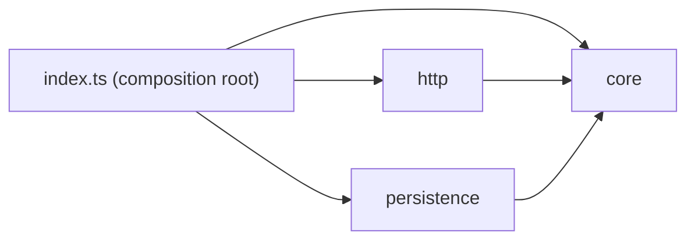

# Structuring a small Node project

No scaffold this time. Here's how to think about the layout, not just which folders to create.

## Start from responsibilities, not folders

List what the program must do, then group by **reason to change**:

| Responsibility | Changes when... |
|---|---|
| Key/value semantics, TTL rules, counters | the product rules change ("TTL max is now 7 days") |
| File format, atomic writes, when to flush | storage strategy changes (JSON → SQLite, add fsync) |
| URLs, status codes, headers, body limits | the API contract changes |
| Startup, wiring, shutdown, timers | deployment/runtime concerns change |

Each row becomes a module (a file or a folder). If one change would force you to edit three modules, the split is wrong.

## Three reasonable layouts

**Flat** (fine for this size):

```
src/index.ts  src/server.ts  src/store.ts  src/persistence.ts  src/http.ts  src/clock.ts
```

**By layer** (the reference solution):

```
src/core/       src/persistence/       src/http/       src/index.ts       src/server.ts
```

**By feature** (shines when there are many features, see [module 06](../../06-layered-architecture/README.md)):

```
src/kv/{store,routes,persistence}.ts   src/stats/{routes}.ts   src/index.ts
```

There's no single right answer. Pick one, keep the dependency direction clean, and be able to defend it in a PR description.

## Dependency direction



- `core` imports nothing from the others. It's the most stable, most tested part.
- `http` and `persistence` depend on `core` types, never on each other.
- Only the composition root knows everything, and it contains no business logic: it creates objects, connects callbacks, starts timers and defines the shutdown order.

A quick self-check: `grep -r "node:http" src/core src/persistence` should find nothing. `grep -r "node:fs" src/core src/http` should find nothing.

## The composition root

```ts
export async function createKvServer(opts: KvServerOptions): Promise<KvServer> {
  const clock = opts.clock ?? systemClock;
  const initial = await loadSnapshot(opts.dataFile);                 // persistence
  const flusher = new DebouncedFlusher(() => writeSnapshotAtomic(opts.dataFile, store.snapshot()), ...);
  const store = new KvStore(clock, () => flusher.schedule(), initial); // core
  const server = http.createServer(createRequestHandler({ store, ... })); // http
  const sweeper = setInterval(() => store.sweep(), ...);
  return { server, listen, close };                                   // lifecycle
}
```

Reading it top to bottom tells you how the whole system fits together. That's the goal.

## Public API vs internals

The tests import only from `src/index.ts`. Treat that file as the package's front door: export the types and the factory, and nothing else. Internals can then be renamed and reorganized freely without breaking anyone. That's the same reason libraries have an `exports` map in package.json.

## When to split a file

- It has two unrelated reasons to change.
- You can't name it without "and" (`storeAndPersistence.ts`).
- Testing one part forces you to set up the other (to test TTL logic you need a temp file → split).

And when not to: don't create `utils/`, `helpers/`, `managers/` folders "for later". Folders should be discovered from real responsibilities, not predicted.
