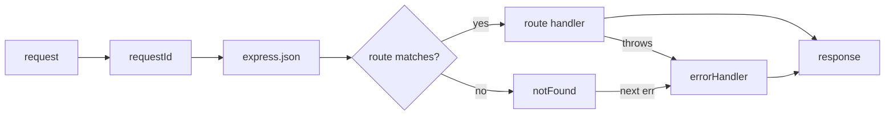
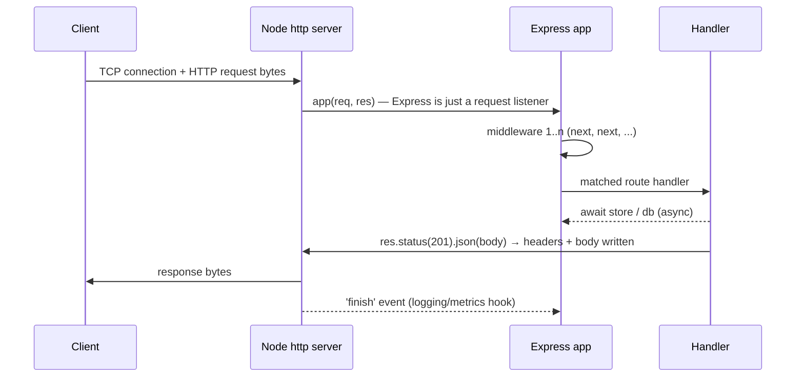

# 05 · Express Basics

> In module 03 you wrote an HTTP server with nothing but `node:http`, and you found out how much plumbing that takes. Express is a thin layer over that same server. It gives you routing and a **middleware chain**, and nearly every Node backend you'll touch at work is organized around that chain.

**Time:** ~6h · **Challenge:** 🧩 Scaffold · **Prereqs:** [03 · HTTP Fundamentals](../03-http-fundamentals/README.md) · **Services:** none

## What you'll learn

- What Express adds on top of `node:http`, and what it deliberately leaves out
- How routing works: methods, paths, route params, query strings, routers
- The **middleware chain**: what `next()` actually does and why order matters
- The request/response lifecycle, from socket to `res.end()`
- Async handlers and how Express 5 forwards errors for you
- **Centralized error handling**: one place that turns errors into responses
- Why `createApp()` and `listen()` belong in separate files

---

## 1. What Express is (and isn't)

Here's the `node:http` version of a JSON endpoint:

```ts
import http from "node:http";

http.createServer((req, res) => {
  if (req.method === "GET" && req.url === "/health") {
    res.writeHead(200, { "Content-Type": "application/json" });
    res.end(JSON.stringify({ status: "ok" }));
    return;
  }
  res.writeHead(404).end();
}).listen(3000);
```

Once you have 30 routes, params like `/notes/:id`, JSON bodies, auth checks and error handling, that `if` chain falls apart. Express gives you:

| Problem | Express feature |
|---|---|
| Matching method + path | `app.get("/notes/:id", handler)` |
| Reading `/notes/42` → `"42"` | `req.params.id` |
| Parsing `?q=milk&limit=5` | `req.query` |
| Parsing JSON bodies | `express.json()` middleware |
| Cross-cutting logic (auth, logging, ids) | middleware + `next()` |
| Grouping routes | `express.Router()` |
| Errors | error-handling middleware |
| Sending responses | `res.status(201).json(obj)`, `res.location()`, `res.end()` |

Express does **not** give you validation, a database layer, project structure, dependency injection or auth. That's on purpose: Express is unopinionated. The architecture is your job, and modules 06–09 are about doing that job well.

> 💡 `req` and `res` are still Node's `IncomingMessage` and `ServerResponse`, with helpers added. Everything you learned in module 03 still applies underneath.

## 2. Routing

```ts
import express from "express";
const app = express();

app.get("/notes", listNotes);          // GET    /notes
app.post("/notes", createNote);        // POST   /notes
app.get("/notes/:id", getNote);        // GET    /notes/42      → req.params.id === "42"
app.patch("/notes/:id", updateNote);
app.delete("/notes/:id", deleteNote);
```

Things to know:

- **Route params are always strings.** `req.params.id` is `"42"`, not `42`. Convert and validate it yourself.
- **Query values are `string | string[] | ParsedQs | undefined`.** `?limit=5&limit=6` gives you an array, so never assume a string. That's why the challenge's `limit` parsing checks `typeof`.
- **First match wins.** Express tries routes in the order you registered them. `app.get("/notes/:id")` registered before `app.get("/notes/search")` will catch `/notes/search` with `id = "search"`. Register specific paths before parameterized ones.

### Routers: mini-apps you mount

```ts
// routes/notes.ts
export function notesRouter(store: NoteStore) {
  const router = express.Router();
  router.get("/", async (req, res) => { /* GET /notes */ });
  router.get("/:id", async (req, res) => { /* GET /notes/:id */ });
  return router;
}

// app.ts
app.use("/notes", notesRouter(store));
```

A `Router` has its own middleware and routes, and you mount it at a prefix. Notice that `notesRouter` is a **function that receives its dependencies** (`store`) instead of importing a global. That small choice makes testing easy (pass a fake store) and it's the seed of dependency injection, which module 06 builds out properly.

## 3. Middleware: the core idea

A middleware is a function `(req, res, next) => void`. Express keeps an ordered list of them, and every request walks that list:



Each middleware can do one of three things:

1. **Do some work and call `next()`**: pass control to the next function in the chain (logging, attaching a request id, parsing).
2. **End the response**: `res.json(...)`, `res.end()`. The chain stops; that's what route handlers do.
3. **Call `next(err)`**, or throw: skip all normal middleware and jump to the **error handlers**.

```ts
const timing: RequestHandler = (req, res, next) => {
  const start = performance.now();
  res.on("finish", () => {
    console.log(`${req.method} ${req.originalUrl} ${res.statusCode} ${(performance.now() - start).toFixed(1)}ms`);
  });
  next(); // ← forget this and the request hangs forever
};
app.use(timing);
```

> ⚠️ **The #1 Express bug:** a middleware that neither calls `next()` nor sends a response. The client waits until it times out. If a request "just hangs", look for this first.

### Order is behavior

`app.use()` calls run in **registration order**. Some consequences:

- `express.json()` must come **before** routes that read `req.body`, or `req.body` is `undefined`.
- A request-id middleware must come **first** so even errors from the JSON parser have an id.
- The 404 handler goes **after** all routes. It only runs if nothing matched.
- Error handlers go **last**.

Read `app.ts` top to bottom and you're reading the life of a request.

### Where state goes: `res.locals`

To pass data down the chain (the request id, the authenticated user), put it on `res.locals`. It's scoped to one request/response pair. Don't use module-level variables for per-request data: Node handles many requests concurrently in one process, so a global would leak data between users. (Module 08 shows how to give `req.user` a proper type.)

## 4. The request/response lifecycle



Key points:

- **Headers go out before the body.** Once you've called `res.json()` or `res.write()`, the headers are sent (`res.headersSent === true`). Calling `res.status()` afterward throws `ERR_HTTP_HEADERS_SENT`. That usually means a handler sent a response twice: a missing `return` after `res.json()` inside an `if`.
- **One request, one response.** Every path through your code must end in exactly one response, either directly or by forwarding an error.
- `res.json(obj)` sets `Content-Type: application/json` and serializes for you. `res.status(204).end()` sends no body at all, which is what 204 means.

## 5. Async handlers & Express 5

Real handlers await things like databases and caches. What happens when the promise rejects?

```ts
router.get("/:id", async (req, res) => {
  const note = await store.get(req.params.id); // what if this rejects?
  if (!note) throw notFound("Note");             // or this throws?
  res.json({ data: note });
});
```

- **Express 4** ignored the returned promise. A rejection became an *unhandled rejection*: no response, the request hung, and the process might crash. Everyone wrapped handlers in `asyncHandler(fn)` helpers or used `express-async-errors`.
- **Express 5** (what we use) checks whether a handler returns a promise. If it rejects, Express calls `next(err)` for you. So `throw` inside an async handler goes straight to your error handler. 🎉

You'll still see `try/catch` + `next(err)` and `asyncHandler` wrappers in older codebases. Recognize them, but you don't need them here.

> Callbacks are the exception: if you throw inside `setTimeout` or an old-style callback API, no promise exists for Express to catch. Wrap callback APIs in promises (`util.promisify`) and `await` them.

## 6. Centralized error handling

An error-handling middleware has **four** parameters, and that's how Express recognizes it:

```ts
const errorHandler: ErrorRequestHandler = (err, req, res, next) => { ... };
app.use(errorHandler); // last!
```

Why one central handler instead of `res.status(400).json(...)` everywhere?

1. **Consistency.** Every error response has the same shape, so clients can rely on it:
   ```json
   { "error": { "code": "NOT_FOUND", "message": "Note not found", "requestId": "3f2a…" } }
   ```
   A machine-readable `code` lets the frontend branch on errors without parsing English text.
2. **Separation of concerns.** Route handlers say *what* went wrong (`throw notFound("Note")`). The error handler decides *how* that's represented in HTTP. Handlers stay short and the policy lives in one place.
3. **Safety.** Unexpected errors (bugs, a database down) must **never** leak their message or stack to the client. `connection to db-primary-7 refused` tells an attacker about your infrastructure. Log the details server-side with the request id and return a generic 500.

### Expected vs unexpected errors

This distinction comes back in every module:

| | Expected (operational) | Unexpected (bugs/outages) |
|---|---|---|
| Examples | validation failed, not found, conflict, unauthorized | `undefined is not a function`, DB unreachable |
| Status | 4xx (sometimes 409/422/429) | 500 / 503 |
| Message to client | specific and helpful | generic |
| Logging | info/debug, or not at all | **error**, with full stack + request id |
| Represented as | `HttpError` (or a domain error, module 07) | any other `Error` |

The challenge's `HttpError` class carries `status` + `code` + `message`. Anything that isn't an `HttpError` is treated as unexpected.

### Two special cases

- **Malformed JSON.** `express.json()` throws an error with `type === "entity.parse.failed"` and `status 400`. Without handling it, a client typo in their JSON looks like *your* server crashed (500). Map it to a 400.
- **Headers already sent.** If an error happens mid-stream you can't send a new status. Check `res.headersSent` and bail out. Express's default handler will close the connection.

### 404 is its own middleware

When no route matches, no error is thrown. The request simply falls off the end of the chain, and Express's default replies with an HTML `Cannot GET /x`. To keep your API consistently JSON, add a catch-all after your routes that forwards an `HttpError(404, "ROUTE_NOT_FOUND", ...)` to the error handler.

## 7. `createApp()` vs `server.ts`

```
src/
  app.ts      ← createApp(deps): builds and returns the app. No listen(), no process.env.
  server.ts   ← reads config, calls createApp(), listen(), handles shutdown signals.
```

Why split them?

- **Tests** import `createApp()` and use [supertest](https://github.com/ladjs/supertest), which runs requests against the app in-process without opening a real port. Tests are fast, parallel-safe and need no cleanup.
- **Dependencies are injected**: `createApp({ store })` lets a test pass a store that fails on purpose, which is exactly how the challenge tests your 500 handling.
- `server.ts` becomes the **composition root**: the one place that knows about environment variables, ports and real implementations. You'll grow this idea a lot in module 06.

## Common mistakes

- Forgetting `next()` in middleware (request hangs).
- Registering `express.json()` after routes (`req.body` is `undefined`).
- Missing `return` after sending a response inside an `if` (`ERR_HTTP_HEADERS_SENT`).
- Error handler with 3 parameters: Express treats it as normal middleware and it never receives errors.
- Error handler registered *before* routes: it never sees their errors.
- Treating `req.query.x` as a `string`, then crashing on `?x=1&x=2`.
- Sending `err.message` to the client for 500s.
- Mixing `res.send()` and `res.json()` shapes across endpoints, so clients can't rely on a format.

## In production

- **Request IDs** are standard. Load balancers and API gateways (AWS ALB, nginx, Envoy) often set `X-Request-Id` or a trace header. Reusing a trustworthy incoming id lets you follow one user action through several services. You'll connect this to structured logs and tracing in [module 24](../24-observability/README.md).
- **Body size limits** (`express.json({ limit: "100kb" })`) are a cheap defense against memory exhaustion.
- `app.disable("x-powered-by")` stops advertising your framework. It's minor, but it's free.
- Big companies wrap Express in internal frameworks, but underneath it's the same chain: auth middleware → validation → handler → error handler. Alternatives like Fastify, Koa and Hono use the same ideas with different APIs. Learn the concepts and the framework becomes a detail.

## Check yourself

1. What are the three things a middleware can do with a request?
   <details><summary>Answer</summary>Call <code>next()</code> to continue, end the response, or call <code>next(err)</code> / throw to jump to the error handlers.</details>
2. Your POST handler sees `req.body === undefined`. What's the likely cause?
   <details><summary>Answer</summary><code>express.json()</code> isn't registered, is registered after the route, or the client didn't send <code>Content-Type: application/json</code>.</details>
3. How does Express know a function is an error handler?
   <details><summary>Answer</summary>It has exactly four parameters <code>(err, req, res, next)</code>.</details>
4. Why return a generic message for 500s?
   <details><summary>Answer</summary>Internal messages and stacks leak implementation and infrastructure details, and they don't help the client anyway. Log them server-side with the request id.</details>
5. What changed in Express 5 about async handlers?
   <details><summary>Answer</summary>Rejected promises returned by handlers are forwarded to <code>next(err)</code> automatically, so <code>throw</code> in an async handler reaches the error handler.</details>

## Further reading

- Express guide, Routing: https://expressjs.com/en/guide/routing.html
- Express guide, Writing middleware: https://expressjs.com/en/guide/writing-middleware.html
- Express guide, Error handling: https://expressjs.com/en/guide/error-handling.html
- Migrating to Express 5: https://expressjs.com/en/guide/migrating-5.html
- Deep dives in this module: [docs/middleware-patterns.md](docs/middleware-patterns.md) · [docs/error-response-design.md](docs/error-response-design.md) · [docs/express-cheatsheet.md](docs/express-cheatsheet.md)

## ➡️ Next: [the challenge](CHALLENGE.md)
