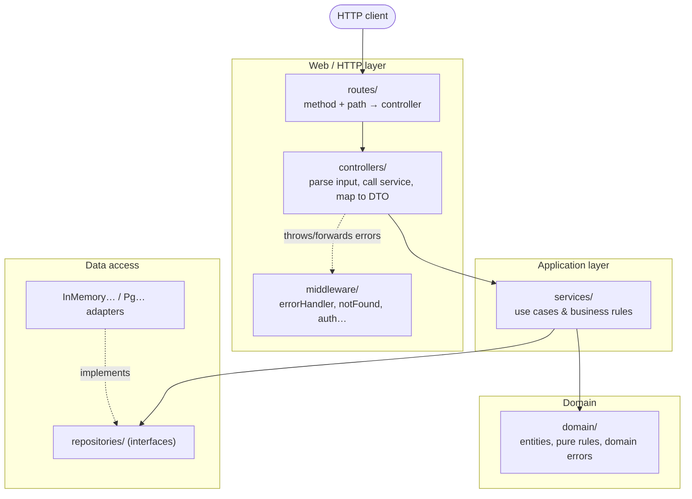
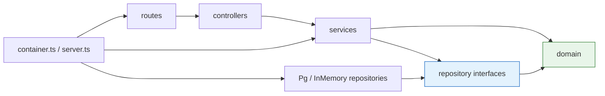
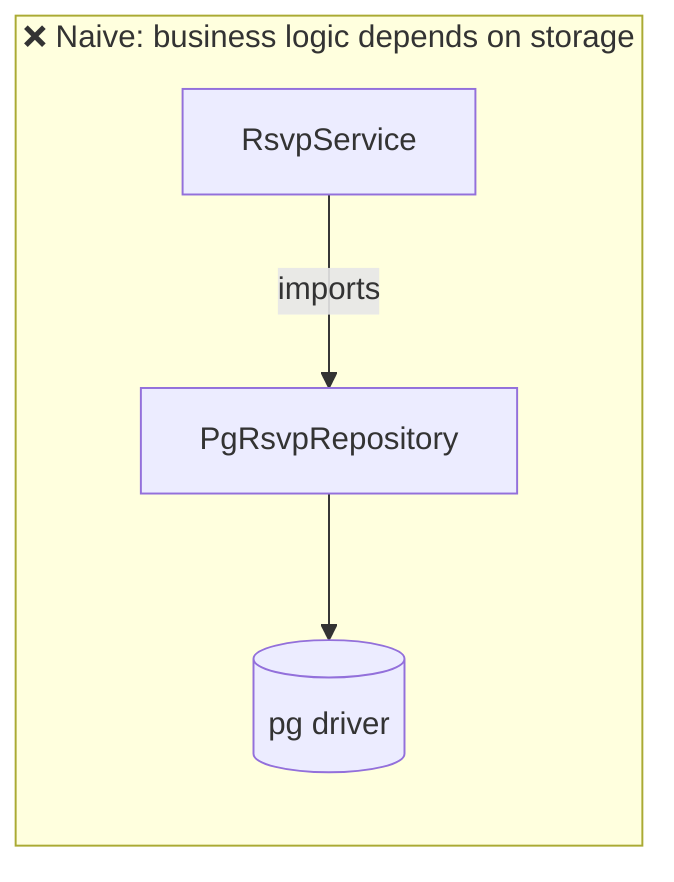
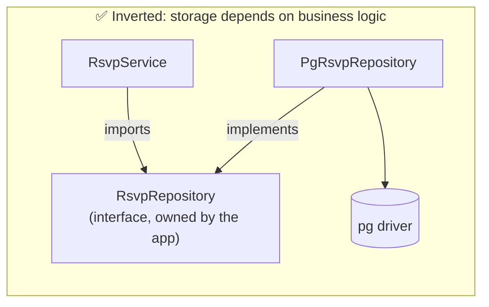
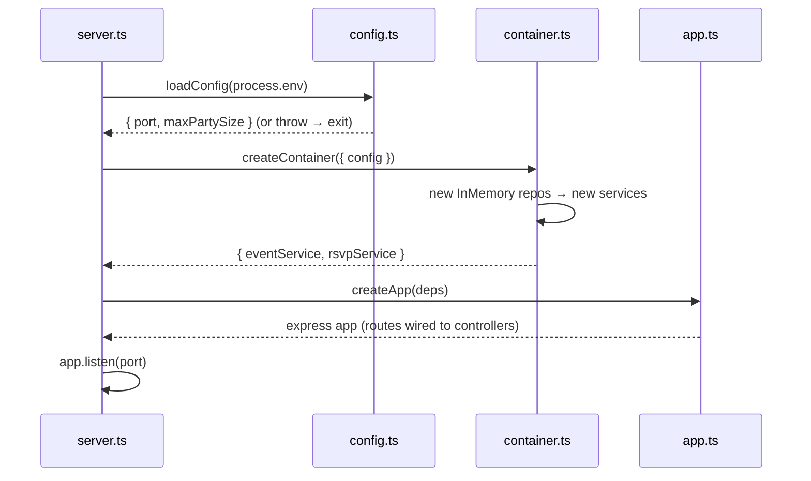
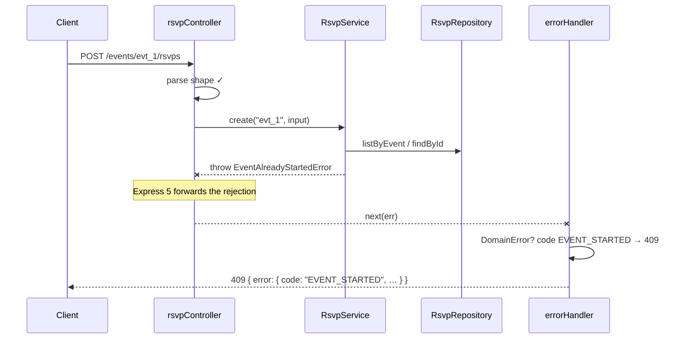
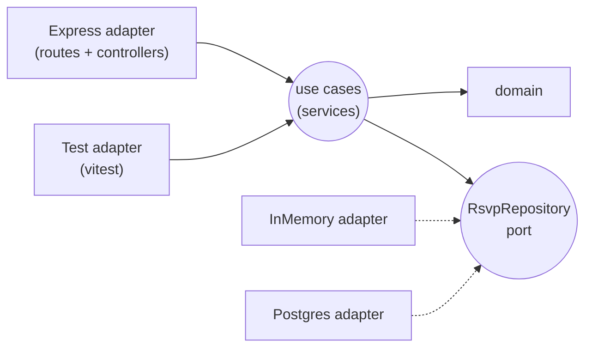

# 06 · Layered Architecture & Separation of Concerns

> Every backend you join will have *some* structure, good or bad. Knowing where code belongs, and why, is what lets you change a system without breaking it. It's also the first thing a senior engineer notices in your pull requests.

**Time:** ~7h · **Challenge:** 🐛 Debug / refactor · **Prereqs:** [05 · Express Basics](../05-express-basics/README.md) · **Services:** none

## What you'll learn

- Why mixing concerns hurts, in concrete terms: untestable rules, copy-paste drift, painful storage changes
- The classic layers (**routes → controllers → services → repositories**, plus a **domain** core) and exactly what each one is allowed to know
- **Dependency direction**: why imports must point inward, and how an interface lets the database depend on your business logic instead of the other way round
- **Dependency injection** with constructors and factory functions, without a framework
- The **composition root**: the one place that wires real implementations together
- Where **validation** goes (shape at the edge, rules in the service) and how **domain errors** become HTTP responses
- **DTOs vs entities**, and why your API shape shouldn't be your storage shape
- How to **test each layer** in isolation, and how to *enforce* the architecture with tests
- Layer folders vs feature folders, hexagonal/clean architecture, and when all of this is overkill

---

## 1. The problem: a file that does everything

In module 05 your route handlers parsed input, called a store and formatted responses. For a notes app with five endpoints that's fine. Now look at a handler from this module's challenge, an event RSVP service that grew for a year without anyone stepping back:

```ts
app.post("/events/:id/rsvps", (req, res) => {
  const ev = events.get(req.params.id);                       // storage (a global Map)
  if (!ev) return sendError(res, 404, "EVENT_NOT_FOUND", "…"); // HTTP decision

  if (typeof req.body.email !== "string" || …)                 // input validation
    return sendError(res, 400, "VALIDATION_ERROR", "…");

  const maxParty = Number(process.env.MAX_PARTY_SIZE ?? 6);    // config, read per request
  if (new Date(ev.startsAt).getTime() <= Date.now())           // business rule + hidden clock
    return sendError(res, 409, "EVENT_STARTED", "…");

  let taken = 0;                                               // business rule (copy #2 of 3)
  for (const r of list) if (r.status === "confirmed") taken += r.partySize;
  const status = taken + partySize < ev.capacity ? "confirmed" : "waitlisted";
  // …
  res.status(201).json({ data: rsvpToJson(rsvp) });            // response formatting
});
```

Count the **reasons this code might need to change**:

1. The HTTP contract changes (a new field, a different status code).
2. A validation rule changes (names can now be 200 chars).
3. A business rule changes (VIPs skip the waitlist).
4. Storage changes (Map → Postgres).
5. Configuration changes (party size comes from a feature flag).
6. The error format changes.

Six unrelated reasons, all in one function. That has real costs:

| Symptom | Why it happens |
|---|---|
| **You can't test a business rule without HTTP.** To check "a party that exactly fills the last seat is confirmed" you have to boot Express, POST an event, POST RSVPs and parse JSON. | The rule only exists inside a request handler. |
| **Rules drift apart.** The seat-counting loop exists three times. One copy says `< capacity`, another says `<= capacity`. That's a real bug in the challenge. | Copy-paste is the only way to reuse logic that lives in a handler. |
| **Changing storage means touching every endpoint.** Every handler reaches into `events` and `rsvpsByEvent` directly. | No boundary between "what we do" and "where data lives". |
| **Tests interfere with each other.** Two `createApp()` calls share the same module-level Maps. | State is global instead of owned by an object you can create fresh. |
| **Time-based rules are untestable.** "Event already started" depends on the real clock. | `Date.now()` is a hidden dependency. |
| **Every change is risky.** A 400-line file where everything touches everything else means every PR conflicts with every other PR. | Low cohesion, high coupling. |

None of this is about style or taste. Each item is a bug you'll ship or an hour you'll lose.

## 2. Separation of concerns, in one idea

A **concern** is a reason to change. Separation of concerns means: **code that changes for different reasons lives in different places, and code that changes for the same reason lives together.**

Two words you'll hear in design reviews:

- **Cohesion**: how related the things inside one module are. High cohesion = a module does one job. `rsvpService.ts` holding all RSVP rules is cohesive.
- **Coupling**: how much one module depends on the internals of another. Low coupling = you can change one without touching the other. A service that calls `repo.listByEvent()` instead of iterating a Map is loosely coupled to storage.

Good structure is **high cohesion, low coupling**. Layers are the most common, most boring and most effective way to get there in a backend. Boring is good: every engineer you work with will recognize it.

## 3. The layers



Here's what each layer is for, what it may know about, and what it must never know about:

| Layer | Its job | Knows about | Must NOT know about |
|---|---|---|---|
| **routes** | Map `POST /events/:id/rsvps` to a controller function | Express Router, controllers | business rules, storage |
| **controllers** | Turn an HTTP request into a service call and the result into an HTTP response | `req`/`res`, DTOs, service interfaces | storage, business rules, other controllers |
| **services** | Carry out a use case: load data, apply rules, save data | domain, repository *interfaces*, clock/ids | Express, `req`/`res`, status codes, `process.env`, SQL |
| **repositories** | Store and load entities | the storage technology, domain types | HTTP, business rules |
| **domain** | Entities, value rules, domain errors | nothing but itself | everything else |

A useful test for any line of code: **"If we replaced Express with a CLI, or a Kafka consumer, would this line still be needed?"** If yes, it doesn't belong in a controller. If we replaced the Map with Postgres, would this line change? If no, it doesn't belong in a repository.

Let's go through them from the inside out.

### 3.1 Domain: the vocabulary and the pure rules

The domain is the code that would make sense to someone who runs events but has never seen a computer: an *event* has a *capacity*, an *RSVP* is *confirmed* or *waitlisted*, a party *fits* if there are enough seats.

```ts
// domain/rsvp.ts
export type RsvpStatus = "confirmed" | "waitlisted" | "cancelled";

export interface Rsvp {
  id: string; eventId: string; name: string; email: string;
  partySize: number; status: RsvpStatus; createdAt: Date; cancelledAt: Date | null;
}

export function seatsTaken(rsvps: readonly Rsvp[]): number {
  return rsvps.reduce((sum, r) => (r.status === "confirmed" ? sum + r.partySize : sum), 0);
}

/** THE capacity rule. One definition, used everywhere. */
export function fits(capacity: number, taken: number, partySize: number): boolean {
  return taken + partySize <= capacity;
}
```

Domain code is **pure**: no I/O, no clock, no randomness, no framework. That makes it the easiest code in the system to test (plain function calls, no setup) and the safest to reuse. When the seat rule exists exactly once, it can't drift.

Domain errors live here too (section 8).

> 💡 Not every app needs a rich domain model. In a simple CRUD app the domain might just be types. Pull logic into the domain when it's a *rule* (seat math, state transitions, pricing), not just data shuffling.

### 3.2 Repositories: the boundary around storage

A repository makes storage look like an in-memory collection of domain objects. The service asks for "the RSVPs of event X" and doesn't care whether that's a Map lookup, a SQL query or an HTTP call to another service.

```ts
// repositories/rsvpRepository.ts — the INTERFACE (the "port")
export interface RsvpRepository {
  insert(rsvp: Rsvp): Promise<void>;
  update(rsvp: Rsvp): Promise<void>;
  /** All RSVPs of an event, oldest first. */
  listByEvent(eventId: string): Promise<Rsvp[]>;
}

// repositories/inMemoryRsvpRepository.ts — one IMPLEMENTATION (an "adapter")
export class InMemoryRsvpRepository implements RsvpRepository {
  readonly #rows = new Map<string, Rsvp>();
  async insert(rsvp: Rsvp) { this.#rows.set(rsvp.id, structuredClone(rsvp)); }
  // …
}
```

Design notes that matter:

- **Methods are named after what the service needs** (`listByEvent`), not after the storage (`scanTable`). Add methods when a use case needs them; don't build a generic "repository framework".
- **Everything is `async`**, even for a Map, because a real database is. Swapping in Postgres later won't change a single caller.
- **The interface documents guarantees** the service relies on ("oldest first"). That comment is part of the contract.
- **Copy on the way in and out** (`structuredClone`). A real DB returns fresh objects, so the in-memory version should too. Otherwise a service that mutates an entity and forgets to call `update()` works in tests and breaks in production.

In module 13 you'll write `PgTaskRepository` behind exactly this kind of interface without touching the service.

### 3.3 Services: the use cases

A service method is one thing a user can *do*: create an event, RSVP, cancel. It **orchestrates**: load what it needs through repositories, apply domain rules, save the result, return domain objects or throw domain errors.

```ts
export class RsvpService {
  readonly #deps: RsvpServiceDeps;
  constructor(deps: RsvpServiceDeps) { this.#deps = deps; }

  async create(eventId: string, input: NewRsvpInput): Promise<Rsvp> {
    const { rsvps, clock, ids, maxPartySize } = this.#deps;
    if (input.partySize < 1 || input.partySize > maxPartySize) {
      throw new ValidationError(`partySize must be between 1 and ${maxPartySize}`);
    }
    const event = await this.#findEvent(eventId);           // throws EventNotFoundError
    if (hasStarted(event, clock.now())) throw new EventAlreadyStartedError(eventId);

    const list = await rsvps.listByEvent(eventId);
    const email = normalizeEmail(input.email);
    if (list.some((r) => isActive(r) && r.email === email)) throw new AlreadyRsvpedError(email);

    const rsvp: Rsvp = {
      id: ids("rsvp"), eventId, name: input.name.trim(), email, partySize: input.partySize,
      status: fits(event.capacity, seatsTaken(list), input.partySize) ? "confirmed" : "waitlisted",
      createdAt: clock.now(), cancelledAt: null,
    };
    await rsvps.insert(rsvp);
    return rsvp;
  }
}
```

Notice what's **not** there: no `req`, no `res`, no status codes, no `process.env`, no `Date.now()`, no Map. Everything the service needs arrives through its constructor. That's why you can test every branch of this method with a few lines and no HTTP at all.

Services may call other services, but be careful: if `A` calls `B` and `B` calls `A`, you've found a missing concept. Pull the shared logic into the domain or a small helper (the solution's `promoteWaitlist` is one).

### 3.4 Controllers: translators, and thin ones

A controller translates between HTTP and the service. Every controller function does the same three steps:

```ts
const create: RequestHandler<{ id: string }> = async (req, res) => {
  // 1. Pull input out of the request and check its SHAPE
  const body = asBody(req.body);
  const input = {
    name: text(body.name, "name", 100),
    email: email(body.email, "email"),
    partySize: body.partySize === undefined ? 1 : integer(body.partySize, "partySize"),
  };
  // 2. Call ONE service method
  const rsvp = await rsvps.create(req.params.id, input);
  // 3. Map the result to a DTO and choose the success status
  res.status(201).json({ data: toRsvpDto(rsvp) });
};
```

That's what "**thin controllers**" means. If a controller has an `if` about seats, emails or dates, a business rule has leaked out of the service. If it has `try/catch` to build an error response, error mapping has leaked out of the error handler. A controller longer than ~15 lines is a smell worth investigating.

### 3.5 Routes: the table of contents

```ts
export function eventsRouter(deps: { eventService: EventService; rsvpService: RsvpService }) {
  const events = createEventController(deps.eventService);
  const rsvps = createRsvpController(deps.rsvpService);
  const router = Router();
  router.post("/", events.create);
  router.get("/:id", events.get);
  router.post("/:id/rsvps", rsvps.create);
  router.delete("/:id/rsvps/:rsvpId", rsvps.cancel);
  return router;
}
```

A new teammate opens this file and sees the whole API in ten lines. Route-specific middleware (auth, rate limits, validation in module 07) attaches here: `router.post("/", requireAuth, events.create)`.

Some teams merge routes and controllers into one file per resource. That's fine at this size. What matters is that the HTTP layer is separate from the service layer.

## 4. Dependency direction: imports point inward

This is the most important rule of the module:

> **Outer layers depend on inner layers. Inner layers never depend on outer layers.**



Read the arrows as "imports". The domain imports nothing. Services import the domain and repository **interfaces**. Nobody inside imports Express, and nobody imports the composition root.

### Why "inward"?

The inner layers hold the code that is most valuable and changes for the most important reasons (business rules). The outer layers hold code that changes for technical reasons: a new framework, a new database, a new API version. Dependencies should point **from volatile to stable**, so a technical change can never force a business-rule change.

### The trick: dependency inversion

Here's the puzzle. The service *calls* the repository at runtime, so naively the service depends on the database code:





The **service defines the interface it needs** (what methods, what guarantees), and the Postgres adapter conforms to it. The runtime call still goes service → Postgres, but the *source code dependency* now points the other way. That's the "D" in SOLID: **depend on abstractions, not concretions.**

The payoff: the service can be compiled, run and tested without any database existing. In tests you hand it a fake. In production you hand it Postgres. The service can't tell the difference.

> TypeScript is structurally typed, so any object with the right methods satisfies the interface. `implements RsvpRepository` is optional, but write it anyway: the compiler then tells you right away when the adapter drifts from the contract.

### Enforcing it

Rules that are only written in a README get broken by the third tired PR. The challenge has **architecture tests** that read your source files and fail if, say, a service imports `express` or the domain imports a repository. Real teams do the same with tools like `dependency-cruiser` or ESLint's `import/no-restricted-paths`, and run them in CI.

## 5. Dependency injection: pass things in, don't reach out

**Dependency injection** (DI) sounds like a framework feature. It's actually just this: **a piece of code receives its collaborators instead of creating or importing them.**

```ts
// ❌ Reaching out: hidden, global, untestable
import { db } from "../db.js";               // module-level singleton
export async function cancelRsvp(id: string) {
  const now = new Date();                     // hidden clock
  const max = Number(process.env.MAX_PARTY);  // hidden config
  await db.query(/* … */);
}

// ✅ Passing in: everything visible in the signature
export class RsvpService {
  constructor(deps: { rsvps: RsvpRepository; clock: Clock; maxPartySize: number }) { … }
}
```

With injection, the constructor signature is an honest list of everything the service depends on. A test can pass a fake repository, a clock frozen at any moment, and any config value.

### Two styles, both fine

**Constructor injection (classes):**

```ts
export class EventService {
  readonly #deps: EventServiceDeps;
  constructor(deps: EventServiceDeps) { this.#deps = deps; }
  async get(id: string) { /* this.#deps.events.findById(id) … */ }
}
const service = new EventService({ events, rsvps, clock, ids });
```

**Factory functions (closures):**

```ts
export function createEventService(deps: EventServiceDeps) {
  return {
    async get(id: string) { /* deps.events.findById(id) … */ },
  };
}
export type EventService = ReturnType<typeof createEventService>;
```

Classes are more familiar to people coming from Java/C#/NestJS and show up nicely in stack traces. Factories avoid `this` pitfalls (passing `service.get` as a callback loses `this` with classes) and get true privacy from closures. Pick one per codebase and be consistent. The challenge uses classes for services and factories for controllers and routers so you see both.

> Pass **one deps object**, not positional arguments. `new RsvpService({ events, rsvps, clock, ids, maxPartySize })` is readable, order-independent and easy to extend.

### Time and randomness are dependencies too

`Date.now()` and `randomUUID()` are hidden inputs. They make code non-deterministic, so tests either can't check them or become flaky. Wrap them:

```ts
export interface Clock { now(): Date }
export const systemClock: Clock = { now: () => new Date() };
export type IdGenerator = (prefix: string) => string;
```

Now "you can't RSVP after the event started" is a three-line test: set the fake clock to the start time, call `create`, expect `EventAlreadyStartedError`.

### Do you need a DI container library?

Libraries like InversifyJS, tsyringe and Awilix, or NestJS's built-in container, build the object graph for you with decorators or registration. They help in very large apps. For most Node services, **plain functions that call constructors** (called "pure DI") are clearer: no magic, full type checking, and "go to definition" works. You'll write exactly that in `container.ts`. See [docs/dependency-injection.md](docs/dependency-injection.md) for lifetimes and when a container starts paying off.

## 6. The composition root

If nothing creates its own dependencies, *someone* has to create everything. That someone is the **composition root**: one place, at the edge of the app, that knows the concrete classes and wires them together.

```ts
// container.ts — builds the object graph
export function createContainer(overrides: ContainerOverrides = {}): AppDeps {
  const config = overrides.config ?? loadConfig();
  const clock = overrides.clock ?? systemClock;
  const ids = overrides.ids ?? randomId;

  const events = new InMemoryEventRepository();   // ← the ONLY place that names
  const rsvps = new InMemoryRsvpRepository();     //   concrete implementations

  return {
    eventService: new EventService({ events, rsvps, clock, ids }),
    rsvpService: new RsvpService({ events, rsvps, clock, ids, maxPartySize: config.maxPartySize }),
  };
}

// server.ts — the process entry point
const config = loadConfig();                       // fail fast on bad env
const app = createApp(createContainer({ config }));
app.listen(config.port);
```



Properties of a good composition root:

- **It's the only file that imports concrete adapters.** Moving to Postgres = change two lines here.
- **It runs once, at startup.** Mistakes (missing env vars, bad config) blow up immediately, not on the first request at 3 a.m.
- **Tests reuse it with overrides.** `createContainer({ clock: fakeClock })` gives an end-to-end app where time is controlled. Each call builds a fresh, isolated graph, so tests can't leak state into each other.
- **`createApp(deps)` doesn't build anything.** It receives services and wires HTTP. That's the evolution of module 05's `createApp({ store })`.

### Config is a dependency like any other

`process.env` is global mutable state read from outside the program. Reading it deep inside a handler (like the god file does on every request) means the code's behavior depends on something invisible in its signature, and "configurable without a deploy" is an illusion anyway, since env vars don't change in a running process.

The rule: **`config.ts` is the only file that touches `process.env`**. It parses everything once into a typed object, fails fast with a clear message, and the composition root passes values down. The service receives `maxPartySize: number` and has no idea environment variables exist. Module 07 upgrades this with zod.

## 7. Where does validation go?

"Validate input" covers two different things, and they belong in different layers:

| Kind | Question it answers | Examples | Where |
|---|---|---|---|
| **Shape / syntax** | "Is this well-formed input?" | `capacity` is an integer, `email` looks like an email, `startsAt` parses as a date, required fields present | **Controller** (edge) |
| **Business rules / invariants** | "Is this allowed, right now, in our world?" | capacity ≥ 1, party ≤ configured max, event hasn't started, email not already booked | **Service / domain** |

Why split them?

- **Shape checks are about the transport.** JSON sends `"5"` vs `5`; a query string sends only strings; a CLI would parse differently. The controller converts untrusted `unknown` into typed values, so the service can declare `capacity: number` and trust it.
- **Rules must hold no matter who calls.** If "party ≤ max" lived only in the controller, a future Kafka consumer or admin script calling `rsvpService.create()` would skip it. Rules that depend on state (existing RSVPs), time (has it started?) or config (max party) can only be checked in the service anyway.

The controller **parses**: it turns the ISO string into a `Date`. The service **decides**: "is that date in the future?" A small overlap (both reject non-integers) is fine as defense in depth. The thing to avoid is a rule that *only* exists at the edge.

## 8. Errors across layers

In module 05 handlers threw `HttpError(404, …)`. That was fine with no service layer, but a service that throws "404" has made an HTTP decision. What's the status for "event not found" when the caller is a queue worker?

Instead, the service throws **domain errors** that describe *what* happened in business terms, and the **error handler** (outermost layer) decides *how* that's represented in HTTP:

```ts
// domain/errors.ts — no status codes anywhere
export abstract class DomainError extends Error {
  abstract readonly code: DomainErrorCode;
}
export class EventAlreadyStartedError extends DomainError {
  readonly code = "EVENT_STARTED";
  constructor(readonly eventId: string) { super("This event has already started"); }
}

// middleware/errorHandler.ts — the ONE place that knows the mapping
const STATUS_BY_CODE = {
  VALIDATION_ERROR: 400,
  EVENT_NOT_FOUND: 404,
  RSVP_NOT_FOUND: 404,
  EVENT_STARTED: 409,
  ALREADY_RSVPED: 409,
  CAPACITY_TOO_LOW: 409,
} as const satisfies Record<DomainErrorCode, number>;
```

`satisfies Record<DomainErrorCode, number>` is a neat trick: add a new error code and the build fails until you map it. You can't forget.



The controller didn't catch anything. Unexpected errors (a `TypeError`, the DB is down) aren't `DomainError`s, so they fall through to a logged, generic 500, exactly like module 05. [Module 07](../07-validation-errors-config/README.md) builds out a fuller error hierarchy with field-level details.

## 9. DTOs vs entities

An **entity** is your internal model (`Rsvp` with `createdAt: Date` and `cancelledAt: Date | null`). A **DTO** (data transfer object) is the shape you promise to clients over the wire. They look similar on day one, so keeping them separate feels like ceremony. Here's why it isn't:

- **Types differ.** JSON has no `Date`. The DTO has `createdAt: string` (ISO 8601). Mapping in one function means you never accidentally send `{}` or a locale-formatted date.
- **Not everything should leave.** A `User` entity has `passwordHash`. An `Order` has `internalRiskScore`. If controllers send entities directly, the day someone adds a sensitive field, it ships to every client. With a DTO, new fields are private until someone deliberately exposes them.
- **The API is a contract; the model isn't.** You can rename an entity field, split a table or change how stats are computed without breaking a mobile app that won't update for months.
- **Inputs too.** A request DTO (`NewRsvpInput`) lists exactly what a client may set. Spreading `req.body` into an entity is how "mass assignment" bugs happen (`{"status":"confirmed"}` skips the waitlist). That's a security bug you'll exploit in [module 25](../25-security/README.md).

```ts
export function toRsvpDto(r: Rsvp): RsvpDto {
  return {
    id: r.id, eventId: r.eventId, name: r.name, email: r.email,
    partySize: r.partySize, status: r.status,
    createdAt: r.createdAt.toISOString(),   // Date → string
    // cancelledAt deliberately not exposed
  };
}
```

Mapping happens in the **controller** (or a `dto.ts` next to it), because the DTO is an HTTP concern.

## 10. Testing each layer

Layering pays off most visibly in tests. Each layer gets the cheapest test that gives you confidence:

| Layer | Test style | Dependencies in the test | Speed |
|---|---|---|---|
| domain | plain unit tests: call a function, assert the result | none | microseconds |
| services | unit tests with **fakes** for repositories, a fake clock and predictable ids | in-memory fakes | milliseconds |
| repositories | **contract tests** against the real storage (module 13 runs the same suite against in-memory and Postgres) | real DB | slower |
| controllers + routes | HTTP tests with supertest against `createApp(deps)`, often with a fake service | fake or real services | fast |
| whole app | a few end-to-end tests via `createApp(createContainer())` | everything real (in-memory here) | fast here, slower with a DB |

A service test reads like a specification:

```ts
it("promotes the waitlist first-come, first-served", async () => {
  const { service, rsvps, event } = setup({ capacity: 2 });
  const big = await service.create(event.id, guest("Big", 2));
  const a = await service.create(event.id, guest("Ana"));
  const b = await service.create(event.id, guest("Ben"));
  await service.create(event.id, guest("Cy"));

  const { promoted } = await service.cancel(event.id, big.id);

  expect(promoted.map((r) => r.name)).toEqual(["Ana", "Ben"]);
});
```

No HTTP, no JSON, no ports. When this fails, you know it's the waitlist rule and not a routing typo.

**Fakes vs mocks.** A *fake* is a small working implementation (an array-backed repository). A *mock* is an object that records calls so you can assert "`update` was called with X". Prefer fakes for repositories: tests then check *outcomes* (the RSVP ended up confirmed) instead of *implementation details* (which methods were called in which order), so you can refactor the service without rewriting tests. Module 09 goes deep on test doubles.

## 11. Folder structure: by layer or by feature?

There are two common ways to lay out the same layers on disk.

**Layer folders** (this module):

```
src/
  routes/events.ts
  controllers/eventController.ts  rsvpController.ts
  services/eventService.ts        rsvpService.ts
  repositories/eventRepository.ts rsvpRepository.ts  inMemory…
  domain/event.ts  rsvp.ts  errors.ts
```

**Feature folders** (a.k.a. vertical slices or modules):

```
src/
  events/
    event.routes.ts  event.controller.ts  event.service.ts  event.repository.ts  event.ts
  rsvps/
    rsvp.routes.ts   rsvp.controller.ts   rsvp.service.ts   rsvp.repository.ts   rsvp.ts
  shared/
    errors.ts  clock.ts
```

| | Layer folders | Feature folders |
|---|---|---|
| Easy to see… | the architecture and enforce layer rules | everything about one feature in one place |
| A typical change touches… | 4–5 folders | 1 folder |
| Scales to… | small/medium apps (≈ up to 10 resources) | large apps and teams; maps well to team ownership |
| Risk | folders with 40 unrelated files | features reaching into each other's internals |

Both keep the same layering *inside*. Feature folders are layers sliced vertically. A good path: start with layer folders, move to feature folders when navigating them gets painful. Many NestJS apps use feature modules from day one.

## 12. Hexagonal, clean, onion: same idea, different drawings

You'll hear these names in interviews and design docs. They are variations on what you just learned:

- **Hexagonal architecture / Ports & Adapters** (Alistair Cockburn): the application core defines **ports** (interfaces like `RsvpRepository`, or "an RSVP can be created"). **Adapters** plug into them: an Express adapter drives the app from HTTP, a Postgres adapter implements the storage port, a test adapter drives it from a test. The core doesn't know which adapters exist.
- **Onion architecture**: concentric rings with the domain model in the center and infrastructure on the outside. Dependencies point inward.
- **Clean architecture** (Robert C. Martin): entities → use cases → interface adapters → frameworks & drivers, with the **dependency rule**: source dependencies point only inward.



Our structure **is** a lightweight hexagonal architecture: services are the use cases, repository interfaces are the outbound ports, controllers are an inbound adapter, `InMemory…Repository` is an outbound adapter, and `container.ts` plugs adapters into ports. Don't worry about which drawing is "correct". The shared rule is that **business logic sits in the middle, depends on nothing technical, and talks to the outside world only through interfaces it owns.** More in [docs/hexagonal-and-clean.md](docs/hexagonal-and-clean.md).

## 13. When layering is overkill

Layers have a cost: more files, more indirection, more "go to definition" hops. Skip or flatten them when:

- **It's a script, prototype or throwaway spike.** Ship the 100-line file.
- **It's a thin CRUD proxy** with no rules: a service that only does `return repo.find(id)` adds nothing. Some teams let controllers call repositories directly for pure reads. That's acceptable if it's a conscious, consistent choice.
- **It's a tiny function** (a Lambda that resizes an image).

Signs you've overdone it: interfaces with exactly one implementation *and* no tests that use a fake; `XService` that only forwards to `XManager` that only forwards to `XRepository`; DTO-to-DTO mapping chains three deep. Add a layer when it **separates a reason to change** or **enables a test you need**, not because a diagram said so.

The rules that pay off even in small apps: **keep business rules out of HTTP handlers, read config in one place, and inject dependencies instead of importing singletons.**

---

## Common mistakes

- **Fat controllers.** Business `if`s in handlers ("if seats left…"). Move them to the service.
- **Anemic services that are just pass-throughs** while the real logic sits in the controller. The service should own the use case.
- **Services that take `req` or return HTTP statuses.** `rsvpService.create(req)` couples the service to Express forever. Pass typed input; throw domain errors.
- **Importing a singleton instead of injecting.** `import { db } from "../db.js"` inside a service makes it untestable without a real DB, and hides the dependency.
- **`process.env` sprinkled everywhere.** Parse once in `config.ts`; inject values.
- **Leaking entities to clients.** Sending `res.json(user)` and shipping `passwordHash` the day someone adds it.
- **Spreading `req.body` into an entity** (mass assignment).
- **Interfaces mirroring the database** (`query(sql)`) instead of the use case (`listByEvent`). That isn't an abstraction, it's a pass-through.
- **Repositories that contain business rules** (`insertRsvpAndPromoteWaitlist`). Repositories store and load; services decide.
- **In-memory fakes that share object references,** hiding missing `update()` calls until production.
- **Circular imports between services.** It usually means a concept is missing. Extract it.

## In production

- **Most job codebases look like this.** NestJS (controllers / providers / modules), Spring Boot (controller / service / repository) and ASP.NET all bake in the same layering, so recognizing it makes you productive on day one. Express apps follow the same pattern by convention. What you're learning is the convention.
- **Architecture is enforced in CI**, not by hope. Tools: `dependency-cruiser`, ESLint `import/no-restricted-paths` or `boundaries` plugins, ArchUnit in the Java world. The challenge's `architecture.test.ts` is a homemade version.
- **The composition root grows** to include DB pools, Redis clients, Kafka producers, loggers and metrics registries. Shutdown happens there too, in reverse order (module 26).
- **Swapping adapters is real.** Teams move from one database or queue to another, or add a cache decorator around a repository (module 18's `CachedProductRepository` implements the same interface and wraps the real one). Clean boundaries make that a week of work instead of a quarter.
- **Transactions cross the boundary.** "Cancel and promote" should be atomic in a real DB. You'll pass a transaction-scoped repository or a unit of work into the service (modules 13 and 15), still without the service knowing SQL.
- **Services outlive their HTTP layer.** The same `RsvpService` can run behind REST today, a queue consumer tomorrow (module 20) and gRPC next year.

## Check yourself

1. A teammate adds `if (event.capacity - taken < 5) res.set("X-Almost-Full", "1")` to the RSVP controller. What's right and wrong about it?
   <details><summary>Answer</summary>Setting a header is an HTTP concern, so the controller is the right place for <code>res.set</code>. But computing "almost full" is a business rule and doesn't belong there. The service (or a domain function like <code>isAlmostFull(event)</code>) should decide it, and the controller just turns that answer into a header.</details>
2. Why does `RsvpService` depend on `RsvpRepository` (an interface) instead of `InMemoryRsvpRepository`?
   <details><summary>Answer</summary>So the business logic doesn't depend on a storage technology (dependency inversion). Tests can pass a fake, production can pass Postgres, and the composition root is the only place that chooses. The source dependency points from the adapter to the service's interface, not the other way round.</details>
3. Where does "partySize must be an integer" belong, and where does "partySize must be at most `MAX_PARTY_SIZE`"?
   <details><summary>Answer</summary>"Is an integer" is a shape check on untrusted input, so it goes in the controller (or validation middleware). "At most the configured max" is a business rule that depends on config, so it goes in the service, which receives <code>maxPartySize</code> through injection. That way every caller is subject to it, not just HTTP callers.</details>
4. What is a composition root, and why should there be only one?
   <details><summary>Answer</summary>It's the place at the app's entry point that creates concrete implementations and wires them into the objects that need them. With only one, the rest of the code depends only on abstractions, swapping an implementation is a local change, configuration errors surface at startup, and tests can build the same graph with overrides.</details>
5. Your service throws `new HttpError(404, …)`. Why might a reviewer push back?
   <details><summary>Answer</summary>The service now makes an HTTP decision and is coupled to the transport. A queue worker or CLI calling it gets a meaningless 404. Throw a domain error (<code>EventNotFoundError</code>) and map it to 404 in the error handler.</details>

## Further reading

- Martin Fowler, Presentation–Domain–Data layering: https://martinfowler.com/bliki/PresentationDomainDataLayering.html
- Martin Fowler, Service Layer pattern: https://martinfowler.com/eaaCatalog/serviceLayer.html
- Martin Fowler, Repository pattern: https://martinfowler.com/eaaCatalog/repository.html
- Martin Fowler, Inversion of Control Containers and the Dependency Injection pattern: https://martinfowler.com/articles/injection.html
- Alistair Cockburn, Hexagonal architecture: https://alistair.cockburn.us/hexagonal-architecture/
- Robert C. Martin, The Clean Architecture: https://blog.cleancoder.com/uncle-bob/2012/08/13/the-clean-architecture.html
- Mark Seemann, Composition Root: https://blog.ploeh.dk/2011/07/28/CompositionRoot/
- Deep dives in this module: [docs/dependency-injection.md](docs/dependency-injection.md) · [docs/hexagonal-and-clean.md](docs/hexagonal-and-clean.md) · [docs/refactoring-a-god-file.md](docs/refactoring-a-god-file.md) · [docs/layering-cheatsheet.md](docs/layering-cheatsheet.md)

## ➡️ Next: [the challenge](CHALLENGE.md)
