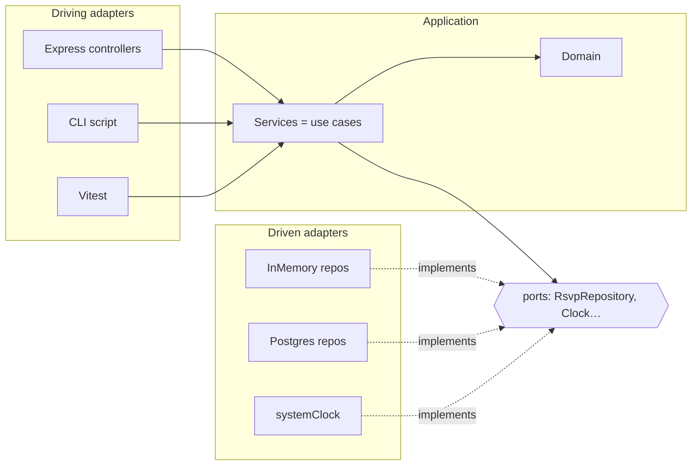

# Hexagonal, onion and clean architecture

Interviewers and design docs throw these names around as if they were very different things. They aren't. All three are ways of drawing one rule: **business logic in the middle, technology at the edges, dependencies pointing inward.** This page shows how each one maps to the folders you built in this module.

## Ports & Adapters (hexagonal architecture)

Alistair Cockburn's version. The hexagon shape doesn't mean anything; it just leaves room to draw many adapters around the edge.

- The **application** (domain + use cases) sits inside.
- **Ports** are interfaces owned by the application:
  - *Driving (inbound) ports*: what the outside can ask the app to do. In our code, the public methods of `EventService` and `RsvpService`.
  - *Driven (outbound) ports*: what the app needs from the outside. `EventRepository`, `RsvpRepository`, `Clock`, `IdGenerator`.
- **Adapters** connect a technology to a port:
  - *Driving adapters* call into the app: Express controllers, a CLI, a queue consumer, your Vitest tests.
  - *Driven adapters* implement outbound ports: `InMemoryRsvpRepository`, a future `PgRsvpRepository`, `systemClock`.

The selling point: you can run the whole application with test adapters on both sides, no web server and no database. The challenge's service tests do exactly that.

## Onion architecture

Concentric rings, from the inside out:

1. **Domain model**: entities and value objects (`Rsvp`, `fits()`).
2. **Domain services**: rules that span several entities (`pickPromotions`).
3. **Application services**: use cases that orchestrate (`RsvpService.cancel`).
4. **Infrastructure / UI / tests**: everything technical.

The rule: code in a ring may only depend on rings further in. Repository interfaces live in an inner ring and their implementations in the outer one.

## Clean architecture

Robert C. Martin's version names the rings **Entities → Use Cases → Interface Adapters → Frameworks & Drivers** and states the **Dependency Rule**: source code dependencies can only point inward. Nothing in an inner circle can name anything in an outer one: not a function, not a class, not a data format.

It also stresses that data crossing a boundary should be in the form most convenient for the inner circle. That's why our services take `NewRsvpInput` and return `Rsvp` entities, and the controller converts to and from HTTP DTOs.

## Mapping table

| Concept | Hexagonal | Onion | Clean | This module |
|---|---|---|---|---|
| Business objects & pure rules | application core | domain model | entities | `src/domain/` |
| Use cases | driving ports | application services | use cases | `src/services/` |
| Storage interfaces | driven ports | (inner ring) | gateway interfaces | `src/repositories/*Repository.ts` |
| Storage implementations | driven adapters | infrastructure | frameworks & drivers | `src/repositories/inMemory*.ts` |
| HTTP handling | driving adapter | UI | interface adapters (controllers, presenters) | `src/controllers/`, `src/routes/`, `src/middleware/` |
| Wiring | configurator | composition root | main component | `src/container.ts`, `src/server.ts` |

## Being pragmatic

Taken literally, these architectures can produce a lot of ceremony: separate "presenter" objects, input/output port interfaces for every use case, mappers between nearly identical types. In a TypeScript service it's usually enough to:

- keep the domain and services free of framework imports
- define interfaces for things that do I/O (storage, external APIs, clock)
- map at the HTTP boundary (input parsing + DTOs)
- wire everything in one composition root

That gets you about 90% of the benefit for 10% of the ceremony. Add the remaining pieces only when a concrete problem calls for them, such as a second delivery mechanism or a second storage technology.

## Interview soundbite

> "I keep business rules in a framework-free core. The core defines interfaces for what it needs, like repositories and a clock, and adapters at the edges implement them: Express on the way in, Postgres on the way out. One composition root wires them together. That's basically hexagonal or clean architecture. The practical payoff is that I can unit-test every rule with in-memory fakes and swap infrastructure without touching the business logic."
