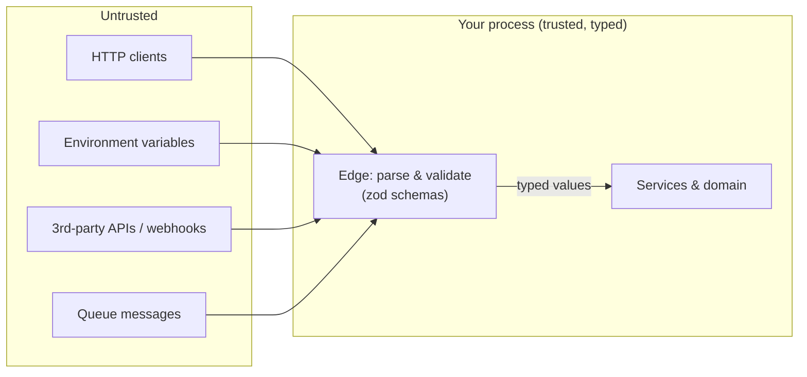
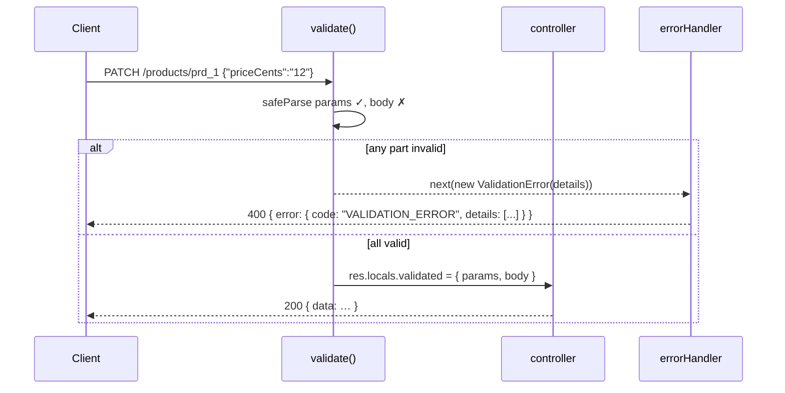
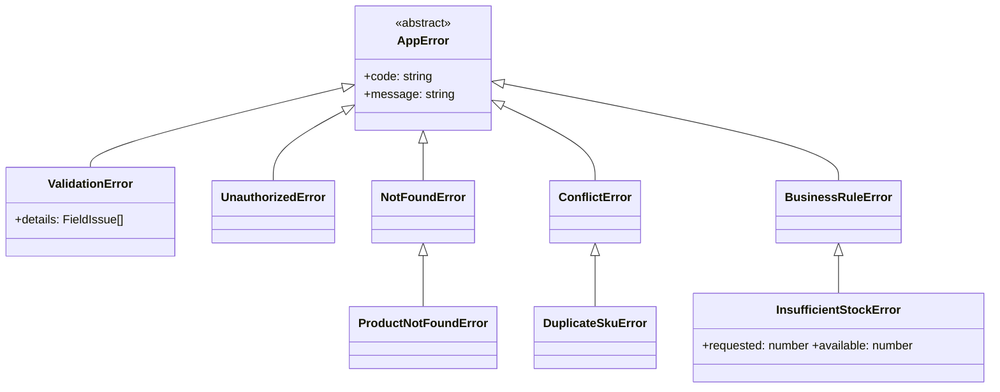
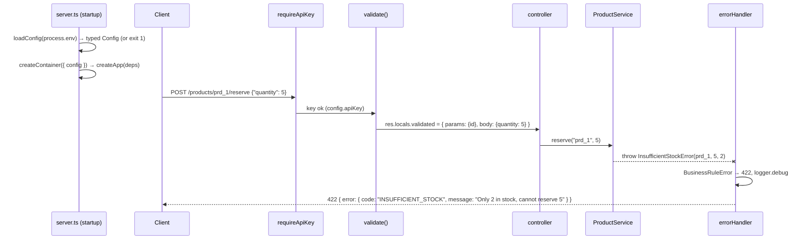

# 07 · Validation, Errors & Config

> Most production incidents don't start in clever algorithms. They start at the edges: a request nobody expected, an error nobody mapped, an environment variable nobody set. This module is about making those edges boring.

**Time:** ~6h · **Challenge:** 🧩 Scaffold · **Prereqs:** [06 · Layered Architecture](../06-layered-architecture/README.md) · **Services:** none

## What you'll learn

- What a **trust boundary** is and why validation belongs exactly there
- **zod** properly: schemas, `parse` vs `safeParse`, coercion for query strings, transforms, refinements, defaults and `z.infer`
- A reusable **`validate({ body, query, params })`** middleware that hands controllers typed, trusted input
- How to report validation failures clients can actually use: a **`details` array** of `{ path, message }`
- An **error class hierarchy** (domain errors vs HTTP errors) and how one error handler maps *categories* to status codes
- **12-factor configuration**: parse env once at startup, fail fast, typed config object, per-environment defaults, secrets out of code
- When to **log**, when to **throw**, and why logging an error and rethrowing it is usually wrong

---

## 1. Trust boundaries

A **trust boundary** is any point where data enters your code from somewhere you don't control. Every byte crossing it is a claim, not a fact.



The rule: **parse at the boundary, trust inside.** Once data has passed a schema, the rest of the code works with real types (`priceCents: number`, `startsAt: Date`) and never re-checks them. If you skip validation at the edge, you end up with defensive `if (typeof x === "string")` checks scattered through every layer, and you'll still miss one.

Notice that **environment variables are a trust boundary too**. A typo in a Kubernetes manifest is just as untrusted as a request body. Section 6 treats config with the same tools.

### "Parse, don't validate"

There's a subtle difference between *validating* (checking and throwing away the result) and *parsing* (checking and producing a more precise value):

```ts
// Validating: TypeScript still thinks body is `any`, the check result is lost
if (!isValidProduct(req.body)) throw …;
service.create(req.body);              // nothing stops you passing the raw body

// Parsing: the output is a NEW, typed, normalized value
const input = createProductSchema.parse(req.body);   // NewProductInput
service.create(input);                                 // " mug-01 " is now "MUG-01"
```

A parser returns something the type system knows is good. Unknown keys are gone, strings are trimmed, defaults are filled in. That's what zod does.

## 2. zod in one sitting

[zod](https://zod.dev) lets you describe the shape of data once and get both a runtime validator and a TypeScript type from it.

### Schemas and `z.infer`

```ts
import { z } from "zod";

const Product = z.object({
  sku: z.string().trim().toUpperCase().regex(/^[A-Z0-9-]{3,32}$/),
  name: z.string().trim().min(1).max(120),
  priceCents: z.number().int().min(0),
  stock: z.number().int().min(0).default(0),
  tags: z.array(z.string().trim().min(1)).max(10).default([]),
});

type Product = z.infer<typeof Product>;
// { sku: string; name: string; priceCents: number; stock: number; tags: string[] }
```

One definition, two products: a function that checks data at runtime, and a type the compiler checks at build time. They can never disagree.

`z.infer` gives you the **output** type (after defaults and transforms). `z.input<typeof Product>` gives you what callers may send (`stock` optional there).

### `parse` vs `safeParse`

```ts
Product.parse(data);        // returns the value, or THROWS a ZodError
const r = Product.safeParse(data);
if (r.success) r.data;      // typed value
else r.error.issues;        // [{ path: ["priceCents"], message: "…", code: "too_small" }, …]
```

Use `parse` when invalid data is a bug (a config file you ship yourself). Use `safeParse` when invalid data is **expected**: user input, which is most of the time. It lets you turn issues into your own error type instead of letting a `ZodError` escape your code.

zod collects **all** issues, not just the first. That matters: a client that sends five bad fields should learn about all five in one response, not in five round trips.

### Coercion: the query string problem

Everything in a URL is a string. `?page=2&inStock=true` arrives as `{ page: "2", inStock: "true" }`. `z.number()` rejects `"2"`, which is exactly what you want for a JSON body (a client sending `"price": "19.99"` has a bug). For query strings and env vars you need **coercion**:

```ts
z.coerce.number().int().min(1).default(1)    // "2" → 2, "abc" → error (NaN), missing → 1
```

And here's the classic trap:

```ts
z.coerce.boolean().parse("false")   // true! (Boolean("false") === true: any non-empty string)
z.stringbool().parse("false")       // false ✓ ("true"/"false", "1"/"0", "yes"/"no", "on"/"off")
```

> ⚠️ Coerce only where the transport forces strings (query, params, headers, env). Never coerce JSON bodies: silently accepting `"5"` hides client bugs, and `z.coerce.number()` turns `""` and `null` into `0`.

Also remember from module 05 that `?limit=1&limit=2` gives you an **array**. `z.coerce.number()` turns `["1","2"]` into `NaN` and rejects it, which is the behavior you want.

### Transforms, defaults and normalization

```ts
z.string().trim()                    // "  Mug " → "Mug"
z.string().toLowerCase()             // normalize case for comparisons
z.string().transform((s) => s.split(","))   // change the type entirely: string → string[]
z.string().default("asc")            // fill in when undefined
```

Normalizing at the edge means the service sees one canonical form. `" mug-01 "`, `"MUG-01"` and `"Mug-01"` all become `"MUG-01"`, so the duplicate-SKU check in the service just works.

### Refinements: rules zod doesn't have built in

```ts
const PriceRange = z
  .object({ min: z.number().optional(), max: z.number().optional() })
  .refine((r) => r.min === undefined || r.max === undefined || r.min <= r.max, {
    message: "must be less than or equal to max",
    path: ["min"],                  // attach the issue to a field, not the whole object
  });
```

`refine` returns a boolean. `superRefine((value, ctx) => ctx.addIssue({...}))` can add several issues with different paths, which is useful for cross-field config rules.

> 💡 Object-level refinements only run when the fields themselves parsed far enough to be checked. If `min` is the string `"abc"` (a type error), zod doesn't run your refine, because there's no number to compare. Simpler rule failures (like `.min(1)`) don't stop it. Don't be surprised if the cross-field error appears only after the field errors are fixed.

### Unknown keys: strip, strict or passthrough

```ts
z.object({...})            // default: unknown keys are STRIPPED from the output
z.strictObject({...})      // unknown keys are an ERROR
z.looseObject({...})       // unknown keys are kept
```

Stripping is a quiet security feature. A client sending `{"name":"Mug","id":"prd_admin","isFeatured":true}` can't sneak `id` or `isFeatured` into your entity, because the parsed value doesn't contain them. That's your first defense against **mass assignment** ([module 25](../25-security/README.md)). Use `strictObject` for public APIs where you'd rather tell clients they sent a typo'd field.

The [zod cheat sheet](docs/zod-cheatsheet.md) collects the API on one page.

## 3. Where schemas live, and how they meet the service

Module 06 drew the line: **shape at the edge, rules in the service.** Zod schemas are the edge. Two design questions follow.

**Who owns the input type?** You might be tempted to export `z.infer<typeof createProductSchema>` and use it in the service. But then the service imports zod and the HTTP layer's schema file, so an inner layer depends on an outer one. Instead, let the **service declare its input type in plain TypeScript** and make the schema prove it produces that type:

```ts
// services/productService.ts — no zod import
export interface NewProductInput { sku: string; name: string; category: string; priceCents: number; stock: number; tags: string[] }

// schemas/product.ts — the edge
export const createProductSchema = z.object({ … }) satisfies z.ZodType<NewProductInput>;
```

If someone adds a required field to `NewProductInput` and forgets the schema, the build fails. Dependencies still point inward. (`z.infer` remains perfect for types that only the edge uses.)

**Which rules go in the schema?** Anything you can decide from the request alone: types, formats, lengths, ranges, "at least one field". Anything that needs state, time or config the edge doesn't have (SKU already taken, enough stock, event started) stays in the service and becomes a domain error. A schema that queries the database to check uniqueness has become a service in disguise, and it has a race condition besides.

## 4. A `validate()` middleware

Calling `schema.safeParse(req.body)` at the top of every controller is repetitive and easy to forget. Put it in middleware, configured per route:

```ts
router.post("/", auth, validate({ body: createProductSchema }), c.create);
router.get("/", validate({ query: listProductsQuery }), c.list);
router.patch("/:id", auth, validate({ params: productParams, body: updateProductSchema }), c.update);
```

Read a route left to right: **who may call it → what input it accepts → what it does.** That's documentation you get for free.



The core of it:

```ts
export function validate(schemas: ValidationSchemas): RequestHandler {
  return (req, res, next) => {
    const validated: Validated = {};
    const details: FieldIssue[] = [];
    for (const part of ["params", "query", "body"] as const) {
      const schema = schemas[part];
      if (!schema) continue;
      const result = schema.safeParse(req[part]);
      if (result.success) validated[part] = result.data;
      else for (const issue of result.error.issues)
        details.push({ path: [part, ...issue.path.map(String)].join("."), message: issue.message });
    }
    if (details.length) return next(new ValidationError(details));
    res.locals.validated = validated;
    next();
  };
}
```

Design choices worth noticing:

- **All parts, all issues.** It doesn't stop at the first failing part.
- **Paths include the part**: `body.priceCents`, `query.limit`, `body.items.2.qty`. A frontend can map `body.priceCents` straight onto the form field.
- **Parsed values go to `res.locals.validated`**, not back onto `req`. In Express 5 `req.query` is a read-only getter, and leaving the raw request untouched makes debugging easier ("what did the client *actually* send?").
- **It throws a domain-level `ValidationError`** and lets the error handler format it. The middleware doesn't build a response.

### The `details` array

```json
{
  "error": {
    "code": "VALIDATION_ERROR",
    "message": "Request validation failed",
    "details": [
      { "path": "body.sku", "message": "must be 3–32 characters: letters, digits and dashes" },
      { "path": "body.priceCents", "message": "Invalid input: expected number, received string" }
    ]
  }
}
```

A stable `code` for programs, a `message` for humans, and `details` for forms. This shape is close to RFC 9457 "problem details", which [module 23](../23-api-design/README.md) covers. Whatever shape you choose, the important thing is that **every** endpoint uses the same one.

## 5. Errors: a hierarchy, not a pile

In module 05 you had one `HttpError`. Module 06 introduced domain errors so services don't make HTTP decisions. Now let's organize them.

### Two families

| | Expected (operational) errors | Unexpected errors |
|---|---|---|
| Meaning | the request can't be fulfilled, and that's a normal outcome | a bug or an outage |
| Examples | invalid input, not found, duplicate SKU, out of stock | `TypeError`, DB connection refused, a `null` you didn't expect |
| Represented as | subclasses of your `AppError` | anything else |
| Client sees | a specific status, code and message | `500 INTERNAL_ERROR`, "Something went wrong" |
| Logged as | debug / info (or not at all) | **error**, with stack and request context |
| Alerting | track rates, don't page | page someone if it spikes |

### The hierarchy



```ts
export abstract class AppError extends Error {
  abstract readonly code: string;
  constructor(message: string) {
    super(message);
    this.name = new.target.name;     // "ProductNotFoundError" in logs and stack traces
  }
}
export abstract class NotFoundError extends AppError {}
export abstract class ConflictError extends AppError {}
export abstract class BusinessRuleError extends AppError {}

export class InsufficientStockError extends BusinessRuleError {
  readonly code = "INSUFFICIENT_STOCK";
  constructor(readonly productId: string, readonly requested: number, readonly available: number) {
    super(`Only ${available} in stock, cannot reserve ${requested}`);
  }
}
```

Why the middle layer of **categories**?

- The error handler maps **categories** to statuses: every `NotFoundError` is a 404. Adding `CategoryNotFoundError` next month needs zero changes in the handler.
- The categories are still **HTTP-free**. "Not found", "conflict" and "business rule violated" mean something to a CLI or a queue worker too.
- Leaf errors carry **structured data** (`requested`, `available`) for logs, tests and richer responses, instead of burying numbers in a message string.

### 409 vs 422 vs 400: picking statuses

| Status | Use for | Example |
|---|---|---|
| **400** Bad Request | the request itself is malformed | wrong types, missing fields, bad JSON |
| **401** Unauthorized | no valid credentials | missing API key |
| **403** Forbidden | valid credentials, not allowed | wrong role (module 22) |
| **404** Not Found | the resource doesn't exist (or you won't admit it does) | unknown product id |
| **409** Conflict | clashes with the current state of the resource | duplicate SKU, version mismatch |
| **422** Unprocessable Content | well-formed and understood, but violates a business rule | reserving more than is in stock |

Teams draw the 400/422 line in different places. Some use 422 for all validation errors. Pick a rule, write it down, apply it everywhere. More in [docs/error-taxonomy.md](docs/error-taxonomy.md).

### The error handler

```ts
const STATUS_BY_CATEGORY = [
  [ValidationError, 400], [UnauthorizedError, 401], [NotFoundError, 404],
  [ConflictError, 409], [BusinessRuleError, 422],
] as const;

export function createErrorHandler(logger: Logger): ErrorRequestHandler {
  return (err, req, res, _next) => {
    if (err instanceof AppError) {
      const status = STATUS_BY_CATEGORY.find(([C]) => err instanceof C)?.[1] ?? 400;
      const body = { error: { code: err.code, message: err.message, ...(err instanceof ValidationError && { details: err.details }) } };
      logger.debug("request failed", { code: err.code, status });
      return res.status(status).json(body);
    }
    if (isJsonParseError(err)) return res.status(400).json({ error: { code: "INVALID_JSON", … } });
    logger.error("unhandled error", { err, method: req.method, path: req.originalUrl });
    res.status(500).json({ error: { code: "INTERNAL_ERROR", message: "Something went wrong" } });
  };
}
```

It's a factory so the **logger is injected**. Tests can assert "this was logged as an error" without spying on `console`.

### Log or throw, but not both

A common anti-pattern:

```ts
// ❌ log-and-rethrow: the same failure shows up 3 times in the logs, at 3 levels
try { await repo.update(p); }
catch (err) { logger.error("update failed", { err }); throw err; }
```

The rule of thumb: **handle an error exactly once.** Either you can do something about it (retry, fall back, translate it into a domain error), or you let it propagate to the one place that logs it: the error handler. Add context by *wrapping* (`throw new Error("saving product failed", { cause: err })`), not by logging at every level.

And **don't log expected errors at `error` level.** If every 404 from a mistyped URL fires an error log, the alert channel becomes noise, and the real outage gets lost in it.

## 6. Configuration: 12-factor, typed, fail-fast

The [Twelve-Factor App](https://12factor.net/config) guideline: **store config in the environment.** Anything that varies between deploys (ports, URLs, credentials, feature limits) comes from env vars, not from code or from a committed file. The same build artifact then runs in dev, staging and production with different settings.

The risk is that env vars are stringly typed, global and easy to typo. So treat them like any other untrusted input:

1. **Read once, in one place** (`config.ts`): the only file that touches `process.env`.
2. **Parse with a schema** into a typed object: `port: number`, not `string | undefined`.
3. **Fail fast**: if anything is wrong, crash at startup with a message listing **every** problem.
4. **Inject the config object** (or the values from it) through the composition root.

```ts
const EnvSchema = z
  .object({
    NODE_ENV: z.enum(["development", "test", "production"]).default("development"),
    PORT: z.coerce.number().int().min(1).max(65_535).default(3000),
    LOG_LEVEL: z.enum(["debug", "info", "warn", "error", "silent"]).optional(),
    DEFAULT_PAGE_SIZE: z.coerce.number().int().min(1).max(1000).default(20),
    MAX_PAGE_SIZE: z.coerce.number().int().min(1).max(1000).default(100),
    API_KEY: z.string().min(16).optional(),
  })
  .superRefine((env, ctx) => {
    if (env.NODE_ENV === "production" && !env.API_KEY)
      ctx.addIssue({ code: "custom", path: ["API_KEY"], message: "is required in production" });
  });

export function loadConfig(env: Env = process.env): Config {
  const result = EnvSchema.safeParse(withoutEmpty(env));
  if (!result.success) throw new ConfigError(result.error.issues.map((i) => `${i.path.join(".")}: ${i.message}`));
  const e = result.data;
  return { env: e.NODE_ENV, port: e.PORT, logLevel: e.LOG_LEVEL ?? DEFAULT_LOG_LEVEL[e.NODE_ENV], … };
}
```

```
$ PORT=http LOG_LEVEL=loud NODE_ENV=production npm start
Invalid environment configuration:
  - PORT: Invalid input: expected number, received NaN
  - LOG_LEVEL: Invalid option: expected one of "debug"|"info"|"warn"|"error"|"silent"
```

### Why fail fast?

Picture the alternative. The app starts happily with `MAX_PAGE_SIZE=abc`, passes its health check, takes traffic, and three hours later the first request that reaches the pagination code crashes with `NaN`. With fail-fast config, the bad deploy never becomes healthy. Kubernetes keeps the old pods running ([module 35](../35-kubernetes-in-practice/README.md)), and the logs say exactly which variable is wrong.

### Design details that matter

- **`loadConfig(env = process.env)`** takes the env as a parameter. Tests pass plain objects and never mutate the global `process.env`, so they can't leak settings into each other.
- **Empty strings mean "unset".** `PORT=` in a `.env` file is a common accident, and `z.coerce.number()` would turn it into `0`.
- **Defaults per environment.** Verbose logs in development, silence in tests, `info` in production. Derive them in one place (`DEFAULT_LOG_LEVEL[env]`) instead of `if (NODE_ENV === …)` checks across the code.
- **Production is stricter.** Settings that are optional on a laptop (an API key) are required in production. Encode that in the schema so it's impossible to forget.
- **Structure the output.** The rest of the app sees `config.pagination.maxLimit`, not `MAX_PAGE_SIZE`. Env var names are a deployment detail.
- **Collect all problems.** Fixing one variable per deploy attempt is miserable.

### Secrets

Secrets (API keys, DB passwords, signing keys) are config with extra rules:

- **Never in code, never committed.** `.env` is gitignored; `.env.example` documents the variables with empty or fake values.
- **Never logged.** Don't `logger.info("config", config)`. If you must log config at startup, redact secret fields.
- **Validated, not just present.** "At least 16 characters" catches the classic `API_KEY=changeme`.
- In production they come from a **secret manager** (AWS Secrets Manager, GCP Secret Manager, Vault) or Kubernetes Secrets, injected as env vars or files ([module 35](../35-kubernetes-in-practice/README.md)).

The [config deep dive](docs/config-12-factor.md) covers `.env` files, `--env-file`, and config that changes at runtime.

## 7. Putting it together

Here's one request through all three topics:



Every layer does one thing: config is checked before the first request, input is checked before the controller, rules are checked in the service, and one handler turns failures into HTTP.

---

## Common mistakes

- **Validating in the service with zod** (or worse, in every layer). Validate shape once at the edge; enforce rules in the service.
- **`z.coerce` on JSON bodies.** Silently accepting `"5"` hides client bugs, and `""`/`null` become `0`.
- **`z.coerce.boolean()` for query flags.** `"false"` becomes `true`. Use `z.stringbool()` or an enum.
- **Using `parse` on user input** and letting a raw `ZodError` reach the client as a 500.
- **Returning only the first validation error.**
- **Spreading `req.body` into an entity** instead of using the parsed, stripped value.
- **One generic `HttpError` thrown from services,** coupling business logic to HTTP.
- **A giant `switch` on error class names** in the handler. Map categories instead.
- **Logging expected errors at `error` level**, or log-and-rethrow at every layer.
- **Reading `process.env` lazily** deep in the code, so a missing variable only explodes on the first request that needs it.
- **`Number(process.env.PORT) || 3000`**: `PORT=abc` silently becomes 3000 and nobody notices the typo.
- **Committing `.env`**, or logging the config object with secrets in it.

## In production

- **Schema-first APIs**: many teams generate zod schemas (or OpenAPI docs) from one source of truth so docs, validation and types can't drift. Module 23 goes spec-first with OpenAPI.
- **Validation at every boundary, not just HTTP**: Kafka consumers validate message payloads (module 33), webhook handlers validate signatures *and* payloads, and responses from third-party APIs get parsed too, since "their API changed" is a classic outage.
- **Error codes are API contract.** Mobile apps branch on `INSUFFICIENT_STOCK`; renaming it is a breaking change. Some companies keep a registry of error codes with docs links.
- **Error rates by category** feed dashboards and alerts: a jump in 5xx pages someone, a jump in 4xx might mean a broken client release (module 24).
- **Config validation in CI**: some teams run `loadConfig` against each environment's settings in the deploy pipeline, so a missing variable fails the pipeline instead of the rollout.
- **Secret rotation**: keys get rotated. Apps either re-read secrets periodically or get restarted on rotation. Startup-only config works well with rolling restarts.

## Check yourself

1. Why use `z.coerce.number()` for `?limit=` but plain `z.number()` for `priceCents` in a JSON body?
   <details><summary>Answer</summary>Query strings can only carry strings, so coercion is required to get a number at all. JSON has real numbers, so a string there means the client has a bug, and accepting it would hide that bug (and coercion turns <code>""</code> or <code>null</code> into <code>0</code>).</details>
2. What does `z.coerce.boolean().parse("false")` return, and what should you use instead?
   <details><summary>Answer</summary><code>true</code>, because it calls <code>Boolean("false")</code> and any non-empty string is truthy. Use <code>z.stringbool()</code> or <code>z.enum(["true","false"]).transform(v => v === "true")</code>.</details>
3. "SKU already exists": schema or service? Why?
   <details><summary>Answer</summary>Service. It depends on stored state, which the edge doesn't have, and it must hold for every caller. A schema that hits the database also has a race window. The real guarantee is a unique constraint in the DB, translated into <code>DuplicateSkuError</code>.</details>
4. Why does the error handler map `NotFoundError` instead of `ProductNotFoundError`?
   <details><summary>Answer</summary>Mapping categories means new leaf errors need no handler changes and the HTTP policy stays small. The categories still carry no HTTP knowledge themselves.</details>
5. Your service starts fine with `MAX_PAGE_SIZE=abc` and crashes hours later. What two things were missing?
   <details><summary>Answer</summary>Parsing config with a schema (so <code>abc</code> is rejected instead of becoming <code>NaN</code>) and doing it at startup (fail fast), so the bad deploy never becomes healthy and the error names the variable.</details>

## Further reading

- zod documentation: https://zod.dev
- The Twelve-Factor App, Config: https://12factor.net/config
- RFC 9457, Problem Details for HTTP APIs: https://www.rfc-editor.org/rfc/rfc9457
- MDN, HTTP response status codes: https://developer.mozilla.org/en-US/docs/Web/HTTP/Status
- Node.js, `process.env` and `--env-file`: https://nodejs.org/api/cli.html#--env-fileconfig
- MDN, `Error: cause`: https://developer.mozilla.org/en-US/docs/Web/JavaScript/Reference/Global_Objects/Error/cause
- Deep dives in this module: [docs/zod-cheatsheet.md](docs/zod-cheatsheet.md) · [docs/error-taxonomy.md](docs/error-taxonomy.md) · [docs/config-12-factor.md](docs/config-12-factor.md)

## ➡️ Next: [the challenge](CHALLENGE.md)
