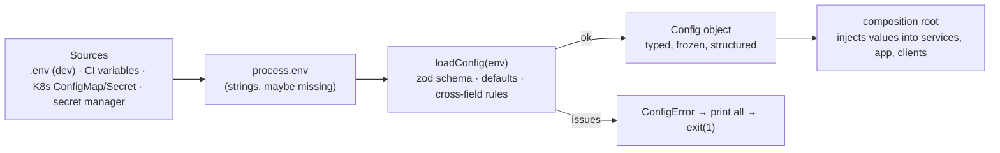

# Configuration deep dive

## What counts as config?

Config is **everything that is likely to vary between deploys** of the same code: ports, database URLs, credentials, log levels, feature limits, third-party endpoints. It is **not** things that are the same everywhere (route definitions, business rules, the list of supported currencies). Those belong in code.

A useful test from the Twelve-Factor App: could you open-source the codebase right now without leaking any credentials? If not, secrets are in the code.

## The pipeline



Everything left of `loadConfig` is deployment tooling. Everything right of it is typed application code that never sees an env var name.

## `.env` files

- `.env` holds local development values and is **gitignored**. `.env.example` is committed and documents every variable (with fake or empty values and a comment).
- Node can load it natively: `node --env-file=.env src/server.js`, or `tsx --env-file=.env src/server.ts`. `--env-file-if-exists` doesn't fail when the file is missing.
- Real environment variables should win over the file, so CI and production can override anything.
- Don't use `.env` files in production. The platform (Kubernetes, ECS, your PaaS) injects variables.

## Naming

- `SCREAMING_SNAKE_CASE`, prefixed by concern: `DB_URL`, `DB_POOL_MAX`, `REDIS_URL`, `AUTH_SESSION_TTL_SECONDS`.
- Put units in names: `_MS`, `_SECONDS`, `_BYTES`. `TIMEOUT=30` invites bugs.
- Map to a structured object (`config.db.poolMax`), so env names stay a deployment detail.

## Defaults: safe, not surprising

- Default things that are safe and obvious (port 3000 locally, page size 20).
- **Don't default secrets or production endpoints.** A default `DATABASE_URL` pointing at localhost is fine for dev, but in production a missing value should crash, not quietly connect somewhere else. Use `superRefine` to make variables required when `NODE_ENV=production`.
- Derive per-environment defaults in one table instead of `if (env === "production")` scattered around the code.

## Typing and freezing

```ts
export type Config = Readonly<{ env: NodeEnv; port: number; pagination: Readonly<{ defaultLimit: number; maxLimit: number }> }>;
return Object.freeze(config);   // optional: catch accidental mutation at runtime too
```

## Testing config

- Make `loadConfig(env)` take the env as a parameter so tests pass plain objects.
- Test: defaults, coercion, every cross-field rule, and that multiple errors are reported together.
- Don't mutate `process.env` in tests. If something forces you to, restore it in `afterEach`.

## Runtime-changeable settings

Env vars are read at startup and don't change while the process runs. That's a feature: behavior is predictable and a restart applies changes. When you genuinely need runtime changes (feature flags, kill switches, rollout percentages), use a **feature flag service** or a config store the app polls (LaunchDarkly, Unleash, a DB table with caching). Keep that separate from boot-time config, and give flags safe defaults for when the flag service is down.

## Secrets checklist

- [ ] Not in git (check history too: `git log -p | grep -i secret` is a sobering exercise)
- [ ] Not in logs, error messages or `/debug` endpoints
- [ ] Validated for basic sanity (length, format)
- [ ] Injected by the platform: K8s Secret, cloud secret manager, CI secret store
- [ ] Rotatable without a code change (restart or periodic reload)
- [ ] Least privilege: the API's DB user can't drop tables (module 25)
