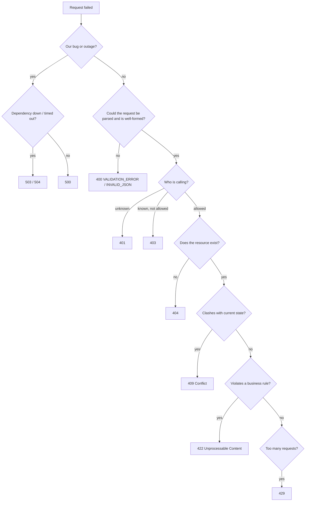

# Error taxonomy

A consistent way to classify failures saves you from three recurring problems: inconsistent status codes, leaked internals, and alert channels full of noise. This page is a reference for designing the error side of an API.

## 1. Classify by who can fix it

| Class | Who can fix it | Retry? | HTTP family | Log level |
|---|---|---|---|---|
| **Client input** | the caller, by changing the request | no (not unchanged) | 4xx | debug |
| **State conflict** | the caller, after re-reading state | maybe, after refresh | 409 / 412 | debug / info |
| **Business rule** | the caller or the user (buy fewer, wait) | no | 422 | info |
| **Auth** | the caller (log in, get permission) | after fixing credentials | 401 / 403 | info (watch for spikes) |
| **Rate limited** | nobody, just wait | yes, after `Retry-After` | 429 | info |
| **Dependency failure** | us / the dependency | yes, with backoff | 502 / 503 / 504 | warn / error |
| **Bug** | us | no | 500 | **error** + stack |

The first five are **expected**: they're modeled as `AppError` subclasses with stable codes. The last two are **unexpected** from the code's point of view and fall through to the generic 500 (or a dedicated `DependencyUnavailableError` → 503 once you add retries and circuit breakers, module 29).

## 2. Status code decision tree



## 3. Error codes

- **SCREAMING_SNAKE_CASE**, specific and stable: `INSUFFICIENT_STOCK`, not `ERROR_42` or `BAD_REQUEST`.
- **A code is a contract.** Clients branch on it. Renaming one is a breaking change; adding one is not.
- **One code per distinct client reaction.** If the UI does the same thing for two failures, they can share a code. If the UI needs to show different things, they need different codes.
- Keep a list (in code, as a union type, and in API docs).

## 4. Messages

- Written for a developer reading logs or an API response, not for end users. UIs localize from the **code**.
- Specific: "Only 2 in stock, cannot reserve 5" beats "Invalid request".
- **Never** include stack traces, SQL, hostnames, file paths or other users' data.
- For 500s: always the same generic message. The request id (module 05) links the client's report to the full log entry.

## 5. Response shape

This repo uses:

```json
{ "error": { "code": "VALIDATION_ERROR", "message": "Request validation failed",
             "details": [{ "path": "body.priceCents", "message": "Too small: expected number to be >=0" }] } }
```

RFC 9457 (Problem Details) standardizes a similar shape with `type`, `title`, `status`, `detail`, `instance` and extension members, served as `application/problem+json`. Module 23 switches to it. Either is fine. Mixing shapes across endpoints is not.

## 6. Class hierarchy patterns

```ts
abstract class AppError extends Error { abstract readonly code: string }
abstract class NotFoundError extends AppError {}       // categories: HTTP-free names
abstract class ConflictError extends AppError {}
abstract class BusinessRuleError extends AppError {}
class ProductNotFoundError extends NotFoundError { readonly code = "PRODUCT_NOT_FOUND" … }
```

- Map **categories** to statuses in one table in the error handler.
- Leaf errors carry **structured fields** (`productId`, `requested`, `available`), useful for logs and tests.
- Set `this.name = new.target.name` so logs show the real class.
- Use `{ cause }` when translating a low-level error: give the constructor an optional `options?: ErrorOptions` argument, pass it to `super(message, options)`, and `throw new DuplicateSkuError(sku, { cause: pgError })` keeps the original for debugging.

## 7. Translating infrastructure errors

Repositories are the right place to turn storage errors into domain errors:

```ts
try {
  await pool.query("INSERT INTO products …", […]);
} catch (err) {
  if (isPgError(err) && err.code === "23505" && err.constraint === "products_sku_key") {
    throw new DuplicateSkuError(product.sku, { cause: err });
  }
  throw err;   // anything else is unexpected: let it become a 500
}
```

The service then doesn't know Postgres exists, and the unique constraint (not a check-then-insert) is what actually prevents duplicates under concurrency (module 15).

## 8. Logging rules

- Log **unexpected** errors once, at `error`, in the central handler, with the stack, request id, method and route.
- Log **expected** errors at `debug`/`info` at most. Track their *rates* with metrics instead (module 24).
- Don't log-and-rethrow. Handle an error once.
- Redact secrets and personal data in log metadata.
