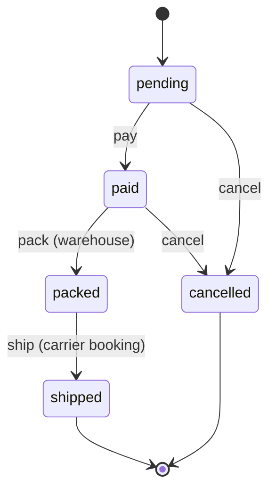
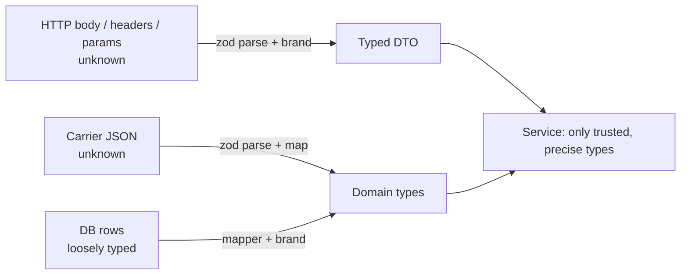

# 08 · TypeScript for Backends

> In module 02 you learned the language. This module is about using the type system as a **bug-prevention tool** on a real backend: you write types that make invalid states impossible to construct, so a whole class of production incidents gets caught when you hit save, long before a customer finds it.

**Time:** ~6h · **Challenge:** 🐛 Debug · **Prereqs:** [02 · TypeScript Fundamentals](../02-typescript-fundamentals/README.md), [07 · Validation, Errors & Config](../07-validation-errors-config/README.md) · **Services:** none

## What you'll learn

- How to read and write **utility, mapped and conditional types** (including `infer`) without getting lost
- **Discriminated unions** as state machines, and `never` for exhaustive checks
- **Branded (nominal) types** so a `UserId` can never be passed where an `OrderId` is expected
- `Result<T, E>` vs exceptions, and when each one fits
- Typing Express properly: `Request` generics and **declaration merging** for `req.user` and `res.locals`
- Deriving static types from **zod schemas** so validation and types can't drift apart
- Typing repositories with a **generic repository interface**
- `satisfies`, `.d.ts` files for untyped JavaScript, type-safe config
- Why every `as` cast and every `any` is a small hole in your safety net, and how to avoid them

---

## 1. Types are a test suite that runs on every keystroke

A unit test checks one example: "cancelling order 42 for Alice works." A type checks **every** call site, forever: "every call to `cancelOrder` passes a user id first and an order id second." Tests and types complement each other, but types have three properties that tests don't:

1. **They're exhaustive.** If a function accepts `OrderStatus`, the compiler considers every status, including the one a teammate adds next quarter.
2. **They're instant.** Your editor underlines the bug while you type. No test run, no CI round trip.
3. **They document intent.** `placeOrder(userId: UserId, input: PlaceOrderInput): Promise<PendingOrder>` tells the next reader more than a paragraph of JSDoc would.

But TypeScript only protects what you **let** it see. Here's the catch that this whole module revolves around:

```ts
function cancel(req: Request, res: Response) {
  const user = (req as any).user;                     // the compiler stops looking here
  return orders.cancelOrder(req.params.id, user.id);  // arguments swapped: compiles fine
}
```

`any` doesn't mean "some type". It means "turn off type checking for everything this value touches". It spreads: `user` is `any`, so `user.id` is `any`, so passing it anywhere is accepted. A codebase migrated from JavaScript usually *compiles* under `strict` and is still full of bugs, because the `any`s and `as` casts quietly disable the checks you think you have.

The rest of this lesson shows you how to make the compiler actually see your domain.

## 2. Type-level tools you'll read every day

You'll write these less often than you read them, but you need to recognize them in library types, error messages and your teammates' code.

### Utility types

| Utility | What it does | Backend example |
|---|---|---|
| `Partial<T>` | every property optional | a PATCH body: `Partial<NewProduct>` |
| `Required<T>` | every property required | config after defaults are applied |
| `Readonly<T>` | every property `readonly` | entities you don't want mutated by accident |
| `Pick<T, K>` / `Omit<T, K>` | keep / drop keys | `Omit<User, "passwordHash">` for a public DTO |
| `Record<K, V>` | object with keys `K` and values `V` | `Record<ErrorCode, number>` status map |
| `ReturnType<F>` / `Parameters<F>` | pull types out of functions | `ReturnType<typeof loadConfig>` |
| `Awaited<T>` | unwrap a promise | `Awaited<ReturnType<typeof repo.findById>>` |
| `NonNullable<T>` | drop `null`/`undefined` | after you've checked a lookup result |
| `Extract<U, X>` / `Exclude<U, X>` | filter a union | `Extract<Order, { status: "shipped" }>` |

### Mapped types

A mapped type builds a new object type by looping over keys. Most utilities above are just mapped types:

```ts
type MyPartial<T> = { [K in keyof T]?: T[K] };
type MyReadonly<T> = { readonly [K in keyof T]: T[K] };

// Remapping keys with `as`: getters for every field
type Getters<T> = { [K in keyof T as `get${Capitalize<string & K>}`]: () => T[K] };
type UserGetters = Getters<{ name: string; age: number }>;
// { getName: () => string; getAge: () => number }
```

> The `as` inside a mapped type is **key remapping**, a completely different feature from an `as` cast. Same keyword, unrelated meaning.

### Conditional types and `infer`

A conditional type is a ternary at the type level: `T extends U ? X : Y`. With `infer` you can capture part of a type while matching it:

```ts
type ElementOf<T> = T extends readonly (infer E)[] ? E : never;
type A = ElementOf<string[]>;            // string

type Unwrap<T> = T extends Promise<infer V> ? V : T;
type B = Unwrap<Promise<number>>;         // number

// Extract the success type of a Result (section 5)
type OkValue<R> = R extends { ok: true; value: infer V } ? V : never;
```

Conditional types **distribute** over unions: `ElementOf<string[] | number[]>` is `string | number`. That's usually what you want, and it's how `Extract` and `Exclude` work under the hood.

### Template literal types (briefly)

String literal types can be composed:

```ts
type Entity = "order" | "user";
type EventName = `${Entity}.${"created" | "deleted"}`;
// "order.created" | "order.deleted" | "user.created" | "user.deleted"
```

Useful for event names, cache key prefixes and route strings. Express 5's types use this trick to work out `req.params` from a path like `"/orders/:id"`. Don't build elaborate type-level parsers in application code, though: they slow the compiler and confuse readers.

## 3. Discriminated unions: make invalid states unrepresentable

Here's the order type the JavaScript version of this module's app had:

```ts
interface Order {
  id: string;
  status: string;            // "pending" | "paid" | "packed" | "shipped" | "cancelled"... in theory
  paidAt?: string;
  shippedAt?: string;
  trackingNumber?: string;
  // ...
}
```

This type allows nonsense: a `"shipped"` order with no tracking number, a `"pending"` order with a `paidAt`, a status of `"shiped"`. Every function that reads an `Order` has to defensively check fields that "should" be there.

Model each state as its own type instead, all sharing a literal `status` field (the **discriminant**):

```ts
type PendingOrder  = OrderBase & { status: "pending" };
type PaidOrder     = OrderBase & { status: "paid"; paidAt: string };
type PackedOrder   = OrderBase & { status: "packed"; paidAt: string; packedAt: string };
type ShippedOrder  = OrderBase & { status: "shipped"; paidAt: string; packedAt: string;
                                   shippedAt: string; carrier: string; trackingNumber: string };
type CancelledOrder = OrderBase & { status: "cancelled"; cancelledAt: string };

type Order = PendingOrder | PaidOrder | PackedOrder | ShippedOrder | CancelledOrder;
type OrderStatus = Order["status"];   // derived, so it can never drift
```

Now the compiler **narrows** on the discriminant:

```ts
function label(order: Order): string {
  if (order.status === "shipped") {
    return `Shipped via ${order.carrier}: ${order.trackingNumber}`; // both are `string` here
  }
  return order.trackingNumber; // ❌ Property 'trackingNumber' does not exist on type 'PendingOrder'...
}
```

### State machines with typed transitions

The real payoff: transitions that only accept the state they're valid for.



```ts
const pay = (order: PendingOrder, at: string): PaidOrder =>
  ({ ...order, status: "paid", paidAt: at });

const ship = (order: PackedOrder, s: { carrier: string; trackingNumber: string }, at: string): ShippedOrder =>
  ({ ...order, status: "shipped", shippedAt: at, ...s });

// In the service:
const order = await repo.findById(id);          // Order | undefined
if (!order) throw notFound();
if (order.status !== "packed") throw invalidTransition(order, "ship");
return ship(order, shipment, now);              // ✅ narrowed to PackedOrder
```

Try calling `ship()` without the status check and the compiler stops you: `Order` isn't assignable to `PackedOrder`. The diagram above is now enforced by the type checker, not by a comment.

### Exhaustiveness with `never`

When you `switch` over a union, add a `default` that only compiles if every case was handled:

```ts
export function assertNever(value: never, context = "Unhandled value"): never {
  throw new Error(`${context}: ${JSON.stringify(value)}`);
}

function isCancellable(order: Order): boolean {
  switch (order.status) {
    case "pending":
    case "paid":
      return true;
    case "shipped":
    case "cancelled":
      return false;
    default:
      return assertNever(order); // ❌ Argument of type 'PackedOrder' is not assignable to 'never'
  }
}
```

After all handled cases, TypeScript narrows `order` to whatever's left. If nothing is left, it's `never` and the call compiles. Forget `"packed"` and the leftover is `PackedOrder`, so the compiler points straight at the switch you need to update.

Compare that with the classic JavaScript habit:

```ts
default:
  return true; // "be lenient with statuses we don't know about"
```

A permissive `default` on a union is a bug waiting for the next new status. That exact pattern is one of the bugs in this module's challenge.

> 💡 The same trick works for maps. `const STATUS = { ... } satisfies Record<ErrorCode, number>` fails to compile if an error code is missing (section 8).

## 4. Branded types: nominal ids in a structural language

TypeScript is **structurally typed**: two types with the same shape are interchangeable. Usually great. For ids, terrible:

```ts
type UserId = string;
type OrderId = string;

function cancelOrder(userId: UserId, orderId: OrderId) { /* ... */ }
cancelOrder(orderId, userId); // compiles: both are just `string`
```

Type aliases are only nicknames. To get **nominal** behavior ("only a real `OrderId` will do"), add a phantom property that exists only at the type level:

```ts
declare const brand: unique symbol;
type Brand<T, Name extends string> = T & { readonly [brand]: Name };

type UserId  = Brand<string, "UserId">;
type OrderId = Brand<string, "OrderId">;

const orderId: OrderId = "ord_1";             // ❌ string is not assignable to OrderId
cancelOrder(orderId, userId);                 // ❌ OrderId is not assignable to UserId
```

`declare const brand: unique symbol` creates a symbol type that nothing else can reproduce, and no value is ever emitted. At runtime a `UserId` is a plain string: no wrapper objects, no performance cost, and JSON serialization is unchanged.

How do you *get* a branded value? Through one constructor per brand, called at the **boundary** where untrusted data becomes trusted:

```ts
export const OrderId = (raw: string): OrderId => {
  if (raw.trim() === "") throw new TypeError("OrderId must be a non-empty string");
  return raw as OrderId; // the ONE place a cast is allowed
};

// controller: route params are just strings, so brand them on the way in
await orders.cancelOrder(req.user.id, OrderId(req.params.id));
```

Boundaries are: route params, headers, request bodies (via your validation schema), database rows (in the repository mapper) and test fixtures. Inside the core of your app, ids flow around already branded and you never think about them again.

Brands work for any primitive with meaning:

| Brand | Prevents |
|---|---|
| `UserId`, `OrderId`, `TenantId` | passing the wrong id, the classic cross-tenant data leak |
| `Cents` (`Brand<number, "Cents">`) | mixing euros and cents, floats, strings |
| `Email` | sending mail to an unvalidated string |
| `Sql` / `SafeHtml` | concatenating untrusted strings into queries or markup |

### Money is not a `number`

Money deserves its own warning. Common ways it goes wrong in Node backends:

- **Floats:** `0.1 + 0.2 === 0.30000000000000004`. Store integer minor units (cents) and only format at the edge.
- **Strings:** many payment and shipping APIs send amounts as strings (`"4.99"` or `"499"`) to avoid float problems, and Postgres `numeric`/`bigint` come back from `pg` as strings (you'll meet this in [module 13](../13-node-postgres/README.md)). Then `subtotal + shipping` is `2598 + "499"`, which is `"2598499"`: as soon as one side of `+` is a string, JavaScript concatenates.

A `Cents` brand plus a constructor that rejects non-integers turns both into compile errors (and runtime errors at the boundary if the data lies).

## 5. `Result<T, E>` vs exceptions

Exceptions are invisible in signatures: `findUser(id): Promise<User>` doesn't tell you it throws `UserNotFound`. A `Result` type puts the failure in the type:

```ts
type Result<T, E> = { ok: true; value: T } | { ok: false; error: E };
const ok  = <T>(value: T): Result<T, never> => ({ ok: true, value });
const err = <E>(error: E): Result<never, E> => ({ ok: false, error });

async function priceLines(lines: Line[]): Promise<Result<PricedLine[], { sku: Sku }>> {
  for (const line of lines) {
    const product = await catalog.findBySku(line.sku);
    if (!product) return err({ sku: line.sku });
    // ...
  }
  return ok(priced);
}

const priced = await priceLines(input.lines);
if (!priced.ok) throw new DomainError("UNKNOWN_SKU", `Unknown SKU: ${priced.error.sku}`);
priced.value; // narrowed to PricedLine[]
```

It's just a discriminated union, so narrowing works exactly as in section 3.

| | Exceptions | `Result<T, E>` |
|---|---|---|
| Visible in the type | ❌ | ✅ caller *must* handle |
| Propagation | automatic up the stack | manual at every level |
| Fits Express | ✅ throw → error handler | needs converting to a throw/response at the edge |
| Good for | unexpected failures, and expected failures that should abort the whole request | expected outcomes the caller decides about (lookup misses, parse failures, "try the next carrier") |
| Ecosystem | everything in Node throws | you wrap libraries yourself |

A pragmatic rule for Express apps: **throw domain errors for things that end the request** (the error handler maps them to HTTP, as you did in module 07), and use `Result` inside your core logic where the caller genuinely branches on the outcome. Don't convert your whole codebase to `Result` chains: in TypeScript without language support, that gets noisy fast. Libraries like `neverthrow` exist if a team goes all in.

## 6. Typing Express

### `Request` generics

`Request` takes type parameters: `Request<Params, ResBody, ReqBody, Query, Locals>`. The useful one is usually the first:

```ts
import type { Request, Response } from "express";

type WithId = Request<{ id: string }>;

async function getOrder(req: WithId, res: Response) {
  req.params.id; // string, not string | undefined
}
```

When you write handlers inline (`router.get("/:id", async (req, res) => ...)`), Express 5's types infer `{ id: string }` from the path string itself. When handlers live in a separate controller file, there's no path to infer from, so annotate them.

> ⚠️ Don't put your request body type in `ReqBody` and call it done. `Request<{}, {}, PlaceOrderBody>` is just a cast with extra steps: the body is whatever the client sent. Type it `unknown` and **parse** it (section 7).

### Declaration merging: `req.user` and `res.locals`

Auth middleware attaches the user to the request. Without help, TypeScript doesn't know that field exists, which is why codebases fill up with `(req as any).user`. Instead, **reopen the global `Express` namespace** that `@types/express` declares:

```ts
// src/types/express.d.ts
import type { AuthUser } from "../domain/user.js";

declare global {
  namespace Express {
    interface Request {
      user?: AuthUser;          // set by authenticate()
    }
    interface Locals {
      requestId: string;        // set by requestId(), which runs first
    }
  }
}

export {}; // makes this file a module, which `declare global` requires
```

Interfaces with the same name in the same scope **merge**: your fields are added to Express's. Every `req` and `res.locals` in the project now has these properties, with no casts. Make sure the file is covered by your tsconfig `include` (here, `src`).

Note `user?:` is optional, and that's honest: on public routes nobody has authenticated. In handlers behind `authenticate()`, use a tiny helper that converts "missing" into a 401:

```ts
function currentUser(req: { user?: AuthUser }): AuthUser {
  if (!req.user) throw new HttpError(401, "UNAUTHENTICATED", "Not authenticated");
  return req.user;
}
```

The alternative, a separate `AuthedRequest` type with a required `user`, needs a cast somewhere because Express can't know your middleware ran. The helper is one line and keeps the types truthful.

## 7. One source of truth: deriving types from zod

In module 07 you validated input with zod. The other half of its value is that the **schema is also the type**:

```ts
import { z } from "zod";

export const placeOrderBody = z.object({
  country: z.string().regex(/^[A-Z]{2}$/),
  lines: z.array(z.object({
    sku: z.string().transform(normalizeSku).refine(isValidSku).transform(Sku),
    quantity: z.number().int().min(1).max(99),
  })).min(1),
});

export type PlaceOrderBody = z.infer<typeof placeOrderBody>;
// { country: string; lines: { sku: Sku; quantity: number }[] }
```

Notice the `sku` type is `Sku`, the branded type: `z.infer` gives you the schema's **output** after transforms. Validation and branding happen in one step at the boundary. Compare with a hand-written `interface PlaceOrderBody` next to hand-written `if` checks: two descriptions of the same thing that drift apart the first time someone edits only one of them.

### Untrusted JSON from other services

The same applies to responses from third-party APIs. `await res.json()` is data some other company's server sent you. Type it `unknown`, then parse:

```ts
const shipmentResponse = z.object({
  tracking_number: z.string().min(1),
  carrier: z.string(),
  eta_days: z.number().int(),
});

const data = shipmentResponse.parse(await transport("/v2/shipments", body));
return { trackingNumber: data.tracking_number /* ✅ typo-proof */ };
```

Without the schema, `data.trackingNumber` (camelCase, while the API sends snake_case) is `undefined` at runtime and nobody notices until a customer asks where their parcel is. With the schema, `data.trackingNumber` is a compile error, and if the carrier changes their format you get a clear error at the boundary instead of corrupted data deep inside your system. Map the wire format (snake_case, strings) to your domain types (camelCase, `Cents`) right there in the adapter.



Everything that crosses into the middle of that diagram has been checked. The core of your app never sees `unknown`, `any` or raw strings for ids and money.

## 8. Repositories, `satisfies`, `.d.ts` and config

### A generic repository interface

```ts
export interface Repository<T extends { readonly id: Id }, Id> {
  findById(id: Id): Promise<T | undefined>;
  save(entity: T): Promise<void>;
}

export interface OrderRepository extends Repository<Order, OrderId> {
  listByUser(userId: UserId): Promise<Order[]>;
}
```

The generic parameters carry the branded id through, so `orderRepo.findById(userId)` doesn't compile. The return type says `| undefined`, so callers must handle "not found". Keep the generic base small (find and save); query methods are specific to each aggregate and belong on the specific interface. Generic "query anything" repositories end up re-inventing a worse SQL.

### `satisfies`: check without widening

An annotation (`const x: T = ...`) checks the value **and replaces its type** with `T`. `satisfies T` checks the value but **keeps the precise inferred type**:

```ts
type ErrorCode = "ORDER_NOT_FOUND" | "UNKNOWN_SKU" | "CARRIER_BAD_RESPONSE";

const STATUS_BY_CODE = {
  ORDER_NOT_FOUND: 404,
  UNKNOWN_SKU: 422,
  CARRIER_BAD_RESPONSE: 502,
} satisfies Record<ErrorCode, number>;
// ✅ missing or misspelled key: compile error
// ✅ STATUS_BY_CODE.UNKNOWN_SKU is still the literal 422
```

Great for config objects, route tables, lookup maps and objects of handlers.

### `.d.ts` for untyped JavaScript

Sometimes you depend on JavaScript with no types: an old internal package, a vendored file. First check for `@types/<pkg>` on npm. If there's none, write a declaration file next to it describing **only what you use**:

```ts
// vendor/sku-check.d.ts, next to vendor/sku-check.js
export function isValidSku(value: unknown): value is string;
export function normalizeSku(value: unknown): string;
```

For a package in `node_modules`, use `declare module "pkg-name" { ... }` in a `.d.ts` inside your `src`. The quick fix you'll see in the wild, `export function isValidSku(value: any): any`, silences the compiler and buys you nothing. Prefer `unknown` for inputs and the most precise honest type for outputs (here, a type guard).

### Type-safe config

Your config is just another untrusted input, so parse it once at startup:

```ts
const envSchema = z.object({
  PORT: z.coerce.number().int().min(1).max(65_535).default(3000),
  CARRIER_BASE_URL: z.url().default("http://localhost:4010"),
});

export function loadConfig(env: NodeJS.ProcessEnv = process.env): Config { /* safeParse, throw a readable error */ }
```

The rest of the app depends on a typed `Config`, never on `process.env.SOMETHING` (which is `string | undefined` and will be `undefined` in exactly one environment).

## 9. Escape hatches and how to avoid them

| Escape hatch | Why it hurts | Do this instead |
|---|---|---|
| `any` | disables checking for everything it touches, and spreads | `unknown` + narrowing or a schema |
| `x as T` | a promise to the compiler that nobody checks | narrowing (`typeof`, `in`, `instanceof`, discriminants), schemas, constructors |
| `x as unknown as T` | the "I really mean it" cast, almost always a bug | fix the types |
| `x!` (non-null assertion) | crash later instead of handling now | handle `undefined` explicitly |
| `// @ts-ignore` | hides the error and any future errors on that line | `@ts-expect-error` with a reason, and only in tests |
| `JSON.parse(...)` returning `any` | untyped data enters silently | annotate the result as `unknown`, then parse |

Narrowing an `unknown` without a cast looks like this:

```ts
function isJsonParseError(err: unknown): boolean {
  return typeof err === "object" && err !== null && "type" in err && err.type === "entity.parse.failed";
}
```

The `in` operator narrows `err` to `object & Record<"type", unknown>`, so `err.type` is allowed. That's a check the runtime actually performs, unlike a cast.

Legitimate casts exist: brand constructors, and occasionally a well-commented spot where you know more than the compiler (e.g. after a library returns a too-wide type). Keep them few, small and in named functions, so they're easy to audit. The challenge enforces this with a test.

Also turn on (and keep on) `noUncheckedIndexedAccess`. With it, `arr[0]` is `T | undefined` and `record[key]` is `V | undefined`, which is the truth. It catches a surprising number of crashes, like `users.filter(...)[0].id` when the filter matched nothing.

## Common mistakes

- Writing `type UserId = string` and believing it protects anything. Aliases are nicknames, not new types.
- Fixing a compiler error with `as`. The error was often the compiler telling you about a real bug.
- Typing request bodies via `Request<{}, {}, Body>` or `req.body as Body` instead of parsing them.
- A permissive `default:` in a switch over a union. Use `assertNever`.
- Keeping both a zod schema and a hand-written interface for the same shape.
- Using `number` for money and trusting that the JSON really contains a number.
- A `.d.ts` full of `any`, which is a type-shaped comment.
- Over-engineering: twelve layers of conditional types for something a union and an interface would express. Types are for readers too.
- Forgetting that types vanish at runtime. A `UserId` brand doesn't validate anything unless your constructor does; data from outside needs a runtime check.

## In production

- **Migrations from JS** are usually incremental: turn on `strict`, then hunt `any`s file by file. Teams track the count in CI and only allow it to go down. Lint rules like `@typescript-eslint/no-explicit-any`, `no-unsafe-assignment` and `no-unsafe-member-access` catch what `tsc` allows.
- **Branded ids** prevent a real class of incidents. "User A could see user B's data" bugs (IDOR, [module 22](../22-auth/README.md)) often start with ids of the wrong kind or from the wrong place being passed around. In multi-tenant SaaS, a branded `TenantId` threaded through every repository method is cheap insurance.
- **Schemas at every boundary** are standard in mature Node codebases: HTTP input, outbound API responses, queue messages ([module 20](../20-background-jobs/README.md), [module 33](../33-event-driven-architecture/README.md)), env config. When a partner silently changes their API, you get one clear parse error with the path of the bad field instead of corrupted rows.
- **Shared types between services** are often generated from a contract (OpenAPI, protobuf, JSON Schema) instead of copied. You'll write an OpenAPI spec in [module 23](../23-api-design/README.md).
- **Compile time matters at scale.** Deeply recursive conditional types can make editor feedback slow in large monorepos. Prefer simple types in hot paths, and use the compiler's `--extendedDiagnostics` when things get sluggish.

## Check yourself

1. Why doesn't `type OrderId = string` stop you from passing a user id?
   <details><summary>Answer</summary>A type alias is just another name for the same type. TypeScript is structural, so any <code>string</code> is accepted. You need a brand (an extra type-only property) to make it nominal.</details>
2. What does `assertNever(order)` in a `default` branch buy you?
   <details><summary>Answer</summary>It only compiles when every member of the union has been handled before it, because only then is <code>order</code> narrowed to <code>never</code>. Adding a new member makes every incomplete switch a compile error.</details>
3. What's the difference between `const m: Record<Code, number> = {...}` and `const m = {...} satisfies Record<Code, number>`?
   <details><summary>Answer</summary>Both check that every code is present with a number. The annotation widens <code>m</code>'s type to <code>Record&lt;Code, number&gt;</code>; <code>satisfies</code> keeps the precise inferred type (e.g. literal values).</details>
4. Why type third-party JSON as `unknown` rather than an interface describing it?
   <details><summary>Answer</summary>An interface is an unchecked promise; the data can differ at runtime. <code>unknown</code> forces you to validate (e.g. with a zod schema), and the schema then gives you a type that is actually true.</details>
5. How do you give `req.user` a type across the whole app?
   <details><summary>Answer</summary>Declaration merging: in a <code>.d.ts</code> (or module) inside your project, <code>declare global { namespace Express { interface Request { user?: AuthUser } } }</code>, with an <code>export {}</code> to make the file a module.</details>

## Further reading

- TypeScript Handbook, Narrowing: https://www.typescriptlang.org/docs/handbook/2/narrowing.html
- TypeScript Handbook, Conditional Types: https://www.typescriptlang.org/docs/handbook/2/conditional-types.html
- TypeScript Handbook, Mapped Types: https://www.typescriptlang.org/docs/handbook/2/mapped-types.html
- TypeScript Handbook, Declaration Merging: https://www.typescriptlang.org/docs/handbook/declaration-merging.html
- TypeScript Handbook, Utility Types: https://www.typescriptlang.org/docs/handbook/utility-types.html
- zod documentation: https://zod.dev
- Deep dives in this module: [docs/branded-types-and-results.md](docs/branded-types-and-results.md) · [docs/typing-express-and-boundaries.md](docs/typing-express-and-boundaries.md) · [docs/typescript-backend-cheatsheet.md](docs/typescript-backend-cheatsheet.md) · and the general [TypeScript cheat sheet](../docs/cheatsheets/typescript.md)

## ➡️ Next: [the challenge](CHALLENGE.md)
