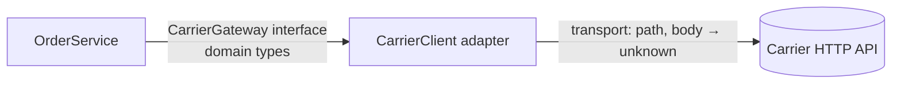

# Typing Express and the boundaries of your app

Most type-safety holes in Node backends sit at the edges: request objects, bodies, third-party responses, environment variables and untyped libraries. This page is a field guide to each.

## The `Request` type, parameter by parameter

```ts
interface Request<
  P = ParamsDictionary,      // req.params
  ResBody = any,             // what res.json() accepts (on the paired Response)
  ReqBody = any,             // req.body
  ReqQuery = ParsedQs,       // req.query
  LocalsObj extends Record<string, any> = Record<string, any> // res.locals
> { ... }
```

Notice the defaults: `ReqBody` and `ResBody` are `any`. That's why `req.body.whatever.you.like` compiles. Two takeaways:

1. Treat `req.body` as `unknown` in your head and immediately pass it to a schema.
2. `P` is worth setting for controllers that live outside the route definition: `Request<{ id: string }>`.

### Typing the response body

You can constrain what a handler sends:

```ts
type OrderResponse = { data: Order };
async function get(req: Request<{ id: string }>, res: Response<OrderResponse>) {
  res.json({ data: order });      // ✅
  res.json({ order });            // ❌ caught
}
```

It's optional, but it's a cheap way to keep responses consistent with your API contract.

## Declaration merging, step by step

TypeScript merges multiple declarations of the same interface in the same scope. `@types/express` declares interfaces in a global `Express` namespace precisely so you can extend them:

```ts
// src/types/express.d.ts
import type { AuthUser } from "../domain/user.js";

declare global {
  namespace Express {
    interface Request { user?: AuthUser }
    interface Locals { requestId: string }
  }
}
export {};
```

Checklist when it "doesn't work":

- **Is the file included?** It must be inside a path in tsconfig `include` (or referenced). Run `npx tsc --listFiles | grep express.d.ts`.
- **Is it a module?** `declare global` is only allowed in a module. A top-level `import` or `export {}` makes it one.
- **Did you merge the right interface?** `Express.Request` (global namespace), not the `Request` you import from `"express"` (that one is generic and extends the global one).
- **Runtime:** a `.d.ts` emits nothing. Something still has to set `req.user` at runtime (your middleware).

Should `user` be optional? If it's required in the global type, every route (including public ones like `/health`) claims to have a user, which is a lie the compiler will happily believe. Keep it optional and use a `currentUser(req)` helper in authenticated handlers.

## Typing middleware

```ts
import type { RequestHandler, ErrorRequestHandler } from "express";

export function requireRole(role: Role): RequestHandler {
  return (req, _res, next) => {
    if (req.user?.role !== role) throw new HttpError(403, "FORBIDDEN", `Requires role: ${role}`);
    next();
  };
}

export const errorHandler: ErrorRequestHandler = (err: unknown, req, res, _next) => { ... };
```

- Typing the parameter as `Role` instead of `string` turns `requireRole("warehose")` into a compile error.
- In the error handler, annotate `err` as `unknown`. Express's own type is `any`, and an `any` error invites `err.status` and `err.message` without any checks.

## Bodies: parse, don't cast

```ts
function parse<S extends z.ZodType>(schema: S, input: unknown): z.infer<S> {
  const result = schema.safeParse(input);
  if (!result.success) {
    throw new HttpError(400, "VALIDATION_ERROR", "Request body is invalid",
      result.error.issues.map((i) => ({ path: i.path.join("."), message: i.message })));
  }
  return result.data;
}

const input = parse(placeOrderBody, req.body); // typed as the schema's output
```

"Parse, don't validate" is a phrase worth remembering: a validator returns `true`/`false` and leaves you with the same untyped value; a parser returns a **new, precisely typed** value or fails. After parsing, the type carries the proof that the check happened.

## Outbound calls: the adapter pattern

A service shouldn't know the carrier's wire format. Split it:



- `CarrierGateway` (owned by the service layer) speaks domain: `quote({ country, weightGrams }): Promise<{ amountCents: Cents }>`.
- `CarrierClient` (in `integrations/`) implements it: builds the snake_case request, parses the response with a schema, maps fields and converts strings to `Cents`.
- The transport (`fetch` in production, a fake in tests) returns `Promise<unknown>`.

Map a parse failure to a specific error (`CARRIER_BAD_RESPONSE` → 502 Bad Gateway). A 502 tells on-call engineers "the upstream misbehaved", which is a very different page at 3am from a 500 "we have a bug".

## Untyped libraries

In order of preference:

1. The package ships its own types (check `"types"` in its package.json).
2. `npm i -D @types/<pkg>` from DefinitelyTyped.
3. Write a minimal declaration for what you use:
   ```ts
   // src/types/legacy-pricing.d.ts
   declare module "legacy-pricing" {
     export function roundPrice(cents: number, mode: "up" | "down"): number;
   }
   ```
   For a local JS file, put `name.d.ts` next to `name.js` with plain `export` declarations.
4. `declare module "pkg";` (shorthand, everything is `any`). Only as a temporary step, with a ticket to replace it.

Write declarations from the library's **behavior**, not its hopes: if it returns `null` sometimes, the declared return type must include `null`.

## Environment and config

```ts
const envSchema = z.object({
  NODE_ENV: z.enum(["development", "test", "production"]).default("development"),
  PORT: z.coerce.number().int().min(1).max(65_535).default(3000),
  CARRIER_BASE_URL: z.url(),
});
export type Config = z.infer<typeof envSchema>;
```

Parse at startup, fail fast with all problems listed, and pass the typed `Config` into the composition root. Nothing else reads `process.env`. You built this in [module 07](../../07-validation-errors-config/README.md); the typing angle is that `Config` is derived from the schema, so adding a variable updates the type automatically.
