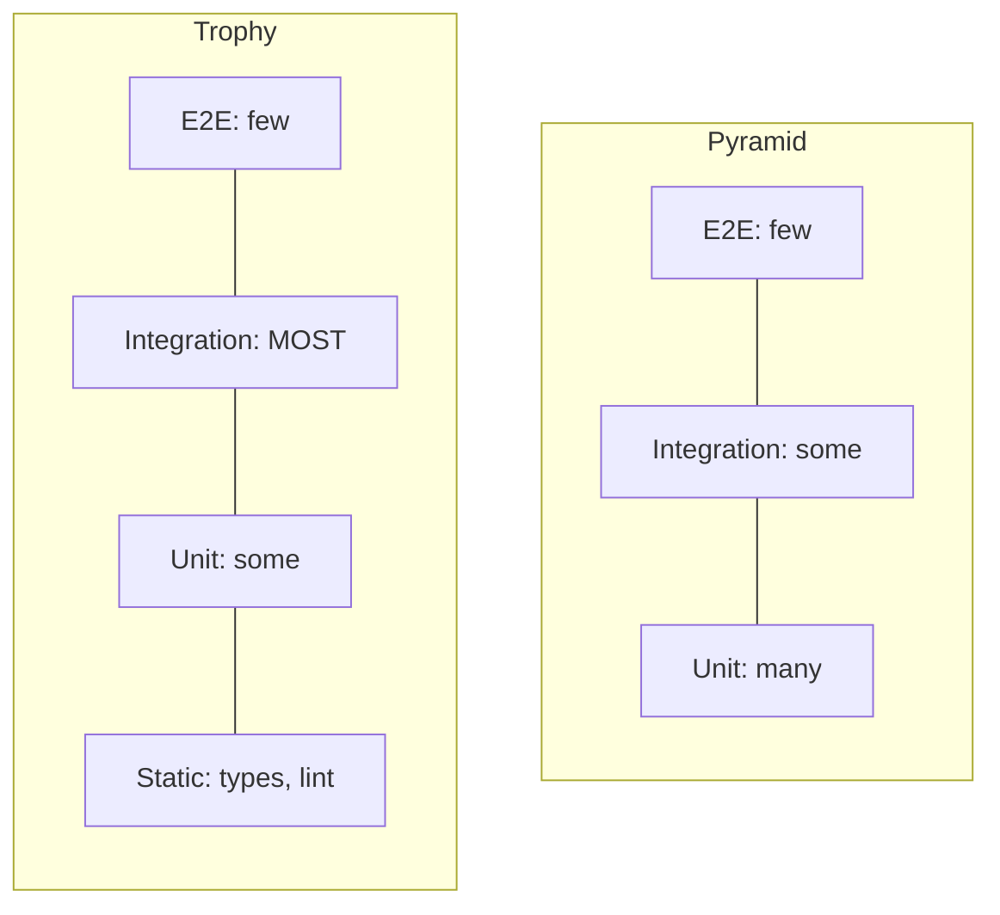
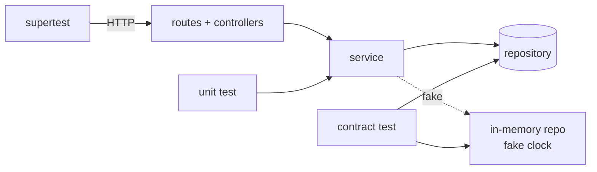
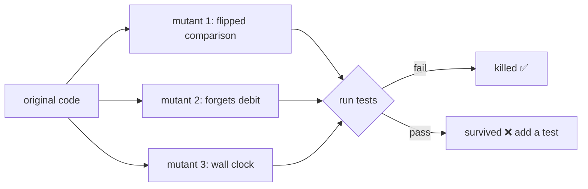

# 09 · Testing Backends

> Tests are how you change code on a Friday afternoon without fear. On a backend team they're also the contract between you and everyone who touches the code after you: a good suite tells the next engineer, in seconds, that they broke something and where.

**Time:** ~7h · **Challenge:** 🛠️ Build (you write the tests) · **Prereqs:** [06 · Layered Architecture](../06-layered-architecture/README.md), [07 · Validation, Errors & Config](../07-validation-errors-config/README.md) · **Services:** Postgres

## What you'll learn

- What tests are actually for, and how to decide **what** to test
- The test pyramid vs the testing trophy, and unit vs integration vs end-to-end tests
- Test doubles: **fakes, stubs, spies and mocks**, and when *not* to mock
- The Vitest API you'll use daily, and supertest for HTTP
- How to test each layer of a layered app
- Testing against a **real Postgres**: isolation, resetting state, transactions
- Fixtures and factories; making tests **deterministic** (clocks, ids, randomness)
- Coverage, why it lies, and **mutation testing** as a better measure
- The TDD loop, and how to write a test that exposes a bug before fixing it

---

## 1. What tests are for

It's tempting to think tests exist to "prove the code works". They can't: a test only checks the examples you thought of. What tests *do* give you:

1. **Regression protection.** Behavior you pinned down stays pinned down. When someone (often future you) breaks it, a test goes red.
2. **Freedom to refactor.** Module 06 was a big refactor. Doing that without tests means clicking around and hoping. With tests, you change the structure and the suite tells you the behavior is intact.
3. **Executable documentation.** `it("resets the daily limit at midnight UTC")` explains a business rule more reliably than a wiki page, because it fails when it goes stale.
4. **Design feedback.** Code that's painful to test is usually badly structured: hidden dependencies, globals, `new Date()` buried in logic. Tests push you toward dependency injection and small units, the same things module 06 argued for.

The goal is **confidence per minute**: the most certainty that the system works, for the least time spent writing, running and maintaining tests.

### What to test

Test **behavior through public interfaces**, not implementation details. "Withdrawing more than the balance fails with `INSUFFICIENT_FUNDS` and leaves the balance unchanged" is behavior. "`withdraw` calls `repo.findById` once and then `repo.commit`" is implementation: it breaks when you refactor even though nothing a user cares about changed.

Prioritize:

- **Business rules** and their **boundaries**: the limit itself, one below, one above. Off-by-one bugs live at boundaries.
- **Error paths**: not found, invalid input, conflicts. They're less exercised by manual testing, so they break silently.
- **Integration seams**: SQL, data conversions from the driver, HTTP status codes and JSON shapes. These are where "it worked in the unit test" goes to die.
- **Bugs you've fixed**: every bug fix gets a test that would have caught it.

Don't bother testing framework code (does Express route?), trivial getters, or the exact wording of log lines.

## 2. Kinds of tests

| | Unit | Integration | End-to-end (E2E) |
|---|---|---|---|
| Scope | one function / class / service, dependencies replaced | several real pieces together (HTTP + service + DB) | the deployed system, like a user |
| Speed | milliseconds | tens of milliseconds | seconds |
| Catches | logic and rule bugs | wiring, SQL, serialization, status codes, config | deployment, networking, cross-service issues |
| Brittleness | low (if testing behavior) | medium | high (timing, environments, data) |
| Debuggability | precise | good | "something somewhere is broken" |

### Pyramid or trophy?



The **pyramid** says: lots of fast unit tests, fewer integration tests, very few E2E. The **trophy** (popular in the JavaScript world) says: static checks catch a lot for free (module 08), and integration tests give the best confidence per minute because they test how pieces work *together*.

For a backend API, a pragmatic mix is:

- **Unit tests for the service layer**, where the business rules live. They're fast, so you can cover every edge case.
- **Integration tests through HTTP with a real database** for every endpoint: happy path, main errors, validation. These catch the bugs unit tests structurally can't.
- **A handful of E2E smoke tests** against a deployed environment, run by CI/CD after deploys.

Notice the challenge's two real bugs: one is pure logic (a unit test with a controlled clock finds it), and one only shows up with a real Postgres driver. Neither kind of test alone would catch both.

## 3. Test doubles

A **test double** stands in for a real dependency. The names are used loosely in conversation, but the distinctions are useful:

| Double | What it is | Example |
|---|---|---|
| **Dummy** | passed but never used | `new Service({ logger: undefined as never })` |
| **Stub** | returns canned answers | a carrier client that always returns `{ price: 499 }` |
| **Spy** | records calls so you can assert on them | `vi.spyOn(console, "error")` |
| **Mock** | a stub + spy with expectations built in | `vi.fn().mockResolvedValue(x)` then `toHaveBeenCalledWith(...)` |
| **Fake** | a working, simplified implementation | `InMemoryWalletRepository`, `FakeClock` |

### Prefer fakes for things you own

A fake repository behaves like the real one (stores data, finds it, filters it), so your service tests read naturally: create a wallet, deposit, withdraw, check the balance. A mock-heavy test of the same thing looks like this:

```ts
// ❌ Testing implementation: brittle and proves little
repo.findById = vi.fn().mockResolvedValue({ id: "w1", balanceCents: 100 });
repo.commit = vi.fn();
await service.withdraw("w1", 30);
expect(repo.commit).toHaveBeenCalledWith({ wallets: [{ id: "w1", balanceCents: 70 }], transactions: [expect.any(Object)] });
```

```ts
// ✅ Testing behavior with a fake
const w = await walletWith(service, 100);
await service.withdraw(w.id, 30);
expect((await service.getWallet(w.id)).balanceCents).toBe(70);
```

The second test survives a refactor of how the service talks to the repository; the first breaks on any change. Mocks still have their place: asserting that an **outgoing side effect** happened (an email was sent, an event was published) is exactly what a spy is for.

### Don't mock what you don't own

Mocking `pg` or `fetch` directly means encoding *your assumptions* about how those libraries behave into the test, and then the test passes while production fails. The classic example: you mock `pool.query` to return `{ rows: [{ balance_cents: 500 }] }` (a number), but the real driver returns `"500"` (a string, for `bigint` columns). Instead:

- Put your own interface in front of the dependency (a repository, a gateway), and fake **that** in unit tests.
- Test the real implementation of the interface against the real thing (a real Postgres) in integration tests.

### Keep fakes honest: contract tests

A fake that behaves differently from the real implementation makes unit tests lie. The fix is a **contract test**: one test suite, run against every implementation of the interface.

```ts
function contract(name: string, makeRepo: () => Promise<WalletRepository>) {
  describe(`WalletRepository contract: ${name}`, () => {
    it("lists newest first", async () => { /* ... */ });
    it("sums only withdrawals since a date", async () => { /* ... */ });
  });
}
contract("in-memory", async () => new InMemoryWalletRepository());
contract("postgres", async () => new PgWalletRepository(pool));
```

If both pass, the fake is trustworthy. You'll reuse this pattern in [module 13](../13-node-postgres/README.md).

## 4. Vitest essentials

```ts
import { describe, it, expect, beforeEach, afterAll, vi } from "vitest";

describe("WalletService", () => {
  let service: WalletService;
  beforeEach(() => { service = buildService().service; }); // fresh state per test

  it("adds deposits to the balance", async () => {
    const w = await service.createWallet("Ada");
    await service.deposit(w.id, 500);
    expect((await service.getWallet(w.id)).balanceCents).toBe(500);
  });

  it.each([0, -1, 1.5])("rejects amount %s", async (amount) => {
    await expect(service.deposit("w", amount)).rejects.toMatchObject({ code: "INVALID_AMOUNT" });
  });
});
```

Matchers you'll use constantly: `toBe` (identity / primitives), `toEqual` (deep equality), `toMatchObject` (subset), `toHaveLength`, `toThrow`, `.resolves` / `.rejects`, `expect.any(String)`. Spies: `vi.fn()`, `vi.spyOn(obj, "method").mockImplementation(...)`, `vi.restoreAllMocks()`. Timers: `vi.useFakeTimers()`, `vi.advanceTimersByTime(ms)`.

Tips:

- **Await your assertions on promises.** `expect(p).rejects.toThrow()` without `await` passes vacuously.
- **Add a message** to assertions whose failure would be confusing: `expect(res.status, JSON.stringify(res.body)).toBe(201)` shows the error body when it fails. Your future self debugging CI will thank you.
- **One behavior per test**, named as a sentence. When it fails, the name should tell you what's broken.
- **Arrange, Act, Assert.** Set up, do one thing, check the result. If a test needs a paragraph of setup, extract a factory.

## 5. Testing each layer



| Layer | How to test | What to assert |
|---|---|---|
| **Domain / pure functions** | call directly | inputs → outputs, boundaries |
| **Service** | unit test with fakes (in-memory repo, fake clock, sequential ids) | business rules, error codes, state after the call |
| **Repository** | integration test against real Postgres (ideally a contract test shared with the fake) | SQL correctness, type mapping, ordering, transactions |
| **HTTP (routes, controllers, middleware)** | supertest against `createApp(deps)` with a real or fake service | status codes, headers, JSON shape, validation, error mapping |

This is where module 06's architecture pays off. Because `createApp` takes its dependencies and the service takes its repository and clock, every layer can be tested in isolation *or* together, without hacks.

### supertest

```ts
import request from "supertest";
const res = await request(app).post("/wallets").send({ owner: "Ada" });
expect(res.status).toBe(201);
expect(res.headers.location).toBe(`/wallets/${res.body.data.id}`);
```

supertest hands requests straight to your Express app in-process: no port, no network flakiness, and the full middleware chain runs exactly as in production.

## 6. Testing with a real Postgres

Integration tests need a database that's (a) real, (b) isolated from your dev data and other modules, and (c) in a known state at the start of every test.

**Isolation between projects:** this repo gives every module its own database (`wl_09` here). A Vitest `globalSetup` file creates it if it's missing.

**Clean state per test:** three common strategies.

| Strategy | How | Pros | Cons |
|---|---|---|---|
| **Truncate** | `TRUNCATE transactions, wallets RESTART IDENTITY CASCADE` in `beforeEach` | simple, works with any code (including code that opens its own transactions) | a few ms per test |
| **Transaction rollback** | `BEGIN` before each test, `ROLLBACK` after, all queries on that one client | very fast, nothing to clean | the code under test must use the injected client; breaks if the code itself commits or uses a pool |
| **Fresh schema/database** | drop and recreate, then migrate | strongest isolation | slow if done per test; fine per file |

This module's solution rebuilds the schema once per test file (so a changed migration is always applied) and truncates before each test. Because test files share one database, they run sequentially (`fileParallelism: false` in `vitest.config.ts`). Larger codebases parallelize by giving each worker its own database or schema.

**Testcontainers** is a popular library that starts a throwaway Docker container (Postgres, Redis, Kafka...) from inside your test run and tears it down afterwards. It gives perfect isolation and works the same on every machine. This repo uses `docker compose` instead (`make up`), which is simpler to reason about and faster across many runs, but you'll meet Testcontainers at work.

**Don't skip the real database "because it's slow".** A Postgres integration test is typically 2–20 ms. The bugs it catches (driver type conversions, SQL typos, constraint violations, ordering, transaction boundaries) are exactly the ones that page people at night.

## 7. Fixtures, factories and determinism

### Factories over fixtures

A **fixture** is a fixed blob of test data loaded up front. A **factory** is a function that builds the data a test needs, with sensible defaults:

```ts
export async function walletWith(service: WalletService, balanceCents: number, owner = "Ada") {
  const wallet = await service.createWallet(owner);
  return balanceCents > 0 ? service.deposit(wallet.id, balanceCents) : wallet;
}
```

Factories keep each test self-contained ("a wallet with 1,000 cents" is visible right in the test) and avoid the shared mega-fixture where changing one row breaks twenty unrelated tests.

### Deterministic tests

A flaky test (sometimes passes, sometimes fails) is worse than no test: people learn to ignore red builds. Sources of nondeterminism and their fixes:

| Source | Fix |
|---|---|
| **Current time** (`new Date()`, `Date.now()`) | inject a `Clock`; tests use a `FakeClock` they can `set()` and `advance()` |
| **Random ids** (`randomUUID()`) | inject an id generator; tests use `sequentialIds()` → `id-1`, `id-2` |
| **Timers** (`setTimeout`, retries, TTLs) | `vi.useFakeTimers()` and advance time explicitly |
| **Shared state** between tests | fresh app/repo per test, truncate tables |
| **Ordering** (DB rows without `ORDER BY`, parallel async) | always order explicitly; don't depend on test execution order |
| **Real network** | fakes behind your own interfaces |

Time deserves special attention because so many business rules depend on it: daily limits, expiry, "within 30 days", streaks. A `FakeClock` lets you test **the exact boundaries**: 23:59:59.999 yesterday vs 00:00:00.000 today. Pick test dates deliberately: late in a month, across a month boundary, a leap day. Some date bugs only appear on specific dates, and a test that runs "now" will pass on most days and fail on others.

```ts
it("resets at midnight UTC", async () => {
  clock.set("2026-03-19T23:59:59.999Z");
  await service.withdraw(w.id, LIMIT);
  clock.set("2026-03-20T00:00:00.000Z");
  await expect(service.withdraw(w.id, LIMIT)).resolves.toBeDefined();
});
```

## 8. Coverage and mutation testing

**Code coverage** reports which lines ran during your tests. It's useful for one thing: finding code that **no** test touches. It's terrible as a quality target, because executing a line isn't the same as checking its result:

```ts
it("withdraws", async () => {
  await service.withdraw(w.id, 30); // 100% of withdraw() is "covered"...
});                                  // ...and nothing was asserted.
```

**Mutation testing** asks the question coverage can't: *if the code were wrong, would a test notice?* A tool makes small changes ("mutants") to your code, such as flipping `<` to `<=`, deleting a line or replacing a value, and runs your suite against each one:

- Tests fail → the mutant is **killed**. Your tests check that behavior. 🎯
- Tests pass → the mutant **survived**. There's a behavior nobody checks.



Real tools (Stryker for JavaScript/TypeScript) generate hundreds of mutants automatically. It's slow, so teams run it nightly or on critical modules. This module's challenge uses a hand-picked set of 8 mutants so it runs in seconds, and it's how your tests are graded.

## 9. The TDD loop, and testing a bug

**Test-driven development** is a short loop:

1. **Red:** write a test for the next small behavior. Run it; watch it fail (for the right reason).
2. **Green:** write the simplest code that makes it pass.
3. **Refactor:** clean up with the test as your safety net.

You don't have to do TDD all the time, but always do it **for bugs**: before fixing a bug, write a test that reproduces it and watch it fail. That proves you understood the bug, proves your fix works, and guarantees the bug can't silently come back. In the challenge, the code contains two real bugs. Your tests should find them; then you fix them.

> A test you've never seen fail might not be testing anything. If you write a test after the code, break the code on purpose for a moment and make sure the test goes red.

## Common mistakes

- Asserting nothing (or only that "no error was thrown").
- Mocking everything, including your own simple collaborators, until tests only verify that the code calls what it calls.
- Mocking the database driver instead of testing against a real database.
- Using `new Date()` and random ids in code under test, then writing tests that "usually" pass.
- Tests that depend on each other's leftovers or on execution order.
- Forgetting `await` on `expect(...).rejects`, so the assertion never runs.
- Only testing the happy path; the error paths are where production incidents live.
- Chasing 100% coverage instead of meaningful assertions.
- Giant shared fixtures that make every test depend on everything.
- Leaving the "placeholder" test around and calling it a suite.

## In production

- **CI runs the suite on every PR** (this repo does too). A red build blocks the merge. Teams aim for a full suite under ~10 minutes; beyond that, people stop running it locally.
- **Flaky tests get quarantined and fixed fast.** Google and others have written about flakiness as one of the biggest costs in large test suites. The usual culprits are time, ordering and shared state.
- **Service containers in CI**: GitHub Actions can start Postgres/Redis next to the job, so integration tests run against real services in CI too. You'll set this up in [module 26](../26-docker-ci-deploy/README.md).
- **Contract testing between services** (e.g. Pact) extends the contract-test idea across team boundaries: the consumer's expectations are verified against the provider's real API in CI.
- **Testing in production** complements all of this: canary deploys, feature flags and good observability ([module 24](../24-observability/README.md)) catch what no pre-production test can.

## Check yourself

1. What's the difference between a fake and a mock? When would you use each?
   <details><summary>Answer</summary>A fake is a working simplified implementation (an in-memory repository); a mock is a programmable stand-in with call expectations. Use fakes for collaborators you own so tests check behavior; use mocks/spies to assert outgoing side effects like "an email was sent".</details>
2. Why shouldn't you mock `pg` in your repository tests?
   <details><summary>Answer</summary>The mock encodes your assumptions about the driver, not its real behavior (e.g. bigint columns come back as strings). Test the repository against a real Postgres; fake the repository interface in service tests.</details>
3. How do you test a rule like "max €1,000 of withdrawals per UTC day" deterministically?
   <details><summary>Answer</summary>Inject a clock into the service and use a fake clock in tests. Set it to just before midnight, withdraw the limit, move it to exactly midnight, and check the next withdrawal is allowed; also test exactly-the-limit and one-cent-over.</details>
4. Your suite has 100% line coverage. Why might it still be weak?
   <details><summary>Answer</summary>Coverage only says lines ran, not that results were checked. Tests without meaningful assertions, or that never probe boundaries, cover everything and catch nothing. Mutation testing measures whether tests detect changes.</details>
5. Name two strategies to give each integration test a clean database.
   <details><summary>Answer</summary>Truncate the tables before each test; wrap each test in a transaction that's rolled back; or recreate the schema/database (usually per file or per worker because it's slower).</details>

## Further reading

- Vitest documentation: https://vitest.dev/guide/
- Vitest API reference: https://vitest.dev/api/
- supertest: https://github.com/ladjs/supertest
- Martin Fowler, "Mocks Aren't Stubs": https://martinfowler.com/articles/mocksArentStubs.html
- Martin Fowler, "The Practical Test Pyramid": https://martinfowler.com/articles/practical-test-pyramid.html
- Stryker Mutator (mutation testing for JS/TS): https://stryker-mutator.io/
- Testcontainers for Node.js: https://node.testcontainers.org/
- Deep dives in this module: [docs/test-doubles-and-fakes.md](docs/test-doubles-and-fakes.md) · [docs/database-testing.md](docs/database-testing.md) · [docs/testing-cheatsheet.md](docs/testing-cheatsheet.md)

## ➡️ Next: [the challenge](CHALLENGE.md)
