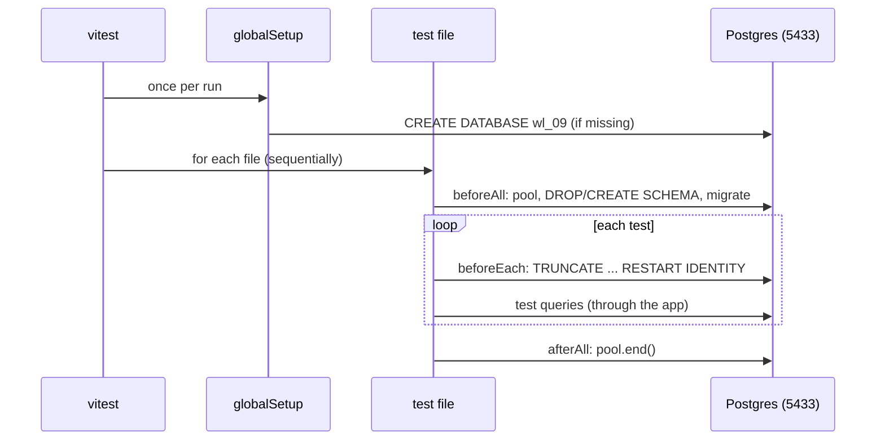

# Testing against a real database

How to make Postgres integration tests fast, isolated and trustworthy.

## The moving parts



- **globalSetup** runs once, before any test file, in the main Vitest process. Use it for things that must exist for the whole run (the database).
- **beforeAll per file** creates a connection pool and brings the schema up to date.
- **beforeEach** resets data. Truncating a handful of small tables takes a few milliseconds.
- **afterAll** closes the pool. Forgetting this leaves open handles; Vitest may hang or warn at the end.

## Why reset the schema at all?

Running the migrations from scratch at the start of each file guarantees the tests run against the schema your migrations produce, not against whatever an older version left behind in your local database. It's cheap (one file, a few statements) and saves you from "works on my machine" when someone changes a migration.

## Truncate vs transaction-per-test

**Truncate** (`TRUNCATE a, b RESTART IDENTITY CASCADE`):

- Works no matter how the code manages connections and transactions.
- `RESTART IDENTITY` resets identity/sequence columns, so generated values are predictable.
- `CASCADE` follows foreign keys so you don't have to list tables in dependency order.

**Rollback per test**:

```ts
let client: pg.PoolClient;
beforeEach(async () => { client = await pool.connect(); await client.query("BEGIN"); });
afterEach(async () => { await client.query("ROLLBACK"); client.release(); });
// the repository must be constructed with `client`, not the pool
```

- Very fast and needs no cleanup.
- Only works if **all** queries in the test go through that one client. Code that takes a pool and opens its own transactions (like `PgWalletRepository.commit`) breaks it: its `BEGIN` on another connection can't see your uncommitted rows, and a nested `BEGIN` on the same connection is a warning, not a savepoint.

For apps with their own transaction handling, truncate is the robust default.

## Parallelism

Tests that share a database must not run at the same time, or one file's `TRUNCATE` wipes another file's data mid-test. Options:

| Option | Trade-off |
|---|---|
| `fileParallelism: false` (this repo) | simple, deterministic; total time is the sum of the files |
| One database per worker (`wl_09_1`, `wl_09_2`... from `VITEST_POOL_ID`) | parallel and isolated; more setup |
| One schema per worker (`SET search_path`) | lighter than databases; all queries must respect the search path |
| Testcontainers per worker | perfect isolation; needs Docker and startup time |

Start simple. Parallelize when the suite gets slow enough that people stop running it.

## What to assert in database tests

- **Round trips:** what you write is what you read, with the right **types**. `bigint` and `numeric` come back from `pg` as strings; `timestamptz` comes back as a `Date`. A test that only checks `toMatchObject({ balanceCents: 500 })` passes if your API returns `500`, but a stricter `typeof` check, or a second operation that does arithmetic, catches the string case.
- **Ordering:** if the API promises newest-first, insert rows with known timestamps (including ties!) and check the order.
- **Constraints:** that invalid data is rejected by the database, not just by the app.
- **Atomicity:** inject a failure in the middle of a multi-step write and assert nothing was written. See the "sabotage a constraint" technique in [test-doubles-and-fakes.md](test-doubles-and-fakes.md).
- **Persistence, not just responses:** for important writes, read back from the database directly (`SELECT balance_cents ...`) as well as through the API.

## Failure messages that help

When Postgres isn't running, a test should say so in plain words rather than dumping `ECONNREFUSED 127.0.0.1:5433` from deep inside the driver:

```ts
try { await pool.query("SELECT 1"); }
catch (err) { throw new Error(`Postgres not reachable on 5433, run \`make up\` (${String(err)})`); }
```

## Speed budget

A typical integration test here takes 5–20 ms: one or two HTTP requests, a few queries, a truncate. If a single test takes seconds, look for: a new pool per test (connection setup is expensive), missing indexes on large seeded data, `pg_sleep`, or real timers waiting on retries.
