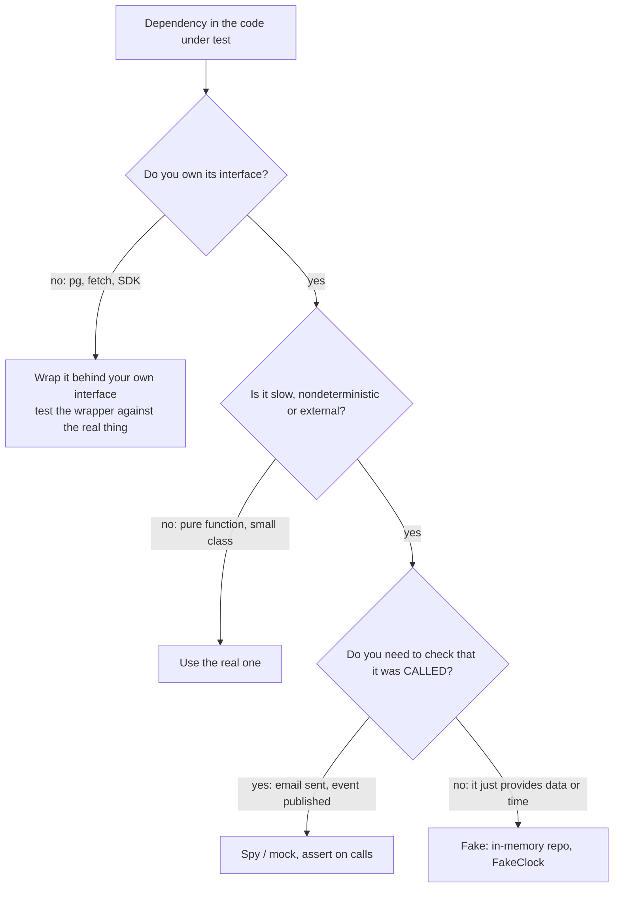

# Test doubles and fakes, in practice

The lesson defined the vocabulary. This page is about writing doubles that make tests clearer rather than more fragile.

## A decision guide



Two principles drive it:

1. **Use the real thing when it's cheap and deterministic.** Pure domain functions, validators, mappers: just call them. Replacing them with mocks adds work and hides bugs.
2. **Replace things at the boundary of your system**, not in the middle. The repository interface, the clock, the id generator, the email gateway. Those are the seams module 06 created.

## Writing a good fake

A fake should be **simple, correct and boring**. Rules of thumb:

- **Copy on the way in and out.** If a fake repository returns the same object it stores, a test (or the service) can mutate stored state by accident, which a real database never allows:
  ```ts
  async findById(id: string) {
    const w = this.#wallets.get(id);
    return w ? { ...w } : undefined;  // a copy, like a fresh DB row
  }
  ```
- **Enforce the same invariants as the real thing where it matters**: unique ids, "unknown wallet" errors, ordering.
- **No test-only logic in production fakes.** If a test needs a failing repository, write a tiny subclass or object in the test file instead of adding `shouldFail` flags to the shared fake.
- **Verify it with a contract test** (see the lesson). This is what makes it safe to rely on the fake in hundreds of unit tests.

### Fake clock

```ts
export class FakeClock implements Clock {
  #now: Date;
  constructor(start = "2026-03-19T10:00:00.000Z") { this.#now = new Date(start); }
  now() { return new Date(this.#now); }          // a copy: callers can't move time by mutating it
  set(at: string) { this.#now = new Date(at); }
  advance(ms: number) { this.#now = new Date(this.#now.getTime() + ms); }
}
```

Prefer an injected `Clock` over `vi.useFakeTimers()` for business logic: it's explicit, it can't leak into other tests, and it doesn't interfere with libraries (like `pg`) that use real timers internally. Use fake timers when the code under test itself schedules work with `setTimeout`/`setInterval`.

### Sequential ids

```ts
export function sequentialIds(prefix = "id") {
  let n = 0;
  return () => `${prefix}-${++n}`;
}
```

With predictable ids you can assert on exact objects (`toEqual({ id: "id-1", ... })`) and failure messages are readable.

## Spies and mocks without the pain

Good uses:

```ts
// Silence and verify error logging for an expected 500
const log = vi.spyOn(console, "error").mockImplementation(() => {});
// ...
expect(log).toHaveBeenCalledOnce();
log.mockRestore();

// A failing dependency for one test
const repo = new InMemoryWalletRepository();
vi.spyOn(repo, "commit").mockRejectedValueOnce(new Error("connection reset"));
```

Smells:

- Asserting the exact sequence of internal calls (`findById` then `commit` with these args). Assert outcomes instead.
- `mockReturnValue` chains five levels deep to satisfy a fluent API. Wrap the library.
- A test that has more mock setup than assertions.
- Forgetting to restore spies (`afterEach(() => vi.restoreAllMocks())`), leaking behavior into later tests.

## Failure injection

Many important behaviors are about what happens when something fails: rollback, error mapping, retries. Ways to inject failures:

| Technique | Example | Good for |
|---|---|---|
| Spy with `mockRejectedValueOnce` | the repo throws on `commit` | service error handling, 500 mapping |
| A throwing fake | a clock whose `now()` throws | "unexpected error → generic 500" |
| Sabotage the real database | temporarily add a `CHECK` constraint that makes the second insert fail | proving a multi-statement write is atomic |
| Stop the dependency | close the pool before the call | connection-failure handling |

The "sabotage" trick is worth remembering: it tests a real Postgres transaction rolling back, which no mock can prove.

## Naming and structure

```ts
describe("WalletService", () => {
  describe("withdraw", () => {
    it("allows withdrawing the entire balance (boundary)", ...);
    it("refuses to go below zero with INSUFFICIENT_FUNDS and changes nothing", ...);
  });
});
```

A test name is a sentence about behavior that a product manager could read. When it fails in CI, the name alone should tell you what's broken.
