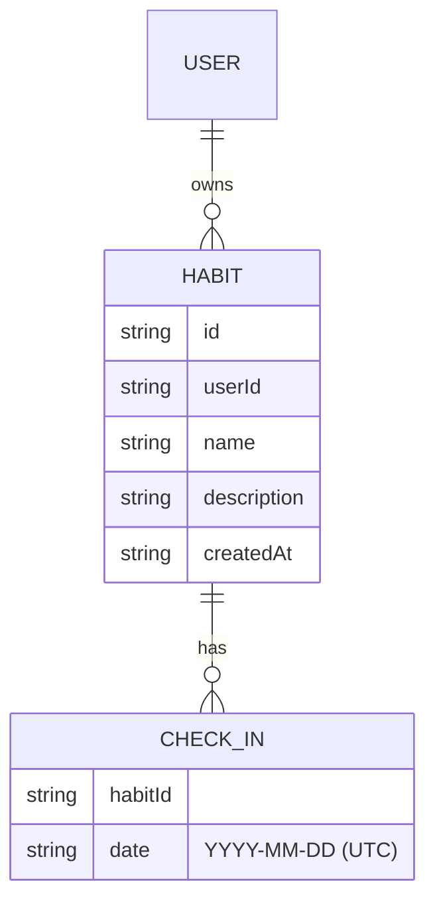
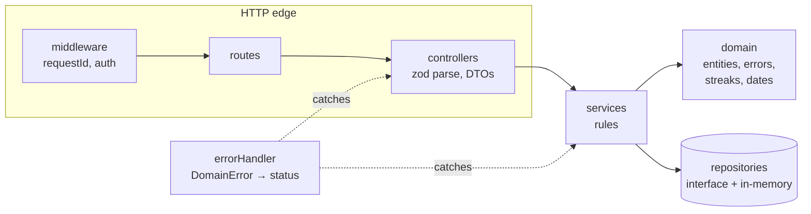
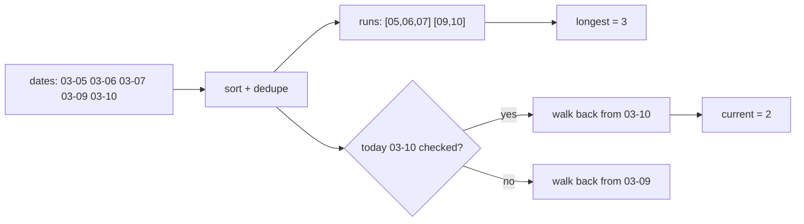

# 10 · Checkpoint: Backend Core

> Up to now every challenge came with a skeleton. Real tickets don't: you get a spec, a deadline and an empty folder. This checkpoint is where you prove to yourself that you can turn a spec into a clean, layered, tested API **without** someone else having decided the structure for you.

**Time:** ~8h · **Challenge:** 🛠️ Build (from scratch) · **Prereqs:** [05](../05-express-basics/README.md) · [06](../06-layered-architecture/README.md) · [07](../07-validation-errors-config/README.md) · [08](../08-typescript-for-backends/README.md) · [09](../09-testing/README.md) · **Services:** none

## What you'll practice

- Reading an API spec and turning it into a **plan**: domain, rules, endpoints, errors
- Designing a **layered** app yourself: routes → controllers → services → repositories, plus a composition root
- **Validation at the edge** with zod, **domain errors** mapped to HTTP in one place, a consistent error format
- **Typed config**, request ids and a central error handler: the cross-cutting pieces every service needs
- Modelling **time** correctly: UTC calendar days, an injected clock, streak calculations
- Working against acceptance tests you didn't write, and adding your own where they help

This lesson is shorter on new concepts and longer on **how to approach** a build like this. Everything technical you need was taught in modules 05–09; links point you back when you need a refresher.

---

## 1. From spec to plan

The worst way to start is to open `app.ts` and type `app.get(...)`. Spend the first 30–45 minutes on paper (or in a scratch markdown file). Read [CHALLENGE.md](CHALLENGE.md) fully and extract four lists.

**1. Nouns: the domain.** What are the things, and what do they own?



Users aren't stored at all here: they arrive as a header. A check-in has no id of its own; it's identified by (habit, date). That's a design hint: a set of dates per habit is enough.

**2. Rules: the business logic.** Write each one as a sentence you could turn into a test:

- A habit name is unique per user, ignoring case and surrounding spaces.
- You can't see, change or check in on someone else's habit; it looks like it doesn't exist.
- A check-in for the same day twice is fine (idempotent), but a future day isn't.
- Deleting a habit deletes its check-ins.
- Streaks: consecutive days, where "today not done yet" doesn't break the streak.

These belong in the **service and domain layers**, and nowhere else.

**3. Endpoints: the HTTP contract.** Method, path, body, success status, error statuses. The spec table gives you this; copy it into your notes and mark which rule each error comes from.

**4. Cross-cutting concerns.** Things every request goes through: request ids, authentication via `X-User-Id`, JSON parsing, validation, the error format, the 404 fallback. These are **middleware**.

With those four lists you can see the whole system before writing a line, and you'll notice questions early ("is renaming `run` to `Run` a conflict with itself?" The spec answers it: no).

## 2. Choosing a structure

You've seen the target shape in modules 06–09:

```
src/
  app.ts              createApp({ clock }): wiring + middleware order, no listen()
  server.ts           composition root: config, real clock, listen, shutdown
  config.ts           zod env schema, the only reader of process.env
  routes/             paths → controller functions (+ auth middleware)
  controllers/        HTTP in/out: parse input, call a service, shape the response
  services/           business rules and orchestration (no express!)
  repositories/       interfaces + in-memory implementations
  domain/             entities, domain errors, pure functions (dates, streaks)
  middleware/         requestId, authenticate, notFound, errorHandler
  lib/                small shared helpers (validation helper, clock type)
```



Arrows point inward. Services know nothing about HTTP; the error handler is the only place that knows `HABIT_NAME_TAKEN` means 409. The architecture test in `challenge/test/architecture.test.ts` enforces the most important of these rules, so read it before you start.

Feature folders (`src/habits/{routes,service,repository}.ts`) are an equally valid layout ([module 06](../06-layered-architecture/README.md) discusses the trade-off), but the architecture test expects layer folders, so use those here.

### How many services?

Two reasonable options:

- **One `HabitService`** handling habits, check-ins and stats. Simple; fine at this size.
- **`HabitService` + `CheckInService`**, where the check-in service asks the habit service for an owned habit. Each class stays small and focused.

Either passes the tests. Pick one, write down why, and move on. Over-designing a checkpoint is a classic way to run out of time.

## 3. Working with time correctly

Two parts of the spec are about dates: rejecting future check-ins and computing streaks. Time is where checkpoint projects (and production systems) most often go subtly wrong.

### Calendar dates are not instants

`2026-03-10T09:00:00.000Z` is an **instant**: one point on the global timeline. `2026-03-10` is a **calendar date**: a whole day, and *which* 24 hours depends on the time zone. This API defines days in **UTC**, so:

- "Today" is `clock.now().toISOString().slice(0, 10)`.
- Keep check-ins as `"YYYY-MM-DD"` strings. They compare and sort correctly as plain strings (`"2026-02-28" < "2026-03-01"`), which makes range filters and sorting trivial.
- Never use local-time methods (`getDate()`, `getDay()`, `setHours()`): they depend on the server's time zone, so the same code behaves differently on your laptop and in a container.

### Validating a date

A regex alone accepts `2026-02-30`. Round-trip it through `Date.UTC` and check nothing rolled over:

```ts
const [y, m, d] = value.split("-").map(Number);
const date = new Date(Date.UTC(y, m - 1, d));
const valid = date.getUTCFullYear() === y && date.getUTCMonth() === m - 1 && date.getUTCDate() === d;
```

(`Date.UTC(2026, 1, 30)` silently becomes 2 March. The check catches that.)

### Adding days

Do arithmetic in UTC milliseconds and convert back to a date string. Since UTC has no daylight-saving jumps, every day is exactly 86,400,000 ms:

```ts
const addDays = (date: string, n: number) =>
  new Date(Date.parse(`${date}T00:00:00Z`) + n * 86_400_000).toISOString().slice(0, 10);
```

### The injected clock

`createApp({ clock })` receives the clock, and everything that needs "now" asks it. Never call `new Date()` for the current time inside services. That's what lets the tests jump to 23:59:59.999 and then to midnight, or to a leap year, in milliseconds. See [module 09](../09-testing/README.md#7-fixtures-factories-and-determinism) for why.

There's more on this in [docs/dates-and-time.md](docs/dates-and-time.md), including what changes if users have their own time zones.

## 4. Designing the streak calculation

Put streak logic in a **pure function** in the domain layer:

```ts
computeStats(dates: string[], today: string): HabitStats
```

No clock, no repository, no HTTP: dates in, numbers out. The service fetches the dates and today's date and calls it. Pure functions are the easiest code in the world to test and reason about.

Think through the algorithm before coding:

- **Longest streak:** sort the unique dates; walk through them; if a date is exactly one day after the previous, extend the current run, otherwise start a new run of 1; track the maximum.
- **Current streak:** start at today if today is checked in, otherwise at yesterday (today isn't over yet). Walk backwards one day at a time while the date is in the set.
- **Last 30 days:** count dates in `[today − 29, today]`. That's 30 days including today, an off-by-one waiting to happen; the tests check both edges.



## 5. Building it, in order

A sequence that keeps you close to green and avoids big-bang integration:

1. **Config** (`config.ts` + `test/config.test.ts`). Small, self-contained, and a warm-up.
2. **App skeleton:** `createApp` with `requestId`, `express.json`, `/health`, the 404 handler and the error handler. Get `test/http.test.ts` partially green.
3. **Domain:** `Habit` type, `DomainError` with a closed set of codes, date helpers, `computeStats`. Optionally unit-test the pure functions yourself.
4. **Repositories:** interfaces first, then in-memory implementations.
5. **Habits slice:** service → controller → routes, endpoint by endpoint, with `test/habits.test.ts` in watch mode.
6. **Check-ins and stats.**
7. **Architecture test**, then a self-review with [docs/review-checklist.md](docs/review-checklist.md).

Run `npm run test:watch` the whole time, and filter to the file you're working on (press `p` in watch mode, or `npx vitest habits`).

### Middleware order matters

```ts
app.use(requestId());            // first: every response, even errors, gets an id
app.use(express.json());         // before routes that read bodies
app.get("/health", ...);         // public
app.use("/habits", habitRoutes); // router starts with authenticate()
app.use(notFoundHandler);        // after all routes
app.use(errorHandler);           // last
```

Authentication goes on the `/habits` router *before* any route, so a request with no user gets a 401 even when its body is invalid. The tests check that ordering.

## Common mistakes

- **Starting with code instead of a plan**, then discovering halfway that check-ins need ownership checks everywhere.
- **Business rules in controllers.** "Name already taken" or "future date" checks in a route handler means they can't be reused or unit-tested. Controllers parse and respond; services decide.
- **Leaking internal fields.** Returning the stored entity directly sends `userId` (and later, things like password hashes) to clients. Map entities to response DTOs in the controller.
- **Returning 403 for other users' habits.** That confirms the habit exists. The spec says 404.
- **Local time**: `getDate()` instead of `getUTCDate()`, or `new Date("2026-03-10")` mixed with local formatting.
- **`new Date()` inside services** instead of the injected clock, so time-based tests fail or flake.
- **Validation errors without details**, or details with paths that don't match the field.
- **Forgetting `res.status(204).end()`**, and sending `{}` with a 204.
- **Gold-plating**: a generic repository framework or an event bus nobody asked for, while the stats endpoint is still red.

## In production

- **Specs come from many places:** product docs, an OpenAPI file ([module 23](../23-api-design/README.md)), a Slack thread. Writing down the four lists (nouns, rules, endpoints, cross-cutting) and sharing them is how senior engineers catch misunderstandings before they become code.
- **Habit trackers, fitness apps, learning platforms** all face the time-zone question for real: a user in Tokyo checking in at 08:00 local time is still on "yesterday" in UTC. Real products store the user's time zone and compute calendar days in it. Section 3's "UTC days" is a deliberate simplification.
- **In-memory repositories** are where many services start; the interface you define now is exactly what you'll implement with Postgres in [module 13](../13-node-postgres/README.md) and re-use in the [Postgres checkpoint](../16-checkpoint-postgres/README.md).
- **Streak calculations at scale** usually aren't recomputed from the full history on every request. They're stored and updated incrementally on each check-in, or cached. With a pure `computeStats` function, switching strategies later is a small, safe change.

## Check yourself

1. Why is "2026-03-10" a different kind of value from `new Date("2026-03-10T09:00:00Z")`?
   <details><summary>Answer</summary>The first is a calendar date (a whole day whose start and end depend on a time zone); the second is an instant (a single point in time). This API defines days in UTC, so you derive the calendar date from the instant in UTC.</details>
2. Where does the rule "names are unique per user, case-insensitively" live, and where does its HTTP status get decided?
   <details><summary>Answer</summary>The rule lives in the service (it throws a domain error like <code>HABIT_NAME_TAKEN</code>). The error handler maps that code to 409. Neither layer knows the other's concern.</details>
3. Why compute streaks in a pure function instead of inside the service method?
   <details><summary>Answer</summary>A pure function (dates + today in, stats out) has no dependencies, so it's trivial to test every edge case and reason about; the service only gathers inputs. It also makes it easy to swap in incremental or cached computation later.</details>
4. Why should a request for another user's habit return 404 rather than 403?
   <details><summary>Answer</summary>A 403 confirms the resource exists, which leaks information (and enables enumeration of ids). Returning 404 makes "not yours" indistinguishable from "doesn't exist".</details>

## Further reading

- MDN, `Date` (especially the UTC methods): https://developer.mozilla.org/en-US/docs/Web/JavaScript/Reference/Global_Objects/Date
- Express guide, Using middleware: https://expressjs.com/en/guide/using-middleware.html
- zod documentation: https://zod.dev
- Deep dives in this module: [docs/dates-and-time.md](docs/dates-and-time.md) · [docs/review-checklist.md](docs/review-checklist.md) · [docs/project-structure-cheatsheet.md](docs/project-structure-cheatsheet.md)

## ➡️ Next: [the challenge](CHALLENGE.md)
