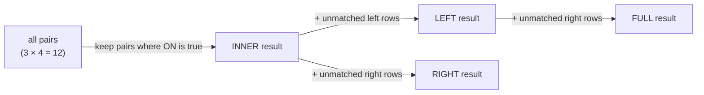

# Joins, with actual rows

Venn diagrams are the usual way to explain joins, but they hide the most important part: **joins work on pairs of rows, and one row can pair with many**. This guide uses two tiny tables so you can see every output row.

```
authors                     books
id | name                   id | author_id | title
---+--------                ---+-----------+------------------
 1 | Ada                     10 |         1 | Engines
 2 | Brian                   11 |         1 | Notes
 3 | Cleo                    12 |         2 | Pipes
                             13 |      NULL | Anonymous Poems
```

Ada wrote two books, Brian one, Cleo none, and one book has no author.

## The mental model

Start from every combination (that's `CROSS JOIN`: 3 × 4 = 12 pairs), then keep the pairs where `ON` is true. Outer joins then **add back** rows that found no partner, padding the missing side with NULLs.



(Databases don't literally build all pairs. They use hash joins, merge joins and indexes. But the *result* is always as if they did.)

## INNER JOIN

```sql
SELECT a.name, b.title FROM authors a JOIN books b ON b.author_id = a.id;
```

```
name  | title
------+---------
Ada   | Engines
Ada   | Notes      ← Ada appears twice: one row per matching book
Brian | Pipes
```

Cleo (no books) and "Anonymous Poems" (no author) are gone.

## LEFT JOIN

```sql
SELECT a.name, b.title FROM authors a LEFT JOIN books b ON b.author_id = a.id;
```

```
name  | title
------+---------
Ada   | Engines
Ada   | Notes
Brian | Pipes
Cleo  | NULL       ← kept, padded with NULL
```

Now count books per author:

```sql
SELECT a.name, count(*) AS c1, count(b.id) AS c2
FROM authors a LEFT JOIN books b ON b.author_id = a.id
GROUP BY a.name;
```

```
name  | c1 | c2
------+----+----
Ada   |  2 |  2
Brian |  1 |  1
Cleo  |  1 |  0    ← count(*) counts the padded row; count(b.id) skips the NULL
```

## FULL JOIN

```sql
SELECT a.name, b.title FROM authors a FULL JOIN books b ON b.author_id = a.id;
```

```
name  | title
------+-----------------
Ada   | Engines
Ada   | Notes
Brian | Pipes
Cleo  | NULL
NULL  | Anonymous Poems   ← unmatched right row
```

FULL JOIN is rare in application code but handy for reconciliation: "compare yesterday's export with today's and show rows missing on either side".

## Anti-join: rows with no partner

```sql
-- authors with no books
SELECT a.name FROM authors a
WHERE NOT EXISTS (SELECT 1 FROM books b WHERE b.author_id = a.id);
-- Cleo

-- the same, LEFT JOIN style
SELECT a.name FROM authors a LEFT JOIN books b ON b.author_id = a.id
WHERE b.id IS NULL;
-- Cleo
```

Now the trap. "Authors who aren't the author of any book" with `NOT IN`:

```sql
SELECT name FROM authors WHERE id NOT IN (SELECT author_id FROM books);
-- (0 rows!)
```

The subquery returns `1, 1, 2, NULL`. For Cleo, `3 NOT IN (1, 1, 2, NULL)` means `3 <> 1 AND 3 <> 1 AND 3 <> 2 AND 3 <> NULL`, which is `true AND true AND true AND null` = **null**. Not true, so the row is dropped. One NULL poisons the whole thing. Use `NOT EXISTS`.

## Semi-join: rows with at least one partner

```sql
-- ❌ duplicates: Ada appears twice
SELECT a.name FROM authors a JOIN books b ON b.author_id = a.id;

-- ✅ each author once
SELECT a.name FROM authors a WHERE EXISTS (SELECT 1 FROM books b WHERE b.author_id = a.id);
```

Reaching for `SELECT DISTINCT` to "fix" duplicates from a join is often a sign that you wanted a semi-join.

## ON vs WHERE in outer joins

```sql
-- books per author, counting only titles starting with 'N'
SELECT a.name, count(b.id)
FROM authors a LEFT JOIN books b ON b.author_id = a.id AND b.title LIKE 'N%'
GROUP BY a.name;
-- Ada 1 · Brian 0 · Cleo 0        ✅ every author kept

SELECT a.name, count(b.id)
FROM authors a LEFT JOIN books b ON b.author_id = a.id
WHERE b.title LIKE 'N%'
GROUP BY a.name;
-- Ada 1                           ❌ Brian and Cleo filtered out after the join
```

`ON` decides which pairs match. `WHERE` filters the rows after the join, including the NULL-padded ones. For inner joins the two are equivalent. For outer joins they are not.

## Joins multiply, so aggregate first

Add a `reviews` table where Ada's "Engines" has 3 reviews. Joining authors → books → reviews makes Ada's "Engines" row appear 3 times, so `count(b.id)` for Ada becomes 4 instead of 2. The fix is to aggregate each child table to one row per parent **before** joining:

```sql
WITH review_counts AS (
  SELECT book_id, count(*) AS reviews FROM reviews GROUP BY book_id
)
SELECT a.name, count(b.id) AS books, coalesce(sum(rc.reviews), 0) AS reviews
FROM authors a
LEFT JOIN books b ON b.author_id = a.id
LEFT JOIN review_counts rc ON rc.book_id = b.id
GROUP BY a.name;
```

## Self-join

A table joined to itself, with two aliases. Employees and managers in one table:

```sql
SELECT e.name AS employee, m.name AS manager
FROM employees e LEFT JOIN employees m ON m.id = e.manager_id;
```
