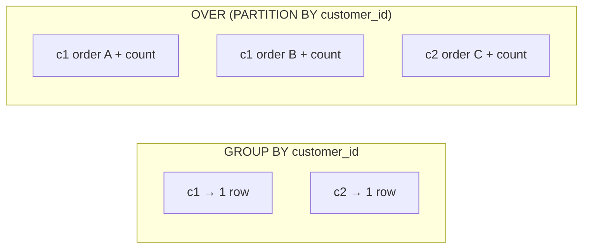

# Window functions guide

Window functions answer "how does this row relate to the rows around it?" without collapsing rows the way `GROUP BY` does. Once they click, many queries that looked impossible (or needed application code) become a few lines.

## GROUP BY vs window

```sql
-- GROUP BY: one row per customer
SELECT customer_id, count(*) FROM orders GROUP BY customer_id;

-- window: every order, plus the customer's order count next to it
SELECT id, customer_id, count(*) OVER (PARTITION BY customer_id) AS customer_orders
FROM orders;
```



## The three parts of OVER

```sql
fn(args) OVER (
  PARTITION BY ...   -- which rows belong together (default: all rows)
  ORDER BY ...       -- order inside the partition
  frame              -- which rows around the current one an aggregate sees
)
```

You can name a window and reuse it:

```sql
SELECT id,
       row_number() OVER w AS rn,
       lag(ordered_at) OVER w AS previous_order
FROM orders
WINDOW w AS (PARTITION BY customer_id ORDER BY ordered_at);
```

## Ranking: row_number, rank, dense_rank

Scores `90, 85, 85, 70`, ordered descending:

| score | row_number | rank | dense_rank |
|---|---|---|---|
| 90 | 1 | 1 | 1 |
| 85 | 2 | 2 | 2 |
| 85 | 3 | 2 | 2 |
| 70 | 4 | 4 | 3 |

- `row_number` always gives distinct numbers. Which of the tied rows gets 2 or 3 is **arbitrary** unless you add a tie-breaker to the window's `ORDER BY`. Arbitrary means it can change between runs.
- `rank` is "Olympic" ranking: two silvers, no bronze.
- `dense_rank` doesn't leave gaps. Use it for "the top 3 distinct prices".

### Top-N per group

```sql
WITH ranked AS (
  SELECT p.*, row_number() OVER (PARTITION BY category_id ORDER BY price DESC, id) AS rn
  FROM products p
)
SELECT * FROM ranked WHERE rn <= 3;      -- 3 most expensive per category
```

Use `rank()` instead if ties should all be included (you might get more than 3).

## lag and lead: compare with neighbours

```sql
SELECT customer_id, id, ordered_at,
       ordered_at - lag(ordered_at) OVER (PARTITION BY customer_id ORDER BY ordered_at) AS since_previous
FROM orders;
```

- `lag(x)` is the previous row's `x` (NULL for the first row in the partition), and `lead(x)` the next row's.
- `lag(x, 2)` looks two rows back. `lag(x, 1, 0)` returns 0 instead of NULL when there's no previous row.
- "Previous row" means previous **in the result**, not "previous calendar month". If a month has no rows, `lag` happily compares March with January. To fill gaps, generate a calendar with `generate_series` and `LEFT JOIN` your data onto it.

## Running and moving aggregates

Any aggregate becomes a window function with `OVER`:

```sql
SELECT day, revenue,
       sum(revenue) OVER (ORDER BY day)                                   AS running_total,
       avg(revenue) OVER (ORDER BY day ROWS BETWEEN 6 PRECEDING AND CURRENT ROW) AS avg_7d,
       revenue / sum(revenue) OVER ()                                     AS share_of_total
FROM daily_revenue;
```

- `OVER ()`: the whole result is the window, which is perfect for "percent of total".
- `OVER (ORDER BY day)`: a running total.
- `OVER (PARTITION BY customer_id ORDER BY ordered_at)`: a running total that restarts for each customer.

## Frames: the subtle part

When a window has an `ORDER BY`, the default frame is `RANGE BETWEEN UNBOUNDED PRECEDING AND CURRENT ROW`. Two surprises follow:

1. **Ties are included together.** With `RANGE`, all rows with the same `ORDER BY` value as the current row are "peers" and are in the frame together. If two orders share a timestamp, both rows show the running total *including both*. Use `ROWS BETWEEN UNBOUNDED PRECEDING AND CURRENT ROW` for a strictly row-by-row total, or add a tie-breaker column.
2. **`last_value` looks broken.** With the default frame, the frame ends at the current row, so `last_value(x)` is just the current row's `x`. Write `ROWS BETWEEN UNBOUNDED PRECEDING AND UNBOUNDED FOLLOWING` to see the whole partition.

| Frame | Rows seen |
|---|---|
| (no ORDER BY) | whole partition |
| default with ORDER BY | start of partition → current row, plus its peers |
| `ROWS BETWEEN 2 PRECEDING AND CURRENT ROW` | the current row and the two before it |
| `ROWS BETWEEN UNBOUNDED PRECEDING AND UNBOUNDED FOLLOWING` | whole partition |

## Windows after GROUP BY

Window functions run after grouping, so they can wrap aggregates:

```sql
SELECT category_id,
       sum(quantity)                               AS units,
       rank() OVER (ORDER BY sum(quantity) DESC)    AS rank_by_units
FROM order_items oi JOIN products p ON p.id = oi.product_id
GROUP BY category_id;
```

Read `rank() OVER (ORDER BY sum(quantity) DESC)` as "rank the groups by their total".

## Where window functions can't go

They are computed in the `SELECT` step, so they're not allowed in `WHERE`, `GROUP BY` or `HAVING`. Wrap the query and filter outside:

```sql
SELECT * FROM (
  SELECT o.*, row_number() OVER (PARTITION BY customer_id ORDER BY ordered_at DESC) AS rn
  FROM orders o
) t
WHERE rn = 1;
```

## Performance notes

- Each distinct `PARTITION BY`/`ORDER BY` combination usually means a sort. An index matching `(partition cols, order cols)` can avoid it.
- For "latest row per group" on big tables, `DISTINCT ON` or a `LATERAL` subquery with `LIMIT 1` backed by an index can beat `row_number()`. Measure with `EXPLAIN ANALYZE` (module 14).
