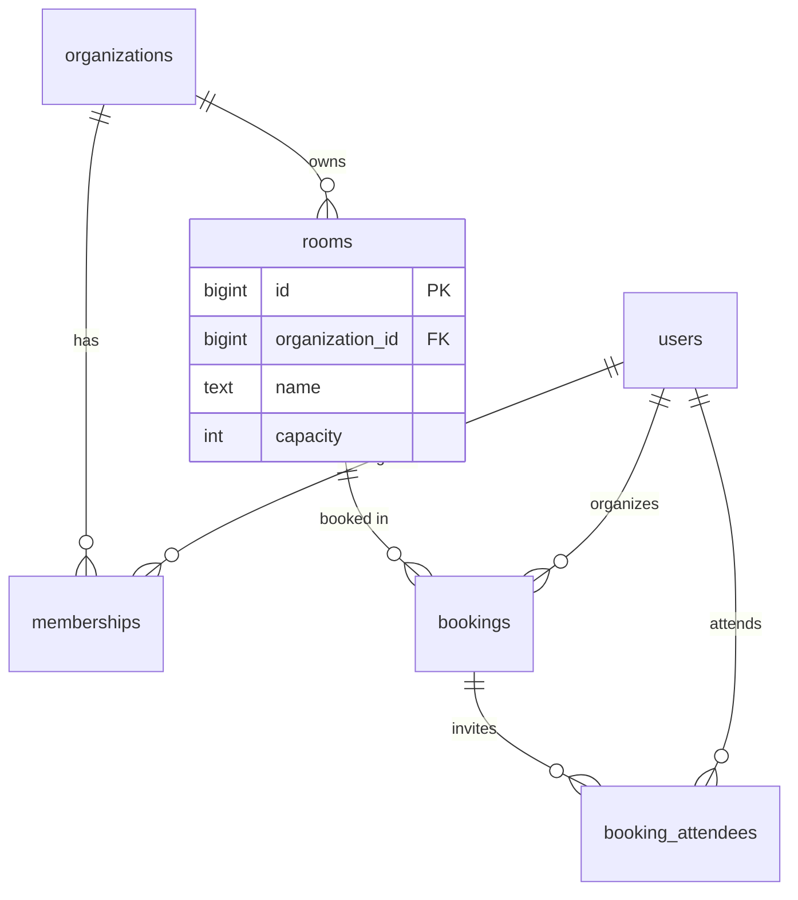
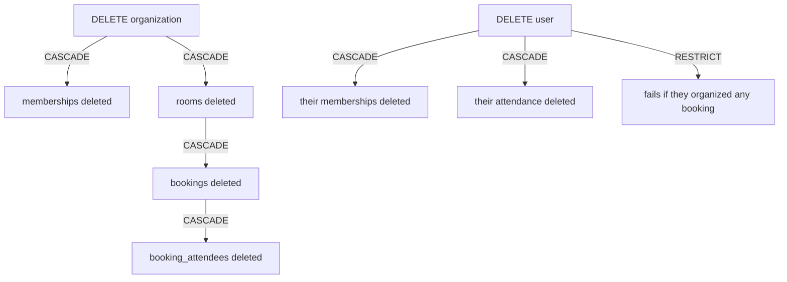
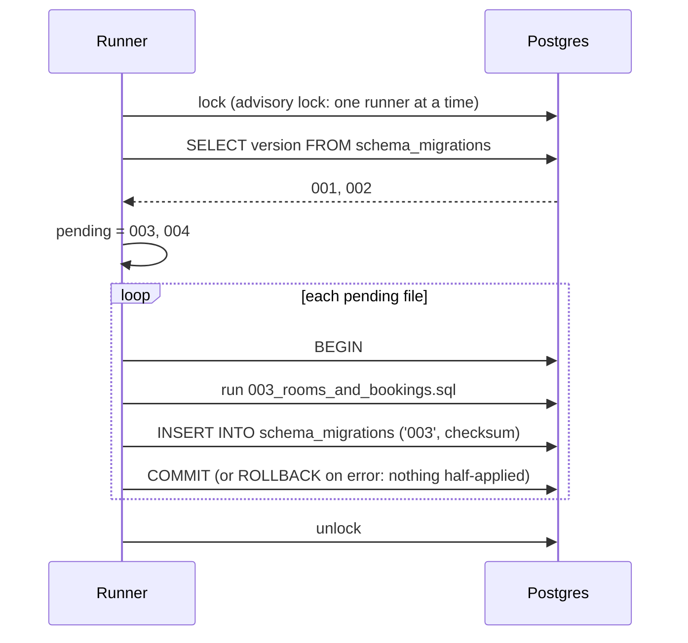
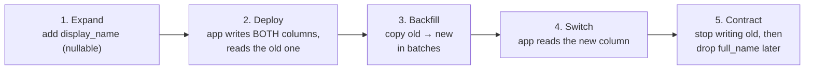

# 12 · Data Modeling & Migrations

> Application code gets rewritten every few years. The data, and the shape you gave it, outlives all of it. A good schema makes bugs impossible to store. A bad one turns every feature into a workaround and every report into an argument.

**Time:** ~6h · **Challenge:** 🛠️ Build · **Prereqs:** [11 · SQL Fundamentals](../11-sql-fundamentals/README.md) · **Services:** 🐘 Postgres

## What you'll learn

- How to go from a product description to entities, attributes and relationships, and draw them as an ERD
- Keys: natural vs surrogate, `bigint` identity vs UUID, composite keys
- Normalization (1NF → 3NF) in plain language, and when denormalizing is the right call
- Constraints as executable business rules: `NOT NULL`, `UNIQUE`, `CHECK`, foreign keys with deliberate `ON DELETE` choices, partial unique indexes and **exclusion constraints**
- Choosing data types: `text` vs `varchar`, `numeric` for money, `timestamptz`, `jsonb`, enums vs lookup tables vs `CHECK`
- Soft deletes and audit columns, including an `updated_at` trigger
- Migrations: why they exist, up/down vs forward-only, and zero-downtime **expand/contract** changes

---

## 1. Why the schema is your most important code

In [module 07](../07-validation-errors-config/README.md) you validated input at the edges of your app, and you should keep doing that. But the database is the one place **every** write goes through: your API, the admin script someone runs at 2am, the new microservice another team builds next year, the data import, the bug in tomorrow's deploy. If a rule lives only in application code, sooner or later something writes around it.

So a senior engineer asks of every business rule: *can the database enforce this?*

| Rule | App-only check | Database constraint |
|---|---|---|
| Emails are unique | `SELECT` then `INSERT`: two concurrent signups both pass | `UNIQUE` index: the second insert fails, always |
| Capacity is positive | a `zod` schema, until someone writes a SQL script | `CHECK (capacity > 0)` |
| No double-booked rooms | "check for overlaps, then insert": race condition | exclusion constraint: physically impossible |
| A booking's room exists | hope | foreign key |

The database constraints are also **concurrency-safe**, which app checks almost never are (module 15 shows the races in detail). Keep validating in the app too, so users get friendly error messages. The database is the backstop that guarantees the invariant.

## 2. From product description to entities

Here's the brief for this module's challenge:

> Companies sign up as **organizations**. **Users** can belong to several organizations, with a **role** in each (owner, admin, member). Each organization has **rooms** with a capacity. Members **book** a room for a time slot; a booking has an organizer and a list of **attendees** who can accept or decline. A room can't be double-booked.

A reliable method:

1. **Nouns become candidate entities** (tables): organization, user, room, booking, attendee.
2. **Facts about one noun become attributes** (columns): room *capacity*, booking *start/end*.
3. **Verbs between nouns become relationships**: a user *belongs to* an organization, a room *is booked by* a booking.
4. For each relationship, ask **"how many on each side?"**

| Relationship | Cardinality | How you store it |
|---|---|---|
| organization → rooms | one-to-many | `rooms.organization_id` foreign key (the "many" side holds the key) |
| user ↔ organization | many-to-many | a **join table** `memberships(organization_id, user_id)` |
| user ↔ booking (attending) | many-to-many | join table `booking_attendees` |
| user → bookings (organizing) | one-to-many | `bookings.organizer_id` |
| user → profile | one-to-one | same table, or a second table whose PK is also an FK |

Notice that *role* isn't an attribute of a user (Dana can be an admin at Acme and a member at Globex). It's an attribute of the **relationship**, so it lives on `memberships`. Spotting where an attribute really belongs is most of data modeling.

### Drawing it: ERDs in Mermaid

An entity-relationship diagram is the fastest way to discuss a schema with your team. Mermaid renders them right in GitHub markdown:



Reading the crow's-foot notation: `||` means "exactly one", `o{` means "zero or more", `|{` means "one or more", `o|` means "zero or one". So `organizations ||--o{ rooms` reads "one organization has zero or more rooms; each room belongs to exactly one organization".

## 3. Keys

A **primary key** identifies a row forever. Two families:

- **Natural keys** come from the domain: an email, an ISBN, a country code.
- **Surrogate keys** are made up by the database: `id bigint GENERATED ALWAYS AS IDENTITY`, or a UUID.

Natural keys are tempting and usually wrong for entities, because **real-world identifiers change**. People change emails, companies rename themselves, "unique" government ids turn out to have duplicates. If `email` is the primary key, every foreign key in every table must be updated when it changes. Use a surrogate key, and make the natural identifier a `UNIQUE` column.

Natural keys *are* great for **join tables**: `memberships` doesn't need its own `id`. `PRIMARY KEY (organization_id, user_id)` is the identity of a membership, and it enforces "at most one membership per pair" for free.

### bigint identity vs UUID

```sql
id bigint GENERATED ALWAYS AS IDENTITY PRIMARY KEY  -- 1, 2, 3, …
id uuid   DEFAULT gen_random_uuid()  PRIMARY KEY      -- 'a3f1c2…' (Postgres 13+)
```

| | `bigint` identity | UUID |
|---|---|---|
| Size | 8 bytes | 16 bytes |
| Index locality | sequential, so inserts append to the end of the index | v4 is random, so inserts scatter across the index (UUIDv7 is time-ordered and fixes this) |
| Generate before insert | no, the database assigns it | yes, the client or another service can create it |
| Leaks information | yes: `/orders/1042` reveals your order volume and invites guessing | no |
| Merging data across databases | collisions | no collisions |

Both are fine. A common pattern is `bigint` internally plus a random public identifier (UUID or a short slug) in URLs. Avoid the older `serial` type: `GENERATED … AS IDENTITY` is the SQL-standard replacement and has fewer permission and ownership quirks. `ALWAYS` (vs `BY DEFAULT`) also stops people from inserting ids by hand and desynchronizing the sequence.

## 4. Normalization: one fact, one place

Normalization is a set of rules for removing redundancy. The formal definitions are about functional dependencies, but the intuition is simple: **every fact should be stored exactly once**, so it can't disagree with itself.

Start with a spreadsheet-style table that someone exported:

| booking_id | room | room_capacity | org_name | attendees | organizer_email |
|---|---|---|---|---|---|
| 1 | Fjord | 8 | Acme | dana@acme.io, li@acme.io | dana@acme.io |
| 2 | Fjord | 8 | Acme | li@acme.io | li@acme.io |

**First normal form (1NF): one value per cell, no repeating groups.** `attendees` holds a list. You can't index it, can't put a foreign key on it, and "find all bookings Li attends" becomes string matching. Move it to its own table (`booking_attendees`), one row per attendee.

**Second normal form (2NF): every non-key column depends on the *whole* key.** This matters for composite keys. If `booking_attendees(booking_id, user_id)` also had a `booking_title` column, the title would depend only on `booking_id`, half the key. It would be repeated for every attendee and could drift. Move it to `bookings`.

**Third normal form (3NF): non-key columns depend on the key, and nothing but the key.** `room_capacity` depends on `room`, not on the booking. Store it once in `rooms`. Otherwise changing Fjord's capacity means updating every booking ever made in it, and missing one gives you two "truths".

The classic summary: *every non-key attribute depends on the key, the whole key, and nothing but the key.*

The symptoms of an un-normalized schema are called **anomalies**:

- **Update anomaly:** the same fact in many rows, updated in some but not others.
- **Insert anomaly:** you can't record a room until someone books it, because rooms only exist inside bookings.
- **Delete anomaly:** deleting the last booking deletes the only record that the room existed.

### When to denormalize

Normalization optimizes for correct writes. Sometimes reads matter more, and you deliberately store a fact twice:

- **Historical snapshots aren't redundancy.** `order_items.unit_price` (module 11) looks like a copy of `products.price`, but it's a different fact: the price *at the time of purchase*. Same for a shipping address on an order. These must be copied.
- **Precomputed aggregates** like `posts.comment_count`, when counting on every page view is too slow. You then own keeping it in sync (trigger, same transaction, or a background job) and accept that a bug can make it drift.
- **Read models**: a search index, a cache, a reporting table. Their source of truth stays normalized.

Rule of thumb: normalize by default, denormalize with a measured reason and a plan to keep the copy correct.

## 5. Constraints: business rules the database enforces

```sql
CREATE TABLE rooms (
  id              bigint  GENERATED ALWAYS AS IDENTITY PRIMARY KEY,
  organization_id bigint  NOT NULL REFERENCES organizations (id) ON DELETE CASCADE,
  name            text    NOT NULL,
  capacity        integer NOT NULL CONSTRAINT rooms_capacity_positive CHECK (capacity > 0)
);
```

### NOT NULL

Make columns `NOT NULL` unless "unknown" is a real, meaningful state. Every nullable column is a three-valued-logic trap for every future query (module 11). Nullable should be a decision, not a default.

### UNIQUE, and its useful variations

```sql
email text NOT NULL UNIQUE                                  -- plain
UNIQUE (organization_id, name)                              -- unique per organization
CREATE UNIQUE INDEX ON users (lower(email));                -- unique, case-insensitively
CREATE UNIQUE INDEX ON rooms (organization_id, name)
  WHERE deleted_at IS NULL;                                  -- unique among live rows only
```

The last two are **expression** and **partial** unique indexes. They express rules that a plain `UNIQUE` can't: "Dana@x.com and dana@x.com are the same person" and "a deleted room's name can be reused". (An alternative for emails is the `citext` extension, a case-insensitive text type.)

Remember from module 11: `NULL`s are never equal to each other, so a `UNIQUE` column allows many NULLs. Postgres 15+ lets you write `UNIQUE NULLS NOT DISTINCT` if you need otherwise.

### CHECK

Any boolean expression over the row's own columns:

```sql
CHECK (capacity > 0)
CHECK (ends_at > starts_at)
CHECK (status IN ('confirmed', 'cancelled'))
CHECK (slug ~ '^[a-z0-9]+(-[a-z0-9]+)*$')
CHECK (jsonb_typeof(features) = 'object')
```

`CHECK` can't look at other rows or other tables. For that you need unique/exclusion constraints, foreign keys, or (rarely) triggers. Name your constraints (`CONSTRAINT rooms_capacity_positive CHECK …`): the name appears in the error message, so your API can map `rooms_capacity_positive` to a friendly message instead of a 500.

### Foreign keys and ON DELETE

A foreign key guarantees the referenced row exists. The interesting decision is what happens when the **referenced** row is deleted:

| Option | Effect | Use when |
|---|---|---|
| `NO ACTION` / `RESTRICT` (default) | the delete fails | the child is valuable history: orders of a customer, bookings by an organizer |
| `CASCADE` | children are deleted too | the child can't exist without the parent and has no independent value: memberships of a deleted org, attendees of a deleted booking |
| `SET NULL` | child's FK becomes NULL | the link is optional: `tasks.assignee_id` when an employee leaves |
| `SET DEFAULT` | child's FK becomes its default | rare |



Think of `ON DELETE` as an ownership graph: things you **own** cascade, things you merely **reference** restrict. Be careful with long cascade chains: one `DELETE` on a parent can silently remove millions of rows.

> ⚠️ Postgres automatically indexes primary keys and unique constraints, but **not foreign key columns**. Without an index on `memberships.user_id`, deleting a user scans the whole memberships table to find children, and "orgs of user X" is a sequential scan. Index your FKs (the left-most columns of a composite PK already count).

### Exclusion constraints: "no overlaps"

`UNIQUE` says "no two rows are *equal* on these columns". An **exclusion constraint** generalizes it: "no two rows satisfy *these operators* on these columns". The killer use case is time ranges:

```sql
CREATE EXTENSION IF NOT EXISTS btree_gist;

ALTER TABLE bookings ADD CONSTRAINT bookings_no_overlap
  EXCLUDE USING gist (
    room_id WITH =,                                  -- same room…
    tstzrange(starts_at, ends_at, '[)') WITH &&      -- …and overlapping time
  ) WHERE (status = 'confirmed');                    -- only confirmed bookings count
```

Read it as: "reject a row if another row has an equal `room_id` **and** an overlapping time range, among confirmed bookings".

- `tstzrange(a, b, '[)')` builds a half-open range: includes the start, excludes the end. So 09:00–10:00 and 10:00–11:00 don't overlap, which is what humans expect for back-to-back meetings.
- `&&` is the "overlaps" operator for ranges.
- `btree_gist` is needed because the constraint is backed by a GiST index, and GiST doesn't support plain `=` on a `bigint` without that extension.
- The `WHERE` clause makes it partial: cancelled bookings don't block the slot.

Why is this so much better than checking in code? The naive version, "SELECT overlapping bookings; if none, INSERT", has a race. Two requests run the SELECT at the same moment, both see nothing, and both insert. The exclusion constraint is checked inside the database with proper locking, so the second insert fails with SQLSTATE `23P01`, and your API turns that into a `409 Conflict`.

## 6. Data types that age well

| Data | Use | Avoid | Why |
|---|---|---|---|
| Text | `text` | `varchar(255)` | In Postgres they perform the same. An arbitrary length limit is a business rule in disguise: if you need one, write `CHECK (length(name) <= 100)` so it's explicit and easy to change. |
| Money | `numeric(12,2)` or integer cents (`bigint`) | `real`, `double precision`, `money` | Floats can't represent 0.10 exactly: `0.1 + 0.2 = 0.30000000000000004`. Store the currency too if you have more than one. |
| Points in time | `timestamptz` | `timestamp` (without time zone) | `timestamptz` stores an absolute instant (internally UTC) and converts on display. `timestamp` stores wall-clock digits with no zone, so "09:00" means different instants for different users. |
| Calendar dates | `date` | `timestamptz` at midnight | A birthday isn't an instant. |
| Durations / ranges | `interval`, `tstzrange` | two loose columns everywhere | Ranges come with operators (`&&`, `@>`) and exclusion constraints. |
| Flags | `boolean NOT NULL DEFAULT false` | `'Y'/'N'` strings, nullable booleans | Three-state booleans are bugs waiting to happen. |
| Semi-structured | `jsonb` | `json`, or a `text` column holding JSON | `jsonb` is parsed, indexable (GIN) and has operators. Use it for genuinely variable data (settings, feature flags, payloads), not to avoid designing columns you filter or join on. |
| Identifiers | `bigint` / `uuid` | `integer` for big tables | 2.1 billion runs out sooner than you think, and changing a PK type on a big table is painful. |

### Enums vs lookup tables vs CHECK

A column that holds one of a small set of values (status, role) has three common implementations:

```sql
-- 1. Postgres enum type
CREATE TYPE booking_status AS ENUM ('confirmed', 'cancelled');
-- 2. text + CHECK
status text NOT NULL CHECK (status IN ('confirmed', 'cancelled'))
-- 3. lookup table + FK
CREATE TABLE booking_statuses (code text PRIMARY KEY, label text NOT NULL);
status text NOT NULL REFERENCES booking_statuses (code)
```

| | Enum | text + CHECK | Lookup table |
|---|---|---|---|
| Add a value | `ALTER TYPE … ADD VALUE` | replace the constraint | `INSERT` a row |
| Remove a value | effectively impossible | replace the constraint | `DELETE` (if unused) |
| Extra data per value (label, sort order, "is final") | no | no | yes |
| Values editable by non-engineers | no | no | yes |

`text + CHECK` is a good default for values your code branches on. A lookup table wins when values carry their own data or change without a deploy. Enums are compact and self-documenting, but painful to change.

## 7. Soft deletes and audit columns

**Audit columns** answer "when did this happen?" for free:

```sql
created_at timestamptz NOT NULL DEFAULT now(),
updated_at timestamptz NOT NULL DEFAULT now()
```

`DEFAULT now()` only fires on insert. To keep `updated_at` honest on every update, whatever code path performs it, use a trigger:

```sql
CREATE FUNCTION set_updated_at() RETURNS trigger LANGUAGE plpgsql AS $$
BEGIN
  NEW.updated_at := now();
  RETURN NEW;
END $$;

CREATE TRIGGER rooms_set_updated_at
  BEFORE UPDATE ON rooms
  FOR EACH ROW EXECUTE FUNCTION set_updated_at();
```

(`now()` is the start time of the current *transaction*, so every row touched in one transaction gets the same timestamp. Usually that's what you want. `clock_timestamp()` gives the actual current time.)

For full history ("who changed the capacity from 8 to 4, and when?"), add an append-only audit/history table written by a trigger or by the application. Columns alone only tell you about the latest change.

**Soft delete** means marking a row as deleted instead of removing it:

```sql
deleted_at timestamptz   -- NULL = live
UPDATE rooms SET deleted_at = now() WHERE id = $1;
```

Benefits: undo, history (old bookings still point at a real room), and fewer cascade surprises. Costs, which teams underestimate:

- **Every query must remember `WHERE deleted_at IS NULL`.** One forgotten filter shows deleted data to users. Mitigate with a view (`CREATE VIEW live_rooms AS …`) or a repository method that always applies it.
- **Unique constraints must ignore deleted rows**, hence the partial unique index `WHERE deleted_at IS NULL`.
- **Privacy law** (GDPR's right to erasure) may require you to *really* delete or anonymize personal data. Soft delete isn't deletion.

Use soft delete where undo or history matters (rooms, documents). Hard-delete things that have no value afterwards (sessions, memberships).

## 8. Migrations

Your schema changes over time, and every environment (your laptop, CI, staging, production) must go through the same changes in the same order. A **migration** is a versioned, checked-in script that moves the schema from one version to the next:

```
migrations/
  001_extensions_and_helpers.sql
  002_organizations_and_users.sql
  003_rooms_and_bookings.sql
  004_add_room_floor.sql          ← next week's change
```

A **migration runner** keeps a table (here `schema_migrations`) of what has been applied, and applies the rest in order:



Ground rules:

- **Migrations are immutable once applied anywhere shared.** Need a change? Write a new migration. (The provided runner stores a checksum and refuses edited history. Locally, `npm run db:reset` rebuilds from scratch while you iterate.)
- **Never edit the schema by hand** in a shared environment. If it isn't in a migration, it doesn't exist for the next environment.
- **One logical change per migration**, small and reviewable.
- Postgres runs DDL in transactions, so a failed migration rolls back cleanly. MySQL doesn't, which is one reason Postgres teams sleep better. (Exception: `CREATE INDEX CONCURRENTLY` can't run inside a transaction.)

### Up/down vs forward-only

Many tools let each migration have an **up** (apply) and a **down** (revert) script. Down migrations are handy in development, but in production they're often a trap. A down that drops a column destroys the data written since the up, and few teams ever test them. Many teams go **forward-only**: to undo a change, write a new migration that reverses it, reviewed like any other. This module's runner is forward-only.

### Zero-downtime changes: expand / contract

In production, old and new versions of your app run *at the same time* during a deploy (rolling deploys, module 26). A migration must work with **both**. Renaming `users.full_name` to `display_name` in one step breaks every running old instance the moment it runs.

The fix is to split risky changes into backward-compatible steps:



Every intermediate state works with the code running beside it. The same pattern covers splitting a table, changing a type, or adding a `NOT NULL` column.

Operations that are dangerous on big, busy tables:

| Operation | Problem | Safer approach |
|---|---|---|
| `ADD COLUMN … NOT NULL` without a default on a populated table | fails | add nullable → backfill → add `NOT NULL` (Postgres 11+ adds a column *with a constant default* instantly) |
| `CREATE INDEX` | blocks writes while it builds | `CREATE INDEX CONCURRENTLY` (outside a transaction) |
| `ADD CONSTRAINT … CHECK/FOREIGN KEY` | scans the table under a heavy lock | `ADD CONSTRAINT … NOT VALID`, then `VALIDATE CONSTRAINT` separately |
| `ALTER COLUMN TYPE` | rewrites the whole table under an exclusive lock | expand/contract with a new column |
| renaming or dropping a column | breaks running code | expand/contract |

Also set a `lock_timeout` in migrations, so a migration waiting behind a long query fails fast instead of queueing every other query behind it.

More detail in [docs/zero-downtime-migrations.md](docs/zero-downtime-migrations.md).

## Common mistakes

- Using a natural key (email, username) as the primary key, then needing to change it.
- Storing lists in a column (`'a@x.com,b@x.com'`) instead of a related table.
- Nullable everything "just in case", leaving every query to deal with three-valued logic.
- `float` for money.
- `timestamp` (without time zone) for instants, which then breaks the day someone deploys in another region.
- Forgetting indexes on foreign key columns.
- `ON DELETE CASCADE` everywhere without thinking, or nowhere, leaving the app to delete children in the right order.
- Rules enforced only in application code (uniqueness, overlaps) that races then violate.
- Soft deletes without partial unique indexes, or queries that forget `deleted_at IS NULL`.
- Editing a migration that already ran in another environment.
- Renaming or dropping columns in the same deploy that stops using them.

## In production

- **Schema reviews are design reviews.** At most companies a migration PR gets extra scrutiny: types, nullability, index on FKs, locking behavior, and whether it's backward-compatible with the currently deployed code. Expect questions like "what happens to running pods while this runs?"
- **Constraint errors are part of your API contract.** Unique violations become `409 Conflict`, check violations `422`, missing FKs `404` or `422`. Map constraint *names* to messages (module 07's error handling, module 13's repositories).
- **Migrations run as a separate deploy step**, usually a one-off job before the new version rolls out (module 26), not on every app instance's startup. Advisory locks are the safety net when that's not possible.
- **Big tables change the rules.** `ALTER TABLE` on a 500 GB table is a project, not a PR. Tools like `pg_repack`, online schema change tools and careful expand/contract plans exist because of this.
- **Exclusion constraints and partial unique indexes** are underused superpowers. Calendars, reservations, pricing periods ("no overlapping prices for the same product") and "only one active subscription per user" all become one-line guarantees.

## Check yourself

1. Why is `role` a column on `memberships` rather than on `users`?
   <details><summary>Answer</summary>A user can have different roles in different organizations. Role describes the relationship between a user and an organization, so it belongs on the table that represents that relationship.</details>
2. What problem does an exclusion constraint solve that a "check for overlaps, then insert" in code can't?
   <details><summary>Answer</summary>Concurrency. Two requests can both check, both see no overlap, and both insert. The constraint is enforced atomically by the database, so the second insert fails with 23P01.</details>
3. When would you choose `ON DELETE RESTRICT` over `CASCADE`?
   <details><summary>Answer</summary>When the child rows have value of their own (history, financial records, bookings someone organized) and must not disappear as a side effect. RESTRICT forces an explicit decision. CASCADE fits children that are meaningless without the parent.</details>
4. Why `numeric` (or integer cents) and never `double precision` for money?
   <details><summary>Answer</summary>Binary floating point can't represent most decimal fractions exactly, so sums drift by fractions of a cent. <code>numeric</code> is exact decimal arithmetic.</details>
5. You need to rename a column on a table used by a running service. What's the safe sequence?
   <details><summary>Answer</summary>Expand/contract: add the new column, deploy code that writes both (reading the old), backfill in batches, deploy code that reads the new one, stop writing the old, and finally drop it in a later migration. Every step is compatible with the code running alongside it.</details>

## Further reading

- PostgreSQL docs, Constraints: https://www.postgresql.org/docs/16/ddl-constraints.html
- Data types: https://www.postgresql.org/docs/16/datatype.html
- Range types (and exclusion constraints): https://www.postgresql.org/docs/16/rangetypes.html
- Identity columns (CREATE TABLE): https://www.postgresql.org/docs/16/sql-createtable.html
- ALTER TABLE (lock levels, NOT VALID): https://www.postgresql.org/docs/16/sql-altertable.html
- Trigger functions in PL/pgSQL: https://www.postgresql.org/docs/16/plpgsql-trigger.html
- Mermaid ER diagrams: https://mermaid.js.org/syntax/entityRelationshipDiagram.html
- Deep dives in this module: [docs/normalization-by-example.md](docs/normalization-by-example.md) · [docs/zero-downtime-migrations.md](docs/zero-downtime-migrations.md) · [docs/schema-design-cheatsheet.md](docs/schema-design-cheatsheet.md)

## ➡️ Next: [the challenge](CHALLENGE.md)
