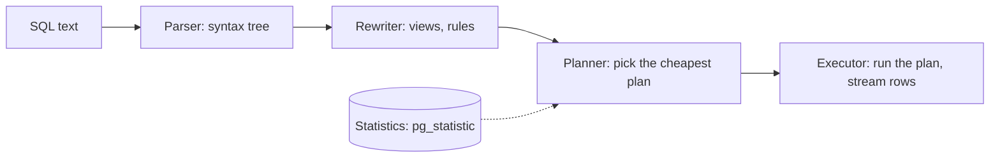
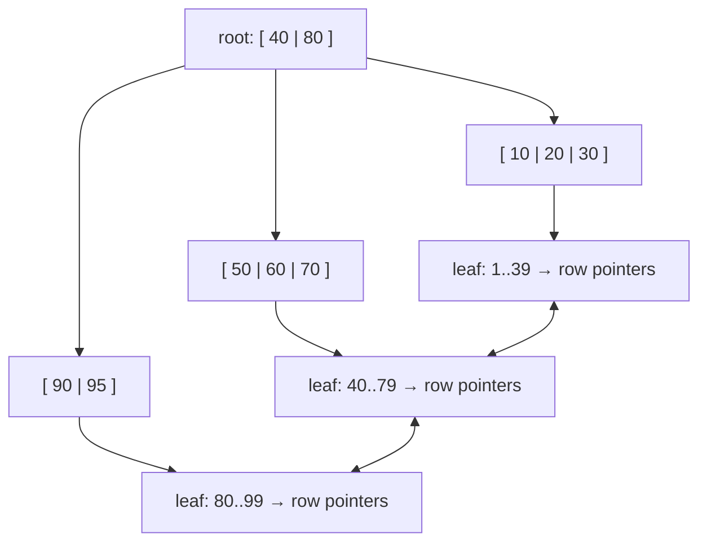
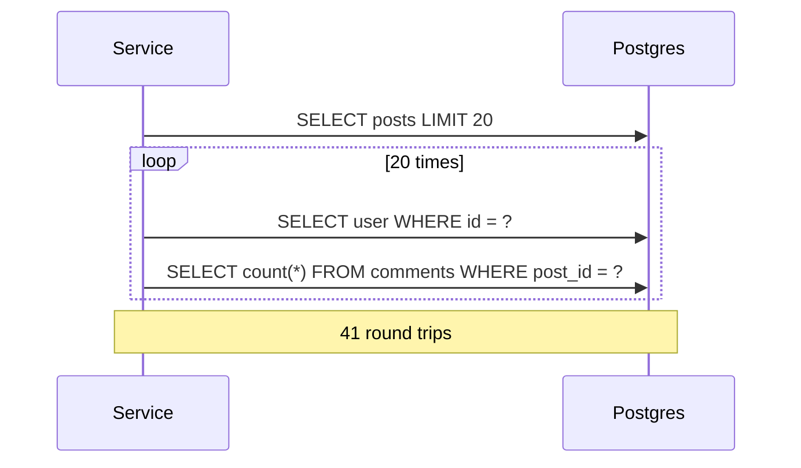
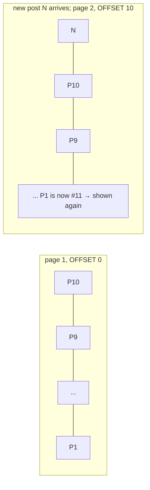

# 14 · Query Performance

> Most "the API is slow" tickets end in the database, and most of those come down to a handful of patterns: a missing index, an index the query can't use, a loop that fires one query per row, or pagination that gets slower every page. Learn to *see* them in a query plan and you'll fix in minutes what other people throw hardware at.

**Time:** ~7h · **Challenge:** 🐛 Debug · **Prereqs:** [11 · SQL Fundamentals](../11-sql-fundamentals/README.md), [13 · Postgres from Node](../13-node-postgres/README.md) · **Services:** Postgres

## What you'll learn

- What happens between sending SQL and getting rows back: parser, planner, executor
- How to read `EXPLAIN` and `EXPLAIN ANALYZE`: scan types, join types, estimated vs actual rows
- How a **B-tree index** works, and why that explains every indexing rule
- **Composite indexes** and column order, **covering indexes** (`INCLUDE`), **partial** and **expression** indexes
- When indexes don't help, and when they actively hurt
- The **N+1 query** problem and its fixes: JOINs, `= ANY($1)` batching, the DataLoader idea
- Why **OFFSET pagination** degrades and how **keyset (cursor) pagination** fixes it
- Planner **statistics** (`ANALYZE`), `pg_stat_statements`, and the pool as a bottleneck

---

## 1. How Postgres runs a query

When your repository sends `SELECT ... FROM posts WHERE author_id = $1 ORDER BY created_at DESC LIMIT 20`, Postgres does four things:



The interesting step is the **planner**. SQL says *what* you want, not *how* to get it. For one query there may be dozens of possible strategies: read the whole table or use an index? Which index? Join A to B or B to A? Nested loop or hash join? The planner estimates the **cost** of each candidate using table statistics (row counts, value distributions) and picks the cheapest.

Cost is in arbitrary units, roughly "pages read" with random reads weighted more than sequential ones. You don't need the formula. You need to know that **the planner is only as good as its estimates**, and estimates come from statistics.

The executor runs the plan as a **tree of nodes**. Each node pulls rows from its children, does its job (filter, sort, join), and hands rows up. Rows stream: a `Limit` node at the top can stop the whole tree early once it has enough rows. That detail matters a lot for pagination.

## 2. Reading `EXPLAIN`

`EXPLAIN` shows the chosen plan without running the query. `EXPLAIN ANALYZE` runs it and adds what actually happened.

```sql
EXPLAIN ANALYZE
SELECT id, created_at FROM posts WHERE author_id = 5 ORDER BY created_at DESC LIMIT 20;
```

```
Limit  (cost=8233.08..8233.09 rows=6 width=16) (actual time=11.2..11.2 rows=6 loops=1)
  ->  Sort  (cost=8233.08..8233.09 rows=6 width=16) (actual time=11.2..11.2 rows=6 loops=1)
        Sort Key: created_at DESC
        Sort Method: quicksort  Memory: 25kB
        ->  Seq Scan on posts  (cost=0.00..8233.00 rows=6 width=16) (actual time=0.9..11.1 rows=6 loops=1)
              Filter: (author_id = 5)
              Rows Removed by Filter: 119994
Planning Time: 0.1 ms
Execution Time: 11.3 ms
```

Read it **from the innermost node outward** (bottom up). Indentation shows the tree.

| Part | Meaning |
|---|---|
| `Seq Scan on posts` | node type and the table it reads |
| `cost=0.00..8233.00` | estimated startup cost .. total cost |
| `rows=6` | **estimated** rows this node outputs |
| `width=16` | estimated bytes per row |
| `actual time=0.9..11.1` | ms to first row .. ms to last row (per loop) |
| `rows=6 loops=1` | **actual** rows per loop, and how many times the node ran |
| `Rows Removed by Filter: 119994` | read and thrown away: the smell |

This plan read **120,000 rows to return 6**. The fix (a composite index starting with `author_id`) turns it into this:

```
Limit  (actual time=0.14..0.15 rows=6 loops=1)
  ->  Sort  (actual time=0.14..0.14 rows=6 loops=1)
        Sort Key: created_at DESC, id DESC
        Sort Method: quicksort  Memory: 25kB
        ->  Bitmap Heap Scan on posts  (actual time=0.06..0.10 rows=6 loops=1)
              Recheck Cond: (author_id = 5)
              ->  Bitmap Index Scan on posts_author_id_created_at_id_idx  (actual time=0.04..0.04 rows=6 loops=1)
                    Index Cond: (author_id = 5)
Execution Time: 0.16 ms
```

About seventy times faster, and the gap grows with the table. (The leftover Sort is over 6 rows, so it's free. Section 4 explains when the index removes it too.)

### Scan types

| Node | What it does | Good when |
|---|---|---|
| **Seq Scan** | reads every page of the table | the table is small, or you need a large fraction of it |
| **Index Scan** | walks the index, fetches each matching row from the table | few rows match; also gives rows in index order |
| **Index Only Scan** | answers from the index alone, no table access | all needed columns are in the index (and the visibility map is fresh) |
| **Bitmap Index Scan → Bitmap Heap Scan** | collects matching row locations from the index, then reads table pages in physical order | a moderate number of rows; can combine several indexes (`BitmapAnd`/`BitmapOr`) |

A Seq Scan is **not always bad**. On a 50-row lookup table it's the fastest option. On a 120k-row table to fetch 6 rows, it's a bug.

### Join types

| Node | How | Good when |
|---|---|---|
| **Nested Loop** | for each outer row, look up matching inner rows (ideally via index) | the outer side is small, e.g. 20 posts → their authors |
| **Hash Join** | build a hash table from one side, probe with the other | large unsorted inputs, equality joins |
| **Merge Join** | walk two sorted inputs together | both sides already sorted (e.g. by index) |

### Estimated vs actual: the most useful comparison

When `rows=` (estimate) and `actual ... rows=` differ by 10× or more, the planner chose its plan based on a wrong belief. Common causes: stale statistics (run `ANALYZE`), correlated columns the planner treats as independent, or functions it can't see through. A bad estimate deep in the tree cascades into a bad join choice above it.

### Useful options

```sql
EXPLAIN (ANALYZE, BUFFERS) ...      -- adds pages hit in cache vs read from disk
EXPLAIN (ANALYZE, FORMAT JSON) ...  -- machine-readable (the challenge's tests use this)
```

> ⚠️ `EXPLAIN ANALYZE` **executes** the statement. For `UPDATE`/`DELETE`, wrap it: `BEGIN; EXPLAIN ANALYZE DELETE ...; ROLLBACK;`

Deeper walk-through: [docs/reading-explain.md](docs/reading-explain.md).

## 3. How a B-tree index works

The default `CREATE INDEX` builds a **B-tree**: a balanced, sorted tree of keys, where each leaf entry points to a row's location in the table (its TID). Leaves are linked, so you can walk them in order in either direction.



That structure explains every rule you'll hear:

- **Lookup is O(log n).** A few page reads find a key among millions.
- **Ranges and sorting are cheap.** Find the start, then walk the linked leaves. An index on `created_at` can return rows already sorted, so `ORDER BY created_at DESC LIMIT 20` reads 20 entries and stops.
- **The index stores the column's value, not anything derived from it.** An index on `email` contains `"User42@Example.com"`. A query on `lower(email)` asks about `"user42@example.com"`, which isn't in that tree. Postgres has no way to use it. (Section 5.)
- **Every index costs writes.** Each `INSERT` updates every index on the table; each `UPDATE` of an indexed column does too. Indexes also take disk and cache space.

### Primary keys and foreign keys

Postgres automatically indexes `PRIMARY KEY` and `UNIQUE` columns (that's how it enforces uniqueness). It does **not** index foreign key columns. `posts.author_id REFERENCES users(id)` gives you an index on `users.id`, not on `posts.author_id`. "Show me this user's posts" needs one you create yourself. This is one of the most common missing indexes in real systems, and it also makes `ON DELETE CASCADE` slow.

## 4. Composite indexes and column order

A composite index sorts by the first column, then by the second within equal firsts, and so on, exactly like a phone book sorted by (last name, first name).

```sql
CREATE INDEX posts_author_id_created_at_id_idx ON posts (author_id, created_at DESC, id DESC);
```

What it can serve:

| Query | Uses it? | Why |
|---|---|---|
| `WHERE author_id = 5` | ✅ | leading column |
| `WHERE author_id = 5 ORDER BY created_at DESC, id DESC LIMIT 20` | ✅✅ | finds author 5, rows already in order, stops after 20 |
| `WHERE author_id = 5 AND created_at > '2026-05-01'` | ✅ | equality then range |
| `WHERE created_at > '2026-05-01'` | ❌ (mostly) | not the leading column: like finding everyone named "Ana" in a phone book |
| `WHERE author_id IN (1,2,3) ORDER BY created_at` | partly | finds the authors, but needs a sort to merge them |

"Can serve" isn't "will always be used that way". When only a handful of rows match (6 posts for an author), the planner may fetch them with a bitmap scan and sort them in memory, as in section 2. When thousands match, walking the index in order and stopping at the `LIMIT` wins, and that's when the column order really pays off.

The rule of thumb for column order: **equality columns first, then the column you sort or range on**. Put the most selective equality column first when there are several, but the equality/range split matters more.

Direction (`DESC`) matters only for mixed orders like `ORDER BY a ASC, b DESC`; a B-tree can be walked backward, so `(created_at, id)` serves `ORDER BY created_at DESC, id DESC` too.

### Covering indexes (`INCLUDE`)

If an index contains every column a query needs, Postgres can do an **Index Only Scan** and skip the table entirely:

```sql
CREATE INDEX posts_author_feed_idx ON posts (author_id, created_at DESC) INCLUDE (id);
```

`INCLUDE` columns are stored in the leaves but aren't part of the sort key. Use this for very hot queries. Don't stuff big columns (like `body`) in there; you'd duplicate the table.

## 5. Partial and expression indexes

**Expression indexes** index the result of an expression. They're the fix whenever a query wraps a column in a function:

```sql
-- the query
SELECT ... FROM users WHERE lower(email) = lower($1);
-- the index that matches it, character for character
CREATE UNIQUE INDEX users_lower_email_key ON users (lower(email));
```

The rule: **the indexed expression must match the query's expression**. `WHERE created_at::date = '2026-05-01'` can't use an index on `created_at`. Either index `(created_at::date)` or, better, rewrite the query as a range: `WHERE created_at >= '2026-05-01' AND created_at < '2026-05-02'`. Rewriting so the bare column is compared is called making the predicate **sargable**.

Same family of mistakes: `WHERE id::text = $1`, `WHERE coalesce(deleted_at, 'infinity') > now()`, `WHERE email ILIKE $1` (needs a trigram index, see [docs/indexing-cheatsheet.md](docs/indexing-cheatsheet.md)).

**Partial indexes** index only the rows matching a `WHERE`:

```sql
-- Only 2% of jobs are pending, and that's all the worker ever queries.
CREATE INDEX jobs_pending_idx ON jobs (run_at) WHERE status = 'pending';

-- "Unique among non-deleted rows"
CREATE UNIQUE INDEX users_email_active_key ON users (lower(email)) WHERE deleted_at IS NULL;
```

They're smaller, faster to maintain, and great for "hot subset" queries. The query's `WHERE` must imply the index's `WHERE` for Postgres to use it.

## 6. When indexes don't help (or hurt)

- **Low selectivity.** `WHERE status = 'active'` when 95% of rows are active: reading the index and then nearly every table page is slower than a Seq Scan. The planner knows this (from statistics) and ignores the index. That's correct, not a bug.
- **Small tables.** A few pages: a Seq Scan wins.
- **Write-heavy tables.** Ten indexes means every insert does eleven writes. Audit unused indexes (`pg_stat_user_indexes.idx_scan = 0`) and drop them.
- **Redundant indexes.** An index on `(author_id)` is redundant next to `(author_id, created_at)`, which serves the same queries.
- **Leading wildcards.** `LIKE '%term'` can't use a B-tree.
- **Type mismatches.** Comparing a `bigint` column with a `numeric` parameter can disable the index. Cast the parameter, not the column.

Indexes are a trade-off you justify with a query, not a decoration you add "just in case".

## 7. The N+1 query problem

The most common performance bug in application code. It hides in innocent-looking loops:

```ts
const posts = await postRepo.listRecent(20);                 // 1 query
for (const post of posts) {
  post.author = await userRepo.findById(post.authorId);       // +20 queries
  post.commentCount = await commentRepo.countForPost(post.id); // +20 queries
}
// 41 queries for one page
```

Each query is fast (0.5 ms), so nobody notices in development. In production, each one is a **network round trip** to the database plus a pool checkout. 41 × 1 ms is 41 ms of pure latency per request, it scales with page size, and under load those queries compete for pool connections (section 9).



Layered architectures make N+1 *easy*: the service composes repositories that each fetch one thing. ORMs with lazy-loaded relations make it *invisible*. The fix is to fetch **by set, not by item**.

**Fix 1: JOIN** when the relationship is one-to-one from the row's point of view:

```sql
SELECT p.id, left(p.body, 140) AS excerpt, u.handle, u.display_name
FROM posts p JOIN users u ON u.id = p.author_id
ORDER BY p.created_at DESC, p.id DESC LIMIT 20;
```

**Fix 2: batch with `= ANY($1)`** and stitch in code. Often cleaner in a layered app because each repository keeps owning its table:

```ts
const posts   = await postRepo.listFeedPage(20);                          // 1
const authors = await userRepo.findByIds(posts.map((p) => p.authorId));   // 1: WHERE id = ANY($1::bigint[])
const counts  = await commentRepo.countByPostIds(posts.map((p) => p.id)); // 1: ... GROUP BY post_id
const byId = new Map(authors.map((a) => [a.id, a]));
// 3 queries, whatever the page size
```

Note the details: deduplicate ids, return a `Map`, default missing counts to 0 (posts with no comments don't appear in a `GROUP BY` result).

**Fix 3: the DataLoader pattern.** In GraphQL servers, resolvers run per field, so you can't hand-batch. A DataLoader collects all `load(id)` calls made in the same tick and issues one batched query. Same idea, automated.

> `Promise.all(posts.map(p => userRepo.findById(p.authorId)))` is **not** a fix. It's still 20 queries, just fired at once, and now they grab 20 pool connections simultaneously.

**How to catch it:** log queries in development (the challenge's `LOG_QUERIES=true`), count queries per request in tests (the challenge's tests do), and watch `calls` in `pg_stat_statements` in production.

## 8. Pagination: OFFSET vs keyset

The obvious way:

```sql
SELECT ... FROM posts ORDER BY created_at DESC, id DESC LIMIT 20 OFFSET 3000;
```

Two problems.

**It gets slower every page.** `OFFSET 3000` doesn't jump to row 3000. Postgres has to produce rows 1..3020 and throw away the first 3000. Page 1 reads 20 rows, page 151 reads 3,020, page 5,000 reads 100,000. Deep pages (and crawlers love deep pages) are slow and expensive.

**It's wrong when data changes.** A user loads page 1 (posts 1–10). Someone publishes a post. Page 2 (`OFFSET 10`) now starts at what *used to be* post 10, so the user sees it twice. Deletions make items silently disappear between pages instead.



**Keyset pagination** (also called cursor or seek pagination) remembers *where you were*, not *how many you skipped*:

```sql
-- first page
SELECT id, created_at, ... FROM posts ORDER BY created_at DESC, id DESC LIMIT 21;

-- next page: everything strictly after the last row we returned
SELECT id, created_at, ... FROM posts
WHERE (created_at, id) < ($1, $2)
ORDER BY created_at DESC, id DESC
LIMIT 21;
```

- With an index on `(created_at, id)`, Postgres **seeks** directly to the position and reads 21 entries. Page 5,000 costs the same as page 1.
- New posts land "before" the cursor, so they never shift the pages after it.
- Fetching `limit + 1` rows tells you whether a next page exists without a `count(*)`.

Get the details right:

1. **A unique tie-breaker.** `created_at` alone isn't unique; two posts in the same millisecond (or batch-inserted rows) would be skipped or repeated at page boundaries. Order by `(created_at, id)` and compare the **row value** `(created_at, id) < ($1, $2)`.
2. **Precision.** Postgres timestamps have microsecond precision; JavaScript `Date` has milliseconds. If you put `row.created_at.toISOString()` in the cursor, you lose microseconds and the comparison can skip rows. Carry the value as Postgres text (`created_at::text`) or epoch microseconds.
3. **Opaque cursors.** Encode the position (base64url JSON) and treat it as opaque in the API contract. That lets you change the encoding later, and clients can't construct arbitrary ones. Validate on decode.
4. **Trade-offs.** No "jump to page 37" and no total page count. For infinite scroll, feeds and APIs, that's fine. For admin tables that genuinely need page numbers, OFFSET on a *filtered, small* result set is acceptable.

More detail: [docs/pagination-and-n-plus-one.md](docs/pagination-and-n-plus-one.md).

## 9. Fetch only what you need

`SELECT *` in a list endpoint pulls every column of every row: the 5 KB `body`, the JSON blob, the column someone adds next year. That costs disk and cache reads (large values live out of line in TOAST storage, which is extra I/O to fetch), network bandwidth between database and app, and memory and JSON serialization time in Node.

If the list shows a 140-character excerpt, compute it in SQL (`left(body, 140) AS excerpt`) and select only the columns you use. Bonus: a narrow select can enable Index Only Scans.

## 10. Statistics, `pg_stat_statements` and the pool

**Statistics.** The planner's estimates come from `pg_statistic`, filled by `ANALYZE` (autovacuum runs it automatically as tables change). After a bulk load or a big delete, statistics can be stale, and plans go wrong. Run `ANALYZE tablename` manually after large data changes (the challenge's seed does). For correlated columns (`city` and `zip_code`), `CREATE STATISTICS` teaches the planner about the dependency.

**Finding slow queries.** Don't guess. The `pg_stat_statements` extension aggregates every normalized query: calls, total and mean time, rows.

```sql
CREATE EXTENSION IF NOT EXISTS pg_stat_statements; -- needs shared_preload_libraries
SELECT calls, round(total_exec_time) AS total_ms, round(mean_exec_time, 2) AS mean_ms, left(query, 80)
FROM pg_stat_statements ORDER BY total_exec_time DESC LIMIT 10;
```

Sort by **total** time, not mean: a 2 ms query called 5 million times a day matters more than a 2 s report run once. An N+1 shows up as a cheap query with an enormous `calls` count. Also useful: `log_min_duration_statement = 250ms` logs slow statements, and the `auto_explain` module logs their plans.

**The pool as a bottleneck.** Your pool has `max` connections. When every connection is busy, requests queue in Node *before* reaching the database. Database metrics look calm while API latency climbs. Slow queries and N+1s hold connections longer, which shrinks your effective capacity. By Little's law, connections busy ≈ queries per second × average query time: 2,000 q/s × 5 ms = 10 connections, your entire pool. Making queries faster or fewer is usually the real fix, not a bigger pool ([module 13](../13-node-postgres/README.md) covers sizing).

## Common mistakes

- Assuming foreign keys are indexed. They aren't.
- Wrapping an indexed column in a function or cast (`lower(email)`, `created_at::date`, `id::text`) without a matching expression index.
- Adding an index and never checking with `EXPLAIN` that it's used.
- Composite index in the wrong order: range/sort column before the equality column.
- Benchmarking on a 100-row dev database. Plans on tiny tables tell you nothing; seed realistic volumes.
- Forgetting `ANALYZE` after bulk loads.
- Hiding N+1 with `Promise.all`.
- OFFSET pagination on large, changing tables; keyset without a unique tie-breaker.
- Putting JS `Date` values in keyset cursors (microseconds lost).
- `SELECT *` in list endpoints.
- Indexing every column "just in case", then wondering why writes are slow.

## In production

- **Index changes on live tables** use `CREATE INDEX CONCURRENTLY` (doesn't block writes, can't run inside a transaction, may leave an `INVALID` index if it fails). Migration tools need a way to opt out of the per-file transaction for this.
- **Query budgets.** Mature teams put "max queries per request" assertions in tests (exactly what this challenge does) and alert on query count regressions. Shopify, GitHub and others built tooling for this in Rails; the idea transfers.
- **Observability.** Track p95/p99 per endpoint, `pg_stat_statements` top queries, pool `waitingCount`, and cache hit ratio. Slow-query logs with `auto_explain` capture the plan at the moment it was slow, which you often can't reproduce later.
- **Plans change.** A query that was fast can flip to a bad plan when data grows or the distribution shifts. Re-check hot queries as tables grow, and look at estimated vs actual rows first.
- **Beyond indexes:** caching ([module 18](../18-caching/README.md)), read replicas, materialized views for heavy aggregates, denormalized counters (`posts.comment_count` maintained on write), and partitioning very large tables.

## Check yourself

1. A plan shows `Seq Scan on users ... Filter: (lower(email) = ...)` even though `email` has a UNIQUE index. Why, and what's the fix?
   <details><summary>Answer</summary>The index stores <code>email</code>, but the query compares <code>lower(email)</code>, a value not in the index. Create an expression index on <code>(lower(email))</code> (ideally UNIQUE), or store a normalized email column, or use <code>citext</code>.</details>
2. Which index serves `WHERE author_id = $1 ORDER BY created_at DESC LIMIT 20` best, and why?
   <details><summary>Answer</summary><code>(author_id, created_at DESC)</code> (plus <code>id</code> as tie-breaker if you order by it): the equality column first locates the author's entries, which are already sorted by <code>created_at</code>, so the scan stops after 20 rows with no sort.</details>
3. Why does `OFFSET 100000` get slow, and how does keyset pagination avoid it?
   <details><summary>Answer</summary>OFFSET has to produce and discard every skipped row. Keyset pagination filters <code>WHERE (created_at, id) &lt; (last values)</code>, which an index on <code>(created_at, id)</code> can seek to directly, so each page reads only <code>limit</code> rows.</details>
4. A request makes 41 queries that each take 0.5 ms. Why is that a problem, and how do you fix it?
   <details><summary>Answer</summary>It's an N+1: each query is a network round trip and a pool checkout, so latency and connection usage grow with page size. Fetch by set: a JOIN, or batched <code>WHERE id = ANY($1)</code> queries stitched together with a Map.</details>
5. What does it mean when a node's estimated rows is 5 and actual rows is 50,000?
   <details><summary>Answer</summary>The planner's statistics or assumptions are wrong, so it may have chosen a bad plan (e.g. a nested loop that should be a hash join). Run <code>ANALYZE</code>, check for correlated columns or non-sargable expressions, and re-check the plan.</details>

## Further reading

- PostgreSQL docs, Using EXPLAIN: https://www.postgresql.org/docs/current/using-explain.html
- PostgreSQL docs, Indexes (types, multicolumn, expression, partial, index-only scans): https://www.postgresql.org/docs/current/indexes.html
- PostgreSQL docs, pg_stat_statements: https://www.postgresql.org/docs/current/pgstatstatements.html
- PostgreSQL docs, Statistics used by the planner: https://www.postgresql.org/docs/current/planner-stats.html
- Use The Index, Luke (a free book on SQL indexing): https://use-the-index-luke.com/
- Deep dives in this module: [docs/reading-explain.md](docs/reading-explain.md) · [docs/pagination-and-n-plus-one.md](docs/pagination-and-n-plus-one.md) · [docs/indexing-cheatsheet.md](docs/indexing-cheatsheet.md)
- Repo cheat sheet: [../docs/cheatsheets/sql.md](../docs/cheatsheets/sql.md)

## ➡️ Next: [the challenge](CHALLENGE.md)
