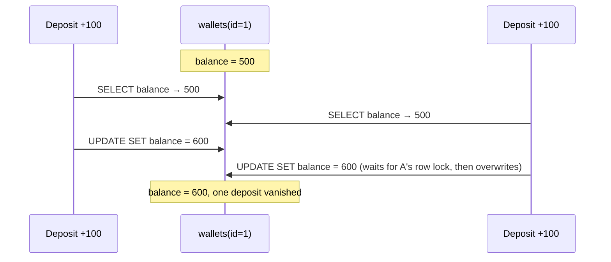
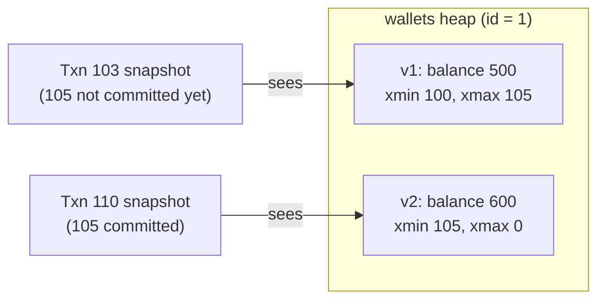
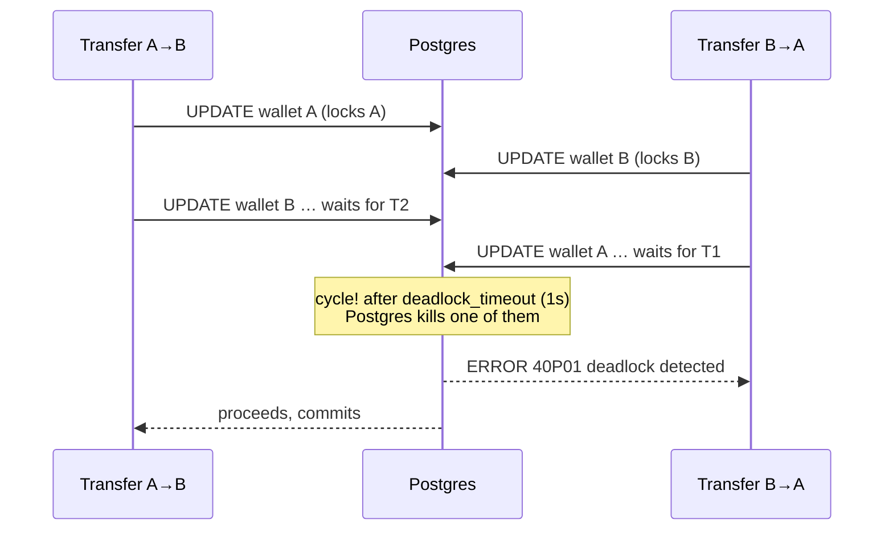

# 15 · Transactions & Concurrency

> Your code works fine when one request runs at a time. Production never runs one request at a time. This module is about the bugs that only appear when two requests touch the same row in the same millisecond: oversold concerts, money that appears from nowhere, double charges and an API that locks up at 3 a.m.

**Time:** ~7h · **Challenge:** 🐛 Debug · **Prereqs:** [13 · Postgres from Node](../13-node-postgres/README.md), [14 · Query Performance](../14-query-performance/README.md) · **Services:** Postgres

## What you'll learn

- What a transaction guarantees (ACID), and the guarantee it does **not** give you by default
- The classic concurrency anomalies: lost update, write skew, phantoms, non-repeatable reads
- Postgres isolation levels (Read Committed, Repeatable Read, Serializable) and what each one prevents
- How MVCC works, and why readers never block writers in Postgres
- Row locks: `SELECT … FOR UPDATE`, `NOWAIT`, `SKIP LOCKED`
- Three ways to stop a race: atomic conditional `UPDATE`s, pessimistic locks, optimistic version columns
- Using **constraints** (UNIQUE, CHECK) as concurrency control
- Deadlocks: why they happen, how Postgres resolves them and how lock ordering prevents them
- Retrying serialization failures (`40001`) correctly
- Advisory locks, and **idempotency keys** for safe client retries
- Why a forgotten `ROLLBACK`/`release()` can take down the whole API

---

## 1. The problem: check-then-act

Almost every concurrency bug in a web backend has the same shape. Here's one from this module's challenge:

```ts
const sold = await countTicketsSold(tx, concertId);      // 1. read
if (sold + quantity > capacity) throw new SoldOutError(); // 2. decide
await insertBooking(tx, { concertId, quantity });          // 3. write
```

Read it slowly: it looks correct, and with one user it *is* correct. The bug is the gap between step 1 and step 3. Between them, another request can do its own step 1 and see the same count. Both decide "there's room", both insert.

```mermaid
sequenceDiagram
  participant A as Request A
  participant DB as Postgres
  participant B as Request B
  Note over DB: capacity 5, sold 4
  A->>DB: SELECT sum(quantity) → 4
  B->>DB: SELECT sum(quantity) → 4
  A->>A: 4 + 1 ≤ 5 ✅
  B->>B: 4 + 1 ≤ 5 ✅
  A->>DB: INSERT booking; COMMIT
  B->>DB: INSERT booking; COMMIT
  Note over DB: sold 6 of 5 😱
```

This pattern is called **check-then-act** (or read-modify-write when the "act" writes back a value derived from the read). Notice that wrapping it in `BEGIN … COMMIT` did **not** help. That's the single most important lesson of this module:

> A transaction makes your changes **atomic** (all or nothing). By default it does **not** make them **isolated** from other transactions running at the same time.

To see why, we need to pin down what a transaction actually promises.

## 2. ACID, precisely

| Letter | Promise | What it means in practice |
|---|---|---|
| **A**tomicity | All statements commit, or none do | If the wallet debit fails, the seat reservation in the same transaction is undone too. |
| **C**onsistency | Constraints hold after every commit | `CHECK (balance_cents >= 0)`, foreign keys and UNIQUE indexes are never violated by committed data. |
| **I**solation | Concurrent transactions don't see each other's half-done work | **How much** isolation you get depends on the isolation level. This is where the bugs live. |
| **D**urability | Once COMMIT returns, it survives a crash | Postgres writes the WAL (write-ahead log) to disk before acknowledging the commit. |

Atomicity and durability you get for free. Consistency is only as good as the constraints you declare (more on that in section 7). Isolation is a dial, and Postgres ships it turned to a fairly low setting for performance reasons.

## 3. The anomalies

The SQL standard defines isolation levels by which "anomalies" they allow. Learn the names: interviewers use them, and so do Postgres error messages and docs.

### Dirty read
Reading another transaction's **uncommitted** change. Postgres never allows this, at any level.

### Non-repeatable read
You read a row twice in the same transaction and get different values, because someone committed an update in between.

### Phantom read
You run the same `WHERE` query twice and get a different **set** of rows, because someone inserted or deleted matching rows in between.

### Lost update
Two transactions read the same value, both compute a new value from it, both write. The second write silently overwrites the first.



Note the detail: B's `UPDATE` *does* wait for A's row lock. But B already computed `600` in JavaScript from a stale read, so waiting doesn't save it. The database can only protect values it computes itself.

### Write skew
The sneakiest one. Two transactions read an **overlapping set** of rows, each checks an invariant, and each writes a **different** row. No row is written twice, so no row lock conflicts, yet together they break the invariant.

Classic example: "at least one doctor must be on call". Alice and Bob are both on call. Each, at the same time, checks `count(on_call) = 2 ≥ 2`, so it's safe to leave, and each updates **their own** row to `on_call = false`. Now nobody is on call. Overselling seats by counting `bookings` rows (section 1) is also write skew: each request inserts a different row.

## 4. Isolation levels in Postgres

```sql
BEGIN ISOLATION LEVEL REPEATABLE READ;
-- or, for the current transaction:
SET TRANSACTION ISOLATION LEVEL SERIALIZABLE;
```

| Level | Snapshot taken | Dirty read | Non-repeatable read | Phantom | Lost update | Write skew |
|---|---|---|---|---|---|---|
| Read Uncommitted (*= Read Committed in PG*) | per statement | ❌ | possible | possible | possible | possible |
| **Read Committed** (default) | **per statement** | ❌ | possible | possible | possible | possible |
| Repeatable Read | per transaction | ❌ | ❌ | ❌ (in PG) | ❌ (raises error) | possible |
| Serializable | per transaction + conflict tracking | ❌ | ❌ | ❌ | ❌ | ❌ (raises error) |

### Read Committed (the default)

Every **statement** sees a fresh snapshot of everything committed before that statement started. So two `SELECT`s in one transaction can see different data.

There's one important behavior for writes. When an `UPDATE` (or `DELETE`, or `SELECT … FOR UPDATE`) hits a row that another transaction has modified but not yet committed, it **waits**. When the other transaction commits, Postgres **re-reads the latest version of that row and re-checks the `WHERE` clause** against it before applying the update. That's what makes this safe even at Read Committed:

```sql
UPDATE wallets SET balance_cents = balance_cents + 100 WHERE id = 1;
```

Two of these in parallel: the second waits, then adds 100 to the *new* value. No lost update, because the arithmetic happens inside the database on the current row version.

### Repeatable Read

The whole transaction sees **one** snapshot, taken at its first statement. Re-reading gives the same result. Postgres implements this as *snapshot isolation*, which (unlike the SQL standard's minimum) also prevents phantoms.

If you try to update a row that someone else changed and committed after your snapshot, Postgres doesn't silently re-check like Read Committed does. It aborts you:

```
ERROR:  could not serialize access due to concurrent update   (SQLSTATE 40001)
```

So lost updates become errors, which is good, but you must **retry** the transaction. Write skew still gets through, because the two transactions write different rows.

### Serializable

Postgres uses **Serializable Snapshot Isolation (SSI)**: Repeatable Read plus tracking of read/write dependencies between concurrent transactions. If the combination of transactions couldn't have happened in *some* serial order, one of them fails with `40001`. It catches write skew. The guarantee is simple to state: *if every transaction is correct when run alone, they're correct together*. The price is retries and some overhead, and you should keep transactions short.

> 💡 Higher isolation doesn't make transactions wait more, it makes them **fail** more. Choosing Repeatable Read or Serializable means signing up to catch `40001` and retry the whole transaction. See section 9.

## 5. MVCC: how Postgres does all this

Postgres never updates a row in place. An `UPDATE` writes a **new version** of the row (a new *tuple*) and marks the old one as expired. Each tuple carries hidden columns:

- `xmin`: the transaction id that created this version
- `xmax`: the transaction id that deleted or replaced it (0 if still live)

```sql
SELECT xmin, xmax, id, balance_cents FROM wallets WHERE id = 1;
```

A snapshot is essentially "which transaction ids count as committed for me". When your query scans a table, it picks the version of each row that's visible to your snapshot. Consequences:

- **Readers never block writers, and writers never block readers.** A long `SELECT` sees its snapshot while updates happen underneath it.
- **Writers do block writers** on the same row: the second updater waits on the first one's row lock until commit or rollback.
- Old versions pile up as **dead tuples**. `VACUUM` (usually autovacuum) cleans them once no running transaction can still see them. A transaction left open for hours prevents that cleanup and the table bloats. That's one reason "idle in transaction" sessions are dangerous (section 11).



## 6. Three ways to fix a race

Back to check-then-act. There are three families of fixes, and choosing between them is a real engineering decision.

### 6a. Make it one atomic statement (preferred when possible)

Move the check **into** the write so the database evaluates both under the row lock:

```sql
-- seats: reserve only if there's room
UPDATE concerts
   SET tickets_sold = tickets_sold + $2
 WHERE id = $1 AND tickets_sold + $2 <= capacity
RETURNING tickets_sold;

-- money: debit only if the balance covers it
UPDATE wallets
   SET balance_cents = balance_cents - $2
 WHERE id = $1 AND balance_cents >= $2
RETURNING balance_cents;
```

Zero rows returned means "the condition failed" (sold out / insufficient funds, or the row doesn't exist; check which with a follow-up query if you need to tell them apart). This is the famous `UPDATE … WHERE stock >= n` pattern. One round trip, the shortest possible lock, works at Read Committed, no retries.

It requires that the fact you check is stored in **one row** you can update. That's often a reason to keep a counter (`tickets_sold`) rather than computing `SUM(quantity)` every time.

### 6b. Pessimistic locking: `SELECT … FOR UPDATE`

When the logic is too complex for one statement, lock the row first, then do read-decide-write while holding the lock:

```ts
await withTransaction(pool, async (tx) => {
  const { rows } = await tx.query(
    "SELECT capacity FROM concerts WHERE id = $1 FOR UPDATE", [concertId]);
  // Any other transaction running the same SELECT … FOR UPDATE now waits here
  const sold = await countTicketsSold(tx, concertId);
  if (sold + quantity > rows[0].capacity) throw new SoldOutError();
  await insertBooking(tx, { concertId, quantity });
}); // lock released at COMMIT/ROLLBACK
```

The lock is on the **concert** row, which acts as a mutex for "all bookings of this concert". Every code path that changes bookings for a concert must take the same lock, or the protection is gone.

Variants:

| Clause | Behavior |
|---|---|
| `FOR UPDATE` | Exclusive row lock; waits if another txn holds it |
| `FOR NO KEY UPDATE` | Slightly weaker (doesn't block FK checks from child inserts); what a plain `UPDATE` takes |
| `FOR SHARE` | Shared lock: others can read-lock too, but nobody can update |
| `… NOWAIT` | Don't wait: fail immediately with `55P03 lock_not_available` |
| `… SKIP LOCKED` | Silently skip rows that are locked. Perfect for job queues: `SELECT … FROM jobs WHERE status='ready' ORDER BY id LIMIT 1 FOR UPDATE SKIP LOCKED` lets N workers each grab a different job |

### 6c. Optimistic concurrency: version columns

Don't lock at all. Read the row along with a `version`, and make the write conditional on the version being unchanged:

```sql
SELECT id, title, body, version FROM documents WHERE id = $1;   -- version = 7
-- ... user edits for 3 minutes in the browser ...
UPDATE documents
   SET title = $2, body = $3, version = version + 1
 WHERE id = $1 AND version = 7;
-- rowCount 0 → someone else saved first → 409 Conflict, client reloads/merges
```

This is the right tool when the read and the write are far apart in time (a form open in the browser, an HTTP `If-Match: "7"` ETag header). You can't hold a database lock across a user's think time. Conflicts are expected to be rare, and when they happen you report them instead of blocking.

| | Atomic UPDATE | Pessimistic (FOR UPDATE) | Optimistic (version) |
|---|---|---|---|
| Lock held | one statement | whole transaction | none |
| On conflict | condition fails (0 rows) | waits | 0 rows → retry or 409 |
| Best for | counters, balances, stock | multi-step logic on hot rows | long think-time edits, low contention |
| Risk | logic must fit in SQL | deadlocks, lock waits | retry storms under high contention |

## 7. Constraints are concurrency control

A `UNIQUE` index is enforced by Postgres **across concurrent transactions**: if two transactions insert the same key, the second one *waits* for the first, then fails with `23505 unique_violation` if the first committed (or succeeds if it rolled back). That's a free, bulletproof lock on a value that doesn't exist yet. Row locks can't do that, because you can't lock a row that doesn't exist.

Use it for "only one X":

```sql
-- one seat can be sold once
CREATE UNIQUE INDEX ON seat_assignments (concert_id, seat_no);
-- one active subscription per user
CREATE UNIQUE INDEX ON subscriptions (user_id) WHERE status = 'active';
```

And `CHECK` constraints are your last line of defense:

```sql
ALTER TABLE concerts ADD CHECK (tickets_sold BETWEEN 0 AND capacity);
ALTER TABLE wallets  ADD CHECK (balance_cents >= 0);
```

Even if a future teammate writes a racy code path, the database refuses to commit an oversold concert. Catch the error code (`23514 check_violation`, `23505 unique_violation`) and map it to a domain error. Treat this as a safety net, not your main logic: error-driven control flow is harder to read, and an aborted statement aborts the whole transaction.

## 8. Deadlocks and lock ordering

Transfer A→B debits A then credits B. Transfer B→A debits B then credits A. Run them at the same moment:



Postgres runs a deadlock detector when a lock wait exceeds `deadlock_timeout` (1 second by default). It aborts one transaction with `40P01 deadlock_detected`. Your API returns a 500, and every deadlock costs at least a second of latency for the survivor.

**The fix is lock ordering:** every transaction acquires locks in the same global order. If everyone locks the lower id first, a cycle is impossible: whoever gets the first lock gets both.

```sql
SELECT id FROM wallets WHERE id = ANY($1) ORDER BY id FOR UPDATE;
```

Then do the updates in any order, because you already hold both locks. The same rule applies across tables: decide on an order (e.g. "idempotency key → concert → wallet") and document it next to the code.

Other deadlock reducers: keep transactions short, don't do network calls (HTTP, emails) inside them, and touch rows in a consistent order in batch updates (`UPDATE … WHERE id IN (…)` from two sessions with different orders can deadlock too).

## 9. Retrying serialization failures

At Repeatable Read or Serializable, `40001` is a normal outcome, not a bug. The fix is to **re-run the whole transaction from the start** (re-reading everything), not just the failed statement:

```ts
const RETRYABLE = new Set(["40001", "40P01"]); // serialization_failure, deadlock_detected

export async function withSerializableRetry<T>(
  pool: pg.Pool,
  fn: (tx: pg.PoolClient) => Promise<T>,
  maxAttempts = 5,
): Promise<T> {
  for (let attempt = 1; ; attempt++) {
    const client = await pool.connect();
    try {
      await client.query("BEGIN ISOLATION LEVEL SERIALIZABLE");
      const result = await fn(client);
      await client.query("COMMIT"); // COMMIT itself can throw 40001!
      return result;
    } catch (err) {
      await client.query("ROLLBACK").catch(() => {});
      const code = (err as { code?: string }).code;
      if (!code || !RETRYABLE.has(code) || attempt >= maxAttempts) throw err;
      // jittered backoff so the colliding transactions don't collide again
      await new Promise((r) => setTimeout(r, Math.random() * 10 * 2 ** attempt));
    } finally {
      client.release();
    }
  }
}
```

Rules:

- `fn` must be safe to run more than once: no emails sent, no HTTP calls, no in-memory side effects inside it.
- Retry deadlocks too, but if you see them regularly, fix the lock order instead.
- Cap the attempts and add jitter.

## 10. Advisory locks and idempotency keys

### Advisory locks

Sometimes the thing you want to serialize isn't a row: "only one instance runs the nightly report", "only one rebuild of user 42's feed at a time". Postgres gives you named locks keyed by a 64-bit integer:

```sql
SELECT pg_advisory_xact_lock(hashtext('feed-rebuild:42'));   -- waits; released at COMMIT/ROLLBACK
SELECT pg_try_advisory_lock(12345);                           -- returns true/false, never waits; session-level
```

Prefer the `_xact_` variants: they're released automatically with the transaction. Session-level advisory locks survive until you unlock them or the connection closes, and with a connection pool "the connection" outlives your request. A forgotten unlock means a lock held by some random pooled connection forever.

### Idempotency keys

Mobile networks drop responses. The client sends `POST /bookings`, the server books and charges, the response is lost, the client retries. Without protection, that's a double charge. The standard fix (used by Stripe and most payment APIs) is the **Idempotency-Key** header: the client generates a unique key per *logical* operation and sends the same key on every retry.

The naive server implementation is check-then-act again:

```ts
const previous = await findKey(key);        // check
if (previous) return previous.response;
const booking = await book(input);          // act
await saveKey(key, booking);                // remember (ON CONFLICT DO NOTHING)
```

Two copies arriving together (the client timed out at 2s and retried while the first is still running) both see "no key", and both book. The correct version uses the **unique constraint** as the lock and puts the key in the **same transaction** as the work:

```mermaid
sequenceDiagram
  participant A as Copy 1
  participant DB as Postgres
  participant B as Copy 2
  A->>DB: BEGIN; INSERT key 'k1' → inserted (we own it)
  B->>DB: BEGIN; INSERT key 'k1' ON CONFLICT DO NOTHING … waits on A
  A->>DB: book seats, debit wallet, store response on key row; COMMIT
  DB-->>B: conflict → 0 rows inserted
  B->>DB: SELECT stored response for 'k1'
  B-->>B: return the same booking (replayed)
```

Details that matter:

- Store a **hash of the request body** with the key. Same key + different body is a client bug: reject it (422) instead of replaying something unrelated.
- If the work fails (sold out), the transaction rolls back and the key disappears with it, so the client can retry later. (Some APIs store failures too; it's a product decision.)
- Keys should expire (a cleanup job deleting keys older than 24h) or the table grows forever.
- If the work includes **external** side effects (charging a card through a payment provider), one database transaction can't cover it. You need a state machine on the key row (`started` → `charged` → `completed`) and an idempotency key on the call to the provider too. That's a preview of the outbox pattern in [module 33](../33-event-driven-architecture/README.md).

## 11. Transactions and the connection pool

A transaction lives on **one connection**. With `pg`, that means `pool.connect()` gives you a client, every statement of the transaction goes through that client, and you **must** hand it back:

```ts
const client = await pool.connect();
await client.query("BEGIN");
await doWork(client);           // throws → the lines below never run
await client.query("COMMIT");
client.release();
```

When `doWork` throws, two things leak at once:

1. **The connection.** It never returns to the pool. A pool of 10 dies after 10 errors: every later request waits for a connection (forever if `connectionTimeoutMillis` is 0, the default!) or fails with `timeout exceeded when trying to connect`. Errors in one rare code path turn into a full outage.
2. **The open transaction.** Postgres sees a session that's *idle in transaction*. It keeps holding every row lock it took (other requests touching those rows hang) and it blocks VACUUM.

The fix is the helper you built in module 13, and it's worth memorizing its shape:

```ts
export async function withTransaction<T>(pool: pg.Pool, fn: (tx: pg.PoolClient) => Promise<T>) {
  const client = await pool.connect();
  try {
    await client.query("BEGIN");
    const result = await fn(client);
    await client.query("COMMIT");
    return result;
  } catch (err) {
    await client.query("ROLLBACK").catch(() => {});
    throw err;
  } finally {
    client.release();
  }
}
```

Defense in depth on the server side:

```sql
ALTER DATABASE app SET idle_in_transaction_session_timeout = '30s'; -- kill abandoned txns
ALTER DATABASE app SET lock_timeout = '5s';                         -- don't wait forever on a lock
ALTER DATABASE app SET statement_timeout = '15s';
```

And watch it:

```sql
SELECT pid, state, now() - xact_start AS txn_age, wait_event_type, query
  FROM pg_stat_activity
 WHERE datname = current_database() AND state <> 'idle'
 ORDER BY txn_age DESC NULLS LAST;
```

## Common mistakes

- Believing `BEGIN … COMMIT` alone prevents races. It gives atomicity, not isolation from concurrent check-then-act.
- Computing a new value in JavaScript and writing it back (`SET balance = $1`) instead of `SET balance = balance + $1`.
- Locking rows in an order that depends on the request (`from` then `to`), which deadlocks under opposite requests.
- Raising the isolation level without adding a retry loop for `40001`.
- Retrying only the failed statement instead of the whole transaction.
- Doing slow work (HTTP calls, sending email, bcrypt) inside a transaction while holding locks.
- Using `pool.query()` for statements that must be in the transaction. Each `pool.query` may run on a **different** connection, outside your `BEGIN`.
- Hand-rolled `BEGIN`/`COMMIT` without `try/finally`, leaking connections and open transactions on errors.
- Session-level advisory locks with a pool, then forgetting to unlock.
- Testing concurrency with sequential tests. If your test never sends two requests at once, it can't find these bugs.

## In production

- **Ticketing, inventory and payments** are the classic battlegrounds. Ticket platforms during a big on-sale see thousands of requests per second for the same few rows. They use atomic counters, short transactions and often a queue or reservation system in front of the database to reduce contention on one hot row.
- **Hot rows** are a scaling problem: if every booking updates the same `concerts` row, those updates serialize on its lock. Common mitigations: shard the counter (N rows per concert, pick one at random, sum to read), pre-allocate seat rows and claim with `FOR UPDATE SKIP LOCKED`, or batch.
- **Ledgers**: real payment systems never just `UPDATE balance`. They append immutable ledger entries (double-entry bookkeeping) and treat the balance as a cached sum, exactly like the challenge. Reconciliation jobs check `balance = SUM(ledger)` daily.
- **Monitoring**: alert on `deadlock_detected` counts (`pg_stat_database.deadlocks`), long-running transactions, `idle in transaction` sessions and pool wait time. A pool that's always at max with requests waiting usually means leaked or long-held connections, not "we need a bigger pool".
- **Idempotency keys** are standard on any API that moves money or creates orders. Expect interviewers to ask how you'd prevent double charges.

## Check yourself

1. Two deposits run `SELECT balance` then `UPDATE wallets SET balance = $new`. Inside a transaction at Read Committed, can a deposit get lost?
   <details><summary>Answer</summary>Yes. Both read the same committed balance before either commits. The second UPDATE waits for the first's row lock, but then writes its stale, pre-computed value. Fix: <code>SET balance = balance + $1</code> (or lock with <code>FOR UPDATE</code> before reading).</details>
2. What does Postgres do when your Read Committed `UPDATE … WHERE stock >= 2` hits a row another transaction just updated?
   <details><summary>Answer</summary>It waits for that transaction. If it commits, Postgres re-evaluates the WHERE clause against the newest row version and only updates if it still matches. That's why the atomic conditional UPDATE is safe.</details>
3. Why can't Repeatable Read prevent write skew?
   <details><summary>Answer</summary>Each transaction reads a consistent snapshot and writes a <em>different</em> row, so there's no write-write conflict to detect. Only Serializable (SSI) tracks read-write dependencies and aborts one of them.</details>
4. Transfers A→B and B→A deadlock. What's the general fix?
   <details><summary>Answer</summary>Acquire locks in a consistent global order, e.g. <code>SELECT … WHERE id = ANY($1) ORDER BY id FOR UPDATE</code> before updating, so a wait cycle can't form.</details>
5. Why must an idempotency key be inserted inside the same transaction as the work it protects?
   <details><summary>Answer</summary>So the UNIQUE constraint makes concurrent copies wait for the first, and so the key commits or rolls back together with the work. Checking first and saving afterwards leaves a race window where both copies do the work.</details>

## Further reading

- PostgreSQL docs, Transaction Isolation: https://www.postgresql.org/docs/current/transaction-iso.html
- PostgreSQL docs, Explicit Locking (row locks, advisory locks, deadlocks): https://www.postgresql.org/docs/current/explicit-locking.html
- PostgreSQL docs, Concurrency Control / MVCC introduction: https://www.postgresql.org/docs/current/mvcc-intro.html
- PostgreSQL docs, SELECT locking clause: https://www.postgresql.org/docs/current/sql-select.html#SQL-FOR-UPDATE-SHARE
- PostgreSQL docs, Error codes appendix: https://www.postgresql.org/docs/current/errcodes-appendix.html
- node-postgres, Transactions: https://node-postgres.com/features/transactions
- Deep dives in this module: [docs/isolation-and-anomalies.md](docs/isolation-and-anomalies.md) · [docs/locking-patterns.md](docs/locking-patterns.md) · [docs/concurrency-cheatsheet.md](docs/concurrency-cheatsheet.md)
- SQL cheat sheet: [../docs/cheatsheets/sql.md](../docs/cheatsheets/sql.md)

## ➡️ Next: [the challenge](CHALLENGE.md)
