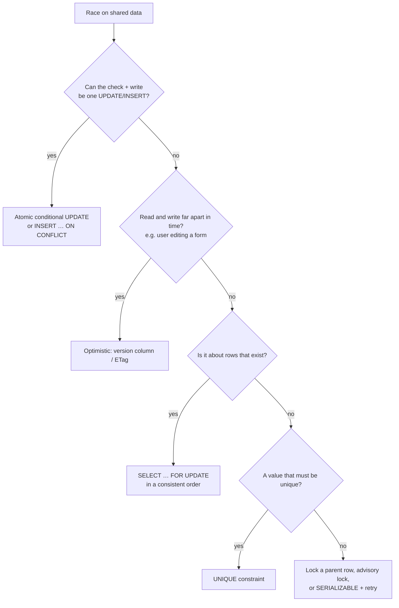

# Locking patterns cookbook

Recipes for the concurrency problems you'll meet over and over. Each one: the problem, the SQL, and the trap.

---

## 1. Decrement stock / reserve capacity

**Problem:** never sell more than you have.

```sql
UPDATE products
   SET stock = stock - $2
 WHERE id = $1 AND stock >= $2
RETURNING stock;
```

0 rows → out of stock (or no such product; check with `SELECT 1` if you need the difference). Add `CHECK (stock >= 0)` as a safety net.

**Trap:** reserving several products in one order. Each `UPDATE` locks a row until commit, so two orders with the same products in different orders can deadlock. **Sort the lines by product id** before updating. That's lock ordering again.

## 2. Move money between accounts

```sql
BEGIN;
SELECT id FROM accounts WHERE id = ANY($1::bigint[]) ORDER BY id FOR UPDATE;  -- both, sorted
UPDATE accounts SET balance = balance - $3 WHERE id = $from AND balance >= $3;  -- 0 rows → insufficient
UPDATE accounts SET balance = balance + $3 WHERE id = $to;
INSERT INTO ledger_entries ... ;   -- two entries: -amount and +amount
COMMIT;
```

**Trap:** `from = to`. Reject it before starting, or the debit and credit cancel out and you write two misleading ledger entries.

## 3. Claim work from a queue: `FOR UPDATE SKIP LOCKED`

```sql
WITH next AS (
  SELECT id FROM jobs
   WHERE status = 'ready' AND run_at <= now()
   ORDER BY run_at
   LIMIT 10
   FOR UPDATE SKIP LOCKED
)
UPDATE jobs SET status = 'running', locked_at = now()
  FROM next WHERE jobs.id = next.id
RETURNING jobs.*;
```

Ten workers run this at the same time and each gets a different batch, with no waiting. This is how many Postgres-backed job queues work (and a decent alternative to Redis queues, module 20, for moderate volume).

**Trap:** if a worker crashes after committing `status = 'running'`, the job is stuck. Either do the work inside the same transaction (holding the lock; crash → rollback → job is ready again) or add a reaper that resets jobs with an old `locked_at`.

## 4. Fail fast instead of waiting: `NOWAIT` and `lock_timeout`

```sql
SELECT * FROM documents WHERE id = $1 FOR UPDATE NOWAIT;
-- ERROR 55P03 lock_not_available if someone else holds it → return 409 "being edited"
```

Or for a whole transaction:

```sql
SET LOCAL lock_timeout = '2s';   -- only for this transaction
```

Use these on user-facing paths where waiting 30 seconds is worse than an error.

## 5. Optimistic concurrency with a version column

```sql
ALTER TABLE documents ADD COLUMN version integer NOT NULL DEFAULT 1;

UPDATE documents
   SET body = $2, version = version + 1, updated_at = now()
 WHERE id = $1 AND version = $3
RETURNING version;
```

0 rows → somebody saved in between → HTTP `409 Conflict` (or `412 Precondition Failed` if the client sent `If-Match`). Expose the version as an `ETag` so clients can send it back.

```ts
const res = await db.query(sql, [id, body, expectedVersion]);
if (res.rowCount === 0) {
  const exists = await db.query("SELECT 1 FROM documents WHERE id = $1", [id]);
  throw exists.rowCount ? new VersionConflictError(id) : new NotFoundError("Document", id);
}
```

**Trap:** under heavy contention on one row, optimistic writers keep failing and retrying (a retry storm). Switch to pessimistic locking or an atomic statement for hot rows.

## 6. "Insert if not exists" without races: let UNIQUE decide

```sql
INSERT INTO usernames (name, user_id) VALUES ($1, $2)
ON CONFLICT (name) DO NOTHING
RETURNING user_id;
```

0 rows → name taken. Never do `SELECT … WHERE name = $1` and then `INSERT`: two signups can both see "free".

Upsert a counter:

```sql
INSERT INTO page_views (page, day, views) VALUES ($1, current_date, 1)
ON CONFLICT (page, day) DO UPDATE SET views = page_views.views + 1;
```

## 7. Idempotency keys (claim-first)

```sql
-- inside the same transaction as the work
INSERT INTO idempotency_keys (key, request_hash) VALUES ($1, $2)
ON CONFLICT (key) DO NOTHING;            -- waits if another txn holds this key uncommitted
-- rowCount 1 → we own it: do the work, then
UPDATE idempotency_keys SET response_status = 201, response_body = $3 WHERE key = $1;
-- rowCount 0 → already processed: SELECT the stored response, compare request_hash
```

**Trap:** using a separate connection (or `pool.query`) for the key insert. Then it's not in the same transaction, the key commits even if the work rolls back, and the next retry replays a response for work that never happened.

## 8. Serializing arbitrary work: advisory locks

```sql
-- transaction-scoped; released automatically at COMMIT/ROLLBACK
SELECT pg_advisory_xact_lock(hashtextextended('report:' || $1, 0));
```

```sql
-- "only one cron instance runs this", without waiting
SELECT pg_try_advisory_xact_lock(42) AS got_it;
```

**Trap:** session-level `pg_advisory_lock()` through a pool. The lock belongs to the *connection*, which goes back to the pool and serves other requests while still holding the lock. If you must use session locks, use a dedicated client and always unlock in `finally`.

## 9. A parent row as a mutex

When an invariant spans many child rows ("the sum of a project's allocations ≤ budget"), lock the parent row before reading the children:

```sql
SELECT budget FROM projects WHERE id = $1 FOR UPDATE;
SELECT COALESCE(SUM(amount), 0) FROM allocations WHERE project_id = $1;
-- decide, then INSERT INTO allocations ...
```

Every writer of allocations must follow the same protocol. Document it in the repository, and consider a test that fires concurrent writes to prove it.

## 10. Choosing quickly


