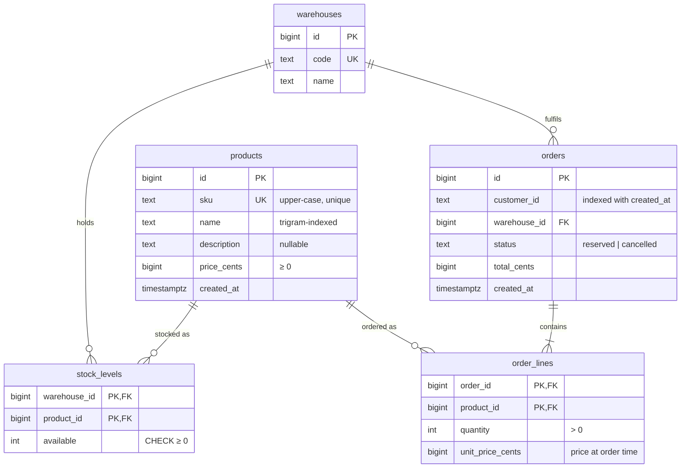
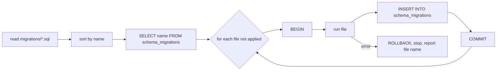
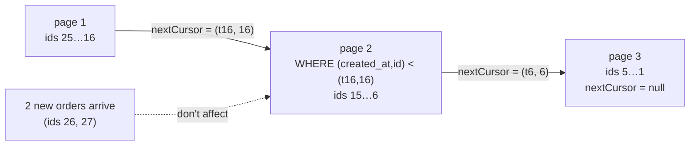
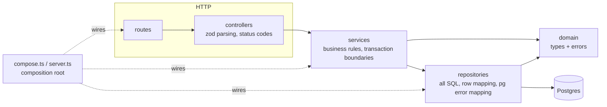

# 16 · Checkpoint: Postgres

> Five modules of Postgres, one service. This checkpoint asks you to build a small but realistic inventory and orders API from an empty folder. It needs everything Phase 2 taught: a schema that protects itself, a migration runner, repositories over `pg`, transactions that hold up under concurrency, and queries that stay fast as data grows.

**Time:** ~8h · **Challenge:** 🛠️ Build · **Prereqs:** [11 · SQL](../11-sql-fundamentals/README.md), [12 · Data Modeling](../12-data-modeling/README.md), [13 · Postgres from Node](../13-node-postgres/README.md), [14 · Query Performance](../14-query-performance/README.md), [15 · Transactions & Concurrency](../15-transactions-concurrency/README.md) · **Services:** Postgres

## What this checkpoint proves

When you finish, you can honestly say you can:

- Turn a product spec into a **relational schema** with keys, constraints and indexes chosen for the queries you'll run
- Write and run **forward-only migrations**
- Build a **layered** Express app on `pg` (routes → controllers → services → repositories) without an ORM
- Make a multi-step write **atomic** (all lines of an order or none) and **correct under concurrency** (no overselling, no deadlocks, no double release)
- Paginate with **keyset cursors** instead of `OFFSET`
- Make a substring search use an **index** (`pg_trgm`)
- Map database errors (unique violations) to clean domain errors

This lesson doesn't introduce much new material. It shows you **how to approach** a build like this the way a senior engineer would, and it reviews the decisions you'll face. Read it before you write code, then use [CHALLENGE.md](CHALLENGE.md) as the spec.

---

## 1. Read the spec like an engineer

Before touching code, extract three lists from the spec in CHALLENGE.md:

1. **Nouns → tables.** Products, warehouses, stock (per product *per warehouse*), orders, order lines.
2. **Invariants → constraints and transactions.** These are the rules that must *never* break:
   - stock in a warehouse is never negative
   - an order reserves stock for all its lines or for none of them
   - a cancelled order releases its stock exactly once
   - a SKU is unique (case-insensitively)
   - an order's total doesn't change when the catalog price changes later
3. **Read paths → indexes.** "Search products by name", "list a customer's orders newest first", "where is product X in stock".

Write these down. Every invariant needs an answer to "what enforces this, and what happens when 30 requests arrive at once?"

| Invariant | Enforced by |
|---|---|
| stock ≥ 0 | `CHECK (available >= 0)` + conditional `UPDATE … WHERE available >= $qty` |
| all-or-nothing order | one transaction; any failed line throws → `ROLLBACK` |
| no deadlocks between orders | reserve lines in a fixed order (ascending product id) |
| cancel releases once | `UPDATE orders SET status='cancelled' WHERE id=$1 AND status='reserved'` |
| unique SKU | unique index, normalize to upper case before insert |
| price frozen at order time | copy `unit_price_cents` onto each order line |

## 2. The data model



Decisions worth thinking through (and defending in your PR description):

- **Composite primary key on `stock_levels (warehouse_id, product_id)`.** There's exactly one stock row per pair, so the natural key *is* the identity. It also gives you the index you need for "reserve product P in warehouse W", and `ON CONFLICT (warehouse_id, product_id)` makes "set stock" a one-statement upsert.
- **`(order_id, product_id)` as the order line key.** It enforces "each product once per order" in the database, and the API rejects duplicates with a 400 before it gets that far.
- **Money as `bigint` cents.** Never floats. Remember `pg` returns `bigint` as a **string** (module 13), so convert deliberately.
- **`status` as `text` + `CHECK`** instead of a Postgres enum. Adding a status later is a one-line constraint change rather than an `ALTER TYPE` (module 12 discussed both).
- **Copy the price onto the line.** An order is a historical record. If you join to `products.price_cents` when reading, last month's orders change total every time marketing runs a sale.

### Simplification: `available`, not `on_hand` + `reserved`

Real inventory systems track `on_hand` (physically in the building) and `reserved` (promised to orders), with `available = on_hand - reserved`, and a shipping step moves units out of both. This checkpoint keeps one number, `available`, which orders decrement and cancellations increment. The concurrency problem is identical, and the stretch goals let you grow it into the full model.

## 3. Migrations

You built a migration runner in [module 13](../13-node-postgres/README.md). Here you write it again from memory, which is a good test of whether you understood it:



Rules to keep:

- **Forward-only, numbered files** (`001_catalog.sql`, `002_stock.sql`, …). Never edit a migration that has run anywhere shared; add a new one.
- **One transaction per file**, so a failed migration leaves no half-applied schema. (Postgres has transactional DDL; MySQL, for example, doesn't.)
- **Idempotent runner**: running it twice applies nothing the second time. The tests check this.
- **Migrations are a deploy step**, separate from app startup. With 5 replicas starting at once, "migrate on boot" means 5 processes racing to alter the same tables. (If you do want it on boot, guard it with an advisory lock, module 15.)

Extensions are part of the schema: `CREATE EXTENSION IF NOT EXISTS pg_trgm;` belongs in a migration.

## 4. Atomic, concurrent-safe order placement

This is the heart of the checkpoint. Here's the algorithm in pseudo-code, using the tools from module 15:

```text
place(order):
  validate input (≥1 line, quantities > 0, no duplicate products)   ← controller (zod)
  sort lines by productId                                           ← lock ordering
  BEGIN
    warehouse exists?                    else 404
    load products for all line ids       else 404 (and remember their prices)
    for each line (in sorted order):
      UPDATE stock_levels SET available = available - qty
       WHERE warehouse_id = W AND product_id = P AND available >= qty
      0 rows? → throw InsufficientStock(P)                          ← ROLLBACK undoes earlier lines
    INSERT order (total computed from the loaded prices)
    INSERT all lines (with unit prices) in one statement
  COMMIT
```

Why each piece matters:

```mermaid
sequenceDiagram
  participant O1 as Order 1 [A, B]
  participant DB as stock_levels
  participant O2 as Order 2 [B, A] → sorted to [A, B]
  O1->>DB: UPDATE A … available >= 1 (locks A)
  O2->>DB: UPDATE A … waits for O1
  O1->>DB: UPDATE B … (locks B)
  O1->>DB: INSERT order + lines; COMMIT (releases A, B)
  DB-->>O2: A re-checked on the new value → ok or 0 rows
  O2->>DB: UPDATE B …
```

- The **conditional UPDATE** combines the check and the write, so 30 concurrent orders can't all see "1 left".
- **Sorting** means every transaction locks stock rows in the same order. Without it, `[A, B]` and `[B, A]` deadlock, Postgres kills one after a second, and your API returns 500s. The test suite fires exactly that pattern.
- **Throwing on the first failed line** relies on your `withTransaction` helper to roll back the lines already reserved. That's all-or-nothing for free.

> 💡 A multi-row alternative: reserve all lines in one statement with `UPDATE … FROM unnest($1::bigint[], $2::int[]) … WHERE available >= qty RETURNING product_id` and compare the returned count to the number of lines. One round trip instead of N, but you have to be careful to still lock in a deterministic order. Per-line updates in sorted order are easier to get right; optimize later if profiling says so.

### Cancellation

```sql
UPDATE orders SET status = 'cancelled', cancelled_at = now()
 WHERE id = $1 AND status = 'reserved'
RETURNING …;
```

Ten concurrent cancel requests: the first one flips the status, the other nine wait for its row lock, re-check `status = 'reserved'` against the committed row, match nothing and get `409 ORDER_NOT_CANCELLABLE`. Only the winner releases stock, again in product-id order. Zero rows also happens when the order doesn't exist, so do a follow-up lookup to tell `404` from `409`.

## 5. Keyset pagination done right

Module 14 showed why `OFFSET 10000` gets slower with every page. The other problem with OFFSET is **correctness**: if two new orders arrive between page 1 and page 2, OFFSET shifts everything by two and page 2 repeats two orders from page 1. A keyset cursor says "give me the rows *after this exact position*", so inserts elsewhere don't matter.

```sql
SELECT … FROM orders
 WHERE ($1::text IS NULL OR customer_id = $1)
   AND ($2::text IS NULL OR status = $2)
   AND ($3::timestamptz IS NULL OR (created_at, id) < ($3, $4))
 ORDER BY created_at DESC, id DESC
 LIMIT $5 + 1;    -- one extra row tells you whether there's a next page
```

Details that separate a working implementation from a subtly broken one:

- **A unique tiebreaker.** `created_at` alone isn't unique. Two orders in the same microsecond would be skipped or repeated. `(created_at, id)` is unique and the row-value comparison `(a, b) < (x, y)` handles it in one expression.
- **The index matches the ORDER BY**: `(customer_id, created_at DESC, id DESC)` lets Postgres jump to the customer and read rows already sorted, stopping after `limit + 1`.
- **Fetch `limit + 1`** to compute `nextCursor` without a `COUNT(*)`.
- **Opaque cursors.** Encode the position (`base64url` of JSON) so clients can't build their own cursors and you can change the format later. Validate it on the way in: garbage → 400, not 500.
- ⚠️ **Precision trap.** `timestamptz` has *microsecond* precision; a JavaScript `Date` has *millisecond* precision. If you build the cursor from `row.created_at.toISOString()`, the microseconds are cut off and the cursor is slightly *earlier* than the real row. Say the last row of page 1 was created at `…:01.123456` and the cursor says `…:01.123000`. The next row in newest-first order, created at `…:01.123200`, is *later* than the cursor, so `(created_at, id) < cursor` excludes it and it silently vanishes from the listing. (If your code rounds up instead, you get duplicates.) Avoid the whole problem: produce the cursor timestamp in SQL as text (`to_char(created_at AT TIME ZONE 'UTC', 'YYYY-MM-DD"T"HH24:MI:SS.US"Z"')`), or paginate on `id` alone if it's monotonic for your use case.



## 6. Search that uses an index

`WHERE name ILIKE '%lamp%'` can't use a B-tree index: a B-tree is sorted by the *beginning* of the string, and the pattern starts with a wildcard. On a big table that's a sequential scan every time. The `pg_trgm` extension splits text into three-character chunks ("trigrams") and a GIN index over them answers `LIKE`/`ILIKE` substring queries:

```sql
CREATE EXTENSION IF NOT EXISTS pg_trgm;
CREATE INDEX products_name_trgm_idx ON products USING gin (name gin_trgm_ops);
```

Verify with `EXPLAIN` on a table with a few thousand rows (on tiny tables the planner correctly prefers a seq scan anyway):

```sql
EXPLAIN SELECT * FROM products WHERE name ILIKE '%lamp%';
--  Bitmap Heap Scan on products
--    ->  Bitmap Index Scan on products_name_trgm_idx
```

Two more details:

- **Escape wildcards in user input.** If the user searches for `100%`, the `%` must match literally. Escape `\`, `%` and `_` with a backslash before wrapping the term in `%…%`. Otherwise `q=%` matches everything, and `q=_` matches any single character.
- **Trigram vs full-text search.** `pg_trgm` is great for "contains this substring" and typo tolerance (`similarity()`). For word-based search with stemming and ranking ("running shoes" matching "run shoe"), use full-text search (`tsvector`, `to_tsquery`, a GIN index on the tsvector). For large catalogs with facets, companies move to a dedicated search engine.

## 7. Errors: let constraints decide

The racy way to reject a duplicate SKU:

```ts
if (await products.findBySku(sku)) throw new DuplicateSkuError(sku); // two requests both pass…
await products.insert(...);                                          // …and one gets a 500
```

The robust way: insert, and translate the unique violation into a domain error **in the repository** (the layer that knows SQL):

```ts
try {
  return await db.query("INSERT INTO products … RETURNING …", [...]);
} catch (err) {
  if ((err as { code?: string }).code === "23505") throw new DuplicateSkuError(sku);
  throw err;
}
```

The service and controller never see Postgres error codes, and the error handler maps `DUPLICATE_SKU` to 409.

## 8. Architecture

The tests include an architecture suite. It checks the same rules as [module 06](../06-layered-architecture/README.md):



- No SQL and no `pg` imports in routes/controllers.
- No `express` imports in services, repositories or domain.
- `process.env` only in `config.ts`.
- `app.ts` builds the app; `server.ts` listens.

Where do transactions go? **Services decide transaction boundaries** ("placing an order is one unit of work"), and **repositories accept a `Queryable`** (pool or transaction client) so the same repository method works inside or outside a transaction. That's the pattern from modules 13 and 15.

## 9. A plan of attack

1. **Schema first.** Write the migrations and the runner. Get `test/migrations.test.ts` green. Play in `make psql`: insert rows by hand and check that your constraints reject bad data.
2. **Skeleton.** `config.ts`, `app.ts` with `/health`, the error handler, `compose.ts`, `server.ts`. Architecture tests go green.
3. **Catalog.** Products (create, get, search), warehouses, stock. `test/catalog.test.ts`.
4. **Orders, single-request.** Place, get, cancel. `test/orders.test.ts`.
5. **Concurrency.** Run `test/concurrency.test.ts`. If you followed section 4 it may already pass; if not, now you know why.
6. **Listing.** Keyset pagination and filters. `test/orders-list.test.ts`.
7. **Polish.** Run the whole suite 3×, `npm run typecheck`, read your own diff as a reviewer would.

Commit after each step. Small green steps beat one giant red one.

## Common mistakes

- Check-then-act on stock (`SELECT available` → compare in JS → `UPDATE … SET available = $new`). It passes single-request tests and fails the concurrency suite.
- Reserving lines in request order, then deadlocking under opposite-order orders.
- Using `pool.query` for some statements of the order transaction. They run on another connection, outside the transaction, and can't be rolled back.
- Forgetting that `bigint` columns arrive as strings: `"2500" * 2` happens to work, `"2500" + 800` does not.
- Computing order totals by joining current product prices when reading orders.
- `OFFSET` pagination, or a keyset on `created_at` alone, or a cursor built from a millisecond `Date`.
- `ILIKE '%' || q || '%'` without escaping `%` and `_`.
- Pre-checking uniqueness with a `SELECT` instead of catching `23505`.
- Running migrations inside `createApp()` or on every test request.

## In production

- **Inventory and order services** at e-commerce companies look like this at their core, plus an outbox to publish `OrderPlaced` events ([module 33](../33-event-driven-architecture/README.md)), reservation expiry (unpaid orders release stock after 15 minutes) and a shipping state machine.
- **Hot products** (a limited sneaker drop) concentrate contention on one stock row. Mitigations: split stock into buckets, queue orders, or reserve in Redis and reconcile into Postgres ([Phase 3](../17-redis-fundamentals/README.md)).
- **Multi-warehouse allocation** (pick the nearest warehouse with stock, split an order across warehouses) is a real algorithmic problem. It's a stretch goal here.
- **Cursor pagination** is what Stripe, GitHub and Slack APIs use for large collections, for exactly the stability reasons above.
- **Migrations on big tables** need care: `CREATE INDEX CONCURRENTLY`, adding columns without rewrites, backfills in batches. Revisit module 12's expand/contract pattern before your first production migration.

## Check yourself

1. Why does sorting order lines by product id prevent deadlocks?
   <details><summary>Answer</summary>Every order transaction then acquires stock row locks in the same global order. A deadlock needs a cycle (T1 holds A wants B, T2 holds B wants A), which can't form if everyone takes A before B.</details>
2. Why fetch `limit + 1` rows when paginating?
   <details><summary>Answer</summary>If you get more than <code>limit</code> rows, there's a next page; you return the first <code>limit</code> and build the cursor from the last one. No <code>COUNT(*)</code> needed.</details>
3. Ten concurrent cancels hit one order. Walk through why stock is released only once.
   <details><summary>Answer</summary>Each runs <code>UPDATE orders … WHERE id = $1 AND status = 'reserved'</code>. The first takes the row lock and flips the status. The others wait, and after it commits Postgres re-evaluates their WHERE against the new row version, where status is 'cancelled', so they update 0 rows and return 409 without touching stock.</details>
4. Why can't a B-tree index serve `name ILIKE '%lamp%'`, and what can?
   <details><summary>Answer</summary>A B-tree is ordered by string prefix, and a leading wildcard means any prefix can match, so it would have to scan everything. A GIN index with <code>gin_trgm_ops</code> (pg_trgm) indexes three-character chunks and can find rows containing the substring.</details>
5. Why store `unit_price_cents` on order lines?
   <details><summary>Answer</summary>An order records what the customer agreed to pay. Product prices change; the order must not.</details>

## Further reading

- PostgreSQL docs, pg_trgm: https://www.postgresql.org/docs/current/pgtrgm.html
- PostgreSQL docs, Row constructor comparison: https://www.postgresql.org/docs/current/functions-comparisons.html#ROW-WISE-COMPARISON
- PostgreSQL docs, INSERT … ON CONFLICT: https://www.postgresql.org/docs/current/sql-insert.html#SQL-ON-CONFLICT
- PostgreSQL docs, Full Text Search: https://www.postgresql.org/docs/current/textsearch.html
- node-postgres, Pooling and Transactions: https://node-postgres.com/features/pooling · https://node-postgres.com/features/transactions
- Deep dives in this module: [docs/design-review-checklist.md](docs/design-review-checklist.md) · [docs/keyset-pagination.md](docs/keyset-pagination.md) · [docs/postgres-backend-cheatsheet.md](docs/postgres-backend-cheatsheet.md)

## ➡️ Next: [the challenge](CHALLENGE.md)
