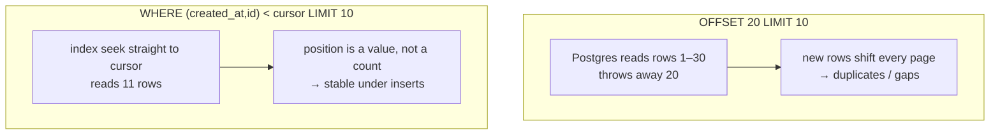

# Keyset pagination, end to end

A focused guide to implementing cursor pagination for `GET /orders` (and any other "newest first" list).

## OFFSET vs keyset in one picture



| | OFFSET | Keyset |
|---|---|---|
| Cost of page N | grows with N (reads and discards N × limit rows) | constant (index seek) |
| New rows between requests | items shift: duplicates or skipped rows | unaffected |
| Jump to page 37 | easy | not possible (only next / previous) |
| Total count / page numbers | natural (but `COUNT(*)` is slow on big tables) | needs a separate, often approximate, count |

Keyset wins for feeds, order histories and API collections. OFFSET is still fine for small admin tables where people want page numbers.

## Step 1: pick a total order

The sort key must be **unique**, or rows with equal keys get skipped or repeated at page boundaries. Newest first:

```sql
ORDER BY created_at DESC, id DESC
```

`id` is the tiebreaker. If `id` is a monotonically increasing identity and you're happy with "insertion order", `ORDER BY id DESC` alone is simpler and avoids the timestamp precision trap. Using `created_at` matters when rows can be inserted with past timestamps (imports, backfills) or ids aren't sequential (UUIDv4).

## Step 2: an index that matches

```sql
CREATE INDEX orders_customer_created_idx ON orders (customer_id, created_at DESC, id DESC);
CREATE INDEX orders_created_idx          ON orders (created_at DESC, id DESC);
```

Equality filters go first (`customer_id`), then the sort columns in sort direction. A `status` filter with only two values isn't selective enough to deserve the leading position; Postgres filters it while walking the index. If "a customer's reserved orders" became a hot query, `(customer_id, status, created_at DESC, id DESC)` would serve it directly.

## Step 3: the query

```sql
SELECT id, customer_id, warehouse_id, status, total_cents, created_at,
       to_char(created_at AT TIME ZONE 'UTC', 'YYYY-MM-DD"T"HH24:MI:SS.US"Z"') AS created_at_key
  FROM orders
 WHERE ($1::text IS NULL OR customer_id = $1)
   AND ($2::text IS NULL OR status = $2)
   AND ($3::timestamptz IS NULL OR (created_at, id) < ($3::timestamptz, $4::bigint))
 ORDER BY created_at DESC, id DESC
 LIMIT $5;   -- pass limit + 1
```

- `(created_at, id) < ($3, $4)` is a **row-value comparison**: true if `created_at < $3`, or `created_at = $3 AND id < $4`. Postgres can use the composite index for it.
- The `$n::type IS NULL OR …` pattern keeps optional filters in one static query. With node-postgres's unnamed statements, Postgres plans with the actual parameter values, so the unused branches are optimized away. If you see poor plans with this pattern, build the `WHERE` clause dynamically (still with placeholders, never string-concatenating values).
- `created_at_key` is the cursor-safe text version of the timestamp (microseconds preserved).

## Step 4: build the page

```ts
const hasMore = rows.length > limit;
const pageRows = hasMore ? rows.slice(0, limit) : rows;
const last = pageRows.at(-1);
const nextCursor = hasMore && last ? encodeCursor({ createdAt: last.created_at_key, id: Number(last.id) }) : null;
```

## Step 5: opaque cursor encoding

```ts
export const encodeCursor = (c: { createdAt: string; id: number }) =>
  Buffer.from(JSON.stringify([c.createdAt, c.id])).toString("base64url");

export function decodeCursor(raw: string) {
  try {
    const v = JSON.parse(Buffer.from(raw, "base64url").toString("utf8"));
    if (Array.isArray(v) && typeof v[0] === "string" && Number.isSafeInteger(v[1])) return { createdAt: v[0], id: v[1] };
  } catch {}
  return undefined;   // → 400 VALIDATION_ERROR
}
```

Why opaque?

- Clients can't depend on its structure, so you can change the sort key later.
- `base64url` is URL-safe, so there's no escaping in query strings.
- It's **not** a security boundary: anyone can decode it. Never put anything secret in it, and always validate it, because a hand-crafted cursor is just more untrusted input. If you need tamper-proofing, sign it with an HMAC.

Validate cursors in the HTTP layer (controller) and pass a typed position to the service. Cursor encoding is a transport detail.

## Step 6: make sure filters and cursor agree

A cursor is only meaningful for the same filters and sort it was created with. If a client changes `status` but keeps the cursor, they get a valid but odd page. Options: document it (most APIs do), or embed a hash of the filters in the cursor and reject mismatches.

## Testing pagination

The checkpoint tests check the properties that matter, and they're a good template for your own projects:

1. Walk all pages: concatenated ids equal the full expected list (no gaps, no duplicates), and the last page has `nextCursor: null`.
2. Insert new rows between page requests: page 2 doesn't repeat page 1.
3. Filters plus pagination: page within a filtered set.
4. Garbage cursor → 400, not 500.
5. Limit bounds.

## Previous page?

For "previous", flip the comparison and the sort, then reverse the results in code:

```sql
WHERE (created_at, id) > ($3, $4) ORDER BY created_at ASC, id ASC LIMIT $5
```

Return both `nextCursor` and `prevCursor` if your UI needs it. Most infinite-scroll UIs only need "next".
