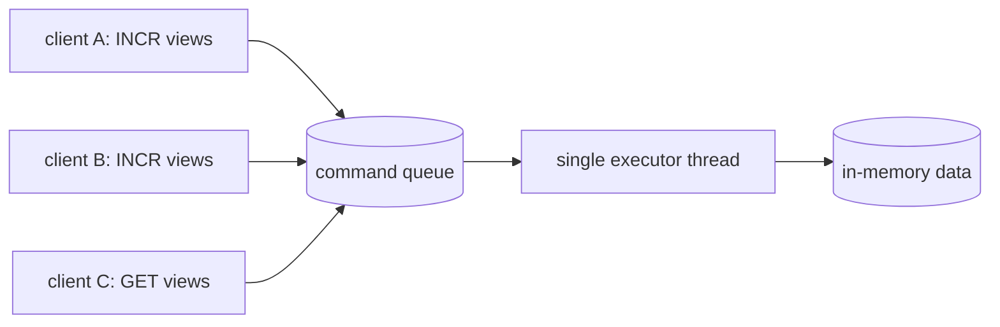
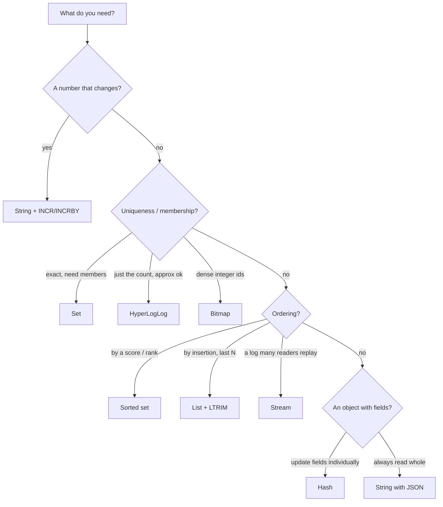
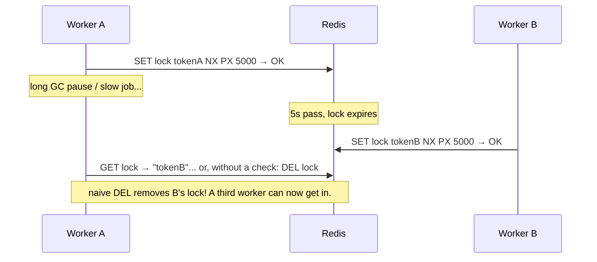
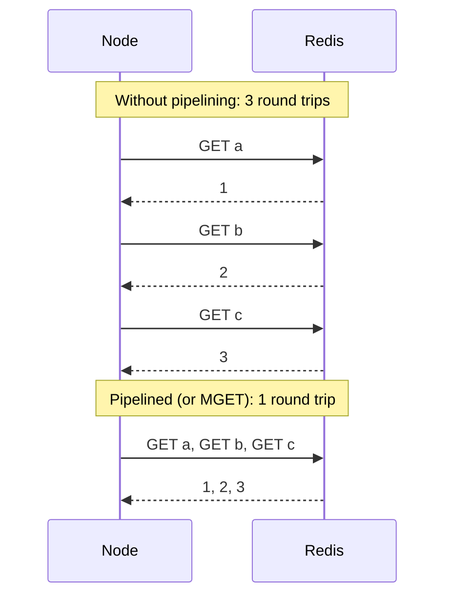

# 17 · Redis Fundamentals

> Postgres is where your data *lives*. Redis is where your system keeps the things it needs **right now**: counters, sessions, leaderboards, locks, queues, caches. Nearly every backend you'll join runs one, and knowing which data structure fits which job is a daily skill.

**Time:** ~5h · **Challenge:** 🛠️ Build · **Prereqs:** [05 · Express Basics](../05-express-basics/README.md), [15 · Transactions & Concurrency](../15-transactions-concurrency/README.md) (helpful for the atomicity part) · **Services:** Redis

## What you'll learn

- What Redis is, and why "in-memory" plus "single-threaded command execution" explains almost everything about it
- The core data structures (strings, hashes, lists, sets, sorted sets, streams, HyperLogLog, bitmaps) and the problem each one solves
- Expiry (TTL) and how Redis deletes expired keys
- Why a single Redis command is atomic, and what to do when you need several commands to be atomic: `MULTI`/`EXEC` and Lua scripts
- Pipelining, and why round trips matter more than command speed
- How to name keys so a shared Redis stays sane
- Persistence (RDB/AOF), memory limits and eviction policies
- When **not** to use Redis
- How to use the `ioredis` client from TypeScript

---

## 1. What Redis is

Redis is a **data-structure server**. You connect over TCP, send commands like `INCR page:home` or `ZADD leaderboard 120 ada`, and Redis applies them to data structures it keeps **in RAM**. It's often called a key-value store, but that undersells it: the *value* behind a key can be a string, a hash, a list, a set, a sorted set, a stream and more, and each type has its own commands.

Two design decisions explain most of its behavior:

### In-memory

All data lives in RAM. Reading a key is a hash table lookup in memory, no disk seek, so a single Redis instance handles on the order of 100k+ simple commands per second with sub-millisecond latency. The flip side: your dataset must fit in memory (RAM is far more expensive than disk), and durability is something you configure, not something you get by default (section 8).

### Single-threaded command execution

Redis executes commands **one at a time** on a single main thread. (Modern Redis uses extra threads for network I/O and background jobs, but the part that touches your data runs commands serially.)



That sounds like a weakness, but it's the source of Redis's most useful property: **every single command is atomic**. While `INCR views` runs, no other command can see a half-done state or run in between. You get lock-free correctness for free, as long as you can express your operation as one command (or a script, section 5).

It also means one slow command blocks *everyone*. `KEYS *` on a database with 10 million keys freezes the server for every client until it finishes. Remember this whenever you reach for an O(N) command.

### Talking to it

```bash
$ redis-cli -p 6380 -n 1
127.0.0.1:6380[1]> SET greeting "hello"
OK
127.0.0.1:6380[1]> GET greeting
"hello"
127.0.0.1:6380[1]> INCR visits
(integer) 1
```

`-n 1` selects database index 1. A Redis server has 16 numbered databases (0–15) by default. This repo gives each module its own index (module id mod 16) and a key prefix like `wl:17:`, so modules never step on each other. Run `make redis-cli` in the challenge folder to get a shell on this module's database.

## 2. The data structures

Choosing the right structure is the main skill in Redis. The same feature can be one elegant command or a slow, racy mess depending on what you pick.

| Type | Mental model | Typical uses | Key commands |
|---|---|---|---|
| **String** | a blob of bytes (text, JSON, a number) | cache entries, counters, flags, locks | `GET` `SET` `INCR` `INCRBY` `MGET` |
| **Hash** | a small object: field → value | sessions, user profiles, per-object counters | `HSET` `HGET` `HGETALL` `HINCRBY` |
| **List** | a linked list (push/pop at both ends) | recent items, simple queues | `LPUSH` `RPUSH` `LPOP` `LRANGE` `LTRIM` |
| **Set** | unordered unique members | tags, "who already did X", dedupe | `SADD` `SISMEMBER` `SCARD` `SINTER` |
| **Sorted set** | unique members, each with a score, kept sorted | leaderboards, priority queues, time indexes | `ZADD` `ZINCRBY` `ZREVRANGE` `ZRANK` |
| **Stream** | append-only log of entries with ids | event logs, activity history, lightweight queues | `XADD` `XRANGE` `XREAD` `XREADGROUP` |
| **HyperLogLog** | a probabilistic distinct counter | unique visitors, distinct search terms | `PFADD` `PFCOUNT` `PFMERGE` |
| **Bitmap** | a string addressed bit by bit | daily active flags per user id, feature flags | `SETBIT` `GETBIT` `BITCOUNT` |

Let's take them one at a time, with the problem first.

### Strings: counters, flags and blobs

A string holds up to 512 MB of bytes. If those bytes look like an integer, you can do arithmetic on them:

```text
SET product:42 '{"name":"Desk","price":19900}'    # cache a JSON blob
INCR views:home                                  # → 1, 2, 3 ... atomically
INCRBY credits:user:7 -50                        # subtract
SET feature:new-checkout on EX 3600              # a flag that expires in an hour
MGET views:home views:pricing views:blog          # many keys, one round trip
```

`INCR` is the textbook example of why Redis atomicity matters. Doing `GET`, adding one in Node, then `SET` would lose updates when two requests interleave: the classic *lost update* from [module 15](../15-transactions-concurrency/README.md). `INCR` does the read-modify-write inside Redis as one command, so 1,000 concurrent increments always add 1,000.

### Hashes: small objects

```text
HSET session:abc userId 7 role admin createdAt 1718000000000
HGET session:abc role          # "admin"
HGETALL session:abc            # all fields
HINCRBY user:7:stats logins 1  # bump one field
```

A hash lets you read or update one field without rewriting the whole value, and small hashes are stored very compactly. Two gotchas you'll hit in the challenge:

- Every value comes back as a **string**. `createdAt` is `"1718000000000"`, not a number.
- `HGETALL` on a missing key returns an **empty object** `{}`, not `null`. Check for the fields you need.

> Hash vs JSON string? Store a JSON string when you always read and write the whole object (a cache entry). Use a hash when you update individual fields, or want `HINCRBY` on one of them.

### Lists: ordered, push and pop at the ends

Lists are linked lists: pushing or popping at either end is O(1), while reading by index in the middle is O(N).

```text
LPUSH feed:7 '{"type":"comment"}'   # newest at the head (index 0)
LTRIM feed:7 0 49                   # keep only indexes 0..49
LRANGE feed:7 0 9                   # 10 newest
```

`LPUSH` + `LTRIM` is the **capped list** pattern: "last N things" that never grows without bound. Note that `LRANGE` and `LTRIM` stop indexes are **inclusive**. `0 49` is 50 elements.

Lists can also be simple queues (`LPUSH` to enqueue, `BRPOP` to block until an item arrives), but a job that's popped and then lost when the worker crashes is gone forever. Real job queues need acknowledgements and retries. That's what BullMQ builds for you on top of Redis in [module 20](../20-background-jobs/README.md).

### Sets: uniqueness

```text
SADD coupon:spring:claimed user:7   # (integer) 1, added
SADD coupon:spring:claimed user:7   # (integer) 0, already there
SISMEMBER coupon:spring:claimed user:7
SCARD coupon:spring:claimed         # how many members
SINTER tags:redis tags:postgres     # members in both
```

The reply of `SADD` is the number of members **actually added**. That one detail turns a set into an atomic "do this only once" primitive: if `SADD` returned 1, you were first. No separate check needed, so no race.

### Sorted sets: always-sorted rankings

A sorted set (ZSET) maps each unique member to a floating-point score and keeps members ordered by score. Inserts, updates and rank lookups are O(log N).

```text
ZINCRBY leaderboard:weekly 50 ada         # "50"  (scores come back as strings)
ZINCRBY leaderboard:weekly 80 grace
ZREVRANGE leaderboard:weekly 0 2 WITHSCORES
# 1) "grace" 2) "80" 3) "ada" 4) "50"
ZREVRANK leaderboard:weekly ada           # (integer) 1   ← 0-based!
ZRANGEBYSCORE events 1718000000 1718086400   # range by score, e.g. timestamps
```

Doing "top 10" in SQL means sorting (or maintaining an index) on every request. With a ZSET, the ordering is maintained as you write, so reading the top N is cheap even with millions of players. Scores can be anything numeric, so ZSETs also work as **time indexes** (score = timestamp) and **priority queues** (score = priority).

Watch the off-by-ones: `ZREVRANGE key 0 n-1` returns n elements, and `ZREVRANK` is 0-based, so humans want `rank + 1`.

### Streams: append-only logs

A stream is an append-only log. Each entry gets an id like `1718000000000-0` (milliseconds-sequence), always increasing, plus a flat map of fields:

```text
XADD orders MAXLEN ~ 1000 * type created orderId 42
# "1718000000000-0"
XRANGE orders - +                 # everything, oldest first
XRANGE orders (1718000000000-0 +  # strictly after that id ("(" = exclusive)
XREAD BLOCK 5000 STREAMS orders $ # wait up to 5s for new entries
```

Because entries are never removed when read, many independent readers can each track their own position (the last id they processed) and resume after a restart. Add **consumer groups** (`XREADGROUP`, `XACK`) and Redis tracks positions and pending acknowledgements for you, much like a tiny Kafka. You'll compare the two properly in [module 32](../32-kafka-fundamentals/README.md).

`MAXLEN ~ 1000` keeps the stream bounded. The `~` means "about 1000": Redis trims whole internal blocks at once instead of entry by entry, which is far cheaper. You might keep 1,080 entries instead of exactly 1,000, and that's usually fine.

### HyperLogLog: counting distinct things in 12 KB

How many unique visitors did the homepage have today? The exact answer needs a set of every visitor id. With 10 million visitors that's hundreds of megabytes per day, per page.

A **HyperLogLog** answers "how many distinct?" approximately, using at most about 12 KB per key, no matter how many items you add. The standard error is about 0.81%.

```text
PFADD visitors:2026-01-15 user:1 user:2 user:1
PFCOUNT visitors:2026-01-15                          # 2
PFCOUNT visitors:2026-01-15 visitors:2026-01-16      # distinct across BOTH days
PFMERGE visitors:week visitors:2026-01-15 visitors:2026-01-16
```

The intuition, without the math: hash each item to a random-looking bit pattern. Seeing a hash that starts with many zeros is rare, so the longest run of leading zeros you've observed hints at how many distinct items you've hashed. HLL splits items into thousands of buckets and averages these hints to get a stable estimate. Adding the same item twice produces the same hash, so duplicates don't change anything.

You **cannot** list the members or ask "has user 7 visited?". It's a counter, not a container. Use it for analytics, never for billing.

### Bitmaps: one bit per id

A bitmap is a string you address bit by bit. If user ids are dense integers, "did user N log in today?" is one bit:

```text
SETBIT active:2026-01-15 1007 1
GETBIT active:2026-01-15 1007     # 1
BITCOUNT active:2026-01-15        # number of active users
BITOP AND active:both active:2026-01-15 active:2026-01-16
```

Ten million users fit in about 1.2 MB per day, with exact answers. The catch is that ids must be smallish integers. A UUID can't be a bit offset.

### Picking a structure: a decision guide



There's a longer guide with complexity notes in [docs/data-structures-guide.md](docs/data-structures-guide.md).

## 3. Expiry (TTL)

Any key can have a time to live. When it runs out, the key disappears as if you'd deleted it.

```text
SET otp:user:7 482913 EX 300       # set with a 5-minute TTL in one command
EXPIRE session:abc 1800            # (re)set the TTL on an existing key → 1, or 0 if missing
PEXPIRE lock:report 5000           # milliseconds
TTL session:abc                    # seconds left; -1 = no expiry, -2 = key doesn't exist
PERSIST session:abc                # remove the TTL
```

TTL is what makes Redis self-cleaning. Sessions that users abandon, one-time codes, rate-limit windows and cache entries all expire on their own, with no cleanup job.

Things that surprise people:

- **Overwriting a key with `SET` removes its TTL** (unless you pass `KEEPTTL`). Updating a cached value with a plain `SET` turns it immortal.
- `EXPIRE` on a missing key does nothing and returns 0. It never creates the key. That makes it a natural "sliding session" primitive: touch the TTL if the session exists, otherwise report that it's gone.
- Modifying a hash field or pushing to a list **keeps** the key's TTL. Only commands that replace the whole value reset it.
- TTLs apply to **whole keys**. You can't expire one field of a hash or one member of a set (Redis 7.4 added per-field hash expiry, but don't rely on it unless you know your server version).

### How expired keys are actually removed

Redis doesn't run a timer per key. It combines two strategies:

1. **Lazy expiry:** when you access a key, Redis checks its expiry first and deletes it if it's past due. You never read an expired value.
2. **Active expiry:** several times per second, Redis samples a few keys that have TTLs and deletes the expired ones, repeating while many of the sampled keys turn out to be expired.

So an expired key you never touch may sit in memory a little longer, but you will never *see* it.

## 4. Atomicity and MULTI/EXEC

One command is atomic. But real operations often need two: "write the session hash **and** set its expiry", or "push to the feed **and** trim it". If your process crashes between the two, you're left with an immortal session or a list that grows forever. And another client could observe the in-between state.

`MULTI` starts a transaction. Commands after it are **queued**, and `EXEC` runs them all back to back, with no other client's commands in between:

```text
MULTI
HSET session:abc userId 7 role admin
EXPIRE session:abc 1800
EXEC
# 1) (integer) 2
# 2) (integer) 1
```

```ts
const results = await redis
  .multi()
  .hset(key, { userId: "7", role: "admin" })
  .expire(key, 1800)
  .exec(); // [[null, 2], [null, 1]]  — one [error, reply] pair per command
```

What a Redis transaction is **not**, if you're coming from Postgres:

| Postgres transaction | Redis `MULTI`/`EXEC` |
|---|---|
| You can read inside and decide what to write next | Commands are only queued, so you can't use a reply to decide the next command |
| A failure rolls everything back | No rollback: if one command fails at runtime (say, `INCR` on a hash), the others still apply |
| Isolation levels, MVCC | Simply "nothing else runs during EXEC" |

Because you can't branch on intermediate results, `MULTI` is for "do these writes together". For "read, decide, write" you have two tools:

- **`WATCH` (optimistic locking):** `WATCH key`, read it, then `MULTI ... EXEC`. If anyone modified the watched key in between, `EXEC` returns `null` and you retry. This is the same optimistic concurrency idea as a version column in module 15. It works, but retry loops get clumsy.
- **Lua scripts**, which are usually the better answer.

## 5. Lua scripts: your own atomic commands

`EVAL` sends a small Lua script that runs **inside Redis, atomically**. While it runs, nothing else does, so you can read, branch and write as if you were the only client:

```lua
-- KEYS[1] = lock key, ARGV[1] = the token we were given when we acquired it
if redis.call("GET", KEYS[1]) == ARGV[1] then
  return redis.call("DEL", KEYS[1])
else
  return 0
end
```

```ts
const released = await redis.eval(RELEASE_SCRIPT, 1, lockKey, token); // 1 = number of KEYS
```

This exact script fixes the classic lock-release bug. Here's the race it prevents:



Even "GET, compare in Node, then DEL" is unsafe: the lock can expire and be taken by B *between* A's GET and A's DEL. The compare and the delete must happen in one atomic step, and a script is how you build that step.

Rules for well-behaved scripts:

- Pass every key you touch in **`KEYS`**, and everything else in **`ARGV`**. Redis Cluster uses `KEYS` to route the script to the right node.
- Keep them **short**. A script blocks the entire server while it runs, just like a slow command.
- Arguments arrive as strings. Use `tonumber(ARGV[2])` before comparing numbers.
- Scripts are cached by SHA. `ioredis` has `redis.defineCommand(name, { numberOfKeys, lua })`, which uses `EVALSHA` and falls back to `EVAL` automatically. Plain `eval` is fine to learn with.

Redis 7 also offers **functions** (`FUNCTION LOAD`, `FCALL`), a way to register named, persistent scripts on the server. Same atomicity, better lifecycle management.

## 6. Pipelining: round trips are the real cost

A Redis command takes microseconds to execute. The network round trip to send it and get the reply usually takes 0.2–1 ms inside a data center. So for a loop of small commands, almost all the time is spent waiting on the network:



**Pipelining** means sending many commands without waiting for each reply, then reading all the replies. Three ways to cut round trips:

```ts
// 1. Multi-key commands, when one exists: best.
const values = await redis.mget("views:a", "views:b", "views:c");

// 2. An explicit pipeline: any mix of commands, one round trip, NOT atomic.
const replies = await redis.pipeline().incr("views:a").get("views:b").zcard("board").exec();

// 3. Fire commands concurrently: ioredis writes them all to the socket at once.
await Promise.all(ids.map((id) => redis.incr(`views:${id}`)));
```

Pipeline vs `MULTI`: a pipeline is a **network** optimization (other clients' commands may run in between yours). `MULTI` is an **atomicity** guarantee. `ioredis` sends `multi()` transactions in a single pipeline too, so you get both.

> The N+1 problem from [module 14](../14-query-performance/README.md) exists in Redis too. A loop of 100 `GET`s inside a request handler adds 100 round trips. Reach for `MGET`, `HMGET` or a pipeline.

## 7. Key naming

Redis has no tables or schemas, just one flat keyspace per database. Conventions keep it understandable:

```text
<app>:<entity>:<id>[:<sub-thing>]

wl:17:session:3f2a9c...
wl:17:leaderboard:weekly
wl:17:coupon:spring:claimed
shop:product:42:views
```

- **Colons as separators** are the universal convention. GUI tools group keys by them.
- **Prefix with the app (and environment, if shared).** Several services or test runs can then share one Redis, and you can find or delete one app's keys with `SCAN MATCH wl:17:*`. The challenge's `key()` helper does this for you.
- **Put the id last** (or before a small suffix), so keys for one entity sit together.
- **Keep keys reasonably short.** Every key is stored in memory, millions of times over.
- **Version the format when the value's shape changes** (`product:v2:42`). Old and new code can then run side by side during a deploy. You'll use this trick for caching in [module 18](../18-caching/README.md).

And never use `KEYS pattern` in production. It's O(N) over the whole keyspace and blocks the server. Use `SCAN`, which iterates in small batches with a cursor:

```ts
let cursor = "0";
do {
  const [next, keys] = await redis.scan(cursor, "MATCH", "wl:17:*", "COUNT", 500);
  cursor = next;
  if (keys.length) await redis.unlink(...keys); // UNLINK frees memory in the background
} while (cursor !== "0");
```

That's exactly how the tests clean up between runs (`test/helpers/redis.ts`).

## 8. Persistence, memory and eviction

### Persistence: how much can you lose?

Redis keeps everything in RAM, but it can write to disk so data survives a restart:

| Mode | How it works | You can lose | Trade-off |
|---|---|---|---|
| **None** | Nothing on disk | everything on restart | fastest; fine for a pure cache |
| **RDB snapshots** | Forks and writes a point-in-time dump every N minutes/changes | everything since the last snapshot (minutes) | compact files, fast restarts |
| **AOF** (append-only file) | Logs every write; `appendfsync everysec` flushes once per second | ~1 second of writes | bigger files, periodically rewritten |
| **RDB + AOF** | Both | ~1 second | the usual choice when Redis holds data you care about |

Even with AOF, Redis is not a replacement for Postgres as your system of record. A second of lost writes, asynchronous replication to replicas and the memory limit all point the same way. Treat Redis data as **reconstructable** or **acceptable to lose**, unless you've deliberately configured and tested otherwise.

### Memory limits and eviction

`maxmemory` caps how much RAM Redis uses. When it's full and a write arrives, the **eviction policy** decides what happens:

| Policy | Behavior | Use when |
|---|---|---|
| `noeviction` | Writes fail with an OOM error | Redis holds data you can't lose (queues, locks, sessions) |
| `allkeys-lru` | Evict the least recently used key, any key | Pure cache |
| `allkeys-lfu` | Evict the least frequently used key | Cache with stable "hot" keys |
| `volatile-lru` / `volatile-lfu` | Same, but only among keys **with a TTL** | Mixed: cache entries have TTLs, important keys don't |
| `volatile-ttl` | Evict keys closest to expiring | Rarely |
| `allkeys-random` / `volatile-random` | Random | Rarely |

Picking the wrong one is a real production incident. If your BullMQ job queue lives in a Redis configured with `allkeys-lru`, a traffic spike can silently evict jobs. A common setup is a separate Redis per role: one for caching (`allkeys-lru`), one for queues and locks (`noeviction`).

Memory tips: `INFO memory` shows usage, `MEMORY USAGE key` measures one key, and `redis-cli --bigkeys` finds the large ones. One giant key (a list with 50 million entries) is dangerous: deleting or reading it blocks the server, and it can't be split across cluster nodes. More in [docs/persistence-memory-eviction.md](docs/persistence-memory-eviction.md).

## 9. When NOT to use Redis

Redis is great at being fast and simple. It's bad at being your database:

- **As the system of record** for data you can't lose (orders, payments, user accounts). Use Postgres and cache in Redis.
- **For relational queries.** "Orders over $100 by customers in Germany last week" means you'd have to maintain every index by hand. That's what SQL is for.
- **For big values or datasets larger than RAM.** Files belong in object storage, analytics history in a database or warehouse.
- **For multi-key transactions with rollback.** `MULTI` doesn't roll back, and Lua scripts get unwieldy fast.
- **For strong distributed locks** guarding correctness (money, inventory). A single-instance Redis lock can be lost on failover, and a paused process can wake up believing it still holds an expired lock. Use database constraints and row locks ([module 15](../15-transactions-concurrency/README.md)) for correctness, and Redis locks for *efficiency* (avoiding duplicate work).
- **When you don't need it.** A Postgres table with the right index often handles "sessions" or "counters" at your current scale. Every extra datastore is something to run, monitor, back up and secure.

## 10. Using Redis from Node with ioredis

```ts
import { Redis } from "ioredis";

const redis = new Redis("redis://localhost:6380/1", {
  lazyConnect: true,          // don't connect until the first command / connect()
  maxRetriesPerRequest: 1,    // fail fast instead of queueing forever when Redis is down
});

await redis.set("wl:17:hello", "world", "EX", 60);
const value = await redis.get("wl:17:hello");         // string | null
const n = await redis.incr("wl:17:counter");          // number
const top = await redis.zrevrange("wl:17:board", 0, 9, "WITHSCORES"); // string[]
await redis.quit();                                    // graceful: waits for pending replies
```

Things worth knowing:

- **Every command is a method** returning a promise. Arguments map 1:1 to the command (`redis.set(key, value, "PX", 5000, "NX")`).
- **Replies are mostly strings.** Integer replies (`INCR`, `SADD`, `EXISTS`) are numbers, but scores, hash values and `GET` results are strings. Convert at the boundary, as the exercises do.
- **`null` means missing** for `GET`, `ZRANK`, `SET ... NX` (when not set) and friends. Hashes and lists return `{}` and `[]` instead.
- **One client, many concurrent requests.** A single connection pipelines commands automatically, so you usually create **one** client per process at startup (in your composition root) and inject it. Blocking commands (`BRPOP`, `XREAD BLOCK`) and pub/sub subscribers are exceptions: they tie up a connection, so give them their own.
- **Reconnects are automatic.** ioredis reconnects and, by default, queues commands while disconnected. In request handlers you usually want commands to fail fast instead (`maxRetriesPerRequest`, `enableOfflineQueue: false`), so a Redis outage doesn't hang every request.
- **Inject the client.** The exercises all take `redis` as their first parameter. Business code that imports a global client is hard to test and hard to point at a different instance. The composition root builds the client once, shuts it down with `quit()` on exit, and passes it in.

## Common mistakes

- Using `KEYS *` (or other O(N) commands on huge keys) in production and freezing the server.
- Read-modify-write in Node (`GET` → compute → `SET`) instead of an atomic command or script. Lost updates.
- Writing a key and setting its TTL in two separate calls without `MULTI` (or `SET ... EX`). A crash leaves an immortal key.
- Overwriting a key with `SET` and silently dropping its TTL.
- Treating `HGETALL` → `{}` as a found record, or forgetting that hash values and scores are strings.
- Off-by-one with inclusive stop indexes (`LRANGE 0 10` returns 11 items) and 0-based ranks.
- Releasing a lock with a plain `DEL` (or GET-then-DEL), deleting someone else's lock.
- Locks without an expiry. One crashed holder blocks everyone forever.
- Unbounded lists or streams (no `LTRIM`, no `MAXLEN`) that eat all memory over weeks.
- A loop of single commands where `MGET`, a pipeline or concurrency would do one round trip.
- Using Redis as the only copy of important data, with `allkeys-lru` eviction.

## In production

- **Managed Redis** (AWS ElastiCache/MemoryDB, Google Memorystore, Azure Cache, Redis Cloud, Upstash) is the norm, so you rarely run servers yourself. You still choose instance size, eviction policy, persistence and replication. Valkey, a community fork of Redis, is now a common engine behind these services, with the same commands.
- **Replication & failover:** a primary with replicas, plus Sentinel or the provider's failover. Replication is asynchronous, so a failover can lose the last few writes. This is one reason Redis locks aren't correctness guarantees.
- **Redis Cluster** shards keys across nodes by hashing the key into 16,384 slots. Multi-key commands and scripts only work when all keys are in the same slot. You force that with **hash tags**: `{user:7}:profile` and `{user:7}:feed` hash only the part in braces, so they land together.
- **Monitor** memory usage vs `maxmemory`, evictions (`evicted_keys`), hit rate, connected clients, and the **slow log** (`SLOWLOG GET`), which tells you which commands are blocking.
- **Security:** never expose Redis to the internet. Use a password or ACL users, and TLS when traffic crosses untrusted networks. Exposed, unauthenticated Redis instances are a recurring cause of real breaches.
- Common roles at real companies: caching (module 18), rate limiting (module 19), job queues (module 20), sessions (module 22), pub/sub fan-out for WebSockets (module 28), leaderboards and counters (this module).

## Check yourself

1. Why is `INCR` safe under concurrency while `GET` + `SET` from Node is not?
   <details><summary>Answer</summary>Redis executes commands one at a time, so <code>INCR</code>'s read-modify-write happens as one indivisible step. With <code>GET</code> then <code>SET</code>, two clients can both read 5 and both write 6. That's a lost update.</details>
2. You need "top 10 players" and "my rank" for a million players. Which structure, and what are the costs?
   <details><summary>Answer</summary>A sorted set: <code>ZINCRBY</code> to update (O(log N)), <code>ZREVRANGE 0 9 WITHSCORES</code> for the top 10 (O(log N + 10)), <code>ZREVRANK</code> for a rank (O(log N), 0-based).</details>
3. What's the difference between a pipeline and `MULTI`/`EXEC`?
   <details><summary>Answer</summary>A pipeline sends many commands in one round trip, but other clients' commands can run between them. <code>MULTI</code>/<code>EXEC</code> guarantees the queued commands run back to back with nothing interleaved. Neither lets you branch on a reply. For that you need <code>WATCH</code> or a Lua script.</details>
4. Why does releasing a lock need a Lua script?
   <details><summary>Answer</summary>You must delete the lock only if it still holds <em>your</em> token. Between a GET and a DEL sent from Node, your lock could expire and be acquired by someone else, so you'd delete their lock. A script makes compare-and-delete atomic.</details>
5. Your cache Redis and your job-queue Redis are the same instance with `allkeys-lru`. What can go wrong?
   <details><summary>Answer</summary>Under memory pressure Redis may evict queue keys (jobs, locks) as readily as cache entries, silently losing work. Use <code>noeviction</code> (or <code>volatile-*</code> with TTLs only on cache keys) for data you can't lose, or separate instances.</details>

## Further reading

- Redis data types overview: https://redis.io/docs/latest/develop/data-types/
- Transactions (MULTI/EXEC/WATCH): https://redis.io/docs/latest/develop/interact/transactions/
- Scripting with Lua: https://redis.io/docs/latest/develop/interact/programmability/eval-intro/
- Pipelining: https://redis.io/docs/latest/develop/use/pipelining/
- Key eviction: https://redis.io/docs/latest/develop/reference/eviction/
- Persistence: https://redis.io/docs/latest/operate/oss_and_stack/management/persistence/
- ioredis: https://github.com/redis/ioredis
- Deep dives in this module: [docs/data-structures-guide.md](docs/data-structures-guide.md) · [docs/atomicity-and-lua.md](docs/atomicity-and-lua.md) · [docs/persistence-memory-eviction.md](docs/persistence-memory-eviction.md) · [docs/redis-cli-cheatsheet.md](docs/redis-cli-cheatsheet.md) · repo cheat sheet: [../docs/cheatsheets/redis.md](../docs/cheatsheets/redis.md)

## ➡️ Next: [the challenge](CHALLENGE.md)
