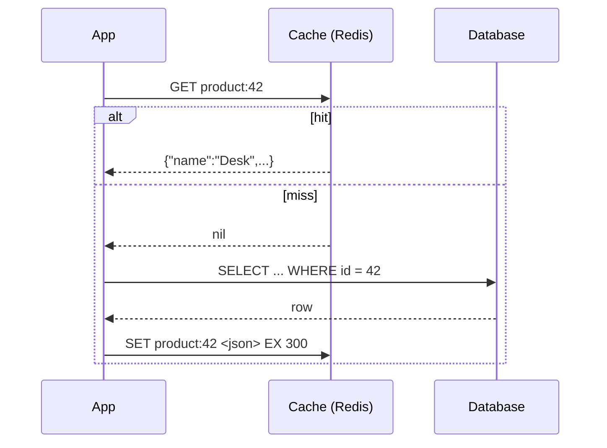
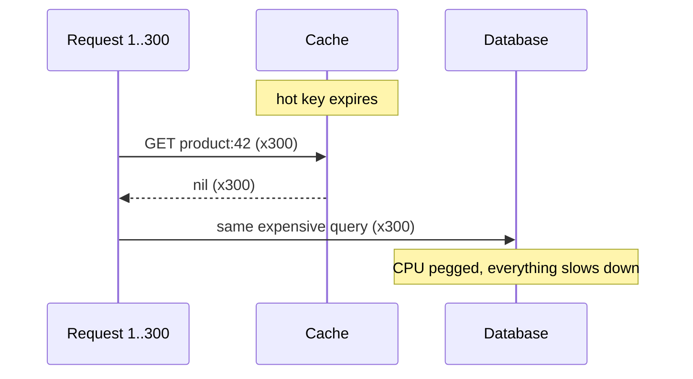
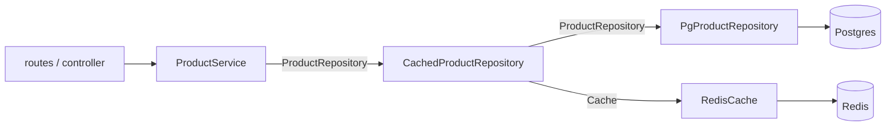
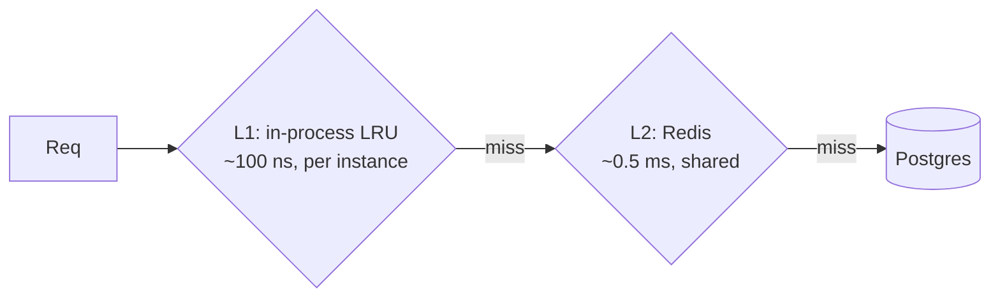
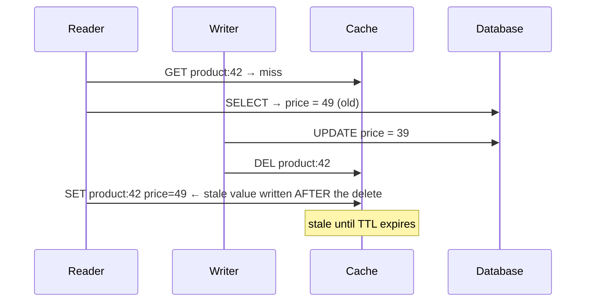

# 18 · Caching

> "Add a cache" is the most common answer to "it's slow", and one of the most common causes of "it's wrong". This module teaches you to add caching that makes a service faster **without** serving stale data, melting the database at the worst moment, or going down when Redis does.

**Time:** ~6h · **Challenge:** 🧩 Scaffold · **Prereqs:** [13 · Postgres from Node](../13-node-postgres/README.md), [17 · Redis Fundamentals](../17-redis-fundamentals/README.md), [06 · Layered Architecture](../06-layered-architecture/README.md) · **Services:** Postgres, Redis

## What you'll learn

- Why caching works, with the latency numbers that justify it
- The four classic patterns: cache-aside, read-through, write-through, write-behind
- How to choose a TTL, and why you add **jitter** to it
- Invalidation strategies: delete on write, versioned keys, TTL as a safety net
- Cache **stampedes** (dogpiles) and three ways to stop them: locks, request coalescing, early refresh
- **Negative caching** and cache key design
- Serialization pitfalls (the `Date` that comes back as a string)
- Measuring a cache: hit ratio and friends
- HTTP caching vs application caching, and multi-layer caches (in-process + Redis)
- The consistency races between writes and invalidation, and how to reason about them
- Implementing all of this as a **decorator** so the rest of the code doesn't know the cache exists

---

## 1. Why cache at all?

A cache is a copy of data kept somewhere faster to read than the original. Rough numbers every backend engineer should have a feel for:

| Operation | Typical time |
|---|---|
| Read from a JS `Map` in your process | ~0.0001 ms (100 ns) |
| Redis `GET` in the same data center (network round trip) | ~0.2–1 ms |
| Simple indexed Postgres query | ~1–5 ms |
| Postgres query with several joins and aggregations | 10–500 ms |
| Call to another service over HTTP | 5–100 ms |
| Call to a third-party API across the internet | 50–1000 ms |

If your product page needs a 200 ms query and gets 500 requests per second for the same few thousand products, you're asking Postgres to do the same work over and over. A cache turns most of those reads into a 0.5 ms Redis lookup. The benefits:

1. **Latency:** users see faster responses.
2. **Load shedding:** the database does a fraction of the work, so it has headroom for writes and for the queries you can't cache.
3. **Cost:** a cache node is much cheaper than scaling the database vertically, or adding read replicas.
4. **Resilience** (sometimes): a cache can keep serving popular data during a short database blip.

Caching works because real traffic is **skewed**: a small fraction of items gets most of the reads (popular products, the homepage, the logged-in user's profile). Cache the hot set and you absorb most of the load.

### The price

Every cache introduces a second copy of the data, and two copies can disagree. Everything hard about caching comes from that one fact:

- **Staleness:** the cache says $49, the database says $39.
- **Invalidation:** knowing when to throw a copy away.
- **Cold starts:** an empty cache (after a deploy, a flush, a failover) sends all traffic to the database at once.
- **More moving parts:** one more thing to deploy, monitor and reason about.

So the first rule is: **cache deliberately**. Measure first, cache the expensive, read-heavy, change-rarely data, and decide up front how stale it's allowed to be.

## 2. The four patterns

### Cache-aside (lazy loading): the one you'll use most

The application talks to both the cache and the database. On a read, it checks the cache first, and on a miss it loads from the database and fills the cache. On a write, it updates the database and invalidates the cache.



```ts
async function getProduct(id: string): Promise<Product | null> {
  const cached = await redis.get(`product:${id}`);
  if (cached) return JSON.parse(cached);

  const product = await db.findProduct(id);
  if (product) await redis.set(`product:${id}`, JSON.stringify(product), "EX", 300);
  return product;
}
```

- ✅ Only data that's actually requested gets cached.
- ✅ If the cache is down, the app can still read from the database (if you code for it, section 9).
- ❌ The first read of every item is a miss (slow).
- ❌ The app owns the caching logic, so put it in one place (section 10), not sprinkled through handlers.

### Read-through

Same flow, but the **cache layer** loads from the database on a miss, not your code. You ask the cache for a key, and it knows how to fetch it. CDNs work like this, as do libraries where you register a loader function. From the application's view it's cache-aside hidden behind an interface. The decorator you'll build in the challenge is effectively a read-through cache for the rest of the app.

### Write-through

Every write goes to the cache **and** the database synchronously, typically through the cache layer.

- ✅ The cache is always warm and up to date for written keys.
- ❌ Every write pays for two writes, and you cache data that may never be read.
- ❌ Keeping the two in sync when one of the writes fails is tricky.

### Write-behind (write-back)

Writes go to the cache, and the cache flushes them to the database **later**, asynchronously, often in batches.

- ✅ Very fast writes, and it absorbs write bursts (counters, analytics).
- ❌ If the cache dies before flushing, **data is lost**. The cache becomes your source of truth for a while, with the weaker durability that implies ([module 17](../17-redis-fundamentals/README.md#8-persistence-memory-and-eviction)).
- Typical use: view counters (`INCR` in Redis, flushed to Postgres every minute), not orders.

| Pattern | Who loads on miss | Write path | Stale risk | Data-loss risk |
|---|---|---|---|---|
| Cache-aside | app | DB, then invalidate | low–medium | none |
| Read-through | cache layer | DB, then invalidate | low–medium | none |
| Write-through | cache layer | cache + DB synchronously | low | low |
| Write-behind | cache layer | cache now, DB later | low | **high** |

**Default to cache-aside with delete-on-write.** It's simple, robust, and the database stays the source of truth.

## 3. TTL: how stale is OK?

The TTL is your **maximum staleness budget**. Even if every invalidation works, a TTL bounds the damage when one doesn't (a bug, a failed delete, a write that bypasses your code, like a manual SQL fix).

Choosing a TTL is a product question as much as a technical one:

| Data | Reasonable TTL | Why |
|---|---|---|
| Product description, category tree | 5–60 min | changes rarely, invalidated on write anyway |
| Price, stock level shown on a listing | 10–60 s | changes often, small staleness acceptable |
| Stock at checkout | **don't cache** | must be exact: read the DB (module 15) |
| User's own profile | minutes, invalidate on write | users notice if their own edit doesn't show |
| Exchange rates from a third-party API | per the provider's update interval | the source itself is periodic |
| Feature flags, config | 10–30 s | fast enough propagation, very hot reads |

Longer TTLs give higher hit ratios and staler data. Shorter TTLs give fresher data and more database load. Start with the staleness the product can tolerate and check the hit ratio you get.

### Jitter: don't let everything expire at once

Imagine a deploy that warms the cache with 10,000 products, all with `EX 300`. Five minutes later, they all expire within the same second, and your database gets 10,000 queries at once. Synchronized expiry turns a cache into a periodic load spike.

The fix is cheap: randomize each TTL a little.

```ts
// 300s ± 10% → somewhere in [270, 330]
const ttl = Math.round(300 * (1 + 0.1 * (2 * Math.random() - 1)));
```

Now expiries are smeared across a minute instead of piled into one second. You'll implement this as `ttlWithJitter` (TODO 1), with the randomness **injected** so tests can make it deterministic.

## 4. Invalidation

> "There are only two hard things in computer science: cache invalidation and naming things." This line gets quoted constantly because it's true.

When the data changes, the cached copy must go. Your options:

### Delete on write (recommended default)

```ts
async function updateProduct(id: string, patch: ProductPatch) {
  const updated = await db.updateProduct(id, patch); // 1. source of truth first
  await redis.del(`product:${id}`);                   // 2. then drop the copy
  return updated;
}
```

The next read misses and loads fresh data. Why **delete** rather than **set** the new value?

- **Races.** Two concurrent updates can finish their database writes in one order and their cache writes in the other, leaving the *older* value cached until the TTL expires. A delete has no value to get wrong: the worst case is an extra miss.
- **Lazy.** You don't compute or serialize anything that may never be read.
- **One code path fills the cache** (the read path), so the cached format can't drift between two writers.

Why database **first**, then delete? If you delete first, a concurrent reader can miss, read the *old* row from the database (your write hasn't happened yet), and put it back in the cache, where it stays for a full TTL.

### Versioned keys

Put a version in the key and change the version instead of deleting:

```text
product:v1:42        ← schema version: bump to v2 when the JSON shape changes
catalog:{version}:42 ← data version: INCR catalog:version to invalidate everything at once
```

- A **schema version** (`v1`) lets old and new app versions run side by side during a deploy without reading each other's incompatible JSON. Old entries are simply never read again and expire on their own. The challenge's `productCacheKey` uses this.
- A **data version** makes "invalidate the whole catalog" a single `INCR` instead of deleting thousands of keys. The cost is one extra lookup to read the current version.

### TTL only

For data where some staleness is fine and writes happen elsewhere (a nightly import, a third-party API), you may skip explicit invalidation and let the TTL do the work. That's honest and simple, as long as everyone agrees on the staleness.

### Event-driven invalidation

When many services cache the same data, the writer publishes a "product 42 changed" event and every cache holder drops its copy. You'll see the machinery for this with Kafka in [module 33](../33-event-driven-architecture/README.md). It's powerful, but it adds a delivery-failure mode (a lost event means a stale copy until the TTL), which is one more reason to always have a TTL.

## 5. Cache stampedes (the dogpile effect)

A hot key expires (or is invalidated). In the next 50 ms, 300 requests for it arrive. All 300 miss. All 300 run the 200 ms query at the same time. The database slows down under the load, so the queries take longer, so more requests pile up behind them... This is a **cache stampede**, also called a dogpile or thundering herd, and it's a classic way for a cache to *cause* an outage.



Three standard defenses:

### a) Request coalescing (single-flight), per process

Within one process, the first miss starts the load and stores the **promise** in a map. Every other miss for the same key awaits that same promise instead of starting its own query.

```ts
const inFlight = new Map<string, Promise<Product | null>>();

async function load(id: string) {
  const running = inFlight.get(id);
  if (running) return running; // join the existing load

  const p = db.findProduct(id).finally(() => inFlight.delete(id));
  inFlight.set(id, p);
  return p;
}
```

300 concurrent misses become **one** query per process. This is the same "memoize the promise, not the value" trick from [module 01](../01-js-runtime/README.md). Details that matter:

- Store the promise **synchronously**, before any `await`, or two callers can both see "nothing in flight".
- Remove the entry when the promise settles, **including on failure**. Otherwise a single failed query is cached forever as a rejected promise.
- It only coalesces within one process. With 20 app instances you get at most 20 queries instead of 6,000, which is usually plenty. You implement this in TODO 5.

### b) A distributed lock (cross-process)

The first miss takes a short Redis lock (`SET lock:product:42 <token> NX PX 2000`, from module 17). The winner loads and fills the cache. The losers wait briefly and re-check the cache, or serve a stale copy if one exists. This cuts the load to one query across *all* instances, at the cost of complexity: what do losers do while waiting, and what if the winner dies? Use it for very expensive computations (seconds), not for a 50 ms query.

### c) Early refresh (refresh-ahead / probabilistic early expiration)

Don't wait for the key to expire. Refresh it slightly *before* expiry, while the old value is still being served:

- **Refresh-ahead:** when a hit finds less than, say, 10% of the TTL left, trigger a background reload and still return the current value.
- **Probabilistic early expiration:** each reader decides to recompute early with a probability that rises as expiry approaches, so typically one reader refreshes before everyone else would miss.
- **Stale-while-revalidate:** keep a "soft" expiry inside the value and a longer "hard" TTL in Redis. After the soft expiry, serve the stale value while one request refreshes it.

Jitter (section 3) is the cheap fourth defense against *many keys* expiring together, while coalescing and locks handle *one hot key*.

## 6. Negative caching

What about requests for things that **don't exist**? `GET /products/999999` misses the cache, queries the database, finds nothing... and caches nothing. Every repeat goes to the database again. A buggy client in a retry loop, a crawler, or an attacker iterating ids can hammer your database straight through the cache.

**Negative caching** stores the "not found" answer too, with a **short** TTL:

```ts
const NOT_FOUND = "__not_found__"; // must be impossible to confuse with a real value
if (!product) await redis.set(key, NOT_FOUND, "EX", 30);
```

- Short TTL, because when the item *is* created you want it to appear quickly. Or invalidate on create, like you do on update.
- Use a sentinel that can't collide with a real cached value. Real entries in the challenge are always JSON objects, so a plain string can't be mistaken for one.
- **Validate input before the cache.** If `/products/abc` reaches the cache layer, an attacker can fill Redis with junk negative entries (`abc`, `abd`, `abe`, ...). The challenge's service rejects ids that aren't positive integers before they reach the cache.

## 7. Keys and serialization

### Key design

A cache key must include **everything that changes the answer**, and nothing else.

```text
wl:18:product:v1:42                       ← app, entity, schema version, id
shop:product:v3:42:locale=de:currency=EUR ← the answer depends on locale and currency
shop:search:v1:<sha256 of normalized query params>
```

- Forget an input and users get each other's results, the scariest caching bug there is. A response that depends on the user (permissions, personal pricing) must have the user (or their role/tier) in the key, or not be cached in a shared cache at all.
- Include too much (a timestamp, a request id) and every key is unique, so your hit ratio is zero.
- Normalize before building the key (sort query params, lowercase where it's semantically safe) so equivalent requests share an entry.
- Prefix with app and version, as in module 17.

### Serialization pitfalls

A cache stores **bytes**. Your objects go through `JSON.stringify` on the way in and `JSON.parse` on the way out, and JSON can't represent everything:

| Type | What comes back out of JSON |
|---|---|
| `Date` | an ISO **string**: `product.updatedAt.getTime()` throws on a cache hit and works on a miss |
| `bigint` | `JSON.stringify` **throws** |
| `Map` / `Set` | `{}`: silently empty |
| `undefined` fields | dropped |
| class instances | plain objects (methods gone, `instanceof` false) |

The nasty part is that the bug only shows up on **hits**, so it passes a quick test that only exercises the miss path. Defenses:

- Make your cached types **JSON-safe by design**. The challenge's `Product.updatedAt` is an ISO string for exactly this reason.
- Test that a value **round-trips**: `expect(fromCache).toEqual(fromDb)`. The challenge tests do this.
- For complex objects, validate on the way out (a zod schema) and treat a parse failure as a miss.
- Bump the key version when the shape changes.

## 8. Measuring a cache

A cache you don't measure is a cache you can't trust. The core metrics:

- **Hits and misses**, giving the **hit ratio** = hits / (hits + misses). A product-detail cache might sit at 90–99%. If it's at 30%, the cache is mostly overhead: wrong keys, a TTL that's too short, or data that isn't actually re-read.
- **Coalesced misses:** how much stampede protection is saving you.
- **Errors:** cache operations that failed (Redis down, timeouts).
- **Latency** of hits vs misses (a histogram, [module 24](../24-observability/README.md)).
- From Redis itself: memory used, evictions (`evicted_keys`), keyspace hits/misses in `INFO stats`.

Watch the hit ratio **over time**. A sudden drop after a deploy usually means a key format change (intended or not).

In the challenge you'll expose these counters at `GET /metrics/cache`. In module 24 you'll do it properly with Prometheus counters.

## 9. The cache is not a dependency: fail open

If Redis goes down, should your product page go down? Almost always **no**. The database still has the data. The cache is an optimization, so treat its failures as misses:

```ts
let cached: string | null = null;
try {
  cached = await redis.get(key);
} catch {
  metrics.recordError(); // log/count it, then carry on as a miss
}
```

Two caveats:

- **Timeouts matter.** "Down" often means "hanging", not "connection refused". A cache read that waits 10 s before failing is worse than no cache. Configure the client to fail fast (`maxRetriesPerRequest`, `enableOfflineQueue: false`, command timeouts). The challenge's `server.ts` does this.
- **Your database must survive the full load** when the cache is gone. If it can't, a cache outage becomes a database outage. That's when you add load shedding and circuit breakers ([module 29](../29-reliability-scaling/README.md)), or serve stale data from an in-process layer.

A failed **invalidation** is the uncomfortable case. The database write succeeded, but the delete didn't, so a stale entry lives until its TTL. Usually you log it, count it, and let the TTL bound the damage (another reason TTLs are non-negotiable). Failing the user's write because the cache hiccupped would be worse.

## 10. Where the cache lives in your code: the decorator

Don't put caching in route handlers or services. It's a cross-cutting concern, and module 06's layering gives it a natural home: a **decorator** that implements the same repository interface it wraps.



```ts
// composition root (server.ts)
const products = new CachedProductRepository(
  new PgProductRepository(pool),   // the real thing
  new RedisCache(redis),           // the cache, behind a tiny interface
  metrics,
  { ttlSeconds: 300, jitterRatio: 0.1, negativeTtlSeconds: 30 },
);
const service = new ProductService(products); // has no idea a cache exists
```

Why this shape works well:

- The **service stays pure**: business rules only, unit-testable with a fake repository.
- You can **turn caching off** by changing one line in the composition root, which is handy when you're debugging "is it the cache?".
- The decorator depends on a `Cache` interface, not on ioredis, so tests can inject a cache that throws (that's how the fail-open tests work).
- All caching policy (keys, TTLs, invalidation, coalescing, metrics) lives in **one file**.

## 11. HTTP caching vs application caching

Everything above is **application caching**: your server caches data it would otherwise compute. **HTTP caching** is different: the response itself is cached by the browser, a CDN or a reverse proxy, and the request may never reach your server.

```text
Cache-Control: public, max-age=60, stale-while-revalidate=300
ETag: "a1b2c3"
```

| | HTTP caching | Application caching |
|---|---|---|
| Where | browser, CDN, proxy | your Redis / process memory |
| What's cached | whole responses | data / computed values |
| Who controls invalidation | mostly nobody: you wait for `max-age` (CDNs offer purge APIs) | you (delete on write) |
| Saves | network, your whole server | database / downstream work |
| Personalized data | only `private` (browser), never a shared CDN | fine, if the key includes the user |

They stack: a CDN in front, an in-process cache, Redis, then the database. HTTP caching basics (`Cache-Control`, `ETag`, `304`) were introduced in [module 03](../03-http-fundamentals/README.md). There's a deeper comparison in [docs/http-vs-app-caching.md](docs/http-vs-app-caching.md).

## 12. Multi-layer caching: in-process + Redis

A Redis hit still costs a network round trip (~0.5 ms) and some CPU for JSON parsing. For extremely hot, tiny data (feature flags, config, the category tree), an **in-process LRU cache** in front of Redis serves it in nanoseconds:



The trade-off is **consistency across instances**. Redis is shared, so one `DEL` invalidates it for everyone. An in-process cache exists separately in each of your 20 instances, and deleting from one doesn't touch the other 19. Options:

- Give L1 a **very short TTL** (1–10 s) and accept that much staleness.
- Broadcast invalidations over Redis pub/sub so every instance drops its L1 copy ([module 28](../28-realtime/README.md) uses pub/sub).
- Only put data in L1 that is effectively immutable or versioned.

Also bound L1 by **size** (an LRU with max entries), or you've built a memory leak.

## 13. Consistency pitfalls: the races you should know

Even "database first, then delete" has a race. It's rare, but you should be able to explain it:



The reader loaded the old value before the write, but stored it after the invalidation. Mitigations, from simplest:

1. **Keep a TTL.** It bounds the damage, and for most data it's enough.
2. **Delayed double delete:** delete, then delete again a few hundred ms later, after any in-flight reads have probably finished.
3. **Versioned values:** store `updatedAt` (or a version column) with the cached value, and only overwrite with newer data (a Lua compare-and-set, as in module 17).
4. **Don't cache it.** For data that must be exact (stock at checkout, account balances), read the source of truth.

In-process request coalescing has a cousin of this race: a reader joining a load that started *before* a write gets the pre-write data. The reference solution drops the in-flight entry on update so later readers start a fresh load.

The mindset: a cache gives you **eventual consistency** with a bounded staleness window. Design so that window is acceptable, and keep correctness-critical reads off the cache.

## Common mistakes

- Caching without a TTL. One missed invalidation becomes permanently wrong data.
- Same TTL for everything warmed at once. Synchronized expiry spikes.
- No stampede protection on hot, expensive keys.
- Setting the new value on write instead of deleting (races), or deleting **before** the database write.
- Not caching misses, so non-existent ids go straight through to the database.
- Cache keys missing an input (locale, user, permissions). Users see each other's data.
- Caching `Date`s, `Map`s or class instances, and breaking only on cache hits.
- Treating Redis errors as request errors. The cache takes the whole service down with it.
- Caching stuff that's cheap to compute or rarely re-read: all overhead, no benefit.
- No hit-ratio metric, so nobody notices when the cache stops working.
- Caching in route handlers instead of one decorator, so policy is scattered and inconsistent.

## In production

- **Big sites are cache hierarchies:** CDN → reverse proxy → in-process → Redis/Memcached → database read replicas → primary. Each layer absorbs most of the traffic that reaches it.
- **Cold-start planning:** after a cache flush or a new region launch, the database takes the full load. Teams warm caches gradually, rate-limit misses, or shift traffic slowly.
- **Hot keys:** one key getting enormous traffic (a celebrity's profile, a flash-sale product) can saturate a single Redis node. Mitigations include an L1 in-process layer, or replicating the key under several names (`key:1..key:N`) and picking one at random.
- **Memcached vs Redis:** Memcached is a simpler, multi-threaded pure cache. Redis adds data structures, persistence and replication. Many companies use Redis for both caching and everything else.
- **Separate instances per role:** caching Redis with `allkeys-lru`, queue/lock Redis with `noeviction` (module 17).
- **Observe it:** hit ratio, evictions, memory, p99 latency of hits vs misses, cache error rate. Alert when the hit ratio drops suddenly.
- **Interviews:** "design a cache for X" and "how would you handle a cache stampede?" are staple system-design questions ([module 30](../30-system-design/README.md)).

## Check yourself

1. You update the database and then *set* the new value in the cache. What can go wrong that wouldn't with *delete*?
   <details><summary>Answer</summary>Two concurrent writers can complete their DB writes in one order and their cache sets in the other, leaving the older value cached until the TTL expires. A delete carries no value to get out of order. The next read loads whatever the database has now.</details>
2. A hot key expires and 500 requests arrive at once. What happens, and name two defenses.
   <details><summary>Answer</summary>A stampede: all 500 miss and run the expensive query at once, which can overload the database. Defenses: request coalescing (one load per process, others await the same promise), a distributed lock (one load across all instances), early/probabilistic refresh or stale-while-revalidate, and jitter for the many-keys case.</details>
3. Why cache "not found", and why with a shorter TTL?
   <details><summary>Answer</summary>Otherwise every request for a non-existent id (bad clients, crawlers, attackers) reaches the database. Short TTL so a newly created item becomes visible quickly. Validate ids before caching so junk can't fill the cache.</details>
4. Redis goes down. What should a well-built cache-aside service do?
   <details><summary>Answer</summary>Fail open: treat cache errors as misses, read from the database, count/log the errors, and fail fast with tight client timeouts so requests don't hang. The database must be able to carry the load, or you need load shedding.</details>
5. Your cached product has `updatedAt: Date`. What bug appears, and when?
   <details><summary>Answer</summary>After a JSON round trip, <code>updatedAt</code> is a string, so code calling Date methods breaks, but only on cache hits. Make cached types JSON-safe (ISO strings) and test round-trips.</details>

## Further reading

- Redis docs, client-side caching (an advanced L1 approach): https://redis.io/docs/latest/develop/reference/client-side-caching/
- AWS whitepaper, Database Caching Strategies Using Redis: https://docs.aws.amazon.com/whitepapers/latest/database-caching-strategies-using-redis/welcome.html
- MDN, HTTP caching: https://developer.mozilla.org/en-US/docs/Web/HTTP/Caching
- RFC 9111, HTTP Caching: https://www.rfc-editor.org/rfc/rfc9111
- Deep dives in this module: [docs/caching-patterns-cheatsheet.md](docs/caching-patterns-cheatsheet.md) · [docs/stampedes-and-consistency.md](docs/stampedes-and-consistency.md) · [docs/http-vs-app-caching.md](docs/http-vs-app-caching.md) · repo cheat sheet: [../docs/cheatsheets/redis.md](../docs/cheatsheets/redis.md)

## ➡️ Next: [the challenge](CHALLENGE.md)
