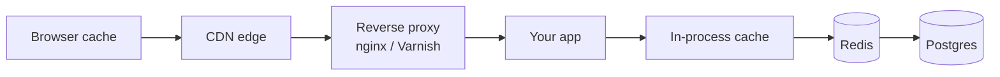

# HTTP caching vs application caching

Both are "caching", but they sit at different layers, are controlled by different parties, and fail in different ways. A backend engineer is expected to use both deliberately.

## The layers



Everything left of "Your app" is **HTTP caching**: whole responses, controlled by response headers. Everything to the right is **application caching**: data, controlled by your code.

## HTTP caching in one page

The server tells caches what they may do using headers:

```text
Cache-Control: public, max-age=60          # any cache may store it for 60s
Cache-Control: private, max-age=0          # only the browser, always revalidate
Cache-Control: no-store                    # nobody stores it (sensitive data, metrics)
Cache-Control: public, s-maxage=300, max-age=60   # CDN 5 min, browser 1 min
Cache-Control: max-age=60, stale-while-revalidate=300
ETag: "v42-a1b2"                           # validator for conditional requests
Last-Modified: Tue, 14 Jan 2026 10:00:00 GMT
Vary: Accept-Language                      # the response differs per this request header
```

**Freshness:** while a response is fresh (`max-age`), caches serve it without contacting you at all.

**Validation:** when it's stale, a cache can ask "has it changed?" with `If-None-Match: "v42-a1b2"`. If not, you answer `304 Not Modified` with no body. You still do some work (at least computing the ETag), but you save bandwidth and serialization. You built this in module 03.

**`Vary`** is HTTP's version of "the cache key must include every input": if the response depends on `Accept-Language` and you forget `Vary`, a CDN serves German pages to English users.

## Comparison

| | HTTP caching | Application caching |
|---|---|---|
| Granularity | whole response | any value (rows, computed objects, API results) |
| Key | URL (+ `Vary` headers) | whatever you design |
| Control after the fact | weak: you can't reach into browsers; CDNs have purge APIs | strong: `DEL` on write |
| Saves | network, your servers entirely | database or downstream work |
| Personalized responses | `private` (browser only) | yes, with the user in the key |
| Typical staleness tool | `max-age`, `stale-while-revalidate` | TTL + invalidation |
| Failure mode | stale or **leaked** responses (a private page cached publicly) | stale data, stampedes |

## Choosing

- **Public, identical-for-everyone, cacheable for seconds or more** (product pages for anonymous users, images, JS bundles, public API listings): HTTP caching at the CDN. Nothing beats a request that never reaches you.
- **Personalized or permission-dependent** responses: `Cache-Control: private` or `no-store`, and application caching of the underlying data (keyed safely).
- **Data reused across many different responses** (a product appears on the detail page, in search results, in the cart): application caching, because one cached product serves every response that includes it.
- **Writes must be visible immediately:** application caching with invalidation. HTTP caches can't be invalidated reliably from the server side, so keep `max-age` short (or zero, with ETags).

## The most dangerous HTTP caching bug

A response containing user-specific data, served with `Cache-Control: public` (or without explicit headers behind a CDN configured to cache by default), gets stored at the edge and served to other users. Real data leaks have happened exactly this way. Rules:

1. Authenticated responses default to `Cache-Control: private, no-store` unless you've thought about it.
2. Be explicit: set `Cache-Control` on every response, and don't rely on CDN defaults.
3. Never let a shared cache store a response that varies on a cookie or `Authorization` header.

## In this module's challenge

The product API could reasonably send `Cache-Control: public, max-age=30` on `GET /products/:id` for anonymous traffic, in addition to the Redis cache. The metrics endpoint sends `no-store`. If you add HTTP caching as an extension, remember that `PATCH` invalidates Redis, but it can't reach browsers that already hold a fresh copy. That's exactly the "weak control" row in the table.
