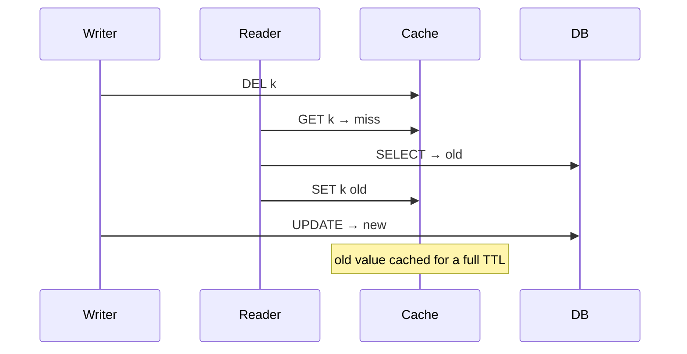
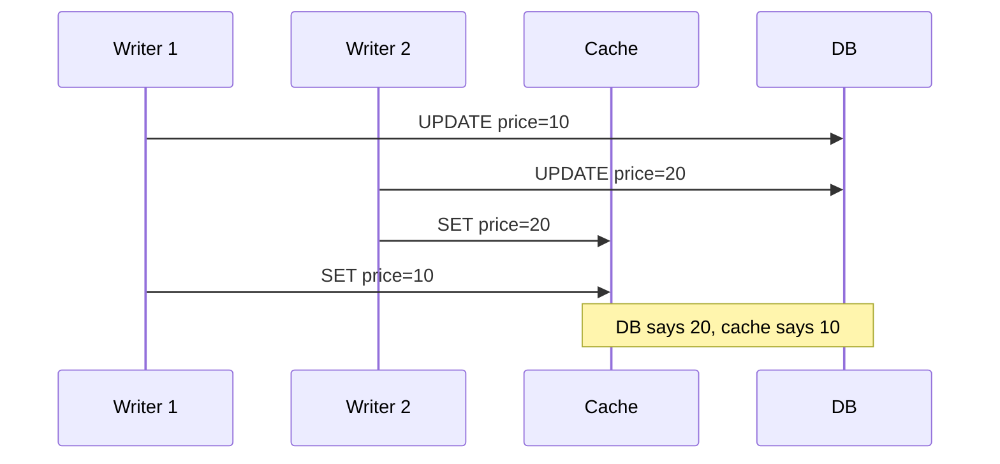

# Stampedes and consistency: a deeper look

The lesson gave you the shape of both problems. This doc goes one level further: the timelines that cause trouble, and the more advanced fixes you may meet at work or in interviews.

## Part 1: Stampedes

### Why stampedes feed themselves

A stampede is dangerous because of a feedback loop:


The longer the recompute takes, the bigger the pile-up. A 5 ms query rarely stampedes. A 2 s report does, and badly.

### Request coalescing: the details

```ts
const inFlight = new Map<string, Promise<V>>();

function singleFlight(key: string, load: () => Promise<V>): Promise<V> {
  const running = inFlight.get(key);
  if (running) return running;
  const p = load().finally(() => {
    if (inFlight.get(key) === p) inFlight.delete(key); // don't delete a newer entry
  });
  inFlight.set(key, p); // synchronous: no await between get and set
  return p;
}
```

- **No `await` between the `get` and the `set`.** JavaScript runs one piece of code at a time, so a synchronous check-then-set can't interleave with another caller. Put an `await` in between and two callers can both see an empty map.
- **Clean up on rejection.** `finally` runs on both outcomes.
- **Guard the delete** (`=== p`) if anything else can replace the entry, like an invalidation that drops it and a new load that starts.
- **Waiters share failures.** If the load fails, all waiters get the error. That's usually right: they'd all have failed anyway, and you made one failing query instead of a hundred.
- **Timeouts:** if the load hangs, every waiter hangs. Put a timeout on the underlying query.

### Distributed lock with waiting

When even one query per instance is too many (a very expensive computation, many instances):

```text
on miss:
  if SET lock:<key> <token> NX PX 5000 == OK:
      value = compute()
      SET <key> value EX ttl
      release lock (Lua compare-and-delete)
      return value
  else:
      repeat up to N times: sleep 50ms; GET <key>; if found return it
      fall back: compute anyway (or serve stale, or return 503)
```

Decide what losers do: wait and poll (adds latency), serve a stale copy (needs one, see below), or compute anyway after a timeout (bounded stampede).

### Stale-while-revalidate in the application

Store a logical expiry inside the value, and give Redis a longer physical TTL:

```json
{ "value": { "...": "..." }, "freshUntil": 1718000300000 }
```

```text
SET key <json> EX 3600          # physical TTL: 1h
on read:
  if now < freshUntil  → return value                         (fresh)
  else                 → return value AND trigger one refresh (stale, refresh in background
                         guarded by a lock or single-flight)
  if missing           → load synchronously                   (cold)
```

Users almost never wait on a recompute, and only one refresh runs at a time. The cost: you serve data up to one refresh-duration staler than `freshUntil`, and you store values longer.

### Probabilistic early expiration

Each reader may decide to recompute before expiry, with a probability that rises sharply as expiry approaches and is higher for values that are slow to compute. One well-known formulation (often called "XFetch") recomputes when:

```text
now - delta * beta * ln(random()) >= expiry
```

where `delta` is how long the last recompute took, `beta` ≥ 1 tunes eagerness, and `ln(random())` is negative (so the left side is `now` plus a random, usually small, amount). With many readers, usually one of them refreshes early, with no locks and no coordination. It's elegant, but harder to reason about than single-flight. Know that it exists.

## Part 2: Consistency

### The guarantee you actually have

Cache-aside with delete-on-write and a TTL gives you: **reads may be stale for at most about one TTL, usually much less.** That's eventual consistency with a bound. Everything else is about shrinking the window or the probability.

### Race 1: delete before write



Fix: write the database **first**, then delete.

### Race 2: set instead of delete



Fix: delete instead of set.

### Race 3: slow reader across a write (DB first, then delete)

The race from the lesson: a reader loads the old row, a writer updates and deletes, then the reader stores the old row. It needs the read to start before the write and finish after the delete, which is rare but real under load or GC pauses.

Fixes:
- **TTL** (always).
- **Delayed double delete:** `DEL` now, and `DEL` again after a delay longer than a typical read (schedule it with a timer or a delayed job).
- **Conditional set by version:** cache `{ version, value }` and use a Lua script that only overwrites when the incoming version is greater than or equal to the stored one. Combined with writes that *set* (not delete) the new versioned value, this makes ordering safe. It's more complex, so reserve it for data where staleness hurts.
- **Lease-based invalidation:** on a miss, the cache hands the reader a lease token, and an invalidation revokes outstanding leases, so a set with a revoked lease is ignored. Large-scale cache systems have used this idea. It needs cache-side support, so in Redis you'd emulate it with Lua.

### Race 4: coalesced load across a write (in-process)

A load starts, a write happens, and new readers join the old in-flight load, getting pre-write data even though they arrived after the write. Fix: drop the in-flight entry on write, so post-write readers start a fresh load. The reference solution does this.

### Read-your-writes

Users are much less forgiving of *their own* changes not showing up than of slightly stale data from others. Options:
- Invalidate synchronously on write (you do) and return the updated entity from the write endpoint, so the client doesn't need to re-read.
- For a short window after a user writes, bypass the cache for that user's reads (track "recently wrote" in a cookie or session).
- With read replicas, the same problem appears from replication lag, and the same tricks apply.

### When to give up on caching

If the business can't tolerate *any* staleness window for a piece of data, don't cache it. Read the source of truth, make the query fast (indexes, module 14), and scale the database instead.
