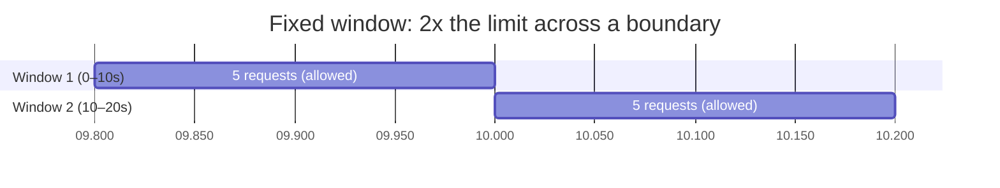
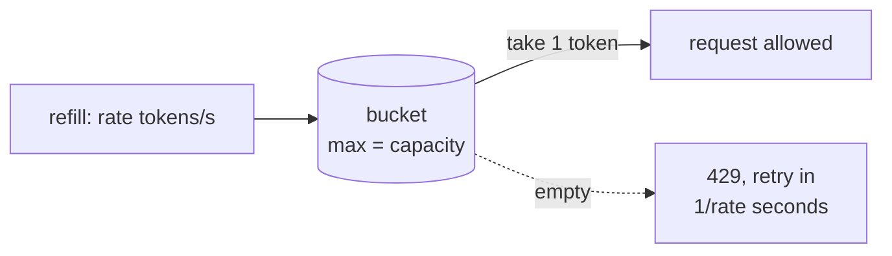
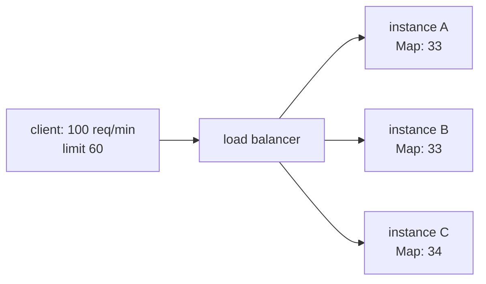
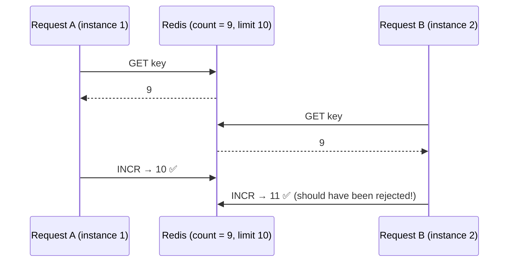
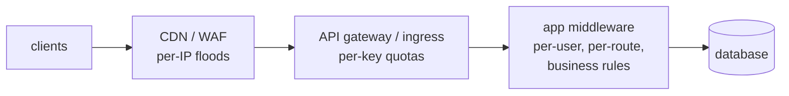

# 19 · Rate Limiting

> Every public endpoint will eventually get hammered: by a buggy client stuck in a retry loop, a scraper, a credential-stuffing botnet or your own biggest customer's cron job. A rate limiter decides, in about a millisecond, who gets served and who gets a polite `429`. Getting it right needs distributed systems thinking in miniature: shared state, atomicity, clocks and failure modes.

**Time:** ~5h · **Challenge:** 🛠️ Build · **Prereqs:** [17 · Redis Fundamentals](../17-redis-fundamentals/README.md), [05 · Express Basics](../05-express-basics/README.md) · **Services:** Redis

## What you'll learn

- Why we rate limit (abuse, fairness, cost, protecting downstreams) and what we limit *by*
- Five algorithms (fixed window, sliding log, sliding window counter, token bucket, leaky bucket), how each behaves at the edges, and when to choose which
- Why an in-process limiter breaks as soon as you run two instances, and how Redis fixes it
- Why "read, decide, write" from Node is a race, and how a **Lua script** makes it atomic
- The HTTP contract: `429 Too Many Requests`, `Retry-After`, `RateLimit-*` headers
- Where limits belong (edge, gateway, app) and choosing **fail-open vs fail-closed**

---

## 1. Why rate limit?

A rate limiter answers one question per request: *has this caller used more than their share recently?* It shows up for several different reasons, and the reason decides how you configure it:

| Reason | Example | What it implies |
|---|---|---|
| **Abuse prevention** | Credential stuffing on `/login`, scraping, card testing on `/checkout` | Strict, per-IP *and* per-account, fail closed |
| **Fairness** | One tenant's batch job shouldn't slow down everyone else | Per API key / per tenant quotas |
| **Cost control** | Each request calls a paid API (SMS, an LLM, a geocoder) | Limits tied to money; often daily quotas too |
| **Protecting dependencies** | The database can do 2,000 writes/s, so don't let 10,000 through | Global limit, closer to *load shedding* (module 29) |
| **Product tiers** | Free plan: 60 req/min; Pro: 1,000 req/min | Limit is data (looked up per customer), not a constant |

Notice that "stop attackers" and "keep the service fair" are different jobs. The login endpoint and the quotes endpoint in this module's challenge get different algorithms and different failure policies for exactly that reason.

### What do we count? The key

Every limiter counts per **key**, a string identifying "who". Picking the key is often harder than picking the algorithm:

- **IP address.** Works for anonymous traffic. But many users share one IP (offices, universities, mobile carrier NAT), and an attacker with a botnet has thousands. Behind a load balancer the socket IP is the *load balancer's*, so you must read `X-Forwarded-For`, and only trust it for the number of proxies you actually run (`app.set("trust proxy", 1)` in Express). Trusting it blindly lets anyone pick their own IP by sending the header.
- **User id / API key.** Fairer and harder to dodge. Requires authentication first, so it can't protect the authentication endpoint itself. Hash secrets before using them in key names: Redis key names show up in `MONITOR`, `SCAN`, slow logs and dashboards.
- **Composite keys.** `ip + username` for login: one attacker can't hammer one account, and one shared office IP doesn't lock out everyone. Large systems layer several limits (per IP, per account, global) and a request must pass all of them.
- **Per route or per cost.** An export endpoint might "cost" 10 units while a read costs 1. Our `consume(key, cost)` interface supports that.

## 2. The algorithms

All the examples below use "5 requests per 10 seconds".

### 2.1 Fixed window counter

Chop time into windows (`floor(now / windowMs)`) and keep one counter per key per window. Increment on each request; reject when the counter would exceed the limit. The window number is part of the key, so a new window automatically means a new, empty counter.

```
key = rl:fw:alice:170000000      (window 170000000 = 10s bucket)
INCR → 1, 2, 3, 4, 5 ✅   6 ❌   ...next window: new key, starts at 0
```

**Pros:** one tiny integer per key, trivially cheap, easy to explain ("60 per minute, resets on the minute").
**Cons:** the **boundary burst**. A client can send 5 requests at 9.9s and 5 more at 10.1s: 10 requests in 200ms, all allowed, because they land in two different windows.



Also, all clients' windows reset at the same instant, so well-behaved clients waiting for the reset tend to stampede together.

### 2.2 Sliding window log

Store a timestamp for every allowed request (a Redis **sorted set**, score = timestamp). On each request, drop everything older than `now - window`, count what's left, and allow if the count is under the limit.

```
ZREMRANGEBYSCORE key -inf (now - 10000)
ZCARD key            → 4  (< 5, allowed)
ZADD key now <unique-id>
```

**Pros:** exact. "No more than 5 in *any* 10-second period" holds with no boundary burst. Retry-After is precise: when the oldest entry slides out.
**Cons:** memory is O(limit) per key. 5 login attempts per 15 minutes? Perfect. 10,000 requests per minute per API key? That's 10,000 sorted-set members per customer.

### 2.3 Sliding window counter (approximation)

The popular compromise. Keep fixed-window counters, but estimate the sliding count by weighting the previous window by how much of it still overlaps:

```
estimate = current_count + previous_count × (1 − elapsed_in_current / window)
```

If you're 30% into the current window, 70% of the previous window still "counts". Two integers per key, and the boundary burst mostly disappears. The estimate assumes the previous window's requests were spread evenly. Cloudflare has written publicly that this approximation is accurate to within a fraction of a percent on real traffic, which is why you see it at large scale. It's a stretch goal in the challenge.

### 2.4 Token bucket

Picture a bucket holding up to `capacity` tokens, refilled at `rate` tokens per second. Each request takes a token (or `cost` tokens). An empty bucket means a rejection.



Two parameters, two meanings: **capacity = allowed burst**, **rate = sustained throughput**. "Burst of 5, then 1 every 12 seconds" is natural to express. This is what AWS API Gateway, Stripe and most cloud APIs describe in their docs.

The implementation trick: **nobody refills buckets on a timer.** You store `{ tokens, lastRefillTimestamp }` and compute the refill lazily on each request:

```
tokens = min(capacity, tokens + (now − ts) × rate)
if tokens >= cost: tokens -= cost → allowed
else: retryAfter = (cost − tokens) / rate
save { tokens, ts = now }
```

Constant memory per key no matter how high the limit. `tokens` is fractional (0.3 tokens after 300ms at 1/s), which matters in section 4.

### 2.5 Leaky bucket

Requests enter a FIFO queue that drains at a fixed rate. If the queue is full, new requests are dropped. Where the token bucket allows bursts, the leaky bucket **smooths** them: output is perfectly even. It's the classic shape for traffic shaping in networks (and nginx's `limit_req` behaves like it). In APIs you rarely want to *delay* requests, so the "leaky bucket as a meter" variant (no queue, reject when full) is mathematically the same as a token bucket seen from the other side.

### Choosing

| Algorithm | Memory/key | Bursts | Accuracy | Typical use |
|---|---|---|---|---|
| Fixed window | 1 int | up to 2x at boundaries | rough | simple quotas, daily limits |
| Sliding log | O(limit) | none | exact | low limits on sensitive actions |
| Sliding counter | 2 ints | smoothed | ~approximate | high-volume API limits |
| Token bucket | 2 numbers | up to `capacity`, by design | exact for its model | public APIs, login, "burst + sustained" |
| Leaky bucket | queue | none (smoothed) | exact | traffic shaping, protecting a fixed-rate consumer |

There's no "best" algorithm. Ask: *Do I want to allow bursts? How high is the limit? How exact must it be?*

## 3. Going distributed: why Redis

Your first instinct might be a `Map<string, number>` in memory. It works on your laptop. Then you deploy three instances behind a load balancer:



Each instance sees a third of the traffic, so each one thinks the client is well under the limit. The effective limit is now `limit × instances`, and it changes every time autoscaling adds a pod. Restarts also reset everything.

The limiter's state has to live somewhere **shared**. Redis fits well: sub-millisecond operations, built-in expiry (TTL) so old counters clean themselves up, and the right data structures (strings for counters, sorted sets for logs, hashes for buckets).

## 4. Atomicity: the part everyone gets wrong

Here's a fixed window written the obvious way:

```ts
// ❌ RACE CONDITION
const count = Number(await redis.get(key) ?? 0);
if (count >= limit) return reject();
await redis.incr(key);
return allow();
```

Every individual Redis command is atomic. The *sequence* isn't. Two requests can interleave:



With 50 concurrent requests, you'll let through far more than 10. This is the same **read-then-write** race you met with database rows in [module 15](../15-transactions-concurrency/README.md). Options:

1. **Just `INCR` first, then check.** `INCR` returns the new value atomically, so `if (await redis.incr(key) > limit) reject()` is race-free. This is fine for a plain fixed window. The catch: rejected requests still increment the counter, and you need a separate `PEXPIRE` (if the process dies between `INCR` and `PEXPIRE`, you've made a counter that never expires). Anything more complex (sliding log, token bucket, "don't count rejected requests") doesn't fit in a single command.
2. **`MULTI/EXEC`.** Commands in a transaction run together, but you can't *branch* on a value you read inside it. `WATCH` + retry works but gets expensive under contention, which is exactly when a limiter is busiest.
3. **A Lua script.** ✅ Redis runs the whole script without interleaving any other command. Read, decide, write, set a TTL: all one atomic step, in one network round trip.

```lua
-- KEYS[1] = counter key; ARGV = cost, limit, ttlMs
local cost  = tonumber(ARGV[1])
local limit = tonumber(ARGV[2])
local count = tonumber(redis.call('GET', KEYS[1]) or '0')
if count + cost > limit then
  return {0, count}                    -- rejected, nothing written
end
count = redis.call('INCRBY', KEYS[1], cost)
if count == cost then redis.call('PEXPIRE', KEYS[1], ARGV[3]) end
return {1, count}
```

Running it from Node with ioredis:

```ts
const reply = await redis.eval(source, 1, key, cost, limit, ttlMs);
```

Sending the full source every time is wasteful, so Redis caches scripts by SHA1: `EVALSHA <sha> ...` sends 40 characters instead. If Redis restarted and forgot the script, it answers `NOSCRIPT` and you fall back to `EVAL` once. The challenge's `src/lib/script.ts` implements this pattern for you (ioredis's `defineCommand` does the same internally).

### Lua gotchas that will bite you

- **Every `ARGV` is a string.** `ARGV[1] + 1` happens to work through coercion, but comparisons don't behave as you'd expect. Always `tonumber()`.
- **Lua floats are truncated in replies.** Return `2.7` from a script and ioredis receives `2`. For a token bucket that means storing tokens with `tostring(tokens)` (keeps the fraction in the hash) and returning `math.floor`/`math.ceil` values. If you truncate the stored token count on every call, slow refill rates *never* accumulate a whole token: a bug that shows up only for small rates.
- **Declare every key in `KEYS`.** Redis Cluster routes the script by its keys. Building key names inside the script works on a single node and breaks in a cluster.
- **Keep scripts short.** While a script runs, Redis runs nothing else. A loop over 100,000 members blocks every client.
- **`nil` from `GET` is `false` in Lua.** Hence `redis.call('GET', k) or '0'`.

### Whose clock?

A token bucket needs "now". Options: the app server's clock (pass `now` as an `ARGV`), or Redis's (`redis.call('TIME')` inside the script). Using Redis's clock means all instances agree even if a server's clock drifts. Passing it in means **tests can control time**: you can say "advance 500ms" without sleeping. This module passes `now` in (via an injected `clock` function) because deterministic tests matter more here, and NTP keeps production servers within milliseconds of each other. The token bucket script guards against small backwards jumps with `max(0, now - ts)`. Know both options and say which you'd pick and why. That's an interview answer.

## 5. The HTTP contract

When you reject, tell the client clearly, and tell well-behaved clients how to stay under the limit:

```http
HTTP/1.1 429 Too Many Requests
Retry-After: 3
RateLimit-Limit: 10
RateLimit-Remaining: 0
RateLimit-Reset: 9
Content-Type: application/json

{"error":{"code":"RATE_LIMITED","message":"Too many requests, retry in 3s"}}
```

- **`429 Too Many Requests`** (RFC 6585) is the status code. Not 403 (that's "you're not allowed, ever") and not 503 (that's "*we're* broken").
- **`Retry-After`** (seconds, or an HTTP date) says when to come back. Round **up**: `Retry-After: 0` invites a client to retry in a tight loop. Good clients (and SDKs) honor it automatically.
- **`RateLimit-Limit` / `-Remaining` / `-Reset`** come from an IETF draft that standardizes what used to be `X-RateLimit-*` headers. Send them on *successful* responses too, so clients can slow down before hitting the wall. `Reset` here is "seconds until the quota is full again". (Later drafts combine these into `RateLimit` and `RateLimit-Policy` structured headers, and you'll see all variants in the wild. Pick one and document it.)
- **Error body.** Keep your normal error shape (module 05) with a stable `code` like `RATE_LIMITED` so frontends can show "slow down" instead of "something broke".

### Middleware shape

Limiting is a cross-cutting concern, so it's middleware, and it doesn't know which algorithm it wraps:

```ts
app.use("/api", rateLimit(apiLimiter, apiKeyOrIp, { failOpen: true }), apiRouter());
router.post("/login", rateLimit(loginLimiter, loginKey, { failOpen: false }), loginHandler);
```

The `RateLimiter` interface (`consume(key, cost) → decision`) is the seam. Swap fixed window for token bucket in `server.ts` and nothing else changes, and middleware tests can use a scripted fake limiter without Redis.

## 6. Where to limit



- **Edge (CDN/WAF, e.g. Cloudflare, AWS WAF):** stops volumetric floods before they cost you anything. Coarse: mostly IP-based, knows nothing about your users.
- **Gateway / ingress (Kong, Envoy, nginx `limit_req`, AWS API Gateway):** per-API-key quotas and plan tiers, in one place for all services. Configured, not coded.
- **Application:** the only layer that knows your domain: "5 password attempts per account", "3 invites per day on the free plan", "exports cost 10". What you build in this module.

Real systems use more than one layer. The edge stops the obvious flood, the app enforces business-meaningful limits.

## 7. When Redis is down: fail open or fail closed?

Your limiter depends on Redis. Redis will, someday, be unreachable. What happens to the request?

| | Fail open (let it through) | Fail closed (reject, 503) |
|---|---|---|
| Availability | the product stays up | everything behind the limiter is down |
| Protection | none until Redis returns | intact |
| Good for | read APIs, product endpoints, internal traffic | login, password reset, SMS/email sending, payments, anything costing money per call |

There's no universal answer, so make it **an explicit option per route** and default to the safer one for your context. Either way:

- **Fail fast.** The limiter must not wait 30 seconds for a reconnect. That's why `connectRedis` disables the ioredis offline queue: commands fail immediately while disconnected. A slow limiter is worse than a missing one, because it stalls every request.
- **Make it loud.** Log and count limiter failures (`onLimiterError`). Failing open silently means you're unprotected and nobody knows.
- Some teams add a **local in-memory fallback limiter** when Redis is down: imperfect (per instance) but better than nothing.

## Common mistakes

- Read-then-write from Node (`GET`, compare, `INCR`). Works in testing, leaks under concurrency.
- Forgetting the TTL, or setting it in a separate command that can be skipped. Redis slowly fills with dead counters.
- Keying by `req.ip` behind a load balancer without `trust proxy` (everyone shares one limit), or trusting `X-Forwarded-For` from anyone (attackers pick their own key).
- Putting raw API keys or emails in Redis key names.
- Returning floats from Lua and getting truncated integers back. Or truncating stored tokens so slow refill never accumulates.
- `Retry-After: 0`, or omitting it, so clients hammer you while blocked.
- One global limit for everything, so a cheap health check and an expensive export share a budget. (And rate limiting `/health` itself, which gets your instances pulled from the load balancer.)
- Fail-open on login "because availability", which turns every Redis blip into an unlimited brute-force window.
- Using `KEYS pattern` to inspect or clean up limiter keys in production. It blocks Redis. Use `SCAN`.

## In production

- **Scale.** One Redis node handles well over 100k simple script calls per second. At larger scale, keys shard naturally across a Redis Cluster (keys are per user, so there are no hot spots unless one user is huge). Some companies keep approximate local counters and sync to Redis periodically, trading exactness for fewer round trips.
- **Latency budget.** The limiter runs on *every* request. Keep Redis close (same region/AZ), use `EVALSHA`, put a timeout on the call, and measure it.
- **Limits are configuration.** Plan tiers live in a database or config service, not in code. The limiter takes `limit` per call or per customer.
- **Observability.** Count allowed/rejected per route and per tier. A spike in 429s is either an attack or a bug in a client you shipped. Both are worth an alert. You'll wire metrics in [module 24](../24-observability/README.md).
- **Clients.** Your own frontends and SDKs should honor `Retry-After` with exponential backoff and jitter ([module 29](../29-reliability-scaling/README.md)); otherwise your limiter turns a spike into a synchronized retry storm.
- **Communicate.** Public APIs document their limits and headers. Surprising customers with 429s at their peak hour is a support ticket waiting to happen.

## Check yourself

1. Why does an in-memory limiter give the wrong answer with three app instances?
   <details><summary>Answer</summary>Each instance only sees its share of the traffic and keeps its own counts, so the effective limit becomes roughly limit × instances (and it resets on every deploy). The state has to be shared, for example in Redis.</details>
2. What is the boundary burst problem, and which algorithms avoid it?
   <details><summary>Answer</summary>With fixed windows, a client can use the full limit at the end of one window and again at the start of the next, sending 2× the limit in a short span. The sliding log avoids it exactly; the sliding window counter mostly avoids it; a token bucket allows a burst of at most <code>capacity</code> by design.</details>
3. Every Redis command is atomic. Why do we still need Lua?
   <details><summary>Answer</summary>The limiter needs read → decide → write as one step. Separate commands from Node can interleave with other clients between the read and the write. A Lua script runs as one atomic unit on the server, in one round trip.</details>
4. A token bucket with capacity 10 and refill 1/s: what does a client get after being idle for an hour, then sending 15 requests at once?
   <details><summary>Answer</summary>10 allowed (the bucket caps at capacity), 5 rejected with Retry-After of about 1 second for the next one.</details>
5. Should a login endpoint fail open or closed when Redis is down? A product listing?
   <details><summary>Answer</summary>Login: closed. Unlimited password guessing is worse than a temporarily unavailable login. Product listing: usually open. Staying available matters more, and the risk of a few minutes without limits is low. Either way, fail fast and alert.</details>

## Further reading

- RFC 6585 (defines 429): https://www.rfc-editor.org/rfc/rfc6585
- IETF draft, RateLimit header fields: https://datatracker.ietf.org/doc/draft-ietf-httpapi-ratelimit-headers/
- Redis docs, Scripting with Lua: https://redis.io/docs/latest/develop/interact/programmability/eval-intro/
- Redis docs, INCR (includes a rate limiter pattern): https://redis.io/docs/latest/commands/incr/
- Express, `trust proxy` setting: https://expressjs.com/en/guide/behind-proxies.html
- Deep dives in this module: [docs/algorithms-deep-dive.md](docs/algorithms-deep-dive.md) · [docs/redis-lua-atomicity.md](docs/redis-lua-atomicity.md) · [docs/rate-limiting-cheatsheet.md](docs/rate-limiting-cheatsheet.md)

## ➡️ Next: [the challenge](CHALLENGE.md)
