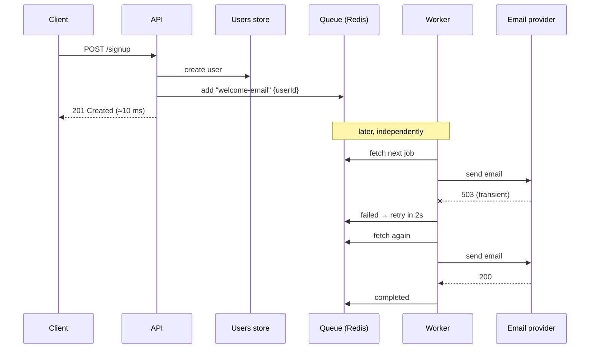
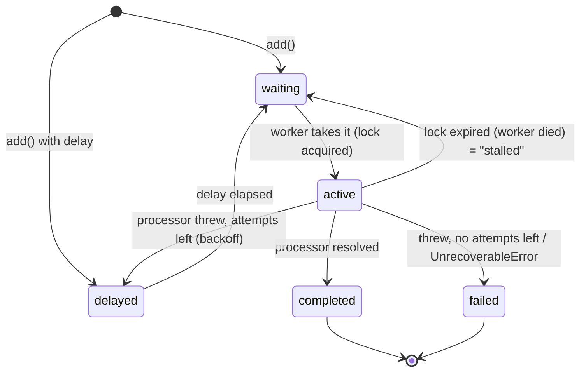
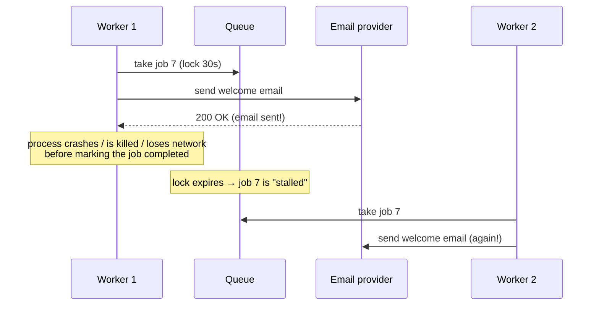
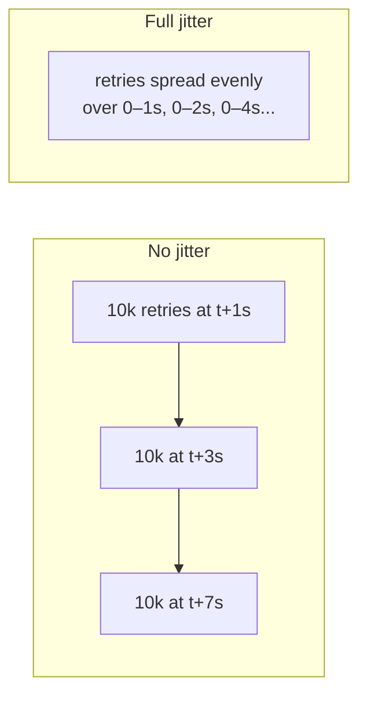
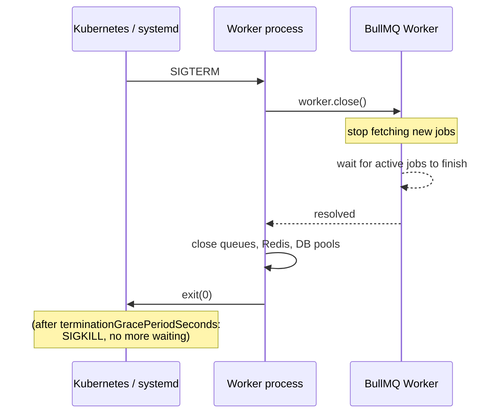

# 20 · Background Jobs & Queues

> Sending an email takes 800ms and fails 1% of the time. Resizing an image takes 2 seconds of CPU. Neither belongs inside an HTTP request. Background jobs are how real backends stay fast and survive flaky dependencies, and "what happens when a job runs twice?" is one of the most common senior-level interview questions.

**Time:** ~6h · **Challenge:** 🧩 Scaffold · **Prereqs:** [17 · Redis Fundamentals](../17-redis-fundamentals/README.md), [06 · Layered Architecture](../06-layered-architecture/README.md) · **Services:** Redis

## What you'll learn

- When to move work out of the request/response cycle, and what you give up when you do
- Queues vs pub/sub, and the vocabulary: producer, consumer, job, ack, visibility
- BullMQ's model: `Queue`, `Worker`, job lifecycle, attempts, backoff, delays, priorities, concurrency, rate limits
- Why queues give you **at-least-once** delivery, and how **idempotent** handlers turn that into "effectively once"
- Retries done right: which errors to retry, **exponential backoff with jitter**, and when to give up
- **Dead-letter queues**: where jobs go to be investigated instead of disappearing
- **Graceful shutdown** of workers, scheduling and cron, and a teaser of the outbox pattern

---

## 1. Why background jobs?

Here's a signup handler that does everything inline:

```ts
router.post("/signup", async (req, res) => {
  const user = await users.create(req.body);          //   5 ms
  await emailProvider.sendWelcome(user);              // 800 ms, sometimes 30 s, sometimes throws
  await imageService.makeThumbnail(user.avatarUrl);   // 2 s of CPU
  res.status(201).json(user);
});
```

Problems:

1. **Latency.** The user waits ~3 seconds for things they don't need to wait for.
2. **Coupled failure.** If the email provider is down, signup fails, even though the user row was created. Retrying the request now creates a *duplicate-email* error. You've turned someone else's outage into yours.
3. **No retries.** A transient 503 from the provider means the email is simply never sent.
4. **Resource contention.** CPU-heavy thumbnailing in the API process slows down every other request on that instance (remember the event loop, [module 01](../01-js-runtime/README.md)).
5. **Spikes.** A marketing campaign brings 10,000 signups in a minute. Inline, that's 10,000 concurrent calls to a provider that allows 100/s.

With a queue:



The API does the minimum that must be synchronous (the user exists, the response says so) and records the *intent* to do the rest. Workers do that work at their own pace, retry on failure and scale separately.

**What you give up:** immediacy and simplicity. The client gets "accepted", not "done". You now have a second kind of process to deploy and monitor, and you must think about duplicates and ordering. Don't queue things that are fast, reliable and needed for the response.

Good candidates: sending email/SMS/push, image/video processing, PDF/report generation, calling slow or rate-limited third-party APIs, webhooks to customers, search indexing, data exports, cleanup jobs, anything scheduled.

## 2. Queues vs pub/sub

Both move messages from producers to consumers, but with different semantics:

| | Work queue | Pub/sub |
|---|---|---|
| Each message goes to | **one** consumer (of many competing workers) | **every** subscriber |
| Purpose | distribute *work* | broadcast *events* |
| If no consumer is running | messages wait | (classic pub/sub) messages are lost |
| Acknowledgement | yes: a job is done only when the worker says so | usually no |
| Examples | BullMQ, Sidekiq, Celery, SQS, RabbitMQ queues | Redis `PUBLISH`, SNS, Kafka topics (with consumer groups it's both) |

"Send this user a welcome email" is work: exactly one worker should do it. "User signed up" is an event: the email service, analytics and CRM might all care. You'll meet event streaming with Kafka in [module 32](../32-kafka-fundamentals/README.md). This module is about work queues.

## 3. BullMQ's model

BullMQ is the standard Redis-backed job queue for Node. Its pieces:

- **`Queue`**: the producer side. `queue.add(name, data, opts)` stores a job in Redis.
- **`Worker`**: the consumer side. Pulls jobs and runs your **processor**, an `async (job) => result` function. Resolve = completed, throw = failed.
- **`Job`**: `{ id, name, data, opts, attemptsMade, progress, returnvalue, failedReason, ... }`.
- **`QueueEvents`**: a listener for global events (completed, failed, progress) across all workers.

```ts
import { Queue, Worker } from "bullmq";
const connection = { host: "localhost", port: 6380, db: 4 };

const emails = new Queue("emails", { connection, prefix: "wl:20" });
await emails.add("welcome-email", { userId: "u_123" }, { attempts: 5, backoff: { type: "exponential", delay: 1000 } });

const worker = new Worker("emails", async (job) => {
  const user = await users.findById(job.data.userId);
  await emailProvider.send(/* ... */);
  return { sent: true };              // stored as job.returnvalue
}, { connection, prefix: "wl:20", concurrency: 5 });
```

### Job lifecycle



Under the hood these are Redis lists, sorted sets and hashes, moved between atomically by Lua scripts (the same tool you used in [module 19](../19-rate-limiting/README.md)). You can watch them with `redis-cli`: `SCAN 0 MATCH wl:20:*`.

### Job options you'll actually use

| Option | What it does | Example |
|---|---|---|
| `attempts` | total tries including the first | `5` |
| `backoff` | delay between retries: `{type: "fixed" \| "exponential", delay}` or `{type: "custom"}` + worker `backoffStrategy` | `{ type: "exponential", delay: 1000 }` |
| `delay` | don't run before N ms from now | "send the trial-ending email in 13 days" |
| `priority` | lower number = sooner (1 is highest) | password reset beats newsletter |
| `jobId` | custom id; **adding an existing id is a no-op** | `welcome-email-${userId}` |
| `removeOnComplete` / `removeOnFail` | `true`, `{count}`, `{age}`: how much history to keep | `{ count: 1000 }` |

### Worker options

- **`concurrency`**: how many jobs one worker runs at once. Async I/O jobs (HTTP calls) can use 10–50. CPU-heavy jobs should use 1 per core, or BullMQ's *sandboxed processors* (separate processes) so they don't block the event loop.
- **`limiter: { max, duration }`**: "at most 100 jobs per second across all workers of this queue". This is how you respect a provider's rate limit globally.
- **`lockDuration`**: how long a worker's claim on an active job lasts before it must renew it. If a worker dies, the lock expires and the job is considered **stalled** and handed to another worker.

## 4. At-least-once delivery ⇒ idempotency

Here's the uncomfortable truth about every job queue: **a job can run more than once.**



Other ways the same job runs twice:

- The provider call **timed out** but actually succeeded, so the job is retried.
- A deploy kills the worker mid-job (see section 7).
- The *producer* enqueued twice (the client retried the HTTP request, a double click).

Why not guarantee "exactly once"? Because the side effect (the email) and the acknowledgement (marking the job done in Redis) happen in two different systems. There's always a moment between them where a crash leaves you not knowing whether the effect happened. The queue chooses to retry rather than risk losing work. That's **at-least-once**. (The alternative, at-most-once, acks *before* processing and loses the job on a crash. That's rarely what you want for anything important.)

So the rule is: **make processors idempotent**: running them twice has the same effect as running them once.

### Techniques, from best to most work

1. **Naturally idempotent operations.** "Set the user's thumbnail URL to X" can run 10 times harmlessly. Prefer *set* over *increment*, *upsert* over *insert*.
2. **Idempotency keys at the provider.** Stripe, many email APIs and most payment APIs accept an `Idempotency-Key` header and drop duplicates on their side. Always send one, derived from the business fact (`welcome-email:${userId}`), not a random value.
3. **Database constraints.** `INSERT ... ON CONFLICT DO NOTHING` on a unique `(user_id, kind)` row in a `sent_emails` table. If the insert affected 0 rows, someone already did it. Best when the side effect is in the same database (do it in one transaction).
4. **Processed-job keys** (what you'll build). Before the side effect, atomically claim a key in Redis. After it, mark it done:

```ts
const claim = await idempotency.claim(`welcome-email:${userId}`, 60_000); // SET key in-progress NX PX 60000
if (claim === "done") return { status: "skipped" };       // already sent
if (claim === "busy") throw new Error("in progress elsewhere"); // retry later
try {
  await email.send(...);
} catch (err) {
  await idempotency.release(key);    // let the retry try again
  throw err;
}
await idempotency.complete(key, 30 * DAY); // SET key done PX ...
```

Why a three-state claim rather than a simple "done" flag? A plain *check-then-act* ("if not done: send; mark done") has the same race you saw in modules 15 and 19: two workers both check, both see "not done", both send. `SET NX` is atomic: exactly one claimant wins. The **lease** (PX) handles crashes: if the winner dies mid-send, the claim expires and a later retry can take over.

Be honest about the limit: if the worker crashes *after* the email was sent but *before* `complete()`, the lease expires and the email is sent again. Processed-job keys shrink the duplicate window from "every retry" to "a crash at exactly the wrong millisecond". Combine them with the provider's idempotency key and you close it.

> 🔑 Key the claim by the **business fact** (`welcome-email:<userId>`), not the job id. Two *different* jobs for the same user (from a double enqueue) must still produce one email.

## 5. Retries, backoff and jitter

### Which errors to retry

Not every failure deserves another attempt:

| Error | Retry? | Why |
|---|---|---|
| Timeout, connection reset, 502/503/504, 429 | ✅ | likely transient |
| 500 from a dependency | ✅ (a few times) | might be transient |
| 400 / 422 / validation error, malformed payload | ❌ | will fail identically forever |
| Resource doesn't exist (user deleted) | ❌ | retrying can't create it |
| Bug in your code (`TypeError`) | ❌ usually | fix and replay from the DLQ instead |

In BullMQ, throw `UnrecoverableError` to fail a job immediately, skipping remaining attempts:

```ts
import { UnrecoverableError } from "bullmq";
if (!isHttpUrl(job.data.imageUrl)) throw new UnrecoverableError("invalid image url");
```

Retrying permanent errors wastes capacity, delays the inevitable, and (with an external API) can get you rate limited or banned.

### Exponential backoff

Retrying immediately hammers a dependency that's already struggling. Wait longer after each failure:

```
delay(n) = base × 2^(n−1), capped at max
base = 1s → 1s, 2s, 4s, 8s, 16s, 32s, 60s, 60s...
```

Five attempts with base 1s spans about 15 seconds, which rides out most blips. Long outages need more attempts, a bigger cap, or a DLQ + replay.

### Jitter: why randomness matters

Imagine the email provider goes down for 10 seconds and 10,000 jobs fail at the same moment. With plain exponential backoff, all 10,000 retry at exactly +1s, then exactly +2s, then +4s: synchronized waves that knock the recovering provider straight back down. This is the **thundering herd**.

**Jitter** spreads the retries out. "Full jitter" picks a random delay between 0 and the exponential ceiling:

```ts
const ceiling = Math.min(maxMs, baseMs * 2 ** (attemptsMade - 1));
const delay = Math.floor(Math.random() * ceiling);
```



AWS's architecture blog popularized this analysis: full jitter finishes the backlog with far less total load on the dependency than no jitter. BullMQ's built-in exponential backoff accepts a `jitter` option; in the challenge you write the function yourself and plug it in as a custom `backoffStrategy`.

## 6. Dead-letter queues

After the last attempt, a job lands in the queue's `failed` set, mixed with everything else, until `removeOnFail` deletes it. Nobody notices until a customer asks why they never got their invoice.

A **dead-letter queue (DLQ)** is a separate queue holding jobs that failed for good, with everything needed to understand and replay them:

```json
{
  "originalQueue": "app-emails",
  "originalJobId": "welcome-email-u_123",
  "name": "welcome-email",
  "data": { "userId": "u_123" },
  "failedReason": "email provider returned 503",
  "attemptsMade": 5,
  "failedAt": "2026-11-24T10:15:00.000Z"
}
```

What you do with it:

- **Alert** when it's non-empty or growing. A DLQ that nobody watches is just a slower way to lose data.
- **Investigate**: bug? bad data? an outage longer than your retry window?
- **Replay** after fixing the cause: re-add each letter's `data` to its `originalQueue`. Your handlers are idempotent, so replaying something that half-succeeded is safe. (Idempotency pays off again.)
- **Discard** what's truly obsolete, deliberately.

BullMQ doesn't have a built-in DLQ, so you build one. Two approaches:

1. **Listen to the worker's `failed` event** and, when `job.attemptsMade >= job.opts.attempts`, add a copy to the DLQ. Simple, but the listener runs *outside* the job's lifecycle: during shutdown it can be cut off mid-write.
2. **Wrap the processor** (what the challenge does): catch the error inside the job, check whether this is the final attempt, write the dead letter, then rethrow. The DLQ write is part of processing, so graceful shutdown waits for it.

Inside a processor, `job.attemptsMade` counts the attempts *before* the current one, so "final" means `attemptsMade + 1 >= attempts`, or the error is an `UnrecoverableError`.

## 7. Graceful shutdown

Every deploy, autoscale-down and node drain sends your worker `SIGTERM`. If the process just exits:

- Active jobs are abandoned mid-flight. Their locks expire, they're marked **stalled**, and another worker runs them again from the start. That's at-least-once in action, and every non-idempotent side effect runs twice.
- Half-finished work (a file half-uploaded) is left behind.

A graceful worker shutdown:



In BullMQ, `await worker.close()` does exactly this. `worker.close(true)` *forces* the close without waiting. Use that only as a last resort when you're out of time.

Practical details:

- Set the platform's grace period (Kubernetes `terminationGracePeriodSeconds`, default 30s) **longer than your longest job**, or break long jobs into smaller steps that checkpoint progress.
- Order matters in a process that runs both an API and workers: stop HTTP first (so no new jobs are created), then drain workers, then close queues and connections. See `src/server.ts`.
- Handle `SIGTERM` once. A second signal shouldn't start a second shutdown.

## 8. Scheduling, progress and observability

- **Delayed jobs**: `queue.add("trial-ending", data, { delay: 13 * DAY })`. Survives restarts, unlike `setTimeout`.
- **Repeatable / cron jobs**: `queue.upsertJobScheduler("nightly-report", { pattern: "0 3 * * *" }, { name: "report", data: {} })`. BullMQ makes sure only one job is created per tick even with many worker instances. That's the classic problem with running `node-cron` in every replica: N instances means N nightly reports.
- **Progress**: `await job.updateProgress(40)` inside the processor; a UI can poll the job or listen via `QueueEvents`. That's how you build "your export is 40% done".
- **Returning a job id to the client**: for long tasks, respond `202 Accepted` with a job id and let the client poll `GET /jobs/:id` (module 21 does this).
- **Observability**: queue depth (waiting count), age of the oldest waiting job, processing duration, failure rate and DLQ size are the metrics that matter. A growing backlog means you need more workers, or something downstream is slow. Tools like Bull Board give a web UI over the queues.

## 9. The dual-write problem (outbox teaser)

Look closely at `SignupService.signup`:

```ts
const user = await this.users.create(input);   // write #1: database
await this.jobs.enqueueWelcomeEmail(user);     // write #2: Redis
```

Two different systems, no shared transaction. If the process crashes between the two lines, or Redis is briefly unreachable, the user exists but the email job doesn't. Reversing the order doesn't help: then a job can exist for a user whose insert rolled back.

The robust fix is the **transactional outbox**: in the *same database transaction* as the user insert, insert a row into an `outbox` table ("send welcome email to user 123"). A separate relay process reads unsent outbox rows and enqueues/publishes them, marking them sent. The database transaction guarantees that the user and the intent are written together. The relay delivers at-least-once, and your idempotent consumers absorb the duplicates. You'll build this in [module 33](../33-event-driven-architecture/README.md). For now, know the problem exists and be ready to name it in an interview.

## Common mistakes

- Putting whole objects in job data (`{ user }`) instead of ids. The data goes stale, the payload is huge, and it may contain secrets. Store `{ userId }` and load fresh data in the processor.
- Non-idempotent processors ("it only runs once, right?").
- Idempotency *check-then-act* without atomicity (`GET` then `SET`), or keyed by job id instead of the business fact.
- Retrying everything, including validation errors, or retrying forever.
- Backoff without jitter, which creates synchronized retry storms.
- No DLQ, or a DLQ nobody alerts on.
- `removeOnComplete: true` everywhere: no history to debug, and `jobId` dedupe stops working once the job is gone. Or keeping everything forever, which fills Redis.
- Killing workers without `await worker.close()`, so every deploy duplicates in-flight jobs.
- CPU-heavy processors in the same event loop as other jobs (use sandboxed processors or a separate deployment).
- Running cron with `setInterval`/`node-cron` in every replica.
- Treating Redis as durable without configuring persistence (AOF). If Redis loses data, queued jobs are gone.

## In production

- **Separate deployments.** API pods and worker pods scale independently, often per queue (email workers: many, cheap; video workers: few, big machines). Autoscale workers on queue depth, not CPU.
- **Redis config.** Queues need `maxmemory-policy noeviction` (evicting a job key silently loses work) and AOF persistence. Many teams run a dedicated Redis for queues, separate from the cache.
- **Alternatives.** SQS (fully managed, visibility timeouts are the same idea as locks), RabbitMQ (rich routing), Sidekiq/Celery in other ecosystems, Postgres-based queues (`SELECT ... FOR UPDATE SKIP LOCKED`, e.g. pg-boss/graphile-worker) when you want jobs in the same transaction as your data (which solves the dual-write problem), and workflow engines like Temporal for long multi-step processes.
- **Poison messages.** One job that crashes the worker process (out of memory on a huge image) can take down a whole worker repeatedly. Limits on input size, sandboxing and the DLQ contain the damage.
- **Ordering.** Queues with concurrent workers do **not** preserve order. If order matters per entity (account events), you need partitioning (Kafka, BullMQ Pro groups) or a design that doesn't depend on it.

## Check yourself

1. Why can a job run twice even if nothing is "wrong" with the queue?
   <details><summary>Answer</summary>The side effect and the acknowledgement happen in different systems. A worker can crash, time out or be killed after the side effect but before marking the job complete; the lock expires and the job is retried. Producers can also enqueue duplicates. Queues choose at-least-once to avoid losing work.</details>
2. What's wrong with "if not processed(key): doSideEffect(); markProcessed(key)"?
   <details><summary>Answer</summary>It's check-then-act without atomicity: two concurrent workers can both see "not processed" and both perform the side effect. Use an atomic claim (<code>SET NX</code>, a unique constraint) before acting.</details>
3. Why add jitter to exponential backoff?
   <details><summary>Answer</summary>Jobs that failed together would otherwise retry together, in synchronized waves that overload the recovering dependency (thundering herd). Randomizing delays spreads the load.</details>
4. Which of these should be retried: a 503 from the email provider, a job whose user was deleted, a timeout?
   <details><summary>Answer</summary>The 503 and the timeout (transient). The deleted user is permanent: fail it with <code>UnrecoverableError</code> and let it go to the DLQ.</details>
5. What does <code>await worker.close()</code> do that <code>process.exit()</code> doesn't?
   <details><summary>Answer</summary>It stops taking new jobs and waits for active ones to finish (and record their result) before disconnecting, so in-flight jobs aren't abandoned, marked stalled and re-run by another worker.</details>

## Further reading

- BullMQ documentation: https://docs.bullmq.io/
- BullMQ guide, Retrying failing jobs: https://docs.bullmq.io/guide/retrying-failing-jobs
- BullMQ guide, Graceful shutdown: https://docs.bullmq.io/guide/workers/graceful-shutdown
- AWS Architecture Blog, Exponential Backoff and Jitter: https://aws.amazon.com/blogs/architecture/exponential-backoff-and-jitter/
- Redis docs, SET (NX/PX options): https://redis.io/docs/latest/commands/set/
- Deep dives in this module: [docs/delivery-guarantees-and-idempotency.md](docs/delivery-guarantees-and-idempotency.md) · [docs/retries-and-failure-handling.md](docs/retries-and-failure-handling.md) · [docs/bullmq-cheatsheet.md](docs/bullmq-cheatsheet.md)

## ➡️ Next: [the challenge](CHALLENGE.md)
