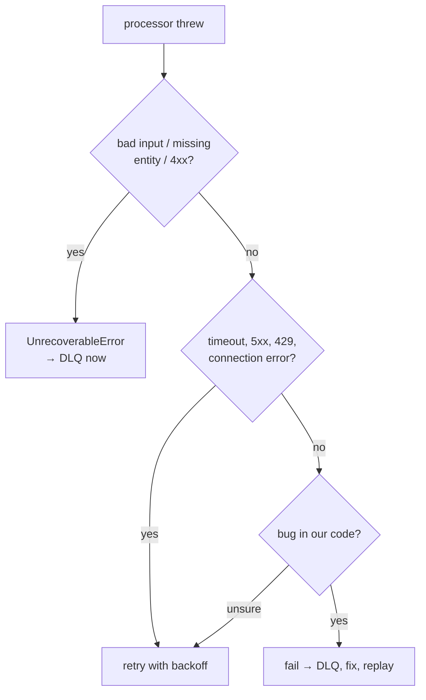

# Retries and failure handling for jobs

A retry policy is a set of decisions: *what* to retry, *how often*, *how far apart*, and *what happens when you give up*. This page goes through each one with numbers.

## 1. Classify the error

Before choosing delays, decide whether retrying can possibly help.



Put the classification close to the dependency. An HTTP client wrapper can translate a 422 from the provider into an `UnrecoverableError` and leave 503s as normal errors, so processors stay readable.

**429 Too Many Requests** from a provider is special: it's transient, and the provider usually tells you when to come back (`Retry-After`). Honor it. In BullMQ, a custom `backoffStrategy` receives the error, so you can return the provider's delay instead of your formula. Better still, avoid hitting the limit with the worker `limiter` option.

## 2. How many attempts, how far apart?

Exponential backoff ceiling per attempt, base 1s, cap 60s:

| Failed attempts | Ceiling | Cumulative max wait |
|---|---|---|
| 1 | 1 s | 1 s |
| 2 | 2 s | 3 s |
| 3 | 4 s | 7 s |
| 4 | 8 s | 15 s |
| 5 | 16 s | 31 s |
| 6 | 32 s | 63 s |
| 7 | 60 s | ~2 min |
| 10 | 60 s | ~5 min |

Choose based on the outages you want to absorb automatically. A welcome email can wait an hour (more attempts, higher cap). A password reset email is useless after 15 minutes. A webhook to a customer often retries for days with a cap of an hour (that's what Stripe and GitHub do for webhooks).

With full jitter, the actual wait averages half the ceiling. That's fine: the point is spreading load, not precise timing.

## 3. Jitter variants

- **No jitter:** `ceiling`. Synchronized retries. Avoid.
- **Full jitter:** `random(0, ceiling)`. Best load spreading; occasionally retries almost immediately.
- **Equal jitter:** `ceiling/2 + random(0, ceiling/2)`. Guarantees at least half the backoff.
- **Decorrelated jitter:** `min(cap, random(base, previousDelay × 3))`. Grows less predictably; also good.

Any of the last three is fine. Full jitter is the simplest to reason about and test.

## 4. Retry budgets and cascading failure

Retries multiply load. If an API call is retried 3 times at each of 3 layers (client → service A → service B), one user action can become 27 calls to B, just when B is struggling. Mitigations (module 29 goes deeper):

- Retry at **one** layer, ideally the outermost one that can do it safely (the job queue is a great place).
- A **retry budget**: retries may add at most ~10–20% extra traffic, otherwise fail fast.
- **Circuit breakers**: after many failures, stop calling the dependency for a while.
- Queue-level **rate limits** so a backlog drains at a pace the dependency can handle.

## 5. Giving up: the dead-letter queue

When attempts run out, the job should go somewhere visible. Checklist for a DLQ:

- [ ] Contains original queue, job name, id, data, error message, attempts, timestamp
- [ ] Deterministic DLQ job id (writing the same dead letter twice doesn't create two)
- [ ] Never auto-deleted, never auto-retried
- [ ] Alert on "DLQ size > 0" or on growth rate, routed to the owning team
- [ ] A replay tool: re-add letters to their original queue (selectively, after the fix)
- [ ] A runbook: what to check for each job type

A replay script is a few lines:

```ts
for (const letter of await dlq.getJobs(["waiting"])) {
  const target = queuesByName[letter.data.originalQueue];
  await target.add(letter.data.name, letter.data.data);   // new job id: a fresh set of attempts
  await letter.remove();
}
```

Replaying is only safe because the handlers are idempotent.

## 6. Stalled jobs

A job is *stalled* when its worker stopped renewing the lock: the process died, or the event loop was blocked so long that the renewal timer couldn't run. BullMQ moves stalled jobs back to waiting (up to `maxStalledCount` times, default 1, then fails them).

Causes and fixes:

| Cause | Fix |
|---|---|
| Worker killed during deploy | graceful `worker.close()` + adequate grace period |
| CPU-bound processor blocking the event loop | sandboxed processor / worker threads; chunk the work |
| Job longer than `lockDuration` with a blocked loop | same as above; or raise `lockDuration` |
| Out-of-memory crash on huge input | validate input size; give heavy jobs their own deployment |

Seeing stalled jobs in production almost always means one of these, and a duplicate side effect for each non-idempotent job.

## 7. Testing failure paths

Inject dependencies that fail on demand (the challenge's `FakeEmailSender(failures)`), use tiny backoff delays in tests (`baseMs: 20`), and assert on outcomes: attempts used, DLQ contents, side effects performed exactly once. Don't assert on exact retry timing with real timers: jitter and scheduling make that flaky. Test the backoff *function* separately with an injected `random`.
