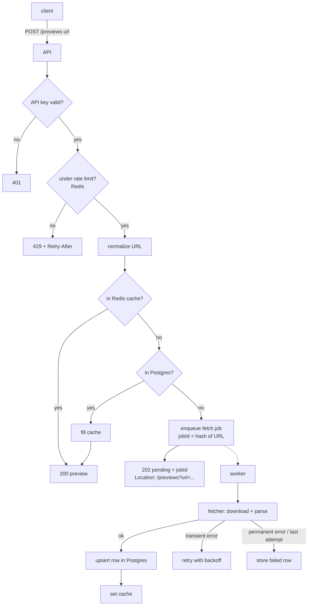
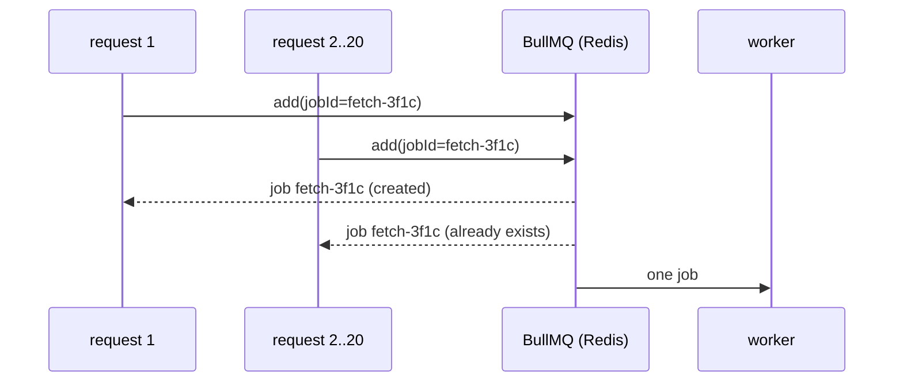
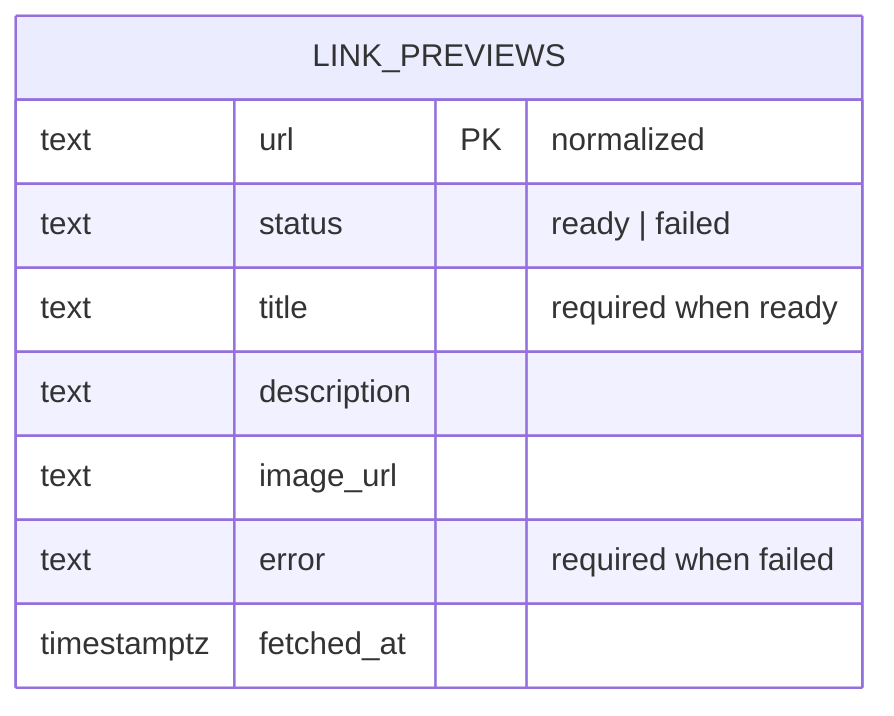
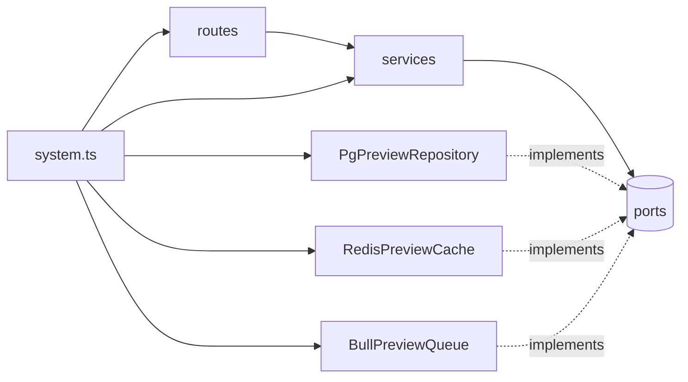

# 21 · Checkpoint: Redis

> Caching, rate limiting and background jobs are each simple in isolation. The skill employers pay for is combining them into one service where every piece has a clear job, failures are handled on purpose, and you can explain why each part exists. That's this checkpoint.

**Time:** ~7h · **Challenge:** 🛠️ Build (from scratch) · **Prereqs:** [18 · Caching](../18-caching/README.md), [19 · Rate Limiting](../19-rate-limiting/README.md), [20 · Background Jobs](../20-background-jobs/README.md) · **Services:** Postgres, Redis

## What you'll learn

- How to turn a product ask into a request flow, a data model and a set of failure modes *before* writing code
- How Postgres (source of truth), Redis cache, Redis rate limiter and a BullMQ queue fit together, and which one owns what
- The **"202 Accepted + poll"** pattern for work that's too slow for a request
- **Request deduplication**: many callers asking for the same expensive thing get one job
- Keeping a multi-component service layered: services that know only ports, adapters that know the infrastructure
- Designing your own structure against a fixed contract (the tests only know `createSystem()`)

This is a checkpoint: there's no new tool. The lesson is a guided design of the system you're about to build. Read it, then try to design your own version before peeking at the suggestions.

---

## 1. The product ask

> *Chat team:* When someone pastes a link into a message, we want to show a card with the page's title, description and image, like every chat app does. Clients will call your service with the URL. Pages can take seconds to fetch, some sites are down, and a viral link gets pasted by 5,000 people within a minute. Please don't fetch it 5,000 times, and don't let one misbehaving client eat the whole capacity.

Pull the requirements out of that, the way you'd do in a system design interview ([module 30](../30-system-design/README.md) formalizes this):

**Functional**
- Request a preview for a URL; get it immediately if known, otherwise "working on it".
- Check the status/result of a preview.
- Previews survive restarts; failures are reported, not hidden.

**Non-functional**
- Fast reads for popular links (cache).
- Don't block requests on slow sites (async jobs).
- **One fetch per URL** no matter how many concurrent requests (dedupe).
- Fair use per client (rate limit per API key).
- Transient fetch failures are retried; permanent ones aren't.
- Scales horizontally: any number of API and worker instances.

## 2. Request flow



Every box maps to something you've already built:

| Concern | Tool | Module |
|---|---|---|
| Source of truth | Postgres table, upserts | [13](../13-node-postgres/README.md) |
| Fast reads | cache-aside in Redis with TTL | [18](../18-caching/README.md) |
| Fair use | per-key limiter, atomic in Redis | [19](../19-rate-limiting/README.md) |
| Slow work | BullMQ queue + worker, retries, unrecoverable errors | [20](../20-background-jobs/README.md) |
| Structure | routes → services → ports ← adapters, composition root | [06](../06-layered-architecture/README.md) |

## 3. The 202 Accepted pattern

When work takes longer than you want a request to take, you **accept** the request and hand back a way to check on it:

```http
POST /previews            {"url": "https://example.com/post"}

HTTP/1.1 202 Accepted
Location: /previews?url=https%3A%2F%2Fexample.com%2Fpost
{"data": {"url": "https://example.com/post", "status": "pending", "jobId": "fetch-3f1c..."}}
```

The client polls the `Location` until the status is `ready` or `failed`. Status codes carry meaning:

| Situation | POST | GET |
|---|---|---|
| Preview known (ready or failed) | `200` + preview | `200` + preview |
| Job in progress | `202` + pending | `202` + pending |
| Never requested | `202` (starts a job) | `404` |
| Bad URL | `400` | `400` |

Note that **GET never starts work**. GET is safe ([module 03](../03-http-fundamentals/README.md)): crawlers, prefetchers and retries can call it freely. Only POST has side effects.

Polling is the simplest delivery mechanism. Alternatives: webhooks (you call the client back), Server-Sent Events or WebSockets ([module 28](../28-realtime/README.md)). Polling with a sensible interval (and `Retry-After` hints) is fine for "a second or two".

## 4. Deduplication: one fetch per URL

5,000 people paste the same link within seconds. Without dedupe, you'd fetch the page 5,000 times: slow for you, and rude to the site (you might get blocked).

Two layers:

1. **Normalize the URL** so trivially different strings map to one key. `https://Example.com:443/post#comments` and `https://example.com/post` are the same page. The WHATWG `URL` parser already lowercases the host and drops default ports; clearing `url.hash` removes the fragment (it's never sent to the server anyway). Be careful about going further: removing query parameters or trailing slashes *can* change which page you get.
2. **Deterministic job id.** `jobId = "fetch-" + sha256(normalizedUrl)`. BullMQ's `add()` with an existing job id is a no-op that returns the existing job. Concurrent adds race inside Redis, atomically, so exactly one job is created. Hashing gives a fixed-length, key-safe id (URLs can be 2 KB and contain `:`).



Is that the only option? You could also keep a `SET pending:<hash> NX EX 60` marker (module 17's lock pattern), or rely on a Postgres unique constraint on a `pending` row. The job-id approach wins here because the dedupe and the work item are the same atomic thing. Note the trade-off in the challenge's DECISIONS.md: dedupe lasts only while the job is retained, and the Postgres row covers what comes after.

The worker must still be **idempotent** (module 20): the job can run twice after a crash. An `INSERT ... ON CONFLICT (url) DO UPDATE` upsert makes a second run harmless.

## 5. Postgres vs Redis: who owns what

A common design mistake is letting the cache become the source of truth. Rules for this service:

- **Postgres owns previews.** Every ready or failed result is a row. If Redis is flushed, nothing is lost, only slower.
- **Redis cache holds copies** of ready previews, with a TTL. A miss falls through to Postgres and fills the cache (cache-aside).
- **Redis also holds ephemeral coordination state**: rate-limit counters, the job queue. Losing these has bounded consequences (limits reset; queued jobs would need re-requesting, which is why queue Redis should have persistence in production).
- **Failed previews are stored** so clients get a definitive answer, and they're not cached, which leaves room for a "retry failed previews" policy later.

### Data model



One table is enough. `CHECK` constraints keep the invariants honest (a ready row has a title; a failed row has an error). "Pending" isn't a row. It's the existence of an unfinished job.

### Key design in Redis

All keys for one deployment share a prefix, `wl:21:<namespace>:`, so tests (and environments) never collide, and you can find or delete everything with `SCAN`:

```
wl:21:app:preview:<sha256(url)>         cached preview JSON   (EX cacheTtl)
wl:21:app:rl:<apiKeyHash>:<window>      rate-limit counter    (PX window)
wl:21:app:previews:...                  BullMQ's keys (prefix option)
```

## 6. Failure modes (decide them up front)

| Failure | What happens | Design response |
|---|---|---|
| Site times out / 5xx | worker throws | retry with exponential backoff + jitter; after the last attempt, store `failed` |
| Site returns 404 / not HTML | retrying won't help | fetcher throws `PermanentFetchError` → `UnrecoverableError` → store `failed` immediately |
| Worker crashes mid-job | job stalls, re-runs | upsert is idempotent; fine |
| Deploy during a fetch | SIGTERM | graceful `close()`: worker finishes the active job and persists it |
| Redis down | cache, limiter, queue unavailable | API returns 500s for /previews. A stretch goal is to degrade: skip cache, fail open on the limit, return 503 for new work |
| Postgres down | can't read or persist | cached previews still served; new work fails and retries |
| Same URL requested 5,000× | | one job via job-id dedupe; everyone polls the same result |
| Client hammers the API | | per-key limit → 429 + `Retry-After` |
| Malicious URL (`http://169.254.169.254/...`) | SSRF | real fetcher must block private IPs: [module 25](../25-security/README.md). Out of scope for the tests, but worth a DECISIONS entry |

Writing this table before coding is what separates "it works on my machine" from "it works at 3 a.m.".

## 7. Structure: keep the layers clean

The tests talk to exactly one function, `createSystem(options)`, and to HTTP. Everything else is your design. The architecture tests enforce the essentials:

- `src/services/` holds the business rules and imports **no** infrastructure (`express`, `pg`, `ioredis`, `bullmq`). It depends on **ports** (interfaces) like `PreviewRepository`, `PreviewCache`, `PreviewJobQueue`.
- `src/repositories/` holds data access and knows nothing about HTTP.
- The HTTP layer (routes/controllers/middleware) never touches `pg`.
- `process.env` is read only in `src/config.ts`.

One way to lay it out:

```
src/
  contract.ts            (given) types shared with the tests
  config.ts              env → typed config
  server.ts              production entry: loadConfig → createSystem → listen → shutdown
  system.ts              composition root: pool, redis, adapters, services, worker, app
  app.ts                 createApp({ previewService, apiKeys, limiter })
  routes/previews.ts     thin controllers: parse, call service, pick status code
  middleware/            apiKey, rateLimit, errorHandler
  domain/preview.ts      types, normalizeUrl, domain errors
  services/
    ports.ts             PreviewRepository, PreviewCache, PreviewJobQueue
    previewService.ts    request(url), get(url), fetchAndStore(url)
  repositories/pgPreviewRepository.ts
  infra/                 redis cache, BullMQ queue + worker, limiter, migrations, fetcher
```



The worker is just another adapter. It receives a job from BullMQ and calls the same service layer. The decision "is this the final attempt? then record a failure" lives in the worker adapter because "attempts" is a queue concept. "Store a failed preview" is a service operation.

## 8. Building it: a suggested order

1. **Skeleton:** `config.ts`, `system.ts` returning an app with `/health`, a `close()` that's safe twice. Get the first test green.
2. **Auth + validation:** API key middleware, `normalizeUrl`, error handler with the `{ error: { code, message } }` shape.
3. **Postgres:** migration, repository with `find` / upsert.
4. **Queue + worker:** enqueue with a deterministic job id, worker that fetches and upserts. Now the "pending → ready" test passes.
5. **GET** with pending detection (look the job up by its id).
6. **Retries & failures:** attempts/backoff from options, `PermanentFetchError` → `UnrecoverableError`, record failure on the final attempt.
7. **Cache** in front of Postgres.
8. **Rate limit** per API key (reuse your module 19 thinking: one atomic Lua script).
9. **Graceful close**, then the architecture tests and a DECISIONS.md pass.

Run single tests with `npx vitest -t "dedupes"` while you work.

## Common mistakes

- Doing the fetch inside the POST handler "just for now".
- GET that enqueues work (an unsafe GET).
- Dedupe by "check Postgres, then enqueue" only. Twenty concurrent requests all see "not found" and all enqueue. The atomic part must be the enqueue itself.
- Forgetting URL normalization, so `#fragment` variants create separate jobs.
- Caching `pending` or `failed` results with a long TTL, so clients never see the final state.
- Treating the cache as the database (no row in Postgres, lost on flush).
- Redis keys without the namespace prefix, so tests leak into each other.
- Retrying 404s. Not retrying timeouts.
- `close()` that kills the worker mid-job, or closes the pool before the worker has finished using it.
- Services importing `ioredis` or `bullmq` directly, making them impossible to unit test.

## In production

- **Scaling:** API and workers deploy separately. Workers scale on queue depth; per-domain concurrency limits keep you polite to popular sites.
- **Freshness:** pages change. Add a `fetched_at` based refresh ("stale after 7 days: serve the old preview, enqueue a refresh"), which is *stale-while-revalidate* from module 18.
- **Security:** the fetcher is an SSRF cannon pointed at your network. Resolve DNS and block private ranges, cap response size and time, and don't follow redirects to internal hosts. Image URLs should be proxied/re-hosted, not hot-linked.
- **Observability:** cache hit rate, queue depth, fetch latency and failure rate by domain, 429s by API key.
- **Real-world prior art:** Slack, Discord and others publish their "unfurl" crawler's user agent so site owners can recognize it. Being a good citizen matters at scale.

## Check yourself

1. Why does POST return 202 instead of waiting for the fetch?
   <details><summary>Answer</summary>Fetching can take seconds or fail; holding the request open ties up resources and couples the client to a third-party site's latency. 202 + a status URL lets the client poll while a worker does the work with retries.</details>
2. Twenty requests for a new URL arrive at the same moment on three API instances. What guarantees only one fetch?
   <details><summary>Answer</summary>All of them enqueue with the same deterministic job id (hash of the normalized URL). BullMQ creates the job atomically in Redis, so one job exists and the others get the existing one. The worker's upsert keeps a rare duplicate run harmless.</details>
3. Redis is flushed by accident. What's lost?
   <details><summary>Answer</summary>Cached copies (rebuilt from Postgres on demand), rate-limit counters (limits reset) and queued/in-flight jobs (those URLs would need to be requested again). Ready and failed previews survive in Postgres.</details>
4. Why isn't a failed preview cached?
   <details><summary>Answer</summary>Failures may be transient at a larger time scale (the site comes back), and you may want a policy to retry them later. Caching would hide that and make the failure stickier than intended. Postgres still gives clients a definitive answer.</details>
5. Where does the "is this the final attempt?" check belong, and why?
   <details><summary>Answer</summary>In the worker adapter, because attempts are a queue concept (BullMQ's attemptsMade/opts.attempts). The adapter then calls a service operation ("record failure") so the business rule stays queue-agnostic.</details>

## Further reading

- RFC 9110, 202 Accepted: https://www.rfc-editor.org/rfc/rfc9110#name-202-accepted
- WHATWG URL Standard: https://url.spec.whatwg.org/
- BullMQ, job ids: https://docs.bullmq.io/guide/jobs/job-ids
- PostgreSQL, INSERT ... ON CONFLICT: https://www.postgresql.org/docs/current/sql-insert.html
- Deep dives in this module: [docs/design-walkthrough.md](docs/design-walkthrough.md) · [docs/api-spec.md](docs/api-spec.md) · [docs/redis-patterns-recap.md](docs/redis-patterns-recap.md)

## ➡️ Next: [the challenge](CHALLENGE.md)
