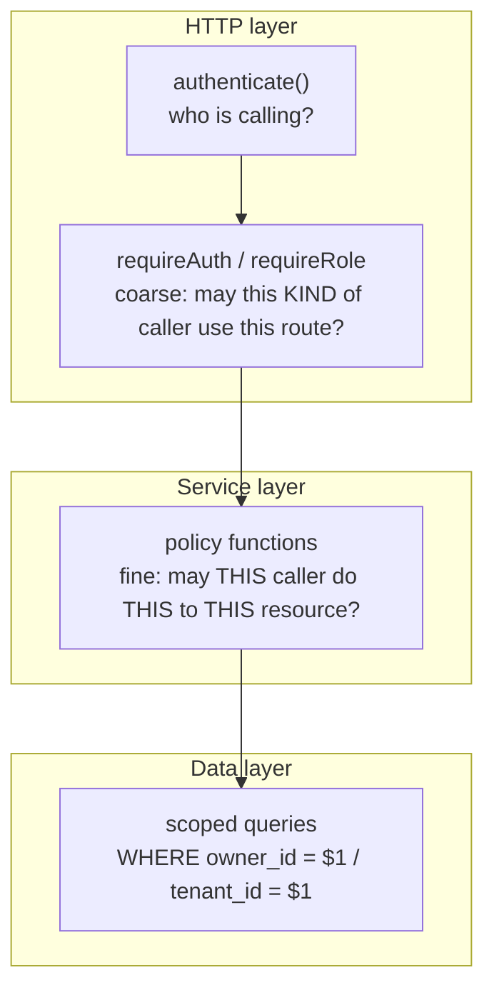

# Authorization patterns in a layered app

Authentication is mostly a solved problem: you pick a mechanism and implement it once. Authorization is never finished. Every new endpoint and every new field is a new chance to forget a check. This page is about structuring code so forgetting is hard.

## Where checks live



- **Route guards** are great for "admins only" or "must be logged in". They can't see the resource.
- **Service-layer policies** are where ownership and attribute rules go. The service receives an `Actor` (`{ id, role }`), not an Express request, so you can unit-test the rules without HTTP.
- **Scoped queries** are your safety net for lists and multi-tenant data: if the query itself is filtered by owner or tenant, a forgotten check returns nothing instead of everything.

## Pattern 1: load-then-check, in one helper

```ts
private async loadVisible(actor: Actor, id: string): Promise<Document> {
  const doc = await this.documents.findById(id);
  if (!doc || !canSee(actor, doc)) throw new NotFoundError("Document");
  return doc;
}
```

Every method that touches a single document starts with `loadVisible`. Adding a new action (archive, share, export) means reusing it, not re-implementing the rule.

## Pattern 2: pure policy functions

```ts
export const canSee  = (a: Actor, d: Document) => d.ownerId === a.id || a.role === "admin";
export const canEdit = (a: Actor, d: Document) => d.ownerId === a.id;
```

Pure functions are trivial to test exhaustively (a table of actor × resource × expected result) and easy to review: a security reviewer reads one file instead of fifty handlers.

## Pattern 3: permissions instead of roles in code

```ts
const PERMISSIONS: Record<Role, ReadonlySet<Permission>> = {
  user:  new Set(["documents:create", "documents:read:own"]),
  admin: new Set(["documents:create", "documents:read:any", "documents:delete:any", "users:read"]),
};
const can = (a: Actor, p: Permission) => PERMISSIONS[a.role].has(p);
```

When product adds a "support" role that can read but not delete, you edit one table instead of every `requireRole("admin")`.

## Pattern 4: tenant scoping (multi-tenant SaaS)

In B2B apps every row belongs to an organization. The worst bug is one customer seeing another customer's data. Defenses, from weakest to strongest:

1. Add `WHERE tenant_id = $1` in every query (easy to forget).
2. Repositories take the tenant id in their constructor, so you can't build one without it.
3. Postgres **Row-Level Security**: `CREATE POLICY ... USING (tenant_id = current_setting('app.tenant_id')::uuid)`. The database enforces it even if the app forgets.

## Pattern 5: policy engines

At larger scale, teams move policies out of application code into a dedicated engine: Open Policy Agent (Rego), Cedar, OpenFGA / Zanzibar-style relationship systems ("user X is editor of folder Y, which contains doc Z"). You won't need these for a while, but recognize the names: they're the same idea as pattern 2, centralized.

## Testing authorization

Write tests from the attacker's side, not just the happy path:

- For every endpoint that takes an id: does **another user** get 404/403?
- For every list endpoint: does it include **only** the caller's items?
- For every write: can the caller set fields they shouldn't (`ownerId`, `role`, `tenantId`)?
- For every role: a table test of allowed/denied actions.

The challenge tests do exactly this. Keep the habit.
