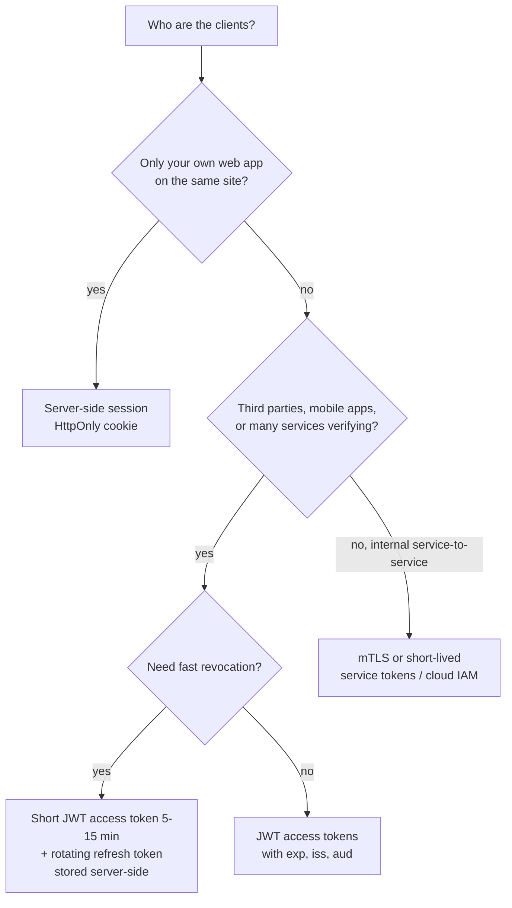

# Sessions vs JWT: a decision guide

"Should we use JWTs?" comes up in nearly every new project, often because a tutorial used them. This page gives you a way to answer it on the merits, which is also what you'll write up in `challenge/DECISIONS.md`.

## The core difference

| | Server-side session | Stateless JWT |
|---|---|---|
| What the client holds | an opaque random id | the claims themselves + a signature |
| Where truth lives | server (Redis, DB) | in the token, until it expires |
| Per-request cost | one key lookup (sub-ms in Redis) | one signature check (microseconds), no I/O |
| Revoke one session | `DEL key` → immediate | not possible before `exp` without a denylist |
| Role change takes effect | next request (if you load the user) | when the token expires |
| Size on the wire | ~45 bytes | 300 bytes to several KB, on every request |
| Works across many services | each needs access to the store | any service with the key can verify |
| Natural transport | `HttpOnly` cookie | `Authorization: Bearer` header (or a cookie) |

Neither is "more secure" by itself. They fail differently:

- Sessions concentrate risk in the **store**: if Redis is down, nobody is logged in; if it leaks, session ids leak (you can store `sha256(sessionId)` as the key to blunt that).
- JWTs concentrate risk in the **key and the verifier**: a leaked signing key lets attackers mint any identity, and verifier bugs (`alg`, `exp`) are common.

## "But JWTs scale better"

The usual argument: sessions need a lookup on every request, so they don't scale. In practice:

- A Redis `GET` on the same network costs ~0.2–0.5 ms and one Redis node handles 100k+ ops/sec. You'll hit limits in your database long before that.
- Your request almost certainly does a database query anyway (loading the user, the resource). One more key lookup doesn't change the picture.
- The moment you need revocation (and product always asks for "log out everywhere" eventually), the JWT design grows a server-side lookup too.

Where JWTs really shine is **verification without access to the issuer's store**: many independent services, third parties, edge functions, or a different company verifying your tokens.

## Decision flow

## Hybrid setups you'll see at work

- **BFF (backend for frontend)**: the browser talks to a small backend with a cookie session. That backend holds OAuth tokens and calls internal APIs with them. Tokens never touch the browser.
- **Edge translation**: an API gateway validates the user's session or token once and forwards a short-lived internal JWT (signed by the gateway) to downstream services.
- **Session + JWT for websockets**: a cookie-authenticated endpoint mints a 60-second JWT the client uses to open a websocket on another host.

## Questions to answer in your DECISIONS.md

1. Who are the clients today, and in 12 months?
2. Is instant revocation a requirement (logout, account lock, password change)?
3. How many services must verify identity, and do they share infrastructure?
4. What's the blast radius if the store (sessions) or the signing key (JWT) leaks?
5. What would make you change your mind later?
