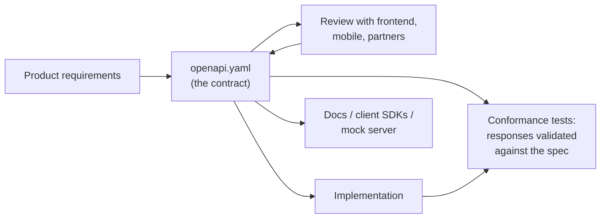
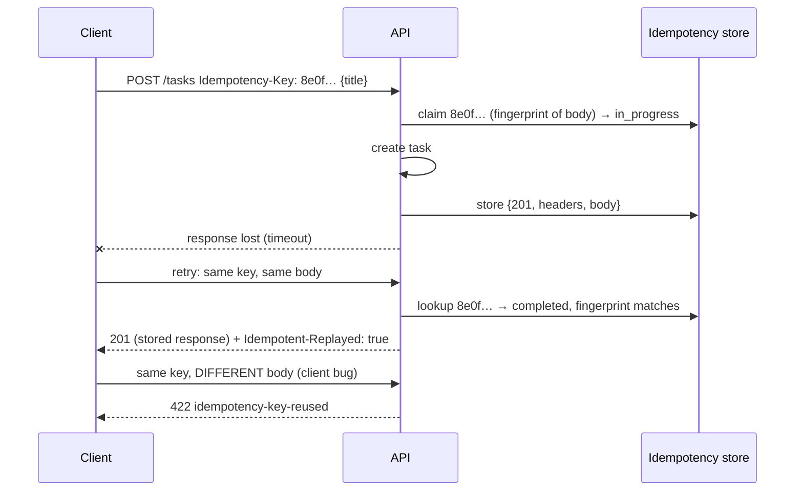
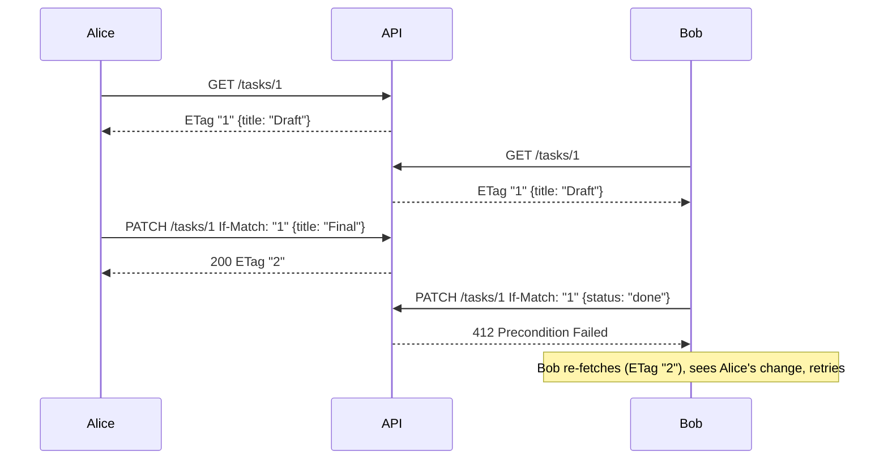

# 23 · API Design

> An API is a promise. Once a mobile app or a partner integration depends on it, every field name, status code and pagination quirk is something you'll support for years. Good API design means making promises you can keep: predictable, hard to misuse, and able to evolve without breaking anyone.

**Time:** ~6h · **Challenge:** 🛠️ Build (spec-first) · **Prereqs:** [03 · HTTP Fundamentals](../03-http-fundamentals/README.md), [07 · Validation, Errors & Config](../07-validation-errors-config/README.md) · **Services:** none

## What you'll learn

- How to model **resources** and URLs: nouns, plural collections, how deep to nest
- Using **methods and status codes** the way clients and proxies expect
- **Idempotency**: which methods have it for free, and how `Idempotency-Key` makes `POST` safe to retry
- **Pagination**: offset vs cursor (keyset), plus filtering and sorting conventions
- A standard **error format**: RFC 9457 Problem Details
- **Conditional requests**: ETags, `If-None-Match` → 304, `If-Match` → 412 (optimistic concurrency)
- **Spec-first** development with OpenAPI 3.1, and why the spec should be the contract
- **Evolving** an API: backward-compatible changes, versioning strategies, deprecation
- When to pick REST, GraphQL or gRPC, and how to design **webhooks**

---

## 1. Design the contract first

Most bad APIs come from the same process: someone writes the handler, then documents whatever it happens to return. The response shape ends up mirroring the database table, error formats differ per endpoint, and pagination is whatever the first developer felt like that day.

**Spec-first** flips it around:



You write the contract in **OpenAPI** (a YAML/JSON description of every path, parameter, request body, response and schema). Then:

- Frontend and backend agree on it *before* anyone writes code, and the frontend can build against a mock server generated from it.
- Docs, client SDKs and request validators are generated from one source of truth.
- Tests validate real responses against the schemas, so the docs can't drift away from the code. That's exactly what the challenge's test suite does to your implementation.

Changing a field name in a YAML file during review costs nothing. Changing it after three apps shipped against it costs a migration project.

## 2. Resource modeling

REST APIs are organized around **resources** (the nouns of your domain) and use HTTP methods as the verbs.

| Do | Don't |
|---|---|
| `GET /v1/projects` | `GET /v1/getProjects` |
| `POST /v1/projects` | `POST /v1/createProject` |
| `GET /v1/tasks/{taskId}` | `GET /v1/task?id=123` |
| `POST /v1/tasks/{taskId}/archive` (an action that doesn't fit CRUD) | `POST /v1/archiveTask` |

Conventions that keep an API predictable:

- **Plural nouns for collections** (`/projects`), an id for one item (`/projects/{id}`).
- **Consistent casing**: pick `camelCase` or `snake_case` for JSON fields and never mix them. URLs use lowercase with hyphens (`/line-items`).
- **Nest at most one level**, to express "belongs to" for creation and listing: `POST /projects/{id}/tasks`, `GET /projects/{id}/tasks`. Once a task exists, give it its own top-level URL: `/tasks/{taskId}`. Deep nesting (`/orgs/1/projects/2/tasks/3/comments/4`) forces clients to know the whole ancestry just to fetch a comment, and it breaks when a task moves to another project.
- **Actions that aren't CRUD** are fine as sub-resources: `POST /tasks/{id}/archive`, `POST /invoices/{id}/send`. Don't contort them into `PATCH {status: "sent"}` if sending has side effects (emails, payments).
- **Don't leak your tables.** The API models what clients need. Internal columns (`password_hash`, `deleted_at`, `internal_score`) stay private, and one resource may combine several tables.

### Response envelopes

Pick one shape and use it everywhere. In the challenge:

```jsonc
// single resource: the object itself
{ "id": "…", "title": "Write spec", "status": "todo", "version": 1, … }

// collection: always an envelope, so pagination metadata has a home
{ "data": [ … ], "page": { "limit": 20, "nextCursor": "eyJjcmVh…" } }
```

Never return a bare JSON array from a list endpoint. You can't add pagination or metadata later without a breaking change.

## 3. Methods, status codes and idempotency

| Method | Meaning | Safe? | Idempotent? | Typical success |
|---|---|---|---|---|
| GET | read | ✅ | ✅ | 200 (304 if cached copy is fresh) |
| POST | create / trigger an action | ❌ | ❌ | 201 + `Location`, or 202 for async work |
| PUT | replace the whole resource | ❌ | ✅ | 200 or 204 |
| PATCH | change some fields | ❌ | ❌ (not guaranteed) | 200 |
| DELETE | remove | ❌ | ✅ | 204 |

- **Safe** means no side effects the client asked for. Crawlers, prefetchers and caches call GETs freely, so a GET must never change state.
- **Idempotent** means doing it twice has the same effect as doing it once. `DELETE /tasks/1` twice leaves the task deleted (the second call may return 404, and that's fine: the *state* is the same). `PUT` with the same body twice gives the same result.

Status codes you'll use daily:

| Code | When |
|---|---|
| 200 OK | success with a body |
| 201 Created | resource created; send `Location: /v1/tasks/{id}` |
| 202 Accepted | work queued, not done yet (return a link to poll) |
| 204 No Content | success, no body (DELETE) |
| 304 Not Modified | conditional GET, client's copy is current |
| 400 Bad Request | malformed or invalid input |
| 401 / 403 | unauthenticated / not allowed ([module 22](../22-auth/README.md)) |
| 404 Not Found | no such resource (or not yours) |
| 409 Conflict | state conflict (duplicate, request in flight) |
| 412 Precondition Failed | `If-Match` didn't match |
| 415 Unsupported Media Type | wrong `Content-Type` |
| 422 Unprocessable Content | well-formed but semantically wrong (e.g. idempotency key reused with another body) |
| 428 Precondition Required | you demand `If-Match` and it's missing |
| 429 Too Many Requests | rate limited ([module 19](../19-rate-limiting/README.md)) |
| 500 / 503 | your fault / temporarily unavailable |

> 💡 400 vs 422 is a long-running debate. Pick one rule and document it. This module uses 400 for anything that fails validation, and 422 only for the idempotency-key reuse case, which the IETF idempotency draft assigns to 422.

### Making POST safe to retry: `Idempotency-Key`

Networks fail in the worst possible place: the server created the order, and then the connection dropped before the response arrived. The client doesn't know whether to retry. Retrying a `POST` might charge the customer twice.

The standard fix, popularized by Stripe and being standardized by the IETF, is the `Idempotency-Key` header:



The rules:

1. The client generates a unique key (a UUID) per **logical operation** and reuses it for every retry of that operation.
2. The server scopes the key (to the endpoint and, in real systems, to the authenticated account) and stores a **fingerprint** of the request body.
3. First request: atomically claim the key (`SET key NX` in Redis, or `INSERT` with a unique index), run the handler, store the response.
4. Retry with the same body: replay the stored response, don't run the handler again.
5. Same key with a different body: client bug, return 422.
6. Same key while the first is still running: 409, "try again shortly".
7. If the handler failed with a 5xx, **release** the key so a retry can actually retry. Store 4xx results, so retries are consistent.
8. Expire keys after a while (24h is common).

## 4. Pagination, filtering and sorting

Every collection endpoint will eventually be too large to return at once. Paginate from day one; adding it later breaks clients that expected "everything".

### Offset pagination

```
GET /v1/projects?limit=20&offset=40      →  SELECT … ORDER BY created_at LIMIT 20 OFFSET 40
```

Simple, and it lets you jump to page 7. But:

- **Slow at depth**: `OFFSET 100000` makes the database read and discard 100,000 rows.
- **Unstable**: if a row is inserted or deleted while the user pages, items shift. They see duplicates or miss items entirely.

### Cursor (keyset) pagination

```
GET /v1/projects?limit=20                       → { data: […20 items], page: { nextCursor: "eyJj…" } }
GET /v1/projects?limit=20&cursor=eyJj…          → next 20 after the last item of the previous page
```

The cursor encodes the **position of the last item you saw**: its sort key plus a unique tiebreaker. The next query asks for rows *after* that position:

```sql
SELECT * FROM projects
 WHERE (created_at, id) > ($1, $2)     -- position from the cursor
 ORDER BY created_at, id
 LIMIT 21;                             -- limit + 1: if 21 rows come back, there's a next page
```

- **Fast at any depth**: with an index on `(created_at, id)`, the database seeks straight to the position.
- **Stable**: new rows don't shift what comes after your cursor.
- **Tiebreaker required**: two rows with the same `created_at` would otherwise be skipped or duplicated at a page boundary. `id` makes the order total.
- **Opaque**: base64url-encode the position. Clients pass it back unchanged and never build one themselves, which leaves you free to change what's inside. (Opaque doesn't mean secret: anyone can decode base64. Don't put anything sensitive in a cursor, or sign it.)
- **Bind it to the query**: a cursor from `sort=-createdAt` is meaningless for `sort=createdAt`. Store the sort (and ideally the filters) in the cursor and reject mismatches with 400.
- **The `limit + 1` trick** tells you whether there's a next page without a `COUNT(*)`, which is expensive on big tables.

The trade-off: no "jump to page 7" and no total count. For infinite scroll, feeds, sync jobs and exports (most API use cases) that's fine. Admin tables that need page numbers can use offset with a hard cap.

### Filtering and sorting conventions

```
GET /v1/projects/{id}/tasks?status=done&sort=-createdAt&limit=50
```

- Filters are plain query params named after fields: `status=done`, `dueBefore=2026-03-01`.
- `sort=field` ascending, `sort=-field` descending. Only allow sorts you have indexes for, and list them in the spec as an `enum`.
- Validate every query parameter: an unknown `status` value is a 400, not an empty list.

## 5. Errors: RFC 9457 Problem Details

In module 05 you built a consistent error body. RFC 9457 ("Problem Details for HTTP APIs") standardizes that idea, so clients and tooling can handle errors from any API the same way:

```http
HTTP/1.1 412 Precondition Failed
Content-Type: application/problem+json

{
  "type": "https://api.wl.example/problems/precondition-failed",
  "title": "Precondition Failed",
  "status": 412,
  "detail": "The resource has been modified since you last fetched it",
  "instance": "/v1/tasks/1c9e…"
}
```

| Member | Meaning |
|---|---|
| `type` | URI identifying the **kind** of problem. Clients branch on this. Ideally it resolves to human-readable docs. `about:blank` means "nothing more specific than the status code". |
| `title` | short, human-readable summary of the type; the same for every occurrence |
| `status` | the HTTP status, repeated (handy when the body gets logged without headers) |
| `detail` | explanation of *this* occurrence |
| `instance` | URI of this occurrence (here: the request path) |
| extensions | any extra members, e.g. `errors` for field-level validation problems |

```json
{
  "type": "https://api.wl.example/problems/validation-error",
  "title": "Validation Failed",
  "status": 400,
  "detail": "Request validation failed",
  "instance": "/v1/projects",
  "errors": [{ "pointer": "/name", "detail": "Too small: expected string to have >=1 characters" }]
}
```

Using **JSON Pointers** (`/name`, `/items/0/qty`) in `errors` lets a frontend attach each message to the right form field. Same rule as module 05: unexpected errors return a generic 500 (`about:blank`) and never leak internals.

In the spec, define `Problem` once under `components/schemas` and `$ref` it from every 4xx/5xx response. That's how the frontend knows *every* error has the same shape.

## 6. Conditional requests: ETags

An **ETag** is a version identifier for a representation, sent as a response header: `ETag: "3"`. Clients send it back in two ways.

### Saving bandwidth: `If-None-Match` → 304

```
GET /v1/tasks/1                      →  200, ETag: "3", body
GET /v1/tasks/1  If-None-Match: "3"  →  304 Not Modified, no body
```

The client already has version 3, so the server skips the body. Browsers and HTTP caches do this automatically.

### Preventing lost updates: `If-Match` → 412

The more important use, in APIs. Two people edit the same task:



Without `If-Match`, Bob's write silently overwrites Alice's change: the **lost update** problem. This is **optimistic concurrency control**: no locks are held between read and write, and conflicts are detected at write time. Under the hood it's the compare-and-set from [module 15](../15-transactions-concurrency/README.md):

```sql
UPDATE tasks SET title = $3, version = version + 1, updated_at = now()
 WHERE id = $1 AND version = $2        -- $2 comes from If-Match
RETURNING *;                            -- 0 rows → 412 (or 404 if it doesn't exist)
```

Details that matter:

- **Strong vs weak**: `"3"` is strong (byte-for-byte identical), `W/"3"` is weak (semantically equivalent). `If-Match` must use strong comparison, so weak tags never match. `If-None-Match` uses weak comparison.
- **`If-Match: *`** means "any current version", i.e. "it must exist".
- **Require it**: if clients may skip `If-Match`, some will, and you're back to lost updates. Answer `428 Precondition Required` when it's missing.
- A version column is the simplest ETag source. Hashing the response body works when you don't have one.

### PATCH semantics: JSON Merge Patch

The challenge's PATCH follows RFC 7396 (`Content-Type: application/merge-patch+json`): fields that are present replace the stored value, absent fields stay unchanged, and `null` clears a field (`"dueDate": null`). It's the intuitive behavior most clients expect. (The alternative, RFC 6902 JSON Patch, is a list of operations like `{"op":"replace","path":"/title","value":"x"}`. It's more powerful and more awkward.)

## 7. Partial responses and HATEOAS (briefly)

- **Partial responses**: `GET /tasks/1?fields=id,title` returns only some fields, which helps mobile clients on slow networks. Google APIs popularized it. It complicates caching and validation, so add it when a real client needs it.
- **Expansion**: `GET /tasks/1?expand=project` embeds the related project instead of just `projectId`, which saves a round trip.
- **HATEOAS** ("hypermedia as the engine of application state"): responses include links to related actions (`"_links": {"archive": {"href": "/tasks/1/archive"}}`), so clients follow links instead of building URLs. It's elegant and part of REST's original definition, but most public APIs only adopt the cheap parts: `Location` headers, `next` links, links in error `type` URIs.

## 8. OpenAPI 3.1 in practice

A minimal operation:

```yaml
paths:
  /v1/tasks/{taskId}:
    parameters:
      - name: taskId
        in: path
        required: true
        schema: { type: string }
    get:
      operationId: getTask          # unique; becomes the method name in generated SDKs
      summary: Get one task
      responses:
        "200":
          description: The task
          headers:
            ETag: { $ref: "#/components/headers/ETag" }
          content:
            application/json:
              schema: { $ref: "#/components/schemas/Task" }
        "404":
          $ref: "#/components/responses/NotFound"
components:
  schemas:
    Task:
      type: object
      additionalProperties: false
      required: [id, title, status, dueDate]
      properties:
        id:      { type: string, format: uuid }
        title:   { type: string, minLength: 1, maxLength: 200 }
        status:  { type: string, enum: [todo, in_progress, done] }
        dueDate: { type: [string, "null"], format: date }   # 3.1: nullable via a type array
```

Things to know:

- **3.1 schemas are real JSON Schema (2020-12)**, so any JSON Schema validator (like Ajv, used by the challenge tests) can check responses against them. In 3.0 you wrote `nullable: true`; in 3.1 you write `type: [string, "null"]`.
- **`components`** holds reusable `schemas`, `parameters`, `responses` and `headers`. Use `$ref` liberally: one `Problem`, one `Limit` parameter, one `NotFound` response.
- **`required` + `additionalProperties: false`** on response schemas turn the spec into a real contract that tests can enforce.
- **Separate input and output schemas** (`NewTask`, `TaskPatch`, `Task`). The server sets `id`, `createdAt` and `version`, so they're required in `Task` and absent from `NewTask`.
- Tooling: Swagger UI / Redoc render docs, Spectral lints style rules, oasdiff detects breaking changes between two versions of the spec, and openapi-typescript generates TS types.

## 9. Evolving an API without breaking clients

Most of an API's lifetime is spent changing it. Learn to tell safe changes from breaking ones:

| Backward compatible (ship any time) | Breaking (needs a new version) |
|---|---|
| New endpoint | Removing or renaming an endpoint or field |
| New optional request field | New **required** request field |
| New response field | Changing a field's type or format (`"42"` → `42`) |
| New optional query parameter | Tightening validation (max length 200 → 100) |
| New enum value *if clients were told to tolerate unknowns* | Changing defaults, status codes or error `type`s |
| Relaxing validation | Changing pagination or the error format |

The other half of compatibility is on the client: **be liberal in what you accept**. Clients should ignore unknown fields and handle unknown enum values gracefully. Say so in your docs.

### Versioning strategies

| Strategy | Example | Pros | Cons |
|---|---|---|---|
| URL path | `/v1/tasks` | visible everywhere, easy routing, cache-friendly | "the URL should identify the resource, not its format" |
| Header / media type | `Accept: application/vnd.wl+json;version=2` | stable URLs | invisible in logs, easy to forget |
| Query param | `/tasks?api-version=2` | easy to try | messes with caching, easy to drop |
| Date-pinned (Stripe) | `Stripe-Version: 2024-06-20` | many small breaking changes, clients upgrade when ready | needs a transformation layer per version |

URL versioning with a **major version only** is the most common choice for public APIs, and the one this module uses. Bump it rarely; most changes should be additive.

### Deprecation

When something must go:

1. Announce it, document the replacement, and give a timeline (months, not weeks, for external clients).
2. Mark responses: `Deprecation: true` (or a date, per RFC 9745) and `Sunset: Sat, 01 Aug 2026 00:00:00 GMT` (RFC 8594), plus `Link: <https://docs…/migrate>; rel="deprecation"`.
3. Measure who still calls it (per API key), and contact them.
4. Remove it after the sunset date, ideally with a short "brownout" period first (temporarily return errors to flush out forgotten callers).

## 10. REST vs GraphQL vs gRPC

| | REST + JSON | GraphQL | gRPC |
|---|---|---|---|
| Shape | resources + HTTP verbs | one endpoint, client-written queries | RPC methods defined in `.proto` |
| Strengths | universal, cacheable (HTTP caching, CDNs), easy to debug with curl | clients fetch exactly what they need in one round trip; great for varied frontends | fast binary protocol over HTTP/2, streaming, strongly typed codegen |
| Weaknesses | over/under-fetching, many round trips for nested data | caching is hard, query cost control (depth/complexity limits), N+1 resolvers | not browser-native (needs grpc-web), harder to inspect by hand |
| Typical use | public APIs, CRUD services | product APIs behind rich web/mobile UIs (BFF) | internal service-to-service calls |

Many companies use all three: gRPC between internal services, GraphQL or a BFF for their own frontends, REST for public and partner APIs.

## 11. Webhooks: your API calling theirs

Webhooks push events to a URL the customer registered (`task.completed` → `POST https://customer.example/hooks`). Design them like an API in reverse:

- **Sign every delivery**: `Webhook-Signature: t=1730000000,v1=<HMAC-SHA256(secret, t + "." + body)>`. The receiver verifies the HMAC (constant-time) and rejects old timestamps to block replays.
- **At-least-once delivery**: retry with exponential backoff on non-2xx or timeouts (that's a background job, [module 20](../20-background-jobs/README.md)). So receivers will see duplicates: include a unique **event id** and tell them to deduplicate.
- **Don't promise ordering.** Include `occurredAt` and the resource version so receivers can drop stale events.
- **Thin payloads** (`{ id, type, data: { taskId } }`) push receivers to fetch the current state via the API, which avoids acting on stale data. Fat payloads save a call but leak more data.
- Give customers a delivery log and a "resend" button. Disable endpoints that keep failing, and email the owner.
- Validate customer URLs against SSRF (no internal IPs), see [module 25](../25-security/README.md).

## Common mistakes

- Writing the handler first and documenting whatever it returns.
- Verbs in URLs (`/createTask`), mixed casing, inconsistent plural/singular.
- Returning a bare array from list endpoints (no room for pagination metadata).
- Offset pagination on large or fast-changing tables; cursors without a unique tiebreaker.
- Making clients parse error *messages* instead of giving them a stable `type` or code.
- Different error shapes per endpoint, or HTML error pages from the framework's default 404.
- `200 OK` with `{"error": "..."}` in the body.
- Non-idempotent POSTs for payments or orders with no idempotency key.
- PATCH/PUT without optimistic concurrency, so concurrent edits silently overwrite each other.
- "Small" breaking changes shipped without a version bump: renaming a field, tightening validation.
- Exposing database ids, internal columns or table structure one-to-one.

## In production

- **API gateways** (Kong, AWS API Gateway, Apigee, Envoy) handle authentication, rate limits, request validation against OpenAPI, and version routing in front of your services.
- **Style guides** exist at most API-heavy companies (Google's AIP, Microsoft's REST guidelines, Zalando's guidelines) and are enforced with linters like Spectral in CI.
- **Breaking-change detection** (oasdiff, openapi-diff) runs on every PR that touches the spec.
- **Idempotency stores** live in Redis or Postgres, keyed by account + key, with a TTL. Payment companies treat them as critical infrastructure.
- **Consumer-driven contract tests** (Pact) let each client publish the parts of the API it relies on, and the provider's CI checks it doesn't break them.
- **SDKs** generated from the spec are how most customers actually consume big APIs, so an `operationId` is effectively a public method name.

## Check yourself

1. Why is `DELETE` idempotent even though the second call returns 404?
   <details><summary>Answer</summary>Idempotency is about the effect on server state, not the response. After one or many DELETEs the resource is gone; the state is the same.</details>
2. Give two reasons to prefer cursor pagination over offset for a feed.
   <details><summary>Answer</summary>Performance at depth (keyset seek on an index instead of scanning and discarding OFFSET rows) and stability (inserts or deletes between pages don't cause duplicates or skipped items).</details>
3. A client retries `POST /payments` with the same `Idempotency-Key` but a different amount. What should happen, and why?
   <details><summary>Answer</summary>Reject it (422): the same key must mean the same operation. Replaying the old response would hide a client bug; executing it would defeat idempotency.</details>
4. What's the difference between `If-None-Match` and `If-Match`, and which status codes go with them?
   <details><summary>Answer</summary><code>If-None-Match</code> on GET: "only send the body if it changed", 304 when it matches (weak comparison). <code>If-Match</code> on writes: "only apply if the resource is still at this version", 412 when it doesn't match (strong comparison), 428 if you require it and it's missing.</details>
5. Is adding a new required field to a request body a breaking change? Adding a new field to a response?
   <details><summary>Answer</summary>A new required request field breaks every existing client (they don't send it). A new response field is backward compatible, provided clients ignore unknown fields.</details>

## Further reading

- RFC 9110, HTTP Semantics (methods, status codes, conditional requests): https://www.rfc-editor.org/rfc/rfc9110
- RFC 9457, Problem Details for HTTP APIs: https://www.rfc-editor.org/rfc/rfc9457
- RFC 7396, JSON Merge Patch: https://www.rfc-editor.org/rfc/rfc7396
- RFC 8594, The Sunset HTTP Header Field: https://www.rfc-editor.org/rfc/rfc8594
- OpenAPI Specification 3.1: https://spec.openapis.org/oas/v3.1.0
- IETF draft, The Idempotency-Key HTTP Header Field: https://datatracker.ietf.org/doc/draft-ietf-httpapi-idempotency-key-header/
- Google API Improvement Proposals (design guide): https://google.aip.dev/
- Stripe API docs, Idempotent requests: https://docs.stripe.com/api/idempotent_requests
- Deep dives in this module: [docs/pagination-deep-dive.md](docs/pagination-deep-dive.md) · [docs/api-evolution.md](docs/api-evolution.md) · [docs/api-design-cheatsheet.md](docs/api-design-cheatsheet.md)

## ➡️ Next: [the challenge](CHALLENGE.md)
