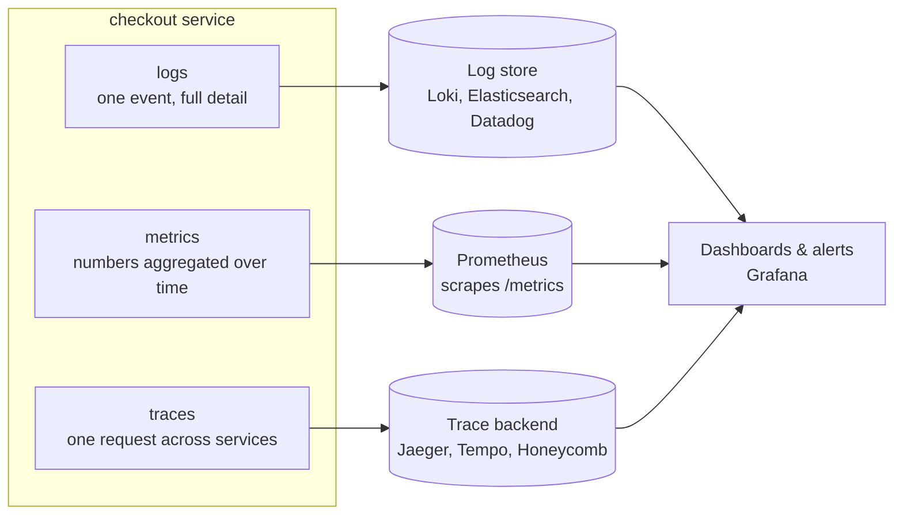
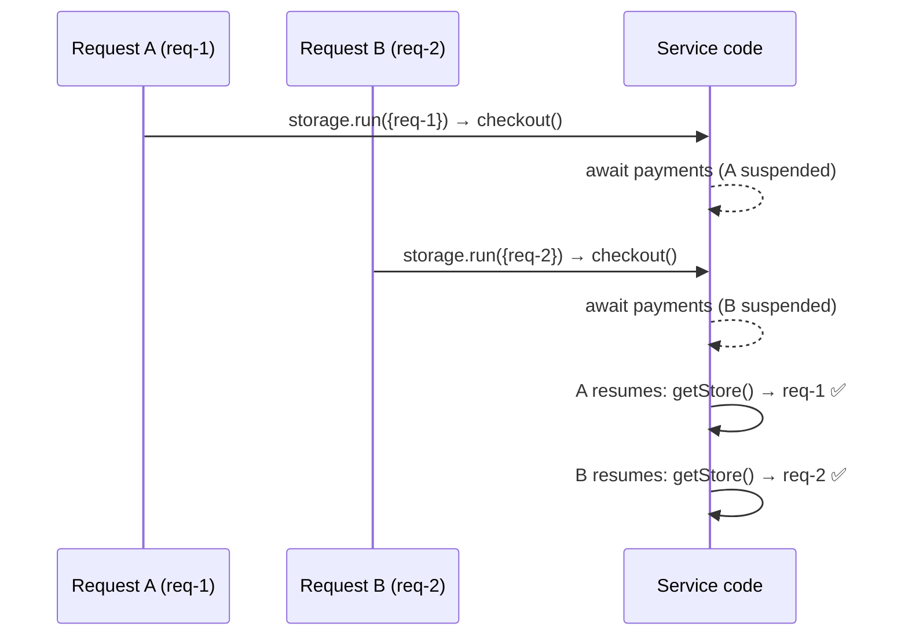
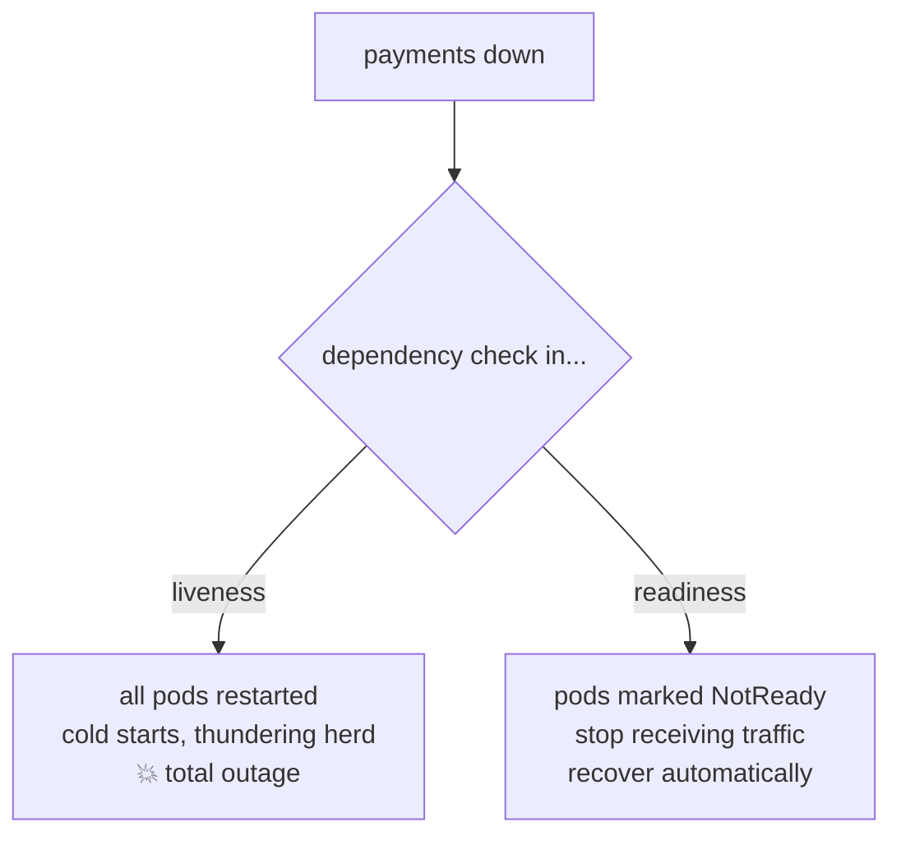
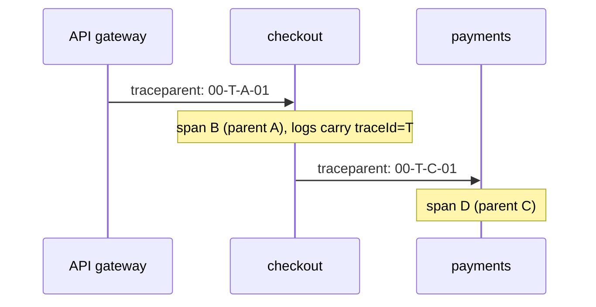

# 24 · Observability

> Your code will break in production in ways you didn't predict. Observability decides whether you find out in two minutes from a dashboard or in forty minutes from angry customers, and whether you can explain *why* afterwards.

**Time:** ~6h · **Challenge:** 🐛 Debug (incident) · **Prereqs:** [06 · Layered Architecture](../06-layered-architecture/README.md), [07 · Validation, Errors & Config](../07-validation-errors-config/README.md) · **Services:** none

## What you'll learn

- What observability is, and how the three signals (logs, metrics, traces) differ and complement each other
- Structured logging with pino: levels, child loggers, redaction, and what (not) to log
- Request-scoped context with `AsyncLocalStorage`, so every log line carries the request id without passing a logger through every function
- Prometheus metrics with `prom-client`: counters, gauges, histograms, labels, and the **cardinality** trap
- The RED and USE methods: which metrics to collect in the first place
- Liveness vs readiness probes, and why mixing them up turns small outages into big ones
- Distributed tracing concepts: traces, spans, W3C `traceparent` propagation, OpenTelemetry
- SLIs, SLOs, error budgets, and alerting on symptoms instead of causes
- How to investigate an incident from logs and metrics and write a blameless postmortem

---

## 1. Monitoring vs observability

**Monitoring** answers questions you thought of in advance: "Is CPU above 90%?", "Is the 5xx rate above 1%?". You write a check, it goes red or stays green.

**Observability** is a property of your system: how well you can answer questions you *didn't* think of in advance, from the outside, without shipping new code. "Why are checkouts from one region slow, but only for orders with more than ten items, and only since 14:00?" A system is observable if its outputs (logs, metrics, traces) are rich and well-structured enough that you can slice your way to the answer.

You need both. Monitoring tells you *that* something is wrong; observability lets you find out *what* and *why*. The incident in this module's challenge is a classic example: every pre-planned monitor (5xx rate, CPU, readiness) stayed green during a 35-minute outage. Only the raw, structured data told the story.

## 2. The three signals



| | Logs | Metrics | Traces |
|---|---|---|---|
| Unit | one event | a number aggregated over time | one request's journey |
| Answers | "what exactly happened to request X?" | "how much / how often / how fast, overall?" | "where did the time go across services?" |
| Cardinality | unlimited (user ids, URLs are fine) | must stay **low** | high, but usually sampled |
| Cost grows with | traffic × verbosity | number of distinct time series | traffic × sampling rate |
| Good for alerting? | rarely | **yes** | rarely |
| Example | `{"msg":"payment declined","customerId":"cus_42","requestId":"…"}` | `http_request_duration_seconds_bucket{route="/checkout",le="0.25"} 16420` | checkout 240 ms → risk 180 ms → payments 50 ms |

The key mental model: **metrics tell you that something is wrong, traces tell you where, logs tell you why.** They connect through shared identifiers: a request id and trace id in every log line let you jump from a slow trace to its logs, and from a spike on a graph to example requests.

## 3. Structured logging

### Why structured

Compare:

```
[2026-10-14 14:06:38] WARN checkout aborted after 30004ms for req 716fc931 on pod h3j6c
```

```json
{"level":"warn","time":"2026-10-14T14:06:38.203Z","service":"checkout","pod":"checkout-7f4c2a-h3j6c","version":"2.14.0","requestId":"716fc931-…","method":"POST","url":"/checkout","durationMs":30004,"msg":"request aborted by client"}
```

The first is pleasant to read and painful to query. To answer "how many aborts per version per minute?" you'd write a fragile regex. The second is a row in a database: `select(.msg == "request aborted by client") | .version` and you're done. Log platforms index these fields so you can filter and group by them.

Rules of thumb:

- **One event per line, as JSON.** The message (`msg`) is a short, *constant* description ("payment declined"). Variable data goes in fields, never interpolated into the message. Constant messages can be counted and grouped.
- **Consistent field names** across the codebase: `requestId`, not `reqId` in one place and `request_id` in another.
- **Log to stdout.** Not to files. The platform (Docker, Kubernetes, a log shipper like Fluent Bit or Vector) collects stdout and ships it. Your app shouldn't manage log rotation.

### pino

[pino](https://getpino.io) is the standard fast JSON logger for Node. It serializes on the main thread as cheaply as possible and leaves pretty-printing to a separate tool (`pino-pretty`) in development.

```ts
import { pino } from "pino";

const logger = pino({
  level: process.env.LOG_LEVEL ?? "info",
  base: { service: "checkout" },          // stamped on every line
  timestamp: pino.stdTimeFunctions.isoTime,
});

logger.info({ orderId: "ord_1", amountCents: 4500 }, "payment authorized");
logger.error({ err }, "request failed");    // the `err` key gets the error serializer: type, message, stack, cause
```

Note the argument order: **fields first, message second**. Passing an `Error` under the `err` key matters: pino's error serializer turns it into `{ type, message, stack }`. `JSON.stringify(new Error("x"))` gives you `{}`, which is why naive loggers lose stack traces.

### Levels

| Level | Use for | In prod? |
|---|---|---|
| `fatal` | the process is about to exit | yes |
| `error` | a request or job failed because of *us* (or a dependency): 5xx, unhandled exceptions | yes, should be rare and actionable |
| `warn` | something unusual that didn't fail the request: retries, slow queries, declined payments, 4xx worth noting | yes |
| `info` | normal, significant events: request completed, order created, service started | yes |
| `debug` | detail useful when investigating | usually off, toggled on when needed |
| `trace` | extremely chatty internals | almost never |

A good test: **an `error` line should be something a human might need to act on.** If your logs have thousands of errors per hour that everyone ignores, the one that matters will be ignored too. A client sending invalid JSON is *not* an error on your side; it's a 400 and at most a `warn` (or just the access log line).

### Child loggers

A child logger is a logger with extra fields bound to it:

```ts
const reqLog = logger.child({ requestId: "req-42", traceId: "4bf9…" });
reqLog.info("payment authorized");
// {"service":"checkout","requestId":"req-42","traceId":"4bf9…","msg":"payment authorized",...}
```

Children are cheap (pino pre-serializes the bound fields once). The standard pattern is one child per request, created by the first middleware, with the request id and trace id bound.

### The access log

Every service should write exactly **one line per request** when the response finishes: method, URL, status, duration, request id. This is your baseline record of traffic.

```ts
res.on("finish", () => {
  log.info({ method: req.method, url: req.originalUrl, statusCode: res.statusCode, durationMs }, "request completed");
});
```

Pick the level from the status: `error` for 5xx, `warn` for 4xx, `info` otherwise. This makes "show me failed requests" a level filter.

> ⚠️ `finish` only fires when the response was fully handed to the OS. If the client disconnects first, you get `close` without `finish`. In this module's incident, abandoned requests were invisible in the metrics for exactly this reason. Nginx logs these as status **499**; consider doing the same.

### What NOT to log

Logs get shipped to third-party vendors, copied into backups, and read by many people. Treat them as semi-public.

- **Never:** passwords, session cookies, `Authorization` headers, API keys, full card numbers, CVCs, private keys.
- **Be careful with:** emails, names, addresses, IPs (personal data under GDPR and similar laws), full request bodies.
- **Prefer** logging ids (`customerId`) over personal details.

pino has **redaction** built in: you list paths and it replaces the values before serialization.

```ts
pino({
  redact: {
    paths: ["headers.authorization", "headers.cookie", "payment.cardNumber", "*.password"],
    censor: "[Redacted]",
  },
});
```

Paths are exact, with `*` matching one level (`*.password` matches `user.password`, not `a.b.password`). Redaction is a **safety net**. The first line of defence is not logging whole objects (`req.headers`, `req.body`, a payment object) in the first place. But someone eventually will, "just for debugging", and the net is what keeps that from becoming a security incident.

## 4. Request context with AsyncLocalStorage

You have a request-scoped child logger in the middleware. How does the *service* layer, three calls deeper, get it?

Option 1: pass it through every function. `checkout(input, log)`, `authorize(req, log)`... It works, but it pollutes every signature and someone always forgets.

Option 2: a module-level "current logger" variable. **Broken.** Node handles many requests concurrently on one thread. While request A awaits the database, request B runs and overwrites the variable. A's later log lines get B's request id.

Option 3: **`AsyncLocalStorage`** (from `node:async_hooks`). It gives you a value that follows the *asynchronous call chain*: everything that starts inside `storage.run(value, fn)`, including every `await`, timer and promise callback created there, sees that value, and concurrent requests each see their own.

```ts
import { AsyncLocalStorage } from "node:async_hooks";

interface RequestContext { requestId: string; logger: Logger }
const storage = new AsyncLocalStorage<RequestContext>();

// middleware
app.use((req, res, next) => {
  const requestId = req.get("x-request-id") ?? randomUUID();
  const logger = baseLogger.child({ requestId });
  storage.run({ requestId, logger }, next);   // ← the rest of the chain runs "inside"
});

// anywhere deeper, e.g. in a service
const log = storage.getStore()?.logger ?? baseLogger;
log.info({ orderId }, "payment authorized");   // carries requestId automatically
```



Things to know:

- `run(ctx, next)` is what makes it work: calling `next()` *outside* `run` means nothing downstream sees the context. Setting `res.locals.logger` is fine for middleware, but services shouldn't know about `res`.
- The same context is how outgoing HTTP calls find the trace id to propagate (section 7).
- It costs a little performance, which is negligible for typical APIs. OpenTelemetry's Node SDK uses this exact mechanism.
- Keep the context small and immutable: ids, the logger, the trace context. It's not a general-purpose global bag.

## 5. Metrics with Prometheus

### The pull model

Prometheus **scrapes**: every 15–30 s it does `GET /metrics` on every instance and stores the numbers as time series. Your app just keeps counters in memory and prints them on request:

```
# HELP http_request_duration_seconds HTTP request latency in seconds
# TYPE http_request_duration_seconds histogram
http_request_duration_seconds_bucket{method="POST",route="/checkout",status_code="201",le="0.25"} 16420
http_request_duration_seconds_sum{method="POST",route="/checkout",status_code="201"} 3274.3
http_request_duration_seconds_count{method="POST",route="/checkout",status_code="201"} 18710
```

A **time series** is a metric name plus one unique combination of label values. The line above is one series, and every distinct `{method, route, status_code, le}` combination is another.

### The metric types

| Type | Behaviour | Example | Query it with |
|---|---|---|---|
| **Counter** | only goes up (resets on restart) | `http_requests_total`, `checkouts_total{outcome}` | `rate(x[5m])`: per-second increase |
| **Gauge** | goes up and down | `upstream_inflight_requests`, memory, queue depth | the value itself, `max_over_time` |
| **Histogram** | counts observations into buckets, plus `_sum` and `_count` | `http_request_duration_seconds` | `histogram_quantile(0.99, …)` |
| Summary | quantiles computed in-process | rarely the right choice | can't be aggregated across instances |

```ts
import { Counter, Histogram, Registry } from "prom-client";

const registry = new Registry();
const httpDuration = new Histogram({
  name: "http_request_duration_seconds",
  help: "HTTP request latency in seconds",
  labelNames: ["method", "route", "status_code"] as const,
  buckets: [0.005, 0.01, 0.025, 0.05, 0.1, 0.25, 0.5, 1, 2.5, 5, 10],
  registers: [registry],
});

httpDuration.observe({ method: "GET", route: "/orders/:id", status_code: "200" }, 0.012);

app.get("/metrics", async (_req, res) => {
  res.set("Content-Type", registry.contentType).send(await registry.metrics());
});
```

**Why histograms for latency?** Averages lie: if 99 requests take 10 ms and one takes 10 s, the average is ~110 ms, which describes nobody's experience. You want percentiles (p50, p95, p99). Histograms let Prometheus estimate any percentile *and* aggregate across all instances, because bucket counts just add up. Choose buckets around your expected latencies and SLO threshold; if your SLO is "under 300 ms", have buckets near 0.25 and 0.5.

**Units:** Prometheus convention is **base units**: seconds, bytes. Name the unit in the metric name (`_seconds`, `_bytes`, `_total` for counters). Recording milliseconds into a histogram with second-sized buckets puts every request in the top bucket, and your p99 graph reads "10 seconds" forever. (One of the challenge's bugs.)

### Cardinality: the trap

Every unique label combination is a separate series stored in Prometheus's memory. The number of series is the **product** of each label's distinct values:

```
methods (5) × routes (20) × status codes (10) × buckets (12) = 12,000 series   ✅ fine
methods (5) × raw URLs (1,000,000 order ids) × status (10) × buckets (12) = 600M   💥
```

The classic mistake is `route: req.originalUrl`. `/orders/9f1c…`, `/orders/a77b…` each become new series. Then a scanner hits `/wp-admin.php`, `/.env`, `/admin/config.json`, and those become series too. Prometheus runs out of memory, or your hosted-metrics bill explodes.

Rules:

- **Label values must come from a small, bounded set** that *your code* controls: the route **template** (`/orders/:id`), the method, the status code, an `outcome` enum.
- **Never** use user ids, emails, raw URLs, request ids, or free-form error messages as labels. Those belong in **logs** (unlimited cardinality is fine there) or traces.
- Unmatched routes (404s) get a single constant label like `"unmatched"`.

In Express, the matched template is available as `req.baseUrl + req.route.path` **once routing has happened**, so read it in the `finish` handler, not at the start of the middleware.

### What to measure: RED and USE

You can't measure everything; these two checklists cover most needs.

**RED**, for every *service* (request-driven things):
- **R**ate: requests per second (`rate(http_request_duration_seconds_count[5m])`)
- **E**rrors: failed requests per second, or as a ratio
- **D**uration: latency distribution (p50/p95/p99 from the histogram)

**USE**, for every *resource* (CPU, memory, connection pools, queues):
- **U**tilization: how busy (pool sockets in use / max)
- **S**aturation: how much work is waiting (queued requests, event-loop lag)
- **E**rrors: resource-level errors (connection failures)

In the incident data, the USE metrics on the risk-service connection pool (`upstream_inflight_requests` = 50 = max, `upstream_queued_requests` = 1,874) point straight at the cause. Nobody was alerting on them.

Add a few **business metrics** too (`checkouts_total{outcome="success|declined|error"}`). They measure what the company cares about, and they catch failures that no technical metric predicted.

## 6. Health checks: liveness vs readiness

Orchestrators like Kubernetes probe your app regularly ([module 34](../34-kubernetes-fundamentals/README.md) covers the YAML). The two probes ask different questions and trigger different actions:

| Probe | Question | On failure | Should check |
|---|---|---|---|
| **Liveness** `/healthz` | "Is this process wedged beyond repair?" | the container is **killed and restarted** | only the process itself: can it answer HTTP at all |
| **Readiness** `/readyz` | "Can this instance serve traffic *right now*?" | removed from the load balancer, **not** restarted; re-added when it passes | dependencies it needs: DB connection, warm caches, required downstream services |

The classic mistake: putting dependency checks in **liveness**. Payments goes down for two minutes → every checkout pod fails liveness → Kubernetes restarts all of them at once → they come back cold, all reconnect at the same moment, and a partial outage becomes total. Restarting your service never fixes someone else's outage.



Readiness checks need **timeouts**. A check that hangs makes the probe hang, the orchestrator times out the probe, and you've lost the information about *which* dependency is the problem. Run checks in parallel, each bounded, and return per-check results:

```json
HTTP/1.1 503
{ "status": "unavailable", "checks": { "payments": { "ok": false, "error": "timed out after 1000ms" }, "db": { "ok": true } } }
```

Two subtleties worth knowing:
- If a dependency is needed by *every* instance and it goes down, *all* instances become NotReady and the load balancer has nowhere to send traffic. Some teams deliberately keep readiness to things that are **instance-specific** (my DB pool is broken, I'm still warming up, I'm shutting down) and handle shared-dependency outages with graceful degradation and alerts instead. There's no universal answer, but you should be able to argue your choice.
- During graceful shutdown ([module 26](../26-docker-ci-deploy/README.md)), flip readiness to failing first so the load balancer drains you before you stop accepting connections.

## 7. Distributed tracing

In a system of many services, one user click can touch ten of them. Logs from each service tell you what happened *there*. A **trace** stitches them together.

- A **trace** is one end-to-end operation, identified by a 16-byte **trace id**.
- A **span** is one unit of work within it (handling an HTTP request, a DB query, an outgoing call) with a start time, a duration, attributes, and a **parent span id**.
- The parent links form a tree, which trace UIs draw as a waterfall:

```
checkout POST /checkout                 ████████████████████████  240ms
  ├─ risk-service POST /v1/score          ██████████████          180ms
  └─ payments-gateway POST /authorizations              ████       50ms
```

### Context propagation

For the tree to form, each service must tell the next one "you're part of trace X, and your parent is span Y". The W3C **Trace Context** standard does this with one header:

```
traceparent: 00-4bf92f3577b34da6a3ce929d0e0e4736-00f067aa0ba902b7-01
             │  │                                │                └ flags (01 = sampled)
             │  │                                └ parent span id (16 hex)
             │  └ trace id (32 hex)
             └ version
```

The rules for a service in the middle:

1. **Incoming:** if a valid `traceparent` arrived, keep its trace id and sampled flag; this request's span gets a **new** span id, and the incoming span id becomes its parent. If it's missing or malformed, start a new trace.
2. **Outgoing:** for each downstream call, create a child span (same trace id, new span id) and send *that* in `traceparent`.
3. Put the trace id in every log line, so you can jump from a trace to its logs.



The challenge implements this by hand, in about thirty lines, so you see there's no magic. In real projects you use **OpenTelemetry** (OTel): a vendor-neutral standard and SDK. Its Node auto-instrumentation patches `http`, `express`, `pg`, `ioredis` and more to create spans and propagate context automatically, using `AsyncLocalStorage` under the hood. You export spans via OTLP to Jaeger, Tempo, Honeycomb, Datadog and others, and switch vendors without touching code. OTel covers metrics and logs too, and it's quickly becoming the industry default.

**Sampling:** recording every span of every request is expensive. *Head sampling* decides at the first service ("keep 10%") and propagates the decision through the `sampled` flag so every service agrees. *Tail sampling* buffers spans and decides after the trace completes ("keep all errors and all slow traces, 1% of the rest"). That's smarter but needs a collector in the middle.

## 8. SLIs, SLOs and error budgets

How reliable should checkout be? "100%" is the wrong answer: it's impossible, and chasing it freezes all change. Instead:

- **SLI** (indicator): a measurement of good vs total events, from the user's point of view. *"Proportion of checkout requests that succeed in under 2 s."*
- **SLO** (objective): a target for the SLI over a window. *"99.5% over 28 days."*
- **Error budget:** what the SLO allows to fail. 0.5% of 28 days ≈ **3.4 hours**. You *spend* it on incidents, risky deploys and experiments. When it's gone, you slow down and invest in reliability.
- **SLA** (agreement): a contract with consequences (refunds). Always looser than the internal SLO.

| SLO | Allowed downtime per 30 days |
|---|---|
| 99% | 7.2 hours |
| 99.5% | 3.6 hours |
| 99.9% | 43 minutes |
| 99.99% | 4.3 minutes |

Each extra nine is about ten times harder and more expensive. Pick the target from what users actually need, not from pride.

### Alert on symptoms, not causes

A **cause-based** alert fires on something you think *might* hurt users: CPU > 90%, a pod restarted, a queue is long. These are noisy (high CPU is often fine) and incomplete (they miss failure modes you didn't predict).

A **symptom-based** alert fires when users *are* being hurt: the error rate or latency SLI is bad. Modern practice is to alert on **error-budget burn rate**: "at the current failure rate, we'd use up the month's budget in two days". A fast burn pages someone now; a slow burn opens a ticket. Cause-based metrics still matter: they're what you look at on the dashboard *after* the symptom alert fires, to find out why.

Every page should be **urgent, actionable and real**. Alert fatigue is a reliability risk in itself: a team that gets 50 pages a week stops reading them.

### Dashboards

A good service dashboard tells a story from top to bottom: SLO status and budget remaining → RED for the service → RED per route → USE for each dependency and resource (pools, event loop, memory) → deploy markers. When the page fires, you should be able to go from "something is wrong" to "it's the risk-service pool" in a few clicks.

## 9. Incidents and postmortems

When things break: **mitigate first, investigate second.** Roll back, flip the feature flag, scale up, fail over, *then* find the root cause. The first question during any incident is "what changed?" Deploys, config changes and flag flips cause most incidents, which is why deploy markers on dashboards are so valuable.

Afterwards, write a **postmortem**. A good one is:

- **Blameless.** "The client was created without a timeout and nothing prevented that" not "Alex forgot the timeout". People make mistakes; systems should make them hard to make and cheap when they happen. Blame makes people hide information, which makes the next incident worse.
- **Evidence-based.** Every claim in the timeline points at a log line, a graph or a message.
- **About mechanism, not just trigger.** "Risk-service was slow" is the trigger. *Why did a slow dependency take down all of checkout?* No timeout → pool exhaustion → queueing → readiness that couldn't see it. That chain is the real root cause, and each link is a place to add a defence.
- **Action-oriented.** Concrete, owned, prioritized items that address prevention, detection and mitigation. "Be more careful" is not an action item.

Typical structure: Summary · Impact · Timeline · Root cause · Detection · Resolution · Action items · Lessons learned. That's the template you'll fill in.

## Common mistakes

- Interpolating values into log messages (`` `order ${id} failed` ``) instead of using fields, which makes them impossible to group.
- Logging `req.headers`, `req.body` or whole user objects, and leaking tokens and personal data to your log vendor.
- `logger.error(err.message)`: losing the stack and type. Use `logger.error({ err }, "…")`.
- Logging every 4xx at `error` level, so real errors drown.
- A module-level "current request id" variable: wrong under concurrency. Use `AsyncLocalStorage`.
- Calling `next()` outside `storage.run(...)`, so the context never reaches downstream code.
- Raw URLs, user ids or error messages as metric labels (cardinality explosion).
- Recording milliseconds into a `_seconds` histogram.
- Using averages instead of percentiles for latency.
- Dependency checks in the liveness probe; readiness checks without timeouts.
- Starting a new trace in every service instead of continuing the incoming `traceparent`.
- Alerting on every cause you can think of and paging people for things that don't hurt users.

## In production

- Companies typically run Prometheus + Grafana (or a managed equivalent), a log pipeline (Fluent Bit / Vector → Loki, Elasticsearch, or a vendor such as Datadog), and OpenTelemetry for traces. The concepts in this lesson map one-to-one onto all of them.
- Observability cost is real money. Log volume (GB/day) and active series count are often among the larger infra bills. Sampling debug logs, dropping noisy fields and policing cardinality are ongoing work.
- Platform teams usually provide a shared library (logger factory with redaction defaults, metrics middleware, OTel setup) so every service gets the same field names and dashboards for free. You'll often be *using* such a library rather than writing one, but you need to know what it does to debug it.
- On-call rotations, runbooks per alert and regular postmortem reviews are standard at any company running services 24/7. Being able to read a dashboard, query logs and write a clear postmortem is a skill interviewers for backend and SRE roles look for explicitly.

## Check yourself

1. You want to know the p99 latency of `/checkout` across 12 instances. Histogram or summary, and why?
   <details><summary>Answer</summary>Histogram. Bucket counts from all instances can be summed and Prometheus estimates the quantile from the combined buckets. Summary quantiles are computed per instance and can't be meaningfully averaged.</details>
2. Why is `route: req.originalUrl` a dangerous label, and what should you use instead?
   <details><summary>Answer</summary>Every distinct URL (each id, each scanner path) creates a new time series, so series count grows without bound. Use the matched route template (<code>req.baseUrl + req.route.path</code>) and a constant like <code>"unmatched"</code> for 404s.</details>
3. The database is down. Which probe should fail, and what happens?
   <details><summary>Answer</summary>Readiness (if the DB is required to serve). The instance is taken out of the load balancer but not restarted, and rejoins when the DB returns. Failing liveness would restart every instance, which doesn't fix the DB and adds a restart storm.</details>
4. A service receives `traceparent: 00-T-A-01` and calls two downstream services. What does it send them?
   <details><summary>Answer</summary>Each downstream call gets <code>00-T-&lt;new span id&gt;-01</code>: the same trace id T and sampled flag, with a freshly generated span id for the client span of that call (different for each call).</details>
5. Your SLO is 99.9% over 30 days. How much error budget is that, and what does a burn rate of 10 mean?
   <details><summary>Answer</summary>About 43 minutes of total failure (0.1% of 30 days). A burn rate of 10 means you're failing at 10× the allowed rate, so you'd exhaust the whole month's budget in about 3 days.</details>

## Further reading

- pino documentation: https://getpino.io
- prom-client: https://github.com/siimon/prom-client
- Prometheus, metric and label naming: https://prometheus.io/docs/practices/naming/
- Prometheus, histograms and summaries: https://prometheus.io/docs/practices/histograms/
- Node.js `AsyncLocalStorage`: https://nodejs.org/api/async_context.html
- W3C Trace Context: https://www.w3.org/TR/trace-context/
- OpenTelemetry for JavaScript: https://opentelemetry.io/docs/languages/js/
- Google SRE book, Service Level Objectives: https://sre.google/sre-book/service-level-objectives/
- Google SRE workbook, Alerting on SLOs: https://sre.google/workbook/alerting-on-slos/
- Kubernetes, liveness, readiness and startup probes: https://kubernetes.io/docs/tasks/configure-pod-container/configure-liveness-readiness-startup-probes/
- Deep dives in this module: [docs/structured-logging.md](docs/structured-logging.md) · [docs/metrics-and-promql.md](docs/metrics-and-promql.md) · [docs/incident-investigation.md](docs/incident-investigation.md) · [docs/observability-cheatsheet.md](docs/observability-cheatsheet.md)

## ➡️ Next: [the challenge](CHALLENGE.md)
