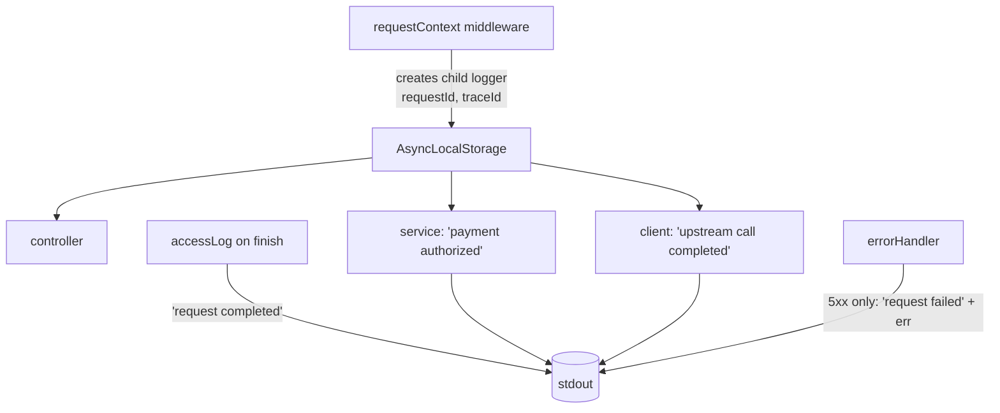

# Deep dive: structured logging in Node

The lesson covered the why. This page covers the practical details you run into when you set pino up for real.

## A logging contract

Agree on field names once and write them down. A minimal contract for HTTP services:

| Field | Type | Set by | Notes |
|---|---|---|---|
| `time` | ISO string | logger | UTC. ISO strings are easier to read than epoch ms; both are fine if consistent |
| `level` | string | logger | use `formatters.level` to emit `"info"` instead of `30` |
| `service` | string | root logger `base` | which service wrote the line |
| `version` | string | root logger `base` | the release. Makes "did the deploy cause this?" a one-line query |
| `pod` / `hostname` | string | root logger `base` | which instance |
| `requestId` | string | request child logger | correlation within this service and across services |
| `traceId` | string | request child logger | links to the trace |
| `msg` | string | call site | **constant** short description |
| `err` | object | call site | `{ type, message, stack }` via pino's serializer |
| `durationMs` | number | call site | always milliseconds in logs (metrics use seconds); name the unit in the key |

The incident logs in the challenge follow this contract, and that's why they can be investigated with a few `jq` filters.

## Where log lines come from in a request

Think about what *each layer* should log:

- **Middleware:** the access log (one line per request). Optionally a debug "request received".
- **Controllers:** usually nothing. They're thin.
- **Services:** business events that matter: "order created", "payment declined", "stock reserved". These are what you search for during support cases.
- **Clients for other services:** one line per outgoing call at debug level (`dependency`, `durationMs`, `statusCode`), and warn for retries or slow calls.
- **Error handler:** one error line for 5xx, with `err`. Don't *also* log at the throw site. Logging the same error at three layers triples the noise and makes counts misleading. The rule is **log or throw, not both**.

## Redaction details

pino uses `fast-redact` under the hood. Paths support:

- dot notation: `payment.cardNumber`
- brackets for odd keys: `headers["x-api-key"]`
- a `*` wildcard for **one** level: `*.password` matches `{ user: { password } }` but not `{ a: { b: { password } } }`

There's no deep wildcard ("anywhere in the object"), on purpose: a deep scan of every logged object would be slow. So you list the shapes you actually log. Write a test (like the challenge does) that logs realistic objects and asserts that secret values never appear in the output. It catches the day someone renames a field.

`censor` can be a string or a function. `remove: true` deletes the key entirely. Keeping the key with `[Redacted]` is usually better: it tells the reader the field existed.

## Performance notes

- pino writes synchronously to stdout by default (`pino.destination(1)`); for very high volume you can enable async mode (`pino.destination({ sync: false })`), accepting that the last lines may be lost on a crash.
- Disabled levels cost almost nothing: `log.debug(...)` with level `info` returns immediately. But **arguments are still evaluated**, so don't build expensive objects just to pass them to a debug call. Guard with `if (log.isLevelEnabled("debug"))` when necessary.
- Pretty printing (`pino-pretty`) belongs in development only: `npm run dev | npx pino-pretty`.

## Changing log level at runtime

When investigating, you often want `debug` on *one* instance *now* without a redeploy. Options:

- An admin endpoint (protected!) that sets `logger.level = "debug"` for N minutes.
- Reading the level from a config service or feature flag.
- Per-request debug: if a trusted header like `x-debug: 1` is present, create the child logger with `level: "debug"`. Child loggers can have their own level.

## Logs vs events vs audit trails

Application logs are for **operators** and can be sampled, truncated or deleted after 14–30 days. If the business needs a durable record ("who changed this invoice?"), that's an **audit log**: a database table or event stream with its own retention and integrity guarantees. Don't rely on the application log pipeline for it.
