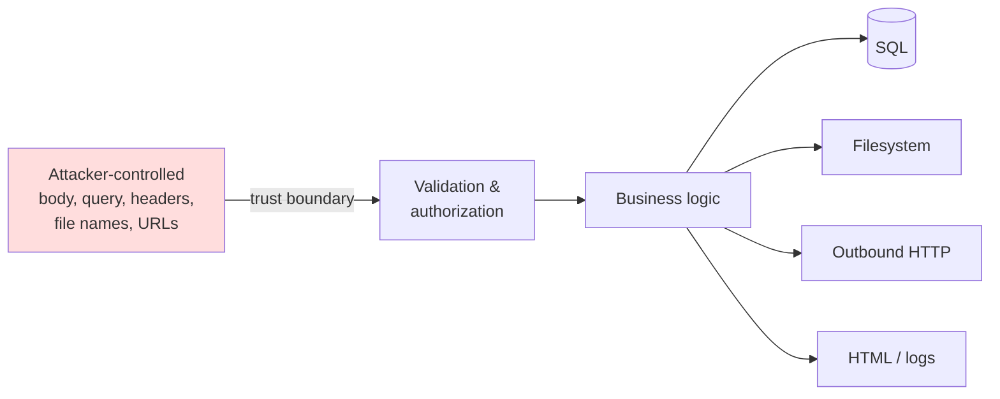
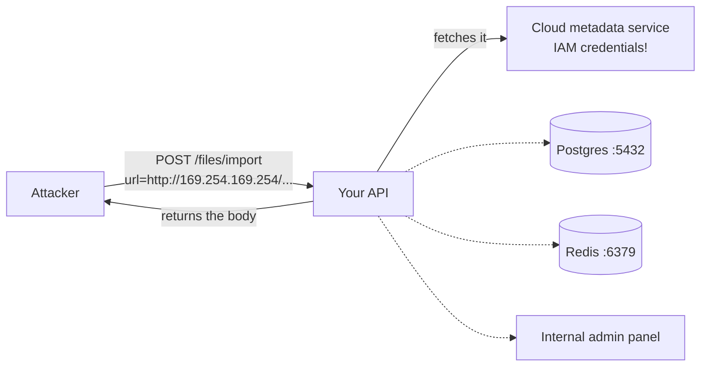
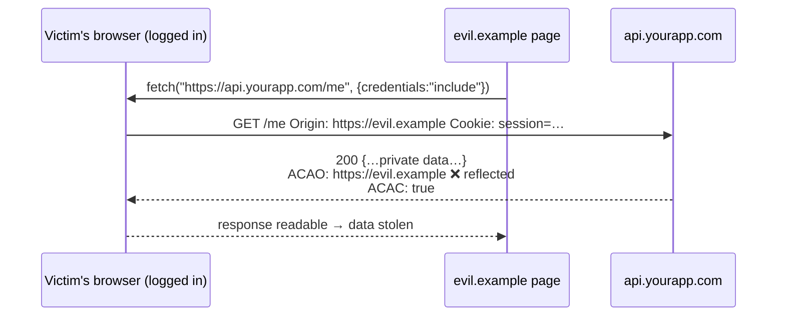

# 25 · Web Security

> Attackers don't need to break your crypto. They send your API inputs you didn't expect. Almost every serious breach comes down to a short list of classic mistakes, and a backend engineer is expected to recognize all of them on sight.

**Time:** ~6h · **Challenge:** 🐛 Debug · **Prereqs:** [13 · Postgres from Node](../13-node-postgres/README.md), [22 · Authentication & Authorization](../22-auth/README.md) · **Services:** Postgres

> ⚖️ Everything in this module is for defending **your own** code. The challenge's exploit inputs run only against the deliberately vulnerable app on your machine. Testing systems you don't own or have no written permission to test is illegal in most countries.

## What you'll learn

- How to think like an attacker: trust boundaries and "what if this input is hostile?"
- The OWASP Top 10, mapped to concrete Node/Express code
- Injection (SQL and friends) and why parameterized queries fix it completely
- XSS, and why JSON APIs still have to care
- CSRF and how cookies, `SameSite` and CORS interact
- SSRF: making your server fetch things for an attacker
- Path traversal, mass assignment and prototype pollution
- ReDoS and other ways a single request can take a server down
- Security headers (helmet) and CORS done right
- Secrets management, dependency vulnerabilities, least privilege, and what not to log

---

## 1. The attacker's mindset

Every value that crosses a **trust boundary** is hostile until proven otherwise. That includes the request body, query string, path params, *headers* (including `Host`, `Origin`, `X-Forwarded-For` and cookies), uploaded file names and contents, URLs you're asked to fetch, webhook payloads, and even data from your own database if users wrote it.



The dangerous moment is when untrusted data reaches an **interpreter** or a **sensitive sink**: a SQL engine, a file path, a URL fetcher, an HTML page, an object merge, a regex engine. Most vulnerabilities in this module are the same bug wearing different clothes: *data was treated as code or structure.*

Three principles you'll see everywhere:

1. **Allowlist, don't blocklist.** "Only these five fields / these two schemes / this exact origin" beats "not these bad things": attackers are better at inventing bad things than you are at listing them.
2. **Defence in depth.** Assume each layer can fail. Validate the input *and* parameterize the query *and* run the DB user with minimal rights.
3. **Secure defaults.** The easy way to write code should be the safe way (a query helper that only takes parameters, a logger that redacts by default).

## 2. OWASP Top 10, mapped to Node

The [OWASP Top 10](https://owasp.org/Top10/) is the industry's shared list of the most critical web application risks. Interviewers expect you to know it. Here it is (2021 edition) with what each means for an Express API:

| # | Risk | In a Node/Express API, typically… | Covered |
|---|---|---|---|
| A01 | Broken Access Control | IDOR (`/files/42` without an ownership check), mass assignment, CORS misconfig, path traversal | §6, §7, §10, [22](../22-auth/README.md) |
| A02 | Cryptographic Failures | plaintext/sha1 passwords, secrets in code, no TLS, weak random tokens | [22](../22-auth/README.md), §12 |
| A03 | Injection | SQL built with string concatenation, shell commands with user input, XSS | §3, §4 |
| A04 | Insecure Design | features that are dangerous by design ("fetch any URL"), no rate limits | §5, [19](../19-rate-limiting/README.md) |
| A05 | Security Misconfiguration | missing headers, verbose errors, `x-powered-by`, default credentials | §9 |
| A06 | Vulnerable & Outdated Components | old packages with known CVEs, no lockfile | §12 |
| A07 | Identification & Authentication Failures | user enumeration, no login throttling, weak sessions | [22](../22-auth/README.md) |
| A08 | Software & Data Integrity Failures | unsafe deserialization, prototype pollution, unsigned updates, CI that runs untrusted code | §8, §12 |
| A09 | Security Logging & Monitoring Failures | no audit trail, secrets *in* logs, no alerts on attacks | §13, [24](../24-observability/README.md) |
| A10 | Server-Side Request Forgery | "import from URL", webhooks, link previews, PDF renderers fetching URLs | §5 |

## 3. Injection

### SQL injection

Here's the bug, in its natural habitat:

```ts
// ❌ the search term becomes part of the SQL text
const sql = `SELECT * FROM files WHERE owner_id = ${userId} AND name ILIKE '%${term}%'`;
```

With `term = "' OR 1=1 --"` the query becomes:

```sql
SELECT * FROM files WHERE owner_id = 7 AND name ILIKE '%' OR 1=1 --%'
```

The quote closes the string literal early, `OR 1=1` makes the `WHERE` clause true for every row, and `--` comments out the leftover `%'`. The attacker's *data* has become *SQL structure*, and they get every user's files. With `UNION SELECT email, ... FROM users` they can read other tables. If the driver allows multiple statements (`pg` does for queries without parameters), `'; UPDATE users SET is_admin = true; --` modifies data. Even a harmless user searching for `report's` gets a 500, and that's often how these bugs are first noticed.

**The fix is parameterized queries**, and it's complete, not a mitigation:

```ts
// ✅ SQL text and values travel separately
await pool.query(
  "SELECT * FROM files WHERE owner_id = $1 AND name ILIKE $2",
  [userId, `%${term}%`],
);
```

With `pg`, the SQL text and the values are sent to Postgres in separate protocol messages. Postgres parses the SQL *first*, so the structure is fixed before any value is seen. A value can never become a keyword, a quote or a semicolon. It's just a value.

What parameters *can't* do:

- **Identifiers** (table/column names, `ASC`/`DESC`) can't be parameters. If a user picks the sort column, map their input through an **allowlist**: `const col = { name: "name", date: "created_at" }[req.query.sort] ?? "name"`.
- **`LIKE` wildcards** inside a parameter still mean something to `LIKE`: a search for `%` matches everything. Escape `%`, `_` and `\` if literal matching matters. That's a correctness issue, not injection.
- **Building SQL from object keys** (`UPDATE users SET ${Object.keys(body)...}`) is injection through the back door: the keys come from the attacker too. The challenge has exactly this, hiding behind a mass-assignment bug.

Query builders (Kysely) and ORMs parameterize for you, but all of them have a "raw SQL" escape hatch (`sql.raw`, `$queryRawUnsafe`) where the same bug comes back.

### Other injections

The same pattern applies to every interpreter:

| Sink | Bug | Fix |
|---|---|---|
| Shell | `exec(\`convert ${file} out.png\`)` | `execFile("convert", [file, "out.png"])`: no shell, args as an array |
| NoSQL | `db.users.find({ user: req.body.user })` where body is `{"$ne": null}` | validate types (a string must be a string) |
| HTML | `res.send(\`<p>${comment}</p>\`)` | escape, or use a template engine that escapes by default (§4) |
| Logs | a username containing `\n` forging fake log lines | structured JSON logging escapes for you |
| Headers | a value with `\r\n` injecting headers | Node rejects these in `setHeader`; don't work around it |

## 4. XSS (and why APIs care)

**Cross-site scripting** is injection into HTML: attacker-supplied text ends up in a page as markup, and their JavaScript runs in the victim's browser with the victim's cookies and session.

- **Stored XSS:** a comment containing `<script>…</script>` is saved and shown to every visitor.
- **Reflected XSS:** a search page echoes `?q=<script>…` back into the HTML.
- **DOM XSS:** frontend code does `el.innerHTML = location.hash`.

"But my API only returns JSON!" Here's why you still care:

- Your JSON is rendered by *some* frontend. If it uses `innerHTML` or React's `dangerouslySetInnerHTML` with your data, stored XSS starts with *your* API accepting and storing the payload. React escapes text by default, which is a big reason modern apps have fewer XSS bugs.
- **File downloads** are a classic hole: a user uploads `evil.html`, your API serves it inline with `Content-Type: text/html` from your domain, and it runs as a page on your origin. Defences: `Content-Disposition: attachment`, `X-Content-Type-Options: nosniff` (so browsers don't guess a type), a strict `Content-Security-Policy`, and ideally serving user content from a separate domain (`usercontent.example.com`).
- An error page that echoes input (`Cannot GET /<script>`) in HTML is reflected XSS. Express's default 404 page escapes; a custom one might not.

The defence in depth for HTML: escape on output (context-aware: HTML body vs attribute vs URL vs JS), CSP to stop inline scripts from running, and `HttpOnly` cookies so script can't read the session even if XSS happens ([module 22](../22-auth/README.md)).

## 5. SSRF: server-side request forgery

Any feature where *your server* fetches a URL the *user* provides is an SSRF risk: "import from URL", link previews, webhooks, avatar-by-URL, PDF/HTML renderers, OAuth/OpenID discovery documents.

Your server sits inside your network. It can reach things the attacker can't:



The cloud metadata endpoint (`169.254.169.254`) is the famous one: on many cloud setups it returns temporary credentials for the machine's role to anyone who can make an HTTP request from that machine. Several large breaches started exactly this way.

Why naive defences fail:

| Naive check | Bypass |
|---|---|
| `if (url.includes("localhost"))` | `127.0.0.1`, `127.1`, `0.0.0.0`, `[::1]`, `2130706433` (decimal IP), `localtest.me` (public DNS → 127.0.0.1) |
| check the hostname string for private IPs | `intranet.corp` or `evil.example` *resolving* to `10.x` |
| check only the first resolved IP | the attacker's DNS returns one public and one private address |
| check, then let `fetch` follow redirects | a public URL answering `302 Location: http://169.254.169.254/` |
| check DNS, then fetch | **DNS rebinding:** the attacker's DNS answers public on your check (TTL 0), private on fetch's own lookup |

A solid application-level defence:

1. Parse with the WHATWG `URL` parser (it normalizes `2130706433` and `127.1` to `127.0.0.1` for you).
2. Allow only `http:`/`https:`, expected ports, no `user:pass@`.
3. **Resolve the hostname yourself** and reject if **any** address is loopback, private (10/8, 172.16/12, 192.168/16), link-local (169.254/16, fe80::/10), CGNAT (100.64/10), unspecified (0.0.0.0, ::), unique-local IPv6 (fc00::/7), or an IPv4-mapped IPv6 version of any of those (`::ffff:127.0.0.1`). Node's `net.BlockList` does the range matching.
4. **Don't follow redirects** (`fetch(url, { redirect: "manual" })`), or follow them manually and re-validate each hop.
5. Time out, cap the response size, and don't return raw error bodies from upstream.

The stronger defences live in infrastructure: an **egress proxy** that enforces the policy at connection time (which closes the rebinding gap), a fetcher running in a network segment with no route to internal ranges, and on AWS, IMDSv2, which requires a session token the attacker can't get through a simple GET. The challenge asks you to write up this trade-off in `DECISIONS.md`.

## 6. Path traversal

```ts
// ❌ name = "../../.env"
const file = path.join(STORAGE, String(userId), req.query.name);
res.sendFile(file);
```

`path.join` happily resolves `..` segments, so `../../.env` walks out of the user's folder into other users' folders, the app's config, `/etc/passwd`. Attackers also try encodings (`..%2F`, double encoding `%252e%252e`), backslashes on Windows, absolute paths, and null bytes.

Fixes, best first:

1. **Don't use user input as a path at all.** Look the file up in the database by (owner, name) or by id, then read from a path *you* constructed (e.g. a UUID). If the DB says the user owns no file called `../../.env`, the filesystem is never touched. This also fixes authorization: you check ownership against data, not against folder layout.
2. **Resolve, then verify containment.** `const full = path.resolve(base, name)` and check that `full` starts with `base + path.sep` (or that `path.dirname(full) === base` for a flat folder). Compare *after* normalization. Don't try to strip `../` from the input with a regex: `....//` becomes `../` after one pass.
3. **Validate names** as a single safe segment (`^[A-Za-z0-9][A-Za-z0-9 ._-]{0,99}$`) at upload time.

The same class of bug shows up when extracting archives ("zip slip": an entry named `../../app.js`), and with `res.sendFile` / `express.static` misconfiguration.

## 7. Mass assignment

```ts
// ❌ copy whatever the client sent into the update
await users.update(currentUser.id, { ...req.body });
```

The frontend only sends `displayName` and `email`. The attacker sends `{"displayName":"x","isAdmin":true}`. A generic update that writes every key is now a privilege-escalation endpoint. The same applies to `role`, `ownerId`, `balance`, `emailVerified`, `id`, `createdAt`.

Fix: **allowlist the writable fields** at the boundary, with a schema (zod `.strict()` rejects unknown keys, `.strip()` drops them), and make the repository method accept only those fields with a fixed column list. Privileged changes (granting admin) get their own endpoint with their own authorization check. Rejecting unknown keys (400) is usually better than silently dropping them: the attempt shows up in your logs.

This is one reason the DTO-vs-entity separation from [module 06](../06-layered-architecture/README.md) matters: request DTOs describe what a client *may* send; entities describe what you store.

## 8. Prototype pollution and unsafe deserialization

JavaScript objects inherit from `Object.prototype`. If an attacker can write a property *onto* `Object.prototype`, that property appears on **every object in the process**:

```ts
const body = JSON.parse('{"__proto__": {"isAdmin": true}}');
// JSON.parse creates an OWN property called "__proto__" (harmless so far)

function naiveMerge(target, source) {
  for (const key of Object.keys(source)) {
    if (typeof source[key] === "object") {
      target[key] ??= {};
      naiveMerge(target[key], source[key]);   // target["__proto__"] IS Object.prototype!
    } else target[key] = source[key];
  }
}
naiveMerge({}, body);
({}).isAdmin; // true, for every object, in every request, until restart
```

Consequences range from crashes (polluting `toString`) to authorization bypasses (`if (user.isAdmin)` when `user` has no own `isAdmin` property) to remote code execution through gadgets in template engines or `child_process` options.

Where it happens: deep merge/extend/clone helpers, "set by path" helpers (`set(obj, "a.__proto__.b", v)`), query-string parsers that build nested objects (`?a[__proto__][b]=1`), and config loaders.

Fixes:

- Skip `__proto__`, `constructor` and `prototype` keys in any recursive merge/set, and only recurse into plain objects that are the target's own properties.
- Validate shape with a schema before merging. Unknown keys are an error.
- Use `Object.create(null)` or `Map` for dictionaries keyed by user input.
- Defence in depth: `node --disable-proto=delete` removes `__proto__` accessors entirely, and `Object.freeze(Object.prototype)` at startup is a blunt but effective guard (test that your dependencies still work).

**Unsafe deserialization** is the general category: never `eval` input, never use serializers that can instantiate arbitrary types or functions (`node-serialize`, YAML loaders with custom tags) on untrusted data. Plain `JSON.parse` + schema validation is the safe path.

## 9. Security headers (helmet)

Browsers support response headers that switch on protections. They cost nothing and `helmet` sets sensible defaults:

| Header | Protects against | Typical API value |
|---|---|---|
| `Content-Security-Policy` | XSS, injected scripts, framing | `default-src 'none'; frame-ancestors 'none'` for a pure JSON API |
| `Strict-Transport-Security` | TLS stripping (downgrade to http) | `max-age=31536000; includeSubDomains` |
| `X-Content-Type-Options: nosniff` | browsers "guessing" a download is HTML/JS | always |
| `X-Frame-Options: DENY` (or CSP `frame-ancestors`) | clickjacking | always for APIs |
| `Referrer-Policy` | leaking URLs (with tokens) to other sites | `no-referrer` |
| `Cross-Origin-Resource-Policy` / `-Opener-Policy` | cross-origin data leaks (Spectre-class) | `same-origin` |
| remove `X-Powered-By` | free fingerprinting of your stack | `app.disable("x-powered-by")` |

```ts
import helmet from "helmet";
app.disable("x-powered-by");
app.use(helmet());               // first, so errors and 404s get the headers too
```

Headers are a **seatbelt**, not a fix. They reduce the blast radius of bugs, but they don't excuse them.

## 10. CORS done right

The **same-origin policy** stops a page on `evil.example` from *reading* responses from `api.yourapp.com`. **CORS** is how your server *relaxes* that for specific origins. Key facts:

- CORS is enforced by **browsers**. curl, scripts and servers ignore it. It's not authentication.
- With `Access-Control-Allow-Credentials: true` (cookies sent), the browser requires `Access-Control-Allow-Origin` to be one **exact** origin, never `*`.
- The classic hole: reflecting whatever `Origin` arrives, *with* credentials. Now any website your logged-in user visits can call your API as them and read the responses. It's like having no same-origin policy at all.



Rules:

- Keep an **exact allowlist** of origins from config. Compare with `Set.has`. Avoid regexes and `endsWith`: `https://app.example.com.evil.net` and `https://evilexample.com` defeat sloppy patterns.
- Never allow the origin `null` (sandboxed iframes and `file:` pages send it, and attackers can produce it).
- Send `Vary: Origin` so caches don't serve one origin's CORS headers to another.
- Answer preflights (`OPTIONS` + `Access-Control-Request-Method`) only for allowed origins.
- If you use cookies, CORS doesn't protect *writes*: see CSRF.

### CSRF in one section

**Cross-site request forgery:** a malicious page makes the victim's browser *send* a request to your API with their cookies attached (a form POST, an ``). The attacker can't read the response, but the action (transfer money, change email) still happens.

Defences:
- `SameSite=Lax` or `Strict` session cookies ([module 22](../22-auth/README.md)): the browser won't attach them on cross-site POSTs. This is the modern baseline.
- Require a non-simple request: JSON `Content-Type` or a custom header forces a CORS preflight, which a non-allowlisted origin fails.
- For high-value forms, anti-CSRF tokens (synchronizer token or double-submit cookie).
- Check `Origin` / `Sec-Fetch-Site` headers on state-changing requests.
- APIs authenticated with `Authorization: Bearer` headers (not cookies) aren't CSRF-able, because browsers don't attach those automatically.

## 11. Denial of service from a single request: limits and ReDoS

Node runs your JavaScript on one thread ([module 01](../01-js-runtime/README.md)). Anything that keeps that thread busy blocks *every* request.

**ReDoS** (regular expression denial of service): regexes with nested or overlapping quantifiers can take exponential time on inputs that *almost* match.

```ts
const EMAIL = /^([a-zA-Z0-9]+[._-]?)+@.../;   // ❌ (x+)+ shape
EMAIL.test("a".repeat(30) + "!");             // seconds to minutes of 100% CPU
```

`([a-zA-Z0-9]+[._-]?)+` can split a run of letters into groups in exponentially many ways. When the match finally fails at the `!`, the engine tries every one. Each extra character roughly doubles the time.

How to defend:

- Avoid nested quantifiers (`(a+)+`, `(a|a)*`, `(\w+\s?)*`) and overlapping alternatives. Make each character matchable in only one way.
- **Bound the input length before matching** (an email is ≤ 254 characters) and bound quantifiers (`{1,63}`).
- Prefer simple checks plus real verification: the real test of an email address is sending it a confirmation link.
- Lint for it (`eslint-plugin-regexp`, `safe-regex`). For user-supplied patterns, use a linear-time engine like RE2 (`re2` package).

Other cheap limits every API needs:

- Body size: `express.json({ limit: "100kb" })`. Upload limits for files.
- Array lengths and string lengths in schemas (`z.array(...).max(100)`, `z.string().max(1000)`).
- Pagination caps (`limit ≤ 100`), query timeouts (`statement_timeout`), outbound timeouts.
- Rate limiting per user/IP ([module 19](../19-rate-limiting/README.md)).
- Beware expensive operations triggered by small inputs: password hashing (rate-limit login), image processing ("decompression bombs"), deeply nested JSON.

## 12. Secrets, dependencies and least privilege

### Secrets

- Never in code, never in git (`.env` in `.gitignore`, `.env.example` with fake values). A secret committed once lives on in history, forks and CI caches. **Rotate** it; don't just delete the commit.
- Load from the environment ([module 07](../07-validation-errors-config/README.md)), injected by your platform from a secret manager (AWS Secrets Manager, GCP Secret Manager, Vault, Kubernetes Secrets with encryption at rest).
- Scope and rotate: separate secrets per environment, short-lived credentials where possible.
- Use secret scanning (GitHub push protection, gitleaks) in CI.

### Dependencies

A typical Node app has hundreds of transitive dependencies. Each is code running with your app's full privileges.

- **Commit the lockfile** and install with `npm ci` in CI/Docker, so builds use exactly the reviewed versions.
- `npm audit` (or Dependabot/Renovate) for known CVEs. Triage: is the vulnerable function reachable in your use? Update promptly when it is.
- Supply-chain attacks (typosquatting, hijacked maintainer accounts, malicious `postinstall` scripts) are real. Prefer well-maintained packages, review new dependencies, and consider `npm config set ignore-scripts true` with explicit allowances.
- Fewer dependencies is a security feature. The challenge app needs four.

### Least privilege

Limit what a compromised component can do:

- The app's **database role** shouldn't be a superuser or the table owner. Grant `SELECT, INSERT, UPDATE, DELETE` on the app's tables only; run migrations with a separate, more powerful role. Then even a successful SQL injection can't `DROP TABLE`, read other databases or run `COPY ... PROGRAM`.

  ```sql
  CREATE ROLE app_rw LOGIN PASSWORD '…';
  GRANT CONNECT ON DATABASE wl_25 TO app_rw;
  GRANT USAGE ON SCHEMA public TO app_rw;
  GRANT SELECT, INSERT, UPDATE, DELETE ON ALL TABLES IN SCHEMA public TO app_rw;
  GRANT USAGE ON ALL SEQUENCES IN SCHEMA public TO app_rw;
  ```
- Containers run as a non-root user with a read-only filesystem where possible ([module 26](../26-docker-ci-deploy/README.md)).
- Cloud roles grant only the buckets and queues the service uses.
- Internal services authenticate each other too ("zero trust"): being inside the network shouldn't be enough.

## 13. Errors and logs: don't hand attackers a map

- Return generic 500s; log details server-side ([module 05](../05-express-basics/README.md)). A leaked SQL error tells an attacker your table names and that injection is working.
- Be deliberately vague where precision helps attackers: "invalid credentials" rather than "no such user" ([module 22](../22-auth/README.md)); "this address is not allowed" rather than "10.0.0.5 is internal".
- Never log passwords, tokens, cookies or card data. Redact by default ([module 24](../24-observability/README.md)).
- *Do* log security events: failed logins, permission denials, blocked SSRF attempts, validation failures with odd keys like `isAdmin`. Alert on spikes. Detection is part of security.

## Common mistakes

- Building SQL with template strings "just for this one dynamic filter" (or from object keys).
- Validating with a blocklist (`!input.includes("..")`, `!url.includes("localhost")`).
- Checking a path or URL *before* normalizing/resolving it.
- Letting `fetch` follow redirects for user-supplied URLs.
- `{ ...req.body }` into an update or create.
- Hand-rolled deep merge or "set by path" without prototype guards.
- Regexes with nested quantifiers on user input, with no length cap.
- `Access-Control-Allow-Origin: <reflected origin>` with credentials, or `endsWith` origin checks.
- Thinking CORS protects the API from non-browser clients, or protects against CSRF.
- Serving user uploads inline from your main domain.
- Secrets in the repo, or in logs.
- The app connecting to Postgres as `postgres`.

## In production

- Security is layered across the organization: a WAF and API gateway (rate limits, basic filtering), the application (everything in this module), infrastructure (network policies, egress proxies, IAM), and process (code review, threat modeling, dependency scanning, pentests, bug bounties).
- **SAST** tools (Semgrep, CodeQL) catch patterns like string-built SQL in CI, and **DAST** tools probe running apps. They're helpful, but they miss logic bugs like missing ownership checks. Those need reviewers who think like attackers.
- **Threat modeling** a new feature before building it ("what could an attacker do with import-from-URL?") is far cheaper than fixing it after a pentest. A simple version: list the trust boundaries, the assets, and for each input ask "what if it's hostile?"
- Incidents happen. Have a plan for rotating secrets, revoking sessions, and notifying users, and practise it.
- In interviews, expect "how would you prevent SQL injection?", "what is CORS and what isn't it?", "how would you design a safe webhook / URL fetcher?" and "walk me through the OWASP Top 10". This module prepares you for all of them.

## Check yourself

1. Why do parameterized queries prevent SQL injection completely, and what can't be parameterized?
   <details><summary>Answer</summary>The SQL text is parsed before values are bound; values travel separately and are never parsed as SQL, so they can't change the query's structure. Identifiers (table/column names, sort direction) can't be parameters. Use an allowlist mapping for those.</details>
2. You block URLs whose hostname is `localhost` or starts with `10.`/`192.168.`. Name three bypasses.
   <details><summary>Answer</summary>Alternate loopback forms (<code>127.1</code>, <code>0.0.0.0</code>, <code>[::1]</code>, decimal <code>2130706433</code>); a hostname that <em>resolves</em> to a private IP; a public URL that redirects to an internal one; DNS rebinding; IPv4-mapped IPv6 (<code>[::ffff:127.0.0.1]</code>); the 169.254.169.254 metadata address, which isn't in your list.</details>
3. Why is `{"__proto__": {"x": 1}}` dangerous in a deep merge but harmless after a plain `JSON.parse`?
   <details><summary>Answer</summary><code>JSON.parse</code> creates an own property named <code>__proto__</code>. A naive merge then reads <code>target["__proto__"]</code>, which is <code>Object.prototype</code>, and writes <code>x</code> into it, adding <code>x</code> to every object in the process.</details>
4. Your API reflects any `Origin` with `Allow-Credentials: true`. What can an attacker do?
   <details><summary>Answer</summary>Host a page that makes credentialed requests to your API from a logged-in victim's browser and <em>read</em> the responses (private data, CSRF tokens), and perform actions as the victim.</details>
5. What makes `/^(\w+\s?)*$/` dangerous and how would you fix the code that uses it?
   <details><summary>Answer</summary>Nested quantifiers let the engine split the input in exponentially many ways, so on a near-match like many words followed by <code>!</code> it backtracks exponentially and blocks the event loop. Rewrite it so each character matches one way (e.g. <code>/^\w+(?:\s\w+)*$/</code>), cap the input length first, or use RE2.</details>

## Further reading

- OWASP Top 10: https://owasp.org/Top10/
- OWASP Cheat Sheet Series (SQL injection, SSRF, XSS, CSRF, Node.js security): https://cheatsheetseries.owasp.org/
- OWASP API Security Top 10: https://owasp.org/API-Security/
- Node.js security best practices: https://nodejs.org/en/learn/getting-started/security-best-practices
- Express security best practices: https://expressjs.com/en/advanced/best-practice-security.html
- helmet: https://helmetjs.github.io/
- MDN, CORS: https://developer.mozilla.org/en-US/docs/Web/HTTP/CORS
- PostgreSQL, privileges: https://www.postgresql.org/docs/current/ddl-priv.html
- Deep dives in this module: [docs/ssrf-defence.md](docs/ssrf-defence.md) · [docs/input-handling-pitfalls.md](docs/input-handling-pitfalls.md) · [docs/secure-code-review.md](docs/secure-code-review.md) · [docs/security-cheatsheet.md](docs/security-cheatsheet.md)

## ➡️ Next: [the challenge](CHALLENGE.md)
