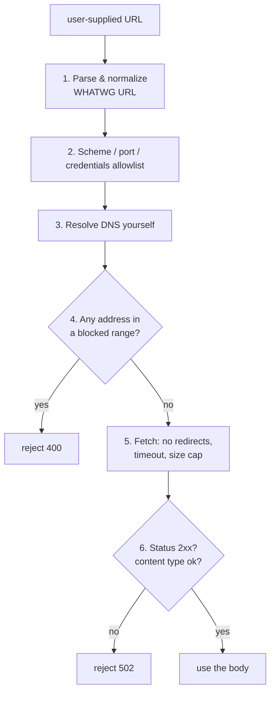

# Deep dive: building a safe URL fetcher

"Fetch this URL for me" turns up everywhere: link previews, webhooks, import-from-URL, avatar URLs, PDF rendering, OpenID discovery. This page goes further than the lesson on how to do it safely.

## The layers



## 1. Parse and normalize

`new URL(input)` normalizes many tricks for you:

| Input | `url.hostname` |
|---|---|
| `http://2130706433/` | `127.0.0.1` |
| `http://0x7f.1/` | `127.0.0.1` |
| `http://127.1/` | `127.0.0.1` |
| `http://[::ffff:127.0.0.1]/` | `[::ffff:7f00:1]` |
| `http://LOCALHOST./` | `localhost.` |

Never validate the raw string with a regex and then hand the raw string to `fetch`. Validate the *parsed* URL and fetch `url.toString()`, so the thing you checked is the thing you request.

Note IPv6 hostnames keep their brackets in `url.hostname`; strip them before `net.isIP`.

## 2. Allowlist the shape

- Schemes: `http:` and `https:` only. `file:`, `gopher:`, `ftp:`, `data:` have all been used in SSRF attacks against various HTTP libraries.
- Ports: the ones you expect (80, 443, maybe 8080/8443). Blocking odd ports stops port-scanning your internal network through your server.
- No `username:password@`: it's rarely legitimate, and a classic way to confuse humans and parsers (`https://trusted.com@evil.example/`).

## 3–4. Resolve and check every address

Resolve with `dns.promises.lookup(host, { all: true })`, which uses the same resolver path as Node's HTTP client, and reject if **any** returned address is blocked. Ranges to block:

| Range | What |
|---|---|
| `0.0.0.0/8`, `::/128` | "this host" (connects to localhost on Linux) |
| `127.0.0.0/8`, `::1` | loopback |
| `10.0.0.0/8`, `172.16.0.0/12`, `192.168.0.0/16` | RFC 1918 private |
| `169.254.0.0/16`, `fe80::/10` | link-local, incl. cloud metadata |
| `100.64.0.0/10` | carrier-grade NAT (also used inside some clouds) |
| `fc00::/7` | IPv6 unique local |
| `224.0.0.0/4`, `ff00::/8` | multicast |
| `240.0.0.0/4`, `192.0.0.0/24`, `198.18.0.0/15` | reserved / benchmarking |
| `::ffff:0:0/96` | IPv4-mapped IPv6: unwrap and check the IPv4 |
| `64:ff9b::/96` | NAT64: embeds an IPv4 address |

Node's `net.BlockList` does the matching:

```ts
import { BlockList } from "node:net";
const blocked = new BlockList();
blocked.addSubnet("10.0.0.0", 8, "ipv4");
blocked.check("10.1.2.3", "ipv4"); // true
```

## 5. Fetch carefully

```ts
const res = await fetch(url, { redirect: "manual", signal: AbortSignal.timeout(5000) });
```

- `redirect: "manual"` returns the 3xx response instead of following it. If you want to support redirects, follow them yourself in a loop (max 3), running steps 1–4 on every `Location`.
- Stream the body and stop after N bytes instead of buffering an attacker's 10 GB file. Check `content-length` early, but don't trust it.
- Don't forward the upstream's error body to the client; it may be an internal page.

## The DNS rebinding gap

Steps 3–5 have a time-of-check/time-of-use race: `fetch` does its own DNS lookup. An attacker's DNS server can answer with a public IP (TTL 0) for your check and a private IP for fetch's lookup a millisecond later.

Ways to close it:

- **Pin the IP:** connect to the address you validated and send the original `Host` header / SNI. With undici you can pass a custom `connect.lookup` to a dispatcher (`new Agent({ connect: { lookup } })`) that runs your validation *inside* the connection's DNS lookup. Then check and use happen together.
- **Egress proxy:** route all user-initiated fetches through a proxy (Smokescreen is purpose-built for this) that enforces the IP policy when it opens the connection.
- **Network isolation:** the fetcher runs where internal ranges simply aren't routable.

## Defence in depth around the fetcher

- **IMDSv2** on AWS (and equivalents elsewhere): metadata requires a PUT to get a session token plus a custom header, which SSRF via simple GETs can't do.
- Internal services require authentication even from inside the network.
- Log and alert on blocked attempts. Someone trying `169.254.169.254` is not a confused user.
- For webhooks, sign outgoing payloads so receivers can verify them, and let customers allowlist your egress IPs.
