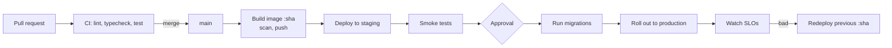

# Deployment strategies, environments and rollback

## The pipeline as a picture

The image is built **once**. Staging and production run the same digest with different environment variables.

## Rolling

Kubernetes Deployments do this by default. Two knobs:

- `maxSurge`: how many extra pods may exist during the rollout (extra capacity)
- `maxUnavailable`: how many pods may be missing (lost capacity)

`maxSurge: 25%, maxUnavailable: 0` means "add new pods, wait until they're ready, then remove old ones". Readiness probes gate every step, so a v2 that never becomes ready stalls the rollout instead of taking you down.

**Requires:** readiness checks, graceful shutdown, and v1/v2 compatibility (both serve traffic at once).

## Blue/green

Two full environments. Blue serves production. You deploy green, test it in place, then switch the router (a load balancer target group, a DNS record, a Kubernetes Service selector). Rollback is switching back.

**Watch out for:** the database. Both colors usually share it, so the schema must work for both. Long-lived connections (WebSockets) on blue need to drain after the switch.

## Canary

Route a small slice of traffic (1%, 5%) to v2. Compare error rate and latency with v1 using the RED metrics from [module 24](../../24-observability/README.md). Widen gradually, or abort automatically if metrics degrade (Argo Rollouts and Flagger automate this).

**Requires:** traffic splitting (service mesh, ingress weights, or a load balancer that supports it) and metrics you trust.

## Feature flags: decoupling deploy from release

A deploy puts code on servers. A **release** exposes behavior to users. Feature flags let you deploy dark code and turn it on for 1% of users, internal staff, or one customer, with no redeploy. Many teams find flags give them most of the safety of canaries more cheaply. The cost is flag debt: remove flags once they're fully rolled out.

## Database changes during deploys

Every strategy except "recreate" runs old and new code together. Use **expand/contract** ([module 12](../../12-data-modeling/README.md)):

1. **Expand**: add the new column or table (nullable, or with a default). Old code ignores it.
2. Deploy code that writes both and reads the new one. Backfill.
3. **Contract**: once no running version uses the old column, drop it in a later deploy.

Never rename or drop something that the currently running version still uses.

## Environments

| Environment | Purpose | Data |
|---|---|---|
| local | developer loop | throwaway (compose) |
| CI | automated tests | ephemeral service containers |
| preview (optional) | one per PR, for reviewers | seeded |
| staging | production-like rehearsal | anonymized or synthetic |
| production | users | real |

GitHub "environments" can hold per-environment secrets and require approvals or wait timers before a job that targets them runs.

## Rollback vs roll forward

- **Rollback**: redeploy the previous SHA. Fast if images are immutable, still in the registry, and the schema is compatible.
- **Roll forward**: ship a fix. Better when the bad version already ran a contract migration, or the fix is trivial.

Decide *before* the incident: practice rollbacks so the button is boring.

## Image tags, one more time

| Tag | Use |
|---|---|
| `:<sha>` | what you deploy, immutable by convention |
| `:main` / `:latest` | convenience pointers, never deployed by reference |
| `:1.4.2` | releases for consumers |
| `@sha256:…` | the real identity: what Kubernetes actually runs |

Many registries let you make tags immutable, so `:sha` can't be overwritten.
