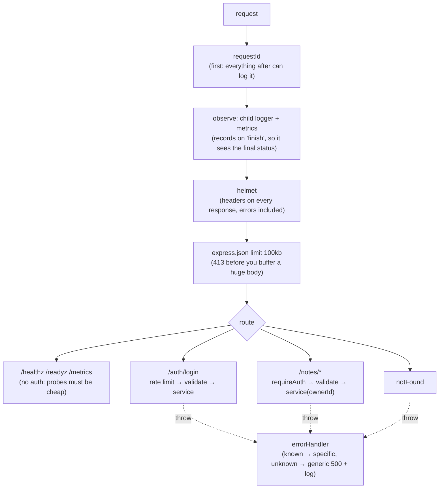
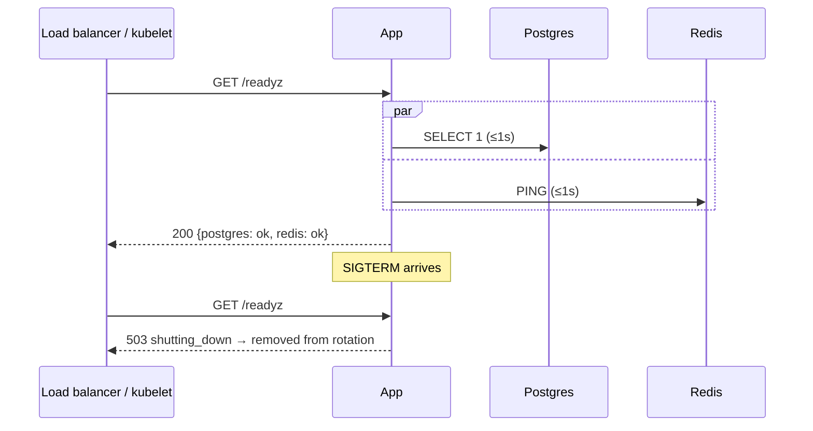

# 27 · Checkpoint: Production Readiness

> "It works" and "it's ready for production" are separate milestones. In this checkpoint you take an API that works and make it safe to put in front of real users: authenticated, abuse-resistant, observable, and well-behaved when the platform restarts it.

**Time:** ~8h · **Challenge:** 🛠️ Build (checkpoint) · **Prereqs:** [22 · Auth](../22-auth/README.md), [19 · Rate Limiting](../19-rate-limiting/README.md), [24 · Observability](../24-observability/README.md), [25 · Security](../25-security/README.md), [26 · Docker, CI & Deployment](../26-docker-ci-deploy/README.md) · **Services:** Postgres, Redis

## What you'll practice

- Running a **production readiness review** on an existing service, the way a senior engineer or SRE would before launch
- Combining the Phase 4 pieces in one codebase without turning it into a mess: auth, rate limiting, validation, error handling, security headers, logging, metrics, health checks, graceful shutdown, containerization
- Deciding **where** each concern lives (middleware, service, repository, composition root) so the code stays layered
- Writing down trade-offs in a decision record that a teammate could challenge

There's no new theory here. This lesson is a map: it connects what you learned in modules 19–26 into one checklist and shows how the pieces fit together in a request's life. Lean on the earlier modules for the details.

---

## 1. What "production ready" means

A service is production ready when the team can run it at 3 a.m. without the original author. Concretely, it answers these questions well:

| Question | Concern | Where you learned it |
|---|---|---|
| Who is calling, and may they do this? | authentication, authorization, ownership | [22](../22-auth/README.md) |
| What stops someone hammering it? | rate limiting, body limits | [19](../19-rate-limiting/README.md), [25](../25-security/README.md) |
| What happens with garbage input? | validation at the edge, safe errors | [07](../07-validation-errors-config/README.md) |
| What does an attacker learn from responses? | generic 500s, no stack traces, no enumeration, security headers | [25](../25-security/README.md) |
| When it breaks, how do we find out and why? | structured logs, request ids, metrics | [24](../24-observability/README.md) |
| How does the platform know it's healthy? | liveness vs readiness | [24](../24-observability/README.md), [26](../26-docker-ci-deploy/README.md) |
| What happens during a deploy? | graceful shutdown, migrations as a step | [26](../26-docker-ci-deploy/README.md) |
| How is it built and shipped? | reproducible, minimal, non-root image | [26](../26-docker-ci-deploy/README.md) |
| Why is it built this way? | decision records | this module |

Many companies have a literal checklist like this ("launch review", "operational readiness review") that a service must pass before it gets production traffic. [docs/production-readiness-checklist.md](docs/production-readiness-checklist.md) is a longer version you can reuse.

## 2. The request's journey through a hardened app

Order matters in Express ([module 05](../05-express-basics/README.md)), and with this many concerns it matters a lot. Here's the chain the reference solution uses, and why each link is where it is:



A few placement decisions worth noticing:

- **The request id comes first** so that even a JSON parse error or a 413 can be correlated with logs.
- **Metrics and the access log hook `res.on("finish")`.** If they logged on the way *in*, they wouldn't know the status code or duration.
- **Helmet runs before routes**, so 404s and 500s carry security headers too.
- **Health endpoints skip auth and rate limits.** Kubernetes probes them every few seconds, and they must never fail because Redis is slow to hand out a session.
- **Auth is a route-level guard**, not global middleware. Public routes stay public by default and protected routes say so explicitly.
- **Rate limiting runs before validation and the password check**, so a flood of requests costs one Redis call each, not a scrypt hash each (scrypt is deliberately slow and memory-hungry).

## 3. Authentication & ownership, revisited

The bare app trusts everyone. Hardening it means three distinct things, and mixing them up is a classic interview stumble:

- **Authentication**: who are you? Login verifies a password hash (scrypt or argon2, salted, never plain SHA) and creates a **server-side session** in Redis. The browser holds only an opaque, random id in an `HttpOnly; SameSite=Lax; Secure` cookie.
- **Authorization**: may you do this? Here the rule is simple: you may only touch your own notes.
- **Ownership enforcement**: *where* the rule lives. The strongest place is the **query itself**:

```sql
SELECT ... FROM notes WHERE id = $1 AND owner_id = $2
```

If every repository method requires an `ownerId`, there's no code path that can forget the check. Compare with "fetch by id, then `if (note.ownerId !== user.id) throw`": that works until someone adds an endpoint and forgets the `if`. That's an **IDOR** (insecure direct object reference), one of the most commonly reported API vulnerabilities.

Answer **404, not 403**, for other people's notes. A 403 confirms the id exists.

Two more details from [module 22](../22-auth/README.md) that the tests check:

- **No user enumeration**: "unknown email" and "wrong password" return the *same* status, code and message. Ideally they take the same time too: verify against a dummy hash when the user doesn't exist.
- **Session rotation**: every login issues a brand-new session id. Never reuse an id that existed before authentication (session fixation).

### Mass assignment

```ts
await service.create(req.body); // ← the bare app
```

If `req.body` contains `ownerId`, `isAdmin` or `id`, whatever the repository does with extra fields is now attacker-controlled. Parsing with a zod object schema **strips unknown keys**, and the owner comes from the session, never from the body.

## 4. Abuse resistance

- **Login rate limiting** ([module 19](../19-rate-limiting/README.md)): a Redis counter shared by every instance, updated atomically (Lua or MULTI), returning `429` with `Retry-After`. The **key** is a real design decision: by IP, by account, or both. Each choice fails differently (shared office IPs, botnets, locking victims out). That's why it's a required entry in your DECISIONS.md.
- **Body size limits**: `express.json({ limit: "100kb" })` returns 413 before buffering megabytes into memory.
- **Bounded inputs**: max lengths on title, body and even passwords. Hashing a 5 MB "password" with scrypt is a cheap way to burn your CPU.

## 5. Failing safely

The bare app's error handler does this:

```ts
res.status(err.status ?? 500).json({ error: err.message, stack: err.stack });
```

That one line leaks table names (`relation "notes" does not exist`), file paths, library versions and sometimes data. The hardened version follows the pattern from [module 05](../05-express-basics/README.md) and [module 07](../07-validation-errors-config/README.md):

| Error | Response |
|---|---|
| validation (`zod`) | 400 `VALIDATION_ERROR` with `details: [{ path, message }]` |
| malformed JSON | 400 `INVALID_JSON` |
| body too large | 413 `PAYLOAD_TOO_LARGE` |
| no or invalid session | 401 `UNAUTHENTICATED` |
| bad credentials | 401 `INVALID_CREDENTIALS` (same for unknown user) |
| not found / not yours | 404 `NOT_FOUND` |
| duplicate email | 409 `EMAIL_TAKEN` |
| rate limited | 429 `RATE_LIMITED` + `Retry-After` |
| anything else | 500 `INTERNAL_ERROR`, "Something went wrong", **logged at error level with the request id** |

Every error body carries the `requestId`, so a user's bug report ("it said error, id 3f2a…") leads straight to the log line.

Malformed ids deserve a mention: `GET /notes/abc` against a `uuid` column makes Postgres throw `invalid input syntax for type uuid`, which becomes a 500. Validate route params like any other input.

## 6. Observability that helps at 3 a.m.

From [module 24](../24-observability/README.md):

- **One structured log line per request**, written when the response finishes: request id, method, path, status, duration. A child logger bound to the request id is available on `res.locals.log`, so every other line in that request carries the id automatically.
- **Never log secrets.** Don't log bodies or headers by default, and configure pino's `redact` as a safety net for the day someone logs `{ req }` anyway. The tests grep the captured logs for the password, the session id and an `Authorization` token.
- **RED metrics** with prom-client: `http_requests_total` and `http_request_duration_seconds`, labeled by method, **route template** and status. The template (`/notes/:id`), never the raw path: one time series per note id would take down your Prometheus.
- **Health**: `/healthz` (liveness) checks nothing but the process. `/readyz` (readiness) checks Postgres and Redis with short timeouts and returns 503 while shutting down.



## 7. Lifecycle and shipping

Port your `createServerLifecycle` from [module 26](../26-docker-ci-deploy/README.md): drain in-flight requests, refuse new connections, then close the pool **and** Redis, within a deadline. Write a Dockerfile with the same properties as before: multi-stage, `npm ci`, production dependencies only, non-root, a node-based HEALTHCHECK, an exec-form `CMD`.

## 8. Keeping it layered

The danger of a hardening pass is that every concern gets bolted into the route handlers. Keep the separation from [module 06](../06-layered-architecture/README.md):

| Layer | Owns | Must not |
|---|---|---|
| `middleware/` | cross-cutting HTTP concerns: ids, logging, metrics, auth guard, rate limit, errors | contain business rules |
| `controllers/` | parse and validate input, call a service, shape the response, set cookies | touch SQL or Redis directly |
| `services/` | rules: hashing, credential checks, ownership semantics, domain errors | know about `req`/`res` or status codes |
| `repositories/` | SQL and Redis access (`PgNoteRepository`, `RedisSessionStore`) | decide HTTP status |
| `lib/` | reusable building blocks: password hashing, rate limiter, metrics registry, lifecycle | depend on Express routes |
| `app.ts` | wiring and middleware order | read `process.env` |
| `server.ts` | composition root: real pool, Redis, logger, lifecycle, signals | contain logic |

The architecture tests enforce three of these rules: `process.env` only in `config.ts`, no `express` in services or repositories, and no `console.*` anywhere.

## Common mistakes

- Checking ownership in some handlers but not others. Put it in the query.
- Returning 403 for other users' resources (it confirms they exist).
- Different messages or status codes for "unknown email" and "wrong password".
- A session cookie without `HttpOnly`, or a session id from `Math.random()`.
- Rate limiting in memory (`new Map()`): every instance has its own counter, so the real limit is N times higher.
- Logging `req.body` "for debugging" and shipping it.
- Metrics labeled with `req.originalUrl`.
- `/readyz` that checks nothing, or `/healthz` that checks the database (a DB blip restarts every pod at once).
- A single global prom-client registry, so tests and multiple app instances crash with "metric already registered".
- Validating the body but not the route params.

## In production

- Launch reviews at larger companies cover all of the above plus capacity planning, on-call runbooks, dashboards, alert definitions (SLOs and error budgets from [module 24](../24-observability/README.md)), backup and restore tests, and a rollback plan.
- Sessions often move to a dedicated Redis (or a managed one with replication), because losing it logs everyone out.
- Auth frequently moves to a gateway or identity provider (OIDC), but ownership checks stay in the service: only the service knows who owns a note.
- Rate limits usually exist in layers: coarse per-IP limits at the CDN or gateway, fine-grained per-account limits in the app.

## Check yourself

1. Why enforce ownership in the SQL `WHERE` clause instead of an `if` after fetching?
   <details><summary>Answer</summary>Every query that needs an owner can't be called without one, so no new endpoint can forget the check. It also avoids leaking timing or existence through a fetch-then-compare.</details>
2. Why should rate limiting run before validation and password verification on the login route?
   <details><summary>Answer</summary>Password hashing is deliberately expensive. Rejecting floods with one Redis call protects CPU and makes brute force pointless.</details>
3. What's wrong with `route="/notes/7d0f…"` as a metric label?
   <details><summary>Answer</summary>Each distinct id creates a new time series (unbounded cardinality), exhausting Prometheus memory and making aggregation useless. Use the route template.</details>
4. Your Redis goes down. What should happen to `/healthz`, `/readyz` and logins?
   <details><summary>Answer</summary><code>/healthz</code> stays 200 (the process is fine, restarting won't help). <code>/readyz</code> returns 503 so traffic shifts elsewhere. Logins fail because sessions can't be stored. Whether the rate limiter fails open or closed is a documented decision.</details>
5. Why give unexpected errors a generic message but log them in full?
   <details><summary>Answer</summary>Internals help attackers and don't help clients. Engineers still need the stack and context, which they find via the request id in the logs.</details>

## Further reading

- OWASP Authentication Cheat Sheet: https://cheatsheetseries.owasp.org/cheatsheets/Authentication_Cheat_Sheet.html
- OWASP Session Management Cheat Sheet: https://cheatsheetseries.owasp.org/cheatsheets/Session_Management_Cheat_Sheet.html
- OWASP API Security Top 10: https://owasp.org/API-Security/
- Express production best practices (security): https://expressjs.com/en/advanced/best-practice-security.html
- Prometheus naming and label best practices: https://prometheus.io/docs/practices/naming/
- Google SRE book, "Monitoring Distributed Systems": https://sre.google/sre-book/monitoring-distributed-systems/
- Deep dives in this module: [docs/production-readiness-checklist.md](docs/production-readiness-checklist.md) · [docs/hardening-walkthrough.md](docs/hardening-walkthrough.md) · [docs/writing-decision-records.md](docs/writing-decision-records.md)

## ➡️ Next: [the challenge](CHALLENGE.md)
