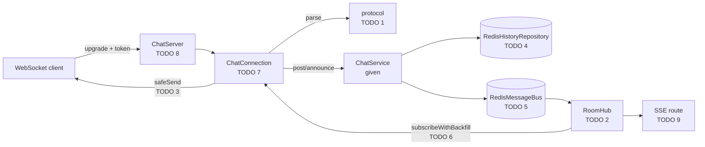

# Challenge · Multi-instance Chat Server

**Type:** 🛠️ Build · **Est:** 4–5h · **Services:** 🟥 Redis

## Scenario

> **#team-platform** · *Marco (staff engineer):* Support wants live chat between agents, and the status page wants a read-only feed of the `#incidents` room. We run at least two replicas of everything, so whatever you build has to work when Alice is connected to pod A and Bob to pod B. I've set up the project: config, auth tokens, the service layer, the HTTP app and the wiring in `instance.ts` are done, and the tests describe the protocol we agreed with the frontend. The real-time core is yours. Please make sure dead phones don't pile up as "online" forever, and that one slow client can't take a pod down. 🙏

## Your task

Implement the stubs in `challenge/src/`, roughly in this order (each has a test file, so you can go green step by step):

| TODO | File | What | Tests |
|---|---|---|---|
| 1 | `realtime/protocol.ts` | `parseClientMessage`: zod-validate every client frame, never throw | `protocol.test.ts` |
| 2 | `realtime/roomHub.ts` | `RoomHub`: local room → subscribers fan-out | `roomHub.test.ts` |
| 3 | `realtime/send.ts` | `safeSend`: refuse to buffer for slow consumers (close 1013) | `send.test.ts` |
| 4 | `repositories/redisHistoryRepository.ts` | Per-room ids + last 50 messages in Redis, atomically (Lua) | `history.test.ts` |
| 5 | `bus/redisMessageBus.ts` | Cross-instance fan-out over Redis pub/sub | `bus.test.ts` |
| 6 | `realtime/backfill.ts` | `subscribeWithBackfill`: history + live with no gap and no duplicates | `backfill.test.ts` |
| 7 | `realtime/chatConnection.ts` | The per-client protocol: join / leave / message, errors, ordering, cleanup | `chat.e2e.test.ts` |
| 8 | `realtime/chatServer.ts` | Upgrade handling with auth, wiring sockets to connections, heartbeat, shutdown | `chat.e2e.test.ts` |
| 9 | `routes/rooms.ts` | `GET /rooms/:room/events`: SSE feed with resume and keep-alives | `sse.test.ts` |

Then fill in `challenge/DECISIONS.md` (see below).

### The protocol

Client → server (JSON text frames):

```json
{ "type": "join", "room": "general" }
{ "type": "leave", "room": "general" }
{ "type": "message", "room": "general", "text": "hi" }
```

Server → client:

```json
{ "type": "welcome", "user": "alice" }
{ "type": "joined", "room": "general", "history": [ChatMessage, ...] }
{ "type": "left", "room": "general" }
{ "type": "message", "message": { "id": 42, "room": "general", "user": "alice", "text": "hi", "ts": 1732400000000 } }
{ "type": "presence", "room": "general", "user": "bob", "change": "join" }
{ "type": "error", "code": "BAD_JSON" | "INVALID_MESSAGE" | "NOT_IN_ROOM" | "INTERNAL", "message": "..." }
```

Connect with `ws://host:port/ws?token=<token>` (`npm run token -- alice` prints one).

### Architecture you're filling in



`src/instance.ts` (given) wires one instance. The tests call it twice with the same Redis prefix to simulate two pods.

## Acceptance criteria

- [ ] Client frames are validated with zod: bad JSON → `BAD_JSON`, wrong shape → `INVALID_MESSAGE`, never a thrown error (`protocol.test.ts`)
- [ ] The hub delivers only to a room's subscribers, survives a throwing subscriber, and forgets empty rooms (`roomHub.test.ts`)
- [ ] A client whose send buffer would exceed the limit is closed with 1013 instead of buffering more (`send.test.ts`)
- [ ] Messages get per-room ids 1, 2, 3...; history keeps the last 50, oldest first; appends are atomic under concurrency (`history.test.ts`)
- [ ] Events published on one bus reach every bus on the same channel, in order; junk payloads don't break it; `close()` stops delivery (`bus.test.ts`)
- [ ] Joining delivers history then live events with no gap and no duplicates (`backfill.test.ts`)
- [ ] Upgrades without a valid token get HTTP 401; other paths get 404 (`chat.e2e.test.ts`)
- [ ] A message sent on instance A reaches room members on instance B, and is echoed to the sender with its id
- [ ] Join returns the last 50 messages; leave stops delivery; errors keep the connection open; back-to-back frames are handled in order
- [ ] Presence join/leave is broadcast across instances, including when a socket disconnects
- [ ] The heartbeat terminates clients that stop answering pings, and keeps healthy ones
- [ ] Disconnecting removes all of a client's hub subscriptions
- [ ] `GET /rooms/:room/events` streams history then live events as SSE, resumes from `Last-Event-ID` (or `?lastEventId=`), sends keep-alives and cleans up on disconnect (`sse.test.ts`)
- [ ] `DECISIONS.md` is filled in
- [ ] `npm test` and `npm run typecheck` pass

## Getting started

```bash
cd 28-realtime/challenge
make install
make up          # Redis on localhost:6380
make test        # watch them fail, then work through the TODOs
```

Try it by hand with two instances:

```bash
PORT=3000 npm run dev         # terminal 1
PORT=3001 npm run dev         # terminal 2
npm run token -- alice        # terminal 3: copy the token
open http://localhost:3000/   # the demo page: paste the token, connect
open http://localhost:3001/   # same with a token for bob
curl -N localhost:3001/rooms/general/events          # the SSE feed
curl -N -H 'Last-Event-ID: 3' localhost:3000/rooms/general/events
make redis-cli                # then: LRANGE wl:28:room:general:history 0 -1
```

## Rules

- Don't modify the tests or `test/helpers/`.
- Keep the layering: `ChatService`, the hub and repositories must not import `ws` or Express. Only `config.ts` reads `process.env`.
- Deliver chat messages through the bus only (no "also send it locally" shortcut).
- No extra dependencies (no Socket.IO: the point is to see what such libraries do for you).

## DECISIONS.md

Fill in `challenge/DECISIONS.md` with one decision record. Suggested topic: *"How do events get from the instance where they happen to clients on every instance?"* Options worth comparing: a single pub/sub channel (what the tests use), a channel per room, sticky sessions only, Redis Streams. Cover what you'd change at 100x traffic.

## Stretch goals

1. **Typing indicators**: `{ type: "typing", room }`, broadcast as an ephemeral event, never stored, throttled to one per user per 2 seconds.
2. **Resume over WebSocket**: accept `{ type: "join", room, afterId }` and send only messages after `afterId` (reuse `historySince`).
3. **Real presence**: `GET /rooms/:room/presence` listing online users across instances, using a Redis sorted set refreshed on every heartbeat, with entries older than two intervals ignored. Handle a user with two tabs.
4. **Per-connection rate limit**: at most 5 messages per second per socket (a token bucket from module 19), answer `RATE_LIMITED` errors.
5. **Metrics**: a gauge of open connections and a counter of messages delivered vs dropped for slow consumers (module 24).
6. **Per-room channels**: subscribe to `wl:28:room:<room>` only while a local member is in the room. Write down the races you had to handle.

## Done?

1. `npm test` is green and `npm run typecheck` is clean.
2. Commit on your branch `module/28-realtime`, push and open a PR. CI runs this module's tests.
3. From the repo root: `npm run progress -- 28` to tick it off on the roadmap.
4. Answer the questions in [INTERVIEW.md](INTERVIEW.md).
5. Add an entry to [LOG.md](../LOG.md).
6. Compare with the reference solution: `git diff main origin/solutions -- 28-realtime/` (and read `SOLUTION.md` on that branch).

Stuck? → [HINTS.md](HINTS.md)
