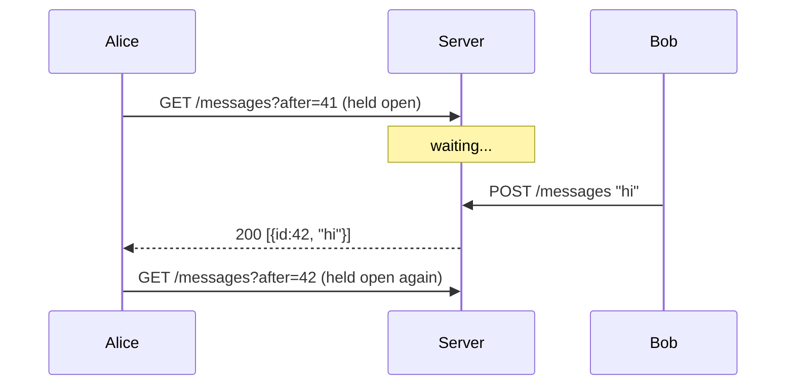
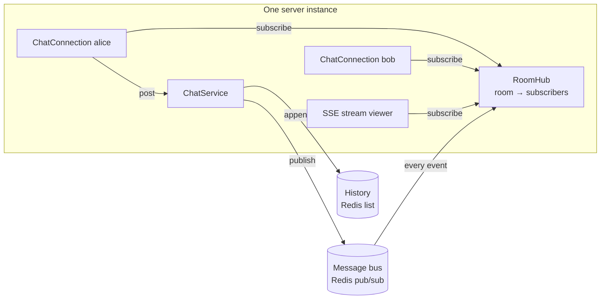
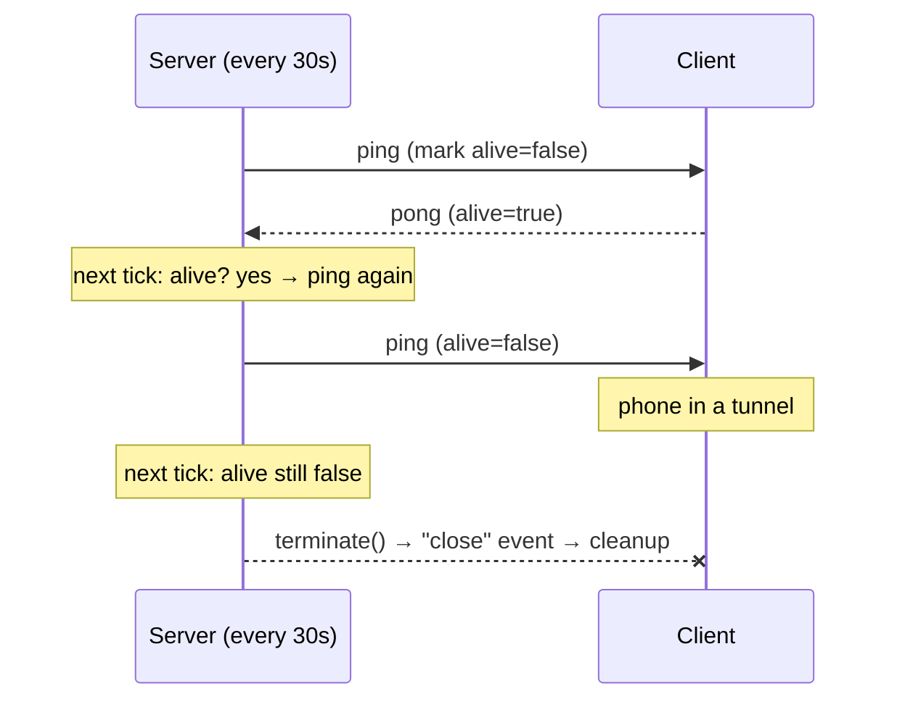
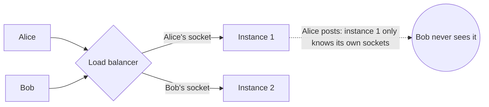
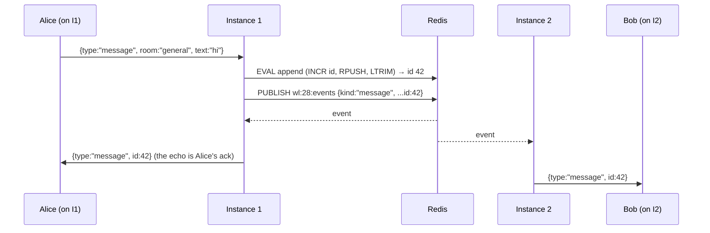
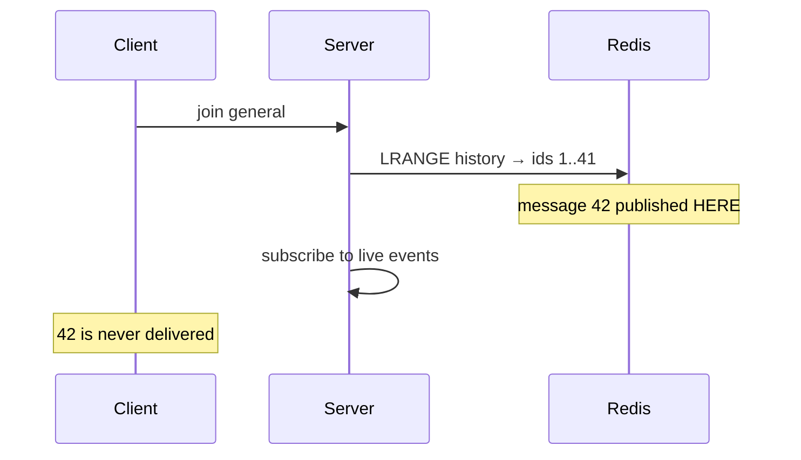

# 28 · Real-time Systems

> Everything you've built so far answers when asked. Chat, live dashboards, notifications, collaborative editors and order tracking work the other way round: the **server** has news and has to get it to the client now. Doing that for one process is easy. Doing it for 50 processes behind a load balancer, with flaky mobile networks and without losing messages, is a real systems problem, and a very common interview topic.

**Time:** ~6h · **Challenge:** 🛠️ Build · **Prereqs:** [17 · Redis Fundamentals](../17-redis-fundamentals/README.md), [22 · Auth](../22-auth/README.md) · **Services:** 🟥 Redis

## What you'll learn

- The four ways to push data to a client (polling, long polling, Server-Sent Events, WebSockets) and how to choose between them
- What actually happens on the wire: the HTTP upgrade handshake, frames, close codes, ping/pong
- How to use the `ws` library on the same port as your Express app
- Authenticating a connection **before** you accept it
- Rooms (channels) and a clean per-instance fan-out design
- Heartbeats: detecting dead connections that TCP doesn't tell you about
- Backpressure: what a slow client does to your memory and how to protect yourself
- The horizontal scaling problem and how Redis pub/sub solves it (and sticky sessions don't)
- Delivery guarantees: why pub/sub is at-most-once, and how message ids, history and resume close the gap
- Presence ("who's online") and why it's harder than it looks

---

## 1. The problem: HTTP is request → response

HTTP's model is simple: the client asks, the server answers, done. The server cannot speak first. That's fine for "load my profile", but terrible for "tell me when Bob sends a message".

There are four common workarounds. Let's look at each with the same question in mind: *when Bob posts, how fast does Alice see it, and what does it cost?*

### Polling

The client asks every N seconds: "anything new since message 41?"

```ts
setInterval(async () => {
  const res = await fetch(`/rooms/general/messages?after=${lastId}`);
  for (const m of await res.json()) render(m);
}, 3000);
```

- **Latency:** up to N seconds (average N/2).
- **Cost:** one full HTTP request per client per interval, even when nothing happened. 10,000 idle clients polling every 3s is ~3,300 requests/second of pure "no".
- **Upside:** dead simple, works through every proxy, stateless on the server, scales like any REST endpoint. Don't underestimate this: for a dashboard that updates every 30 seconds, polling is the right answer.

### Long polling

The client asks, and the server **holds the request open** until there is something to say (or a timeout, say 30s). As soon as the response arrives, the client asks again.



- **Latency:** near-instant.
- **Cost:** one open request per client, plus a new request after every message. Messages that arrive in the gap between "response sent" and "next request arrives" must be buffered (which is why the `after=` id matters).
- This was how real-time web worked before WebSockets (early Facebook chat, Comet). You'll still see it as a fallback.

### Server-Sent Events (SSE)

One long-lived HTTP response that **never ends**. The server writes events into it as text:

```
id: 42
event: message
data: {"user":"bob","text":"hi"}

id: 43
event: message
data: {"user":"bob","text":"you there?"}

```

The browser has a built-in client, `EventSource`, which parses this format, **reconnects automatically**, and on reconnect sends a `Last-Event-ID` header so the server can replay what was missed.

```ts
const source = new EventSource("/rooms/general/events");
source.addEventListener("message", (e) => render(JSON.parse(e.data)));
```

- **Latency:** instant.
- **Direction:** server → client only. The client sends things with ordinary `POST` requests.
- **Upside:** it's just HTTP. It works with your existing auth cookies, load balancers, HTTP/2 multiplexing and your existing middleware. Resume is built into the protocol. This is how most LLM chat UIs stream tokens.
- **Downside:** text only, one direction. On HTTP/1.1 browsers allow only ~6 connections per domain, so many tabs can starve each other (HTTP/2 fixes this).

### WebSockets

A full-duplex, message-oriented connection. It starts as an HTTP request that asks to **upgrade**, then the same TCP connection switches protocols and both sides can send frames at any time.

- **Latency:** instant, both directions.
- **Upside:** bidirectional, low overhead per message (2–14 bytes of framing vs hundreds of bytes of HTTP headers), binary support.
- **Downside:** it's no longer HTTP after the handshake. Your middleware, your status codes, your caching, your request logs: none of it applies to individual messages. You design your own protocol, your own error handling, your own reconnect and resume. Some corporate proxies still break it.

### Choosing

| | Polling | Long polling | SSE | WebSocket |
|---|---|---|---|---|
| Direction | client pulls | client pulls | server → client | both |
| Latency | interval | ~instant | instant | instant |
| Idle cost | high (requests) | medium | low (open conn) | low (open conn) |
| Works with plain HTTP tooling | ✅ | ✅ | ✅ | handshake only |
| Auto reconnect + resume | DIY | DIY | ✅ built in | DIY |
| Good for | slow dashboards, job status | legacy fallback | feeds, notifications, streaming output | chat, games, collaboration, anything interactive |

**Rule of thumb:** if the client mostly *listens*, use SSE. If the client and server have a *conversation* (typing indicators, game moves, cursors), use WebSockets. If "within 30 seconds" is fine, poll and save yourself the trouble.

In the challenge you'll build both: WebSockets for chat participants and an SSE feed for read-only viewers (think "embed this channel on a status page").

## 2. WebSockets on the wire

### The handshake

```http
GET /ws?token=abc HTTP/1.1
Host: chat.example.com
Upgrade: websocket
Connection: Upgrade
Sec-WebSocket-Key: dGhlIHNhbXBsZSBub25jZQ==
Sec-WebSocket-Version: 13
```

```http
HTTP/1.1 101 Switching Protocols
Upgrade: websocket
Connection: Upgrade
Sec-WebSocket-Accept: s3pPLMBiTxaQ9kYGzzhZRbK+xOo=
```

The `Sec-WebSocket-Accept` value is a hash of the client's key plus a fixed GUID. It proves the server understood the WebSocket protocol (it's not security). After the `101`, HTTP is over on that connection.

The important consequence: **the handshake is your last chance to use HTTP semantics.** You can still answer `401` or `404` with a normal HTTP response. After the upgrade, the only way to say "no" is to close the socket with a close code.

### Frames

After the handshake, data travels as **frames**. You rarely touch them directly, but you should know the types:

| Opcode | Frame | Notes |
|---|---|---|
| 0x1 | text | UTF-8. Your JSON goes here. |
| 0x2 | binary | Protobuf, images, anything. |
| 0x8 | close | Carries a code + reason. Both sides send one ("close handshake"). |
| 0x9 / 0xA | ping / pong | Control frames. The peer must answer a ping with a pong. |

A WebSocket is **message-oriented**: one `send("...")` arrives as exactly one `message` event on the other side, never split or merged (unlike raw TCP). That's why a simple "one JSON object per message" protocol works.

Common close codes:

| Code | Meaning | Typical use |
|---|---|---|
| 1000 | Normal closure | client logged out |
| 1001 | Going away | server shutting down, tab closed |
| 1008 | Policy violation | auth expired mid-connection |
| 1009 | Message too big | frame over `maxPayload` |
| 1011 | Internal error | server bug |
| 1013 | Try again later | server overloaded, slow consumer |
| 1006 | Abnormal (never sent on the wire) | what you *observe* when the TCP connection just died |

### `ws` in Node, sharing a port with Express

Browsers have `WebSocket` built in. In Node, the standard server library is [`ws`](https://github.com/websockets/ws). Rather than letting `ws` own a port, attach it to the same `http.Server` your Express app runs on, and handle the upgrade yourself:

```ts
import { createServer } from "node:http";
import { WebSocketServer } from "ws";

const app = createApp(deps);              // Express: never sees upgrade requests
const server = createServer(app);
const wss = new WebSocketServer({ noServer: true, maxPayload: 16 * 1024 });

server.on("upgrade", (req, socket, head) => {
  const user = authenticate(req);          // see section 3
  if (!user) {
    socket.write("HTTP/1.1 401 Unauthorized\r\nConnection: close\r\n\r\n");
    socket.destroy();
    return;
  }
  wss.handleUpgrade(req, socket, head, (ws) => onConnection(ws, user));
});

function onConnection(ws: WebSocket, user: string) {
  ws.on("message", (data, isBinary) => { /* parse, validate, dispatch */ });
  ws.on("close", (code, reason) => { /* clean up rooms, presence */ });
  ws.on("error", (err) => { /* log; "close" follows */ });
  ws.send(JSON.stringify({ type: "welcome", user }));
}
```

`noServer: true` is the key: you decide which requests get upgraded. `maxPayload` caps the size of a single incoming message, and it's your first line of defense against a client sending 500 MB.

### Design your protocol

Since there's no HTTP inside the socket, you need your own envelope. The universal pattern is a JSON object with a `type` discriminator, which maps beautifully onto a TypeScript discriminated union and a zod schema (module 07/08):

```ts
type ClientMessage =
  | { type: "join"; room: string }
  | { type: "leave"; room: string }
  | { type: "message"; room: string; text: string };

const ClientMessageSchema = z.discriminatedUnion("type", [
  z.object({ type: z.literal("join"), room: RoomName }),
  z.object({ type: z.literal("leave"), room: RoomName }),
  z.object({ type: z.literal("message"), room: RoomName, text: z.string().trim().min(1).max(500) }),
]);
```

Every frame from a client is **untrusted input**, exactly like a request body. Validate it at the edge, and answer bad input with an error *message* (`{ type: "error", code: "INVALID_MESSAGE" }`) instead of closing the socket. One typo from a client shouldn't cost them their connection.

## 3. Authentication on upgrade

Authenticate during the handshake, before you call `handleUpgrade`. Rejecting there costs a few bytes of HTTP. Accepting first and checking a "login" message later means every anonymous client gets a socket, buffers and a slot in your heartbeat loop, which is a gift to anyone trying to exhaust your server.

How does the client prove who it is?

| Option | Notes |
|---|---|
| **Cookie** | Browsers send cookies on the upgrade request automatically. Great if your app already uses session cookies (module 22). **Check the `Origin` header**, because cross-site WebSocket hijacking is CSRF for sockets. |
| **Query string token** `?token=` | Works everywhere (the browser `WebSocket` API can't set custom headers). Downside: URLs end up in access logs. Use a **short-lived, single-use ticket**: the client calls `POST /ws-ticket` with its normal auth, gets a token valid for 30 seconds, connects with it. |
| `Sec-WebSocket-Protocol` header trick | Smuggles a token in the subprotocol list. Works, but it's a hack. |
| Auth message after connect | Simple, but you accept unauthenticated sockets first. Needs a short timeout. |

The challenge uses a signed token in the query string to keep things simple. A long connection outlives its credentials, too: a session revoked at 10:00 doesn't close a socket opened at 09:00. Production systems either re-check periodically or push a "revoked" event that closes the socket with `1008`.

## 4. Rooms and fan-out on one instance

A **room** (or channel, or topic) is a named group of connections that should receive the same events. On a single process the data structure is just:

```ts
Map<string /* room */, Set<Subscriber>>
```

A clean design separates three things:



- **Connections** (WebSocket or SSE) are transport. They parse input and format output.
- **The hub** is local fan-out. It doesn't know about sockets: a "subscriber" is anything with a `deliver(event)` method. That's why the same hub can feed WebSockets, SSE streams and tests.
- **The service** holds the business operations (`post`, `announce`, `history`) and talks to repositories and the bus through interfaces. No `ws`, no Express.

Two details that save you from production bugs:

- **Remove empty rooms.** If the last subscriber leaves and you keep an empty `Set` in the map, every room name ever used stays in memory forever. In a system where room names are user ids or document ids, that's a slow leak.
- **Isolate subscribers.** If one subscriber throws during `dispatch`, catch it and keep delivering to the others. One broken socket must not silence a room.

### Ordering inside a connection

Message handlers are async (they hit Redis). If a client sends `join` and then `message` immediately, and you handle frames concurrently, the `message` handler can run while `join` is still awaiting history, and fail with "not in room". Process each connection's frames **one at a time** with a simple promise chain:

```ts
receive(raw: string) {
  this.queue = this.queue.then(() => this.handle(raw)).catch(reportError);
  return this.queue;
}
```

Different connections still run concurrently. You only serialize per client, which is exactly the ordering a client can observe.

## 5. Heartbeats: detecting the dead

TCP doesn't tell you when the other side disappears. A laptop lid closes, a phone goes into a tunnel, a NAT gateway silently drops its mapping: no FIN, no RST, nothing. From the server's point of view the socket is open, forever. Multiply that by every flaky mobile client and you accumulate thousands of **zombie connections**: memory, file descriptors, and users shown as "online" who left an hour ago.

The fix is an application-level heartbeat with ping/pong frames:



```ts
const interval = setInterval(() => {
  for (const ws of wss.clients) {
    if (!alive.get(ws)) { ws.terminate(); continue; }   // missed the last ping
    alive.set(ws, false);
    ws.ping();
  }
}, HEARTBEAT_MS);
```

- Use `terminate()`, not `close()`. `close()` starts a polite close handshake that a dead peer will never complete.
- Browsers answer pings automatically (and the browser API can't send pings), so the server drives the heartbeat.
- Heartbeats also keep idle connections alive through load balancers and proxies that kill connections idle for 60s or so. Pick an interval shorter than the shortest idle timeout on the path.
- SSE needs the same thing: send a comment line (`: keep-alive`) every 15–30s. Comments are ignored by `EventSource` but keep proxies from closing the stream.

## 6. Backpressure and slow consumers

`ws.send()` doesn't wait for the client to receive anything. It appends to an in-memory buffer that the kernel drains as fast as the client reads. If a client reads slower than you write (bad network, a frozen tab, a malicious client that simply stops reading), that buffer grows. `ws.bufferedAmount` tells you how big it is.

In a busy room, one slow client can make the process hold megabytes per message for them. A thousand slow clients and the process runs out of memory, taking every healthy client down with it.

Your options for a slow consumer:

1. **Disconnect it** (close code 1013 "try again later"). It will reconnect and resume from its last message id. Simple and robust: this is what the challenge does.
2. **Drop messages for it** and flag that it missed some (fine for stock tickers or cursor positions where only the latest value matters).
3. **Coalesce**: keep only the latest state per key and send that when the buffer drains.

What you must never do is keep calling `send()` without looking. The same idea appears everywhere in this curriculum: in Node streams (module 01), in queues (module 20) and in load shedding (module 29). Unbounded buffers turn a slow component into an outage.

## 7. Scaling out: the multi-instance problem

One instance can hold tens of thousands of WebSockets, but eventually you need two, and you'll want two anyway for availability. Then this happens:



Each instance's hub only knows its own sockets.

### Sticky sessions don't solve this

"Sticky sessions" (session affinity) make the load balancer send a given client to the same instance every time. That's useful for *long polling and SSE reconnects* that keep per-connection state in memory. But it doesn't help here: Alice and Bob are different clients, so they can still land on different instances. Stickiness solves "my requests find my state", not "my events reach other people".

### A shared message bus

Every instance publishes the events that happen on it to a shared bus, and every instance subscribes to everything:



Notice that instance 1 **doesn't deliver directly** to Alice or to its other local members. It publishes and delivers what comes back, like everyone else. One delivery path means one place for ordering, dedupe and bugs, and the sender's echo (with the server-assigned id) doubles as an acknowledgement.

### Redis pub/sub essentials

- `PUBLISH channel payload` sends to every connection currently `SUBSCRIBE`d to that channel. It returns the number of receivers.
- A connection in subscriber mode **can't run other commands**. You need a separate connection for `PUBLISH` and everything else (ioredis `redis.duplicate()`).
- Pub/sub channels are **global to the Redis server**: they ignore the database index (`/12` in the URL). Prefix channel names (`wl:28:events`) just like keys.
- No persistence, no acknowledgement, no replay: if an instance isn't connected at the moment of `PUBLISH`, it never gets that message. That's **at-most-once delivery**, which leads to the next section.

**One channel or one per room?** The challenge uses one channel for all rooms, and each instance filters locally. Simple, and fine for thousands of messages per second. At larger scale every instance receives every room's traffic, so you'd subscribe per room (`chat:room:general`) only while a local member is in that room. Past that, people move to Redis Streams, Kafka (module 32) or NATS, or a dedicated real-time gateway. See [docs/scaling-realtime.md](docs/scaling-realtime.md).

## 8. Delivery guarantees, history and resume

Be honest about what your system guarantees:

| Guarantee | Meaning | What it takes |
|---|---|---|
| At-most-once | each message delivered 0 or 1 times | fire and forget (pub/sub, plain `send`) |
| At-least-once | delivered 1+ times, maybe duplicated | acks + retries + durable storage |
| Exactly-once *processing* | duplicates are harmless | at-least-once + idempotent handling (dedupe by id) |

Pub/sub plus WebSockets is at-most-once: a message published while a client is reconnecting is simply gone from the live path. The standard fix is to make the **live path a fast, lossy optimization** on top of a **durable, ordered log**:

1. Every message gets a **monotonic id per room** when it's stored (Redis `INCR` inside the same Lua script that appends to the history list, so id order equals list order).
2. Clients remember the last id they've seen.
3. On (re)connect, the client asks for everything after that id (`Last-Event-ID` in SSE does this for you), then continues with live events.
4. Clients drop any message with an id they've already seen.

### The gap between "load history" and "subscribe"

There's a classic race when a client joins:



The fix: **subscribe first, buffer, then load history, then flush the buffer while skipping ids you've already sent.** Message 42 is either in the history (skip the buffered copy) or only in the buffer (deliver it). Either way, no gap and no duplicate. You'll implement exactly this as `subscribeWithBackfill`, and both the WebSocket join and the SSE feed use it.

## 9. Presence

"Who's online in this room?" sounds trivial and isn't:

- A user can have **several connections** (two tabs, phone + laptop). They're online until the *last* one leaves.
- Connections die without saying goodbye, so "leave" events are delayed by up to two heartbeat intervals and can be lost entirely if an instance crashes.
- Across instances you need shared state.

The usual production design keeps presence in Redis with expiry, refreshed by heartbeats: for example a sorted set per room with `ZADD presence:general <now> alice` on every heartbeat, and members whose score is older than 60s are considered gone. A crashed instance's users then expire on their own. The challenge does the simpler part: broadcasting `join`/`leave` presence events across instances, including a `leave` when the heartbeat kills a dead client. Full presence is a stretch goal.

## Common mistakes

- **Accepting the socket, then authenticating.** Reject during the upgrade.
- **No heartbeat.** Zombie connections pile up; "online" indicators lie.
- **Ignoring `bufferedAmount`.** One stalled client grows a buffer until the process dies.
- **Delivering locally *and* via the bus.** The sender's instance delivers twice, or the order differs between instances. Pick one path.
- **"Load history, then subscribe."** Messages in the gap vanish. Subscribe first, dedupe by id.
- **Using one Redis connection for SUBSCRIBE and commands.** ioredis will reject normal commands on a subscribed connection.
- **Forgetting that pub/sub ignores the DB index.** Two environments sharing a Redis server see each other's events unless channels are prefixed.
- **Not cleaning up on `close`.** Every leaked subscriber is a closure holding a dead socket.
- **Treating each frame as trusted.** Validate every message; cap sizes with `maxPayload`.
- **Concurrent handling of one client's frames.** `join` then `message` races. Serialize per connection.
- **Forgetting proxies.** nginx needs `proxy_http_version 1.1` plus the `Upgrade`/`Connection` headers for WebSockets, and `proxy_buffering off` (or `X-Accel-Buffering: no`) for SSE.

## In production

- **Connection counts are a capacity dimension.** A WebSocket server is limited by memory per connection and file descriptors (`ulimit -n`), not just requests per second. Track open connections as a gauge (module 24).
- **Deploys disconnect everyone.** A rolling deploy closes every socket on the old pods. Clients must reconnect with **exponential backoff plus jitter**, or 100,000 clients reconnect in the same second and stampede the new pods (the "thundering herd", see module 29). Close with `1001` so clients know it was intentional.
- **Load balancers** need long idle timeouts (AWS ALB defaults to 60s; your heartbeat must be shorter) and must support upgrades. L4 (TCP) balancers pass WebSockets through untouched.
- **Managed options exist**: AWS API Gateway WebSockets, Ably, Pusher, Azure Web PubSub. They take connection handling off your hands; you still design the protocol and resume.
- **Big players** split the system: a stateless fleet of connection gateways that only hold sockets, and a backend that routes messages to the right gateway (Slack, Discord and WhatsApp all describe variations of this). You'll design one in [module 30](../30-system-design/README.md).

## Check yourself

1. A product manager wants a live "orders shipped today" counter on an internal dashboard. Which transport would you pick and why?
   <details><summary>Answer</summary>SSE (or even polling every 10–30s). Data flows one way, it's plain HTTP so auth and proxies just work, and EventSource reconnects and resumes for free. WebSockets would add protocol and infra complexity for no benefit.</details>
2. Why authenticate in the `upgrade` handler rather than after the connection opens?
   <details><summary>Answer</summary>Before the upgrade you can still answer with a cheap HTTP 401 and never allocate a socket, buffers or heartbeat state for an anonymous client. After the upgrade you've already paid that cost, and HTTP status codes are no longer available.</details>
3. Your server shows 40,000 open connections but analytics says 15,000 users are active. What's the likely cause?
   <details><summary>Answer</summary>Zombie connections: peers that vanished without a TCP close. Without a ping/pong heartbeat that terminates unresponsive sockets, they stay "open" indefinitely.</details>
4. Do sticky sessions let two users on different instances chat with each other? What does?
   <details><summary>Answer</summary>No. Stickiness pins one client to one instance; it doesn't connect instances. A shared message bus (Redis pub/sub, Kafka, NATS) where every instance publishes its events and subscribes to everyone else's does.</details>
5. Redis pub/sub is at-most-once. How does the chat still avoid losing messages for a client that briefly disconnects?
   <details><summary>Answer</summary>Messages are stored in history with monotonic per-room ids. The client remembers its last id and on reconnect gets everything after it (Last-Event-ID for SSE), then continues live, deduplicating by id. The live path can be lossy because the log is the source of truth.</details>

## Further reading

- RFC 6455, The WebSocket Protocol: https://datatracker.ietf.org/doc/html/rfc6455
- MDN, Writing WebSocket servers: https://developer.mozilla.org/en-US/docs/Web/API/WebSockets_API/Writing_WebSocket_servers
- MDN, Using server-sent events: https://developer.mozilla.org/en-US/docs/Web/API/Server-sent_events/Using_server-sent_events
- HTML Living Standard, Server-sent events: https://html.spec.whatwg.org/multipage/server-sent-events.html
- `ws` README (heartbeat example, `noServer`, `handleUpgrade`): https://github.com/websockets/ws
- Redis Pub/Sub: https://redis.io/docs/latest/develop/interact/pubsub/
- Deep dives in this module: [docs/websocket-protocol.md](docs/websocket-protocol.md) · [docs/scaling-realtime.md](docs/scaling-realtime.md) · [docs/realtime-cheatsheet.md](docs/realtime-cheatsheet.md)

## ➡️ Next: [the challenge](CHALLENGE.md)
