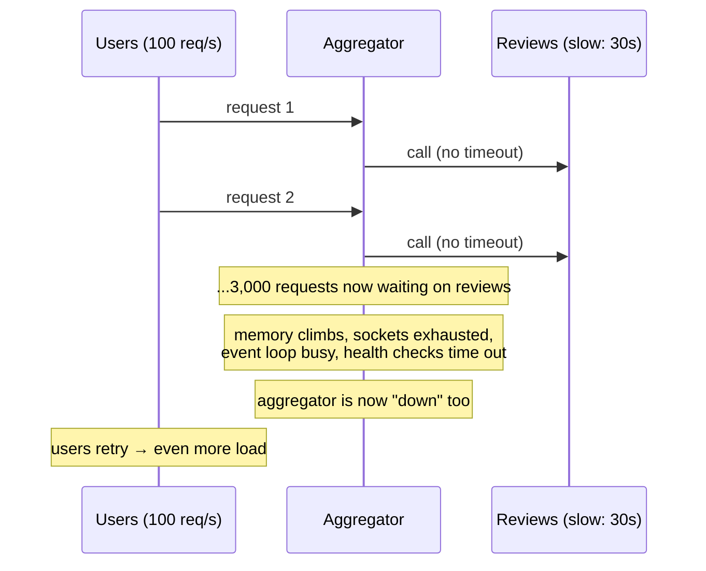
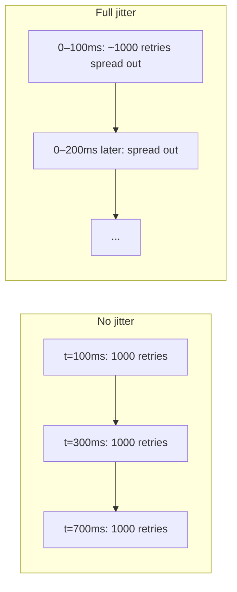
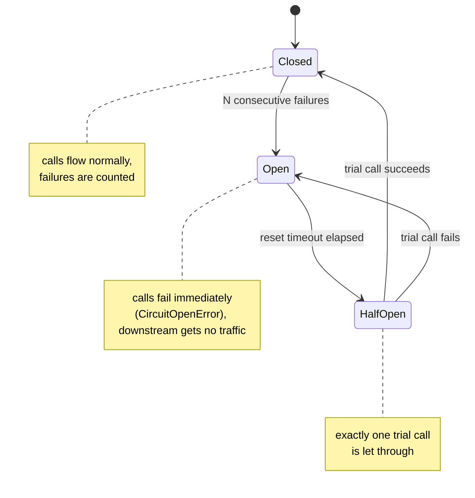
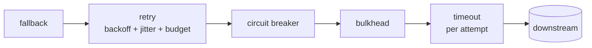

# 29 · Reliability & Scaling

> Your service will depend on things that fail: databases, other teams' APIs, payment providers, DNS. Most big outages aren't one thing breaking. They're one slow thing making everything that waits on it slow too, until the whole system tips over. This module is about the small set of patterns that stop that chain reaction, and about how to reason about capacity before you need it.

**Time:** ~7h · **Challenge:** 🛠️ Build · **Prereqs:** [19 · Rate Limiting](../19-rate-limiting/README.md), [24 · Observability](../24-observability/README.md) · **Services:** none

## What you'll learn

- The difference between scalability and reliability, and why you need both
- Vertical vs horizontal scaling, and why horizontal scaling requires stateless services
- What load balancers do (L4 vs L7, balancing algorithms, health checks)
- How a single slow dependency causes **cascading failure**
- **Timeouts** on every call, and how to choose them from a latency budget
- **Retries** done right: only for transient errors, with exponential backoff, jitter, a cap and a **retry budget**
- **Circuit breakers**: the three states and why failing fast helps everyone
- **Bulkheads** and concurrency limits, **load shedding** and backpressure
- **Graceful degradation**: fallbacks, partial responses, stale caches
- Capacity planning with **Little's law**, load testing with k6, and SLOs as the target for all of it

---

## 1. Scalability vs reliability

Two different questions:

- **Scalability:** can the system handle more load by adding resources? If traffic doubles, can you double the machines and be fine?
- **Reliability:** does the system keep doing the right thing when parts of it fail? Because parts of it *will* fail, all the time.

They're related (an overloaded system becomes unreliable) but distinct. A single beefy server can be perfectly reliable until the day its disk dies. A system of 200 auto-scaled instances can still go down in minutes because they all call one fragile dependency without timeouts.

### Vertical vs horizontal scaling

| | Vertical ("scale up") | Horizontal ("scale out") |
|---|---|---|
| How | bigger machine: more CPU, RAM | more machines behind a load balancer |
| Limits | the biggest machine you can buy; cost grows faster than capacity | coordination, shared state |
| Failure | one box = one point of failure | lose one instance, the rest keep serving |
| Code changes | none | services must be **stateless** |

Vertical scaling is underrated: it's simple, and a modern server is enormous. Databases in particular are usually scaled vertically first (plus read replicas). But for application servers, horizontal is the default, mostly for reliability: you want at least two of everything.

### Stateless services

An instance is **stateless** when any instance can handle any request, because nothing a request needs lives only in one process's memory. Sessions go to Redis (module 22), files go to object storage, jobs go to a queue (module 20), caches are either shared (Redis) or safe to lose.

You've seen the exception: WebSockets (module 28) hold connection state, which is exactly why scaling them needed a shared bus. When someone says "just add more instances", the first question is "where does the state live?".

## 2. Load balancers

A load balancer spreads requests over instances and stops sending traffic to broken ones.

```mermaid
flowchart LR
  C[Clients] --> LB{Load balancer}
  LB --> A[instance A ✅]
  LB --> B[instance B ✅]
  LB -.x.-> X[instance C ❌<br/>failed health checks]
```

**L4 vs L7:**

| | L4 (transport) | L7 (application) |
|---|---|---|
| Sees | TCP/UDP connections, IPs, ports | HTTP: paths, headers, cookies |
| Can do | spread connections | route `/api` vs `/static`, retries, header-based routing, TLS termination |
| Examples | AWS NLB, IPVS | nginx, Envoy, HAProxy (http mode), AWS ALB, Kubernetes Ingress |

**Algorithms:**

- **Round robin:** next instance in turn. Fine when requests are similar.
- **Least connections / least outstanding requests:** pick the instance with the fewest in-flight requests. Much better when request durations vary, because a slow instance naturally gets fewer new requests.
- **Consistent hashing:** the same key (user id, cache key) goes to the same instance, which is useful for cache locality. Module 30 covers this.
- **Power of two choices:** pick two instances at random and send to the less loaded. Almost as good as least-connections without global state.

**Health checks** come in two flavours. Active checks call `GET /health` every few seconds. Passive checks watch real traffic, e.g. nginx's `max_fails`. A key subtlety from module 24: a **liveness** check should only answer "is this process alive?", never "are my dependencies healthy?". If every instance's health check calls the database and the database blips, the load balancer marks *every* instance as dead and you've converted a partial outage into a total one. The challenge's `/health` deliberately ignores downstreams.

`challenge/deploy/nginx.conf` is a commented example of nginx balancing two instances.

## 3. How cascading failures happen

Here's the most important diagram in this module. A product page calls three services. The reviews service gets slow (not down, just slow: a bad query, GC pauses, a noisy neighbour):



Nothing in the aggregator is broken. It's just **waiting**. With no timeout, every request holds memory and a socket until reviews answers. Requests arrive at 100/s and leave at nearly 0/s, so they pile up (this is Little's law, section 10). Soon the aggregator can't answer anything, including requests that don't need reviews at all, and every service that calls the aggregator starts piling up in turn. Then users press refresh, and clients with naive retries multiply the load further.

Every pattern in this module attacks a link in that chain:

| Link in the chain | Pattern |
|---|---|
| Waiting forever | **Timeouts** |
| Hammering a struggling service | **Backoff + jitter, retry budgets, circuit breakers** |
| One dependency consuming all capacity | **Bulkheads** |
| Accepting more work than you can do | **Load shedding** |
| All-or-nothing responses | **Graceful degradation / fallbacks** |

## 4. Timeouts everywhere

A call without a timeout is a promise to wait forever. Every network call needs one: HTTP clients, database queries (`statement_timeout`), Redis commands, queue operations, DNS.

In Node, the idiomatic tool is `AbortController`:

```ts
async function withTimeout<T>(fn: (signal: AbortSignal) => Promise<T>, ms: number): Promise<T> {
  const controller = new AbortController();
  const timer = setTimeout(() => controller.abort(new TimeoutError(ms)), ms);
  try {
    return await fn(controller.signal);   // fn passes the signal to fetch()
  } finally {
    clearTimeout(timer);
  }
}

await withTimeout((signal) => fetch(url, { signal }), 250);
```

Two things matter:

1. **Cancel, don't just stop waiting.** `Promise.race` against a timer stops *you* waiting, but the underlying request keeps running, holding a socket and still loading the downstream. Passing the `AbortSignal` into `fetch` actually closes the request. (`AbortSignal.timeout(ms)` exists too; building it yourself lets you share one signal and control the error type.)
2. **Pick the number from a budget, not from a gut feeling.** Too long and the timeout doesn't protect you. Too short and you fail requests that would have succeeded.

### Choosing timeouts: the latency budget

Start from what the *caller* can tolerate and work inwards. Say the product page must answer within 1 second:

```
page budget                         1000 ms
pricing: 3 attempts × 250 ms         750 ms
         + backoff (≤ 50 + 100 ms)   150 ms
                                    ------
                                     900 ms  ✅ fits, with margin for our own work
```

Then sanity-check against the dependency's real latency: if pricing's p99 is 180 ms, a 250 ms timeout only cuts off the pathological tail. If its p99 is 400 ms, a 250 ms timeout fails 1%+ of normal requests and you need a different plan (a bigger budget, a cache, or making it optional).

**Timeouts must shrink as you go deeper.** If the page's timeout is 1s, the aggregator's call to pricing must be shorter, and pricing's call to its database shorter still. Otherwise the outer layer gives up while inner layers keep working on a request nobody is waiting for. Large systems propagate a **deadline** with the request (gRPC does this natively) so every hop knows how much time is left.

## 5. Retries, done right

Retries turn transient failures (a dropped connection, a pod restarting, a brief 503) into successes. Done badly, they turn a small problem into an outage.

### Only retry what can succeed next time

| Retry | Don't retry |
|---|---|
| timeouts, connection resets | 400 / 422: the request is wrong |
| 502, 503, 504 | 401 / 403: you're not allowed |
| 429 (after `Retry-After`) | 404: it isn't there |
| | an open circuit breaker or a full bulkhead: that's the system telling you to back off |

**And only retry idempotent operations** (or make them idempotent with an idempotency key, module 15/23). A `POST /payments` that timed out may have succeeded, and retrying it blindly charges the customer twice.

### Exponential backoff with jitter

Retrying immediately hits the struggling service again at exactly the wrong moment. Wait, and wait longer each time:

```
delay(attempt) = min(maxDelay, base × 2^(attempt-1))
base 100ms → 100, 200, 400, 800, 1600, ... (capped)
```

But if 1,000 clients all failed at the same moment, they now all retry at +100ms, then all at +300ms: synchronized waves that look like a DDoS. **Jitter** randomizes the delay to spread them out. "Full jitter" is simple and works very well:

```ts
const capped = Math.min(maxDelayMs, baseDelayMs * 2 ** (attempt - 1));
const delay = Math.floor(Math.random() * capped);   // anywhere in [0, capped)
```



### Retry amplification and retry budgets

Here's the trap. Your service retries 3 times. It calls a service that also retries 3 times, which calls a database client that retries 3 times. When the database struggles, one user request becomes 3 × 3 × 3 = **27** database attempts. Retries multiply across layers, and they multiply precisely when the system is already overloaded.

Defenses:

- **Retry at one layer only**, usually the one closest to the user or the one that knows whether the operation is idempotent.
- **Cap attempts** (2–3 total is typical).
- Use a **retry budget**: retries are allowed only as a fraction of successful traffic, say 10%. When a dependency is healthy, occasional failures get retried. When it's failing broadly, the budget runs dry and you stop retrying almost entirely, so you don't kick it while it's down. The challenge implements one as a token bucket: each success earns 0.1 tokens, each retry costs 1. (Google's SRE book and gRPC's retry throttling both describe this idea.)

## 6. Circuit breakers

A timeout bounds how long *one* call can hurt you. But if pricing has been timing out for the last 30 seconds, why keep sending it requests that will each cost you 250 ms and add load to a service that's trying to recover? A **circuit breaker** remembers recent failures and short-circuits calls while a dependency is known to be bad.



- **Closed:** normal. Count consecutive failures (or the failure rate over a window). A success resets the count.
- **Open:** every call fails instantly, without touching the network. Your requests become fast (and can use a fallback), and the downstream gets breathing room.
- **Half-open:** after the reset timeout, let **one** trial call through. Success means it's recovered (close); failure means it isn't (open again, restart the timer). Allowing only one trial matters: letting everyone through at once is a thundering herd onto a service that just came back.

What counts as a failure is a design decision. Timeouts and 5xx: yes. A 404 for a product that doesn't exist: no, that's a healthy service giving a correct answer. If 404s tripped the breaker, a crawler requesting junk ids could take down your product pages.

Real libraries (Polly in .NET, resilience4j in Java, `opossum` in Node, Envoy's outlier detection at the proxy level) usually use a failure *rate* over a sliding window with a minimum request count. The challenge uses consecutive failures, which is simpler and teaches the same state machine.

## 7. Bulkheads, concurrency limits and load shedding

Ships are divided into watertight compartments (bulkheads) so one hull breach doesn't sink the whole ship. In software: **give each dependency its own limited pool of capacity**, so one slow dependency can only exhaust its own pool.

```ts
const pricingBulkhead = new Bulkhead({ maxConcurrent: 30, maxQueue: 30 });
await pricingBulkhead.run(() => pricing.getPrice(id, signal));
// The 61st concurrent caller is rejected immediately (BulkheadFullError).
```

Without it, if pricing hangs, every request ends up waiting on pricing and nothing else gets served. With it, at most 30 requests are stuck on pricing and the rest fail fast for pricing (and use the fallback) while catalog and reviews keep working normally.

This is the same idea as a connection pool size (module 13), a worker's concurrency setting (module 20) or a Kubernetes resource limit (module 34). Bounded concurrency is a recurring theme because **unbounded queues hide overload until it's catastrophic**.

### Load shedding

When you're at capacity, the kindest thing you can do is reject excess work *immediately* instead of accepting it and serving everyone slowly. A fast `503 Service Unavailable` with `Retry-After` lets clients back off or try another instance. A slow timeout after 30 seconds helps nobody and keeps consuming your resources the whole time.

Shed early and cheaply: at the load balancer, in a middleware that checks in-flight request count or event loop lag, or with a bulkhead in front of each expensive dependency. And when shedding, prefer to drop less important traffic first (background refreshes before user-facing checkouts).

### Backpressure

Backpressure is the general principle behind all of this: a component that can't keep up must **push back** on its producers instead of buffering without bound. Node streams do it with `write()` returning `false` (module 01). WebSockets do it with `bufferedAmount` (module 28). Queues do it with max length. HTTP services do it with 429/503. The common failure is a hidden unbounded buffer somewhere (an in-memory array, an unbounded queue, an HTTP agent with no socket limit) that absorbs overload silently until memory runs out.

## 8. Graceful degradation and fallbacks

Not every part of a response is equally important. Decide in advance what happens when each dependency fails:

| Dependency | Importance | Fallback |
|---|---|---|
| catalog (name, description) | **critical**: no product, no page | fail the request: 404 or 503 + Retry-After |
| pricing | important | last known good price, clearly marked `stale: true`; else `null` |
| reviews | nice to have | omit them (`null`) |

The response tells the client what happened:

```json
{
  "data": { "product": {...}, "price": { "amount": 1999, "currency": "EUR", "stale": true }, "reviews": null },
  "degraded": true,
  "unavailable": ["pricing", "reviews"]
}
```

A frontend can then render "price may be out of date" and hide the reviews widget, instead of showing an error page. Netflix's famous example: if the personalized recommendations service fails, show a generic "popular now" row. The user barely notices.

### Caching as resilience

A cache isn't only a performance tool (module 18). A **last-known-good** cache lets you serve a slightly stale answer when the source is down, which is usually far better than no answer. HTTP has this built in: `Cache-Control: stale-if-error=86400` tells caches they may serve a stale response for a day if the origin fails. Bound the staleness and be honest about it in the response. Some data must never be stale (an account balance at checkout), so the fallback is a per-field business decision, not a technical one.

## 9. Putting the patterns together

The order in which you wrap a call matters. The challenge uses this stack, outermost first:



Why this order:

- **Timeout innermost, per attempt**, so each try gets its own deadline and a hung attempt can be retried.
- **Bulkhead inside the breaker**, so an open breaker rejects calls *before* they take a bulkhead slot.
- **Breaker inside retry**, so every attempt counts toward the breaker, and once it opens, the next attempt gets `CircuitOpenError`, which is non-retryable, so retrying stops immediately.
- **Fallback outermost**, to turn whatever failure remains into a degraded-but-useful response.
- And the three calls run **in parallel**, so total latency is the slowest dependency, not the sum.

[docs/resilience-patterns.md](docs/resilience-patterns.md) discusses alternative orderings and what they change.

## 10. Capacity planning and Little's law

**Little's law:** in a stable system, the average number of requests in flight equals the arrival rate times the average time each spends in the system.

```
L = λ × W
in-flight = requests/second × seconds per request
```

It's simple and astonishingly useful:

- 200 req/s at 50 ms each → 200 × 0.05 = **10** requests in flight on average. A pool of 20 connections is plenty.
- The dependency slows to 2 s → 200 × 2 = **400** in flight. Your pool of 20 is exhausted, the rest queue, and latency explodes. That's the cascading-failure diagram, in one line of arithmetic.
- Flip it around to size things: if one instance handles 50 concurrent requests comfortably and requests take 100 ms, one instance does ~500 req/s. For a peak of 3,000 req/s with headroom for losing an instance, you want 3,000 / 500 = 6, plus one or two spare: 7–8.

It also explains why timeouts and bulkheads work: they cap `W` and `L` directly.

**Utilization and queueing:** latency doesn't grow linearly with load. Queueing theory says waiting time grows like `1 / (1 − utilization)`: at 50% busy you wait about 1x the service time, at 90% about 9x, at 99% about 99x. That's why you plan for peak traffic at roughly 60–70% utilization, not 100%. The last 30% of capacity is where latency goes vertical.

### Load testing

You can't plan capacity from guesses. Measure. `challenge/k6/load.js` is a [k6](https://k6.io/) script (optional to run) that ramps an **open-model** arrival rate (a fixed number of new requests per second, like real users, regardless of how slow you are) and encodes the SLO as thresholds that fail the run:

```js
thresholds: {
  http_req_failed: ["rate<0.01"],
  "http_req_duration{name:overview}": ["p(95)<500", "p(99)<1000"],
},
```

Types of tests: **load** (expected peak), **stress** (beyond peak, to find the breaking point and see *how* it breaks), **soak** (hours at normal load, to find leaks), **spike** (sudden jumps, e.g. a marketing push). Test against a production-like environment, watch the server metrics (module 24) as well as the client numbers, and look at percentiles, never averages. See [docs/capacity-and-load-testing.md](docs/capacity-and-load-testing.md).

## 11. SLOs: what "reliable enough" means

From module 24: an **SLI** is a measurement (the fraction of requests served successfully in under 500 ms), an **SLO** is the target (99.9% over 30 days), and the **error budget** is what's left (0.1%, about 43 minutes a month). Every pattern here is in service of the SLO:

- Graceful degradation turns would-be errors into successes (with a `degraded` flag you can track as its own SLI).
- Timeouts keep latency SLIs bounded.
- Load shedding sacrifices some requests to keep serving the rest within the SLO.
- Load tests verify you can meet the SLO at expected peak, before your users find out.

And 100% is the wrong target. Each extra nine costs roughly 10x more and slows feature work. Pick the SLO your users actually need.

## Common mistakes

- **No timeout** on an HTTP client, DB query or Redis call (Node's `fetch` has no default timeout).
- **Timeout without cancellation**: racing a timer while the request keeps running.
- **Inner timeouts longer than outer ones**: the caller gives up, the work continues.
- **Retrying non-idempotent operations** (double charges) or **non-transient errors** (retrying a 400 three times).
- **Retrying without backoff and jitter**: synchronized retry storms.
- **Retries at every layer**: 3 × 3 × 3 = 27x amplification.
- **Retrying when the breaker is open**: defeats the breaker.
- **Liveness checks that test dependencies**: one DB blip and the orchestrator restarts everything.
- **Unbounded queues** "to absorb spikes": they absorb them right up until they run out of memory.
- **Sequential calls** to independent dependencies: latency adds up for no reason.
- **Fallbacks that are never exercised**: a fallback path that hasn't run in six months probably doesn't work. Test it (that's what the challenge tests do) or exercise it in production with chaos testing.
- **Averages instead of percentiles**: the mean hides the 1% of users waiting 10 seconds.

## In production

- **Libraries and meshes.** Many teams use resilience libraries (`opossum`, `cockatiel` in Node; resilience4j; Polly) or push timeouts, retries and outlier detection into a service mesh or proxy (Envoy, Istio, Linkerd). Same concepts, configured instead of coded. Knowing how they work is what lets you configure them sensibly.
- **Chaos engineering.** Netflix's Chaos Monkey randomly kills instances in production so teams are forced to build for failure. Smaller-scale versions: fault injection in staging, "game days" where you deliberately break a dependency and watch.
- **Autoscaling** helps with gradual load growth but is too slow for sudden spikes (new instances take tens of seconds to minutes) and does nothing for a slow dependency. Scaling out the aggregator in the cascading-failure scenario just creates more callers waiting on reviews. Resilience patterns first, autoscaling second (module 35 covers HPA).
- **Metrics to have:** breaker state per dependency, retry rate, shed requests, degraded responses, timeouts by dependency, in-flight requests. During an incident, "the reviews breaker opened at 14:02" is worth a thousand log lines.
- **Postmortems** of major outages (cloud providers, CDNs, social networks) read like a tour of this module: missing timeouts, retry storms, health checks that depended on the failing thing, and queues that grew without bound. They're worth reading.

## Check yourself

1. Why can a slow dependency be more dangerous than a dead one?
   <details><summary>Answer</summary>A dead dependency fails fast (connection refused), so callers free their resources immediately. A slow one makes every caller wait, holding memory, sockets and pool slots. In-flight requests pile up (Little's law), and the caller runs out of capacity for everything, including requests that don't need that dependency.</details>
2. Your service retries 3 times, and calls a service that retries 3 times. The database at the bottom starts timing out. What happens to its load, and what would you change?
   <details><summary>Answer</summary>Each user request can become 9+ database attempts, right when it's struggling. Retry at one layer only, cap attempts, use backoff with jitter, add a retry budget so retries stop when most calls fail, and a circuit breaker so calls stop entirely while it's known to be down.</details>
3. What's the point of the half-open state, and why allow only one trial call?
   <details><summary>Answer</summary>It's how the breaker discovers recovery without a human. One trial call tests the water; if it succeeds the breaker closes. Letting all traffic through at once would hit a just-recovered service with a burst that could knock it over again.</details>
4. 400 requests per second arrive and each takes 250 ms. How many are in flight on average? What happens if latency rises to 5 s?
   <details><summary>Answer</summary>L = λW = 400 × 0.25 = 100. At 5 s it's 400 × 5 = 2,000 in flight, 20x more memory, sockets and pool slots. If any of those are bounded below 2,000, requests queue and latency grows further.</details>
5. Why shouldn't a liveness health check verify that the database is reachable?
   <details><summary>Answer</summary>If the database blips, every instance fails its liveness check at once, and the orchestrator or load balancer restarts or removes all of them, turning a partial degradation into a full outage. Liveness should mean "this process is alive"; dependency status belongs in readiness checks (carefully) or in metrics and dashboards.</details>

## Further reading

- Google SRE book, "Handling Overload": https://sre.google/sre-book/handling-overload/
- Google SRE book, "Addressing Cascading Failures": https://sre.google/sre-book/addressing-cascading-failures/
- AWS Builders' Library, "Timeouts, retries, and backoff with jitter": https://aws.amazon.com/builders-library/timeouts-retries-and-backoff-with-jitter/
- AWS Builders' Library, "Using load shedding to avoid overload": https://aws.amazon.com/builders-library/using-load-shedding-to-avoid-overload/
- Martin Fowler, "CircuitBreaker": https://martinfowler.com/bliki/CircuitBreaker.html
- k6 documentation: https://grafana.com/docs/k6/latest/
- MDN, AbortController: https://developer.mozilla.org/en-US/docs/Web/API/AbortController
- Deep dives in this module: [docs/resilience-patterns.md](docs/resilience-patterns.md) · [docs/capacity-and-load-testing.md](docs/capacity-and-load-testing.md) · [docs/reliability-cheatsheet.md](docs/reliability-cheatsheet.md)

## ➡️ Next: [the challenge](CHALLENGE.md)
