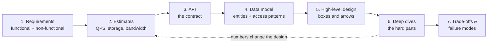
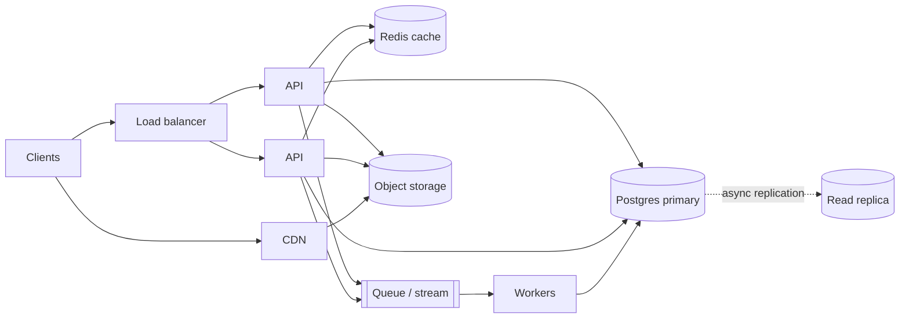
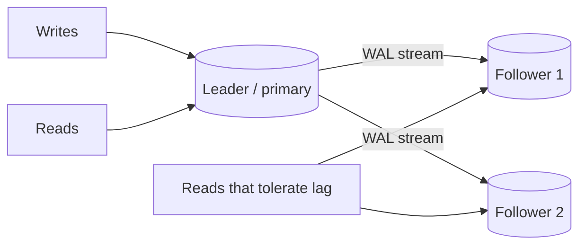
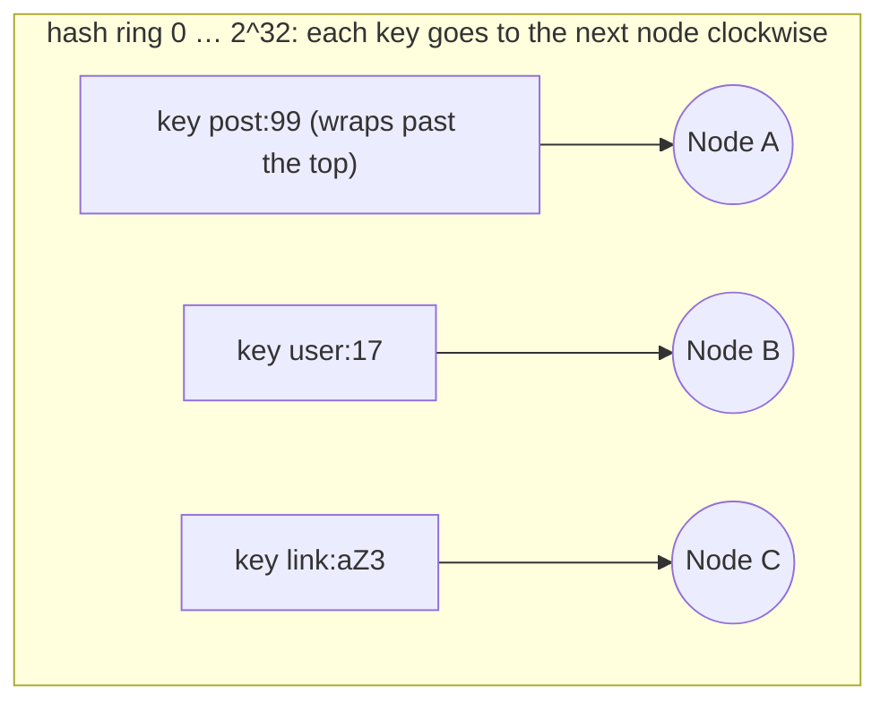

# 30 · System Design

> Code is how you build one service. System design is how you decide *which* services, data stores, caches and queues to build, how they talk, and what happens when each of them breaks. It's the skill that separates "can implement a ticket" from "can be trusted with a feature end to end", and it's a full round in almost every backend interview.

**Time:** ~10h · **Challenge:** 📝 Docs (five design write-ups) · **Prereqs:** [18 · Caching](../18-caching/README.md), [19 · Rate Limiting](../19-rate-limiting/README.md), [28 · Real-time Systems](../28-realtime/README.md), [29 · Reliability & Scaling](../29-reliability-scaling/README.md) · **Services:** none

## What you'll learn

- A **repeatable framework** for any design problem: requirements → estimates → API → data model → high-level design → deep dives → trade-offs and failure modes
- How to do **back-of-envelope estimates** quickly, and the numbers you should carry in your head
- The **building blocks** every design is assembled from: load balancers, CDNs, caches, SQL and NoSQL databases, replication, sharding, consistent hashing, queues and streams, object storage, search indexes
- **CAP, PACELC and consistency models**, explained in terms of what users actually see
- How to find **bottlenecks**, reason about **trade-offs** out loud, and talk through a design in an interview

You've already built most of the pieces: a cache in front of Postgres (18), a distributed rate limiter (19), queues and workers (20), real-time fan-out with Redis (28), timeouts, retries and circuit breakers (29). This module is about composing them deliberately.

---

## 1. What system design is (and what it isn't)

A system design problem looks like this: *"Design a URL shortener."* *"Design a news feed."* *"Design a ticketing system that survives an on-sale for a stadium tour."* It is deliberately vague, because the first skill being tested is turning vagueness into a precise problem.

What you produce isn't code. It's:

1. A clear statement of **what the system must do** and **how well** (latency, scale, availability, consistency).
2. A **design**: components, how data flows between them, where data lives.
3. The **reasoning**: why this design and not the obvious alternatives, backed by numbers.
4. An honest account of **what it gives up** and **how it fails**.

At work this takes the form of a **design doc** (also called an RFC or tech spec): a few pages written before building anything non-trivial, reviewed by peers, and kept as the record of *why* things are the way they are. In interviews it's a 45–60 minute conversation at a whiteboard. Same skill, different clock.

> 💡 There is no single correct answer. Two strong engineers can produce different designs for the same prompt and both pass. What fails is a design with no requirements, no numbers, components chosen because they sound impressive ("we'll use Kafka and Cassandra and Kubernetes"), and no awareness of trade-offs.

## 2. The framework

Every design in this module, in module 31 and in the capstone follows the same seven steps. The template in [`challenge/TEMPLATE.md`](challenge/TEMPLATE.md) is literally this list.



Why this order? Each step constrains the next. You can't size a database before you know the write rate; you can't pick a database before you know the access patterns; you can't know which part is hard until the simple version is on the board. Jumping straight to boxes and arrows is the most common way to fail, because you end up defending choices you made before you knew what you needed.

In a 45-minute interview, a rough budget:

| Step | Time | Output |
|---|---|---|
| Requirements | 5 min | 3–5 functional bullets, 3–5 non-functional numbers, out of scope |
| Estimates | 5 min | QPS (avg, peak), storage, a "so what" |
| API + data model | 5–8 min | 3–6 endpoints, 2–4 tables or key schemas |
| High-level design | 10 min | a diagram that satisfies every functional requirement |
| Deep dives | 15 min | 2–3 hard problems solved with options and reasoning |
| Wrap-up | 2–5 min | bottlenecks, failure modes, what changes at 10x |

### Step 1: Requirements

Split them in two:

- **Functional requirements** are what the system *does*: "a user can shorten a URL", "a user sees posts from people they follow, newest first". Keep the list short, 3–6 items, and explicitly say what's in and out of scope.
- **Non-functional requirements** are *how well* it does it. These drive the architecture far more than the functional ones. Always try to make them numbers:

| Quality | Ask | Example answer |
|---|---|---|
| Scale | How many users? DAU? Requests per user per day? | 100M DAU, 20 reads + 1 write each |
| Latency | What's the latency target on the hot path? | p99 redirect < 50 ms |
| Availability | How bad is downtime? | 99.99% for reads; writes can degrade |
| Consistency | Is stale data OK? Where exactly? | Feed can be 30 s stale; seat inventory never |
| Durability | Can we ever lose data? | Never lose an acknowledged message |
| Read/write mix | Read-heavy or write-heavy? | 100:1 reads |
| Constraints | Budget, compliance, existing stack? | Must run on our Postgres + Redis |

Good clarifying questions sound like *"Should the feed be ranked or chronological? I'll assume chronological to start"*. Ask, then **state an assumption and move on**. Interviewers mostly want to see that you know which questions matter.

> ⚠️ "Highly available, scalable and fast" is not a requirement; it's a wish. "p99 < 200 ms at 50k RPS, 99.95% monthly availability" is a requirement you can design against and test.

### Step 2: Estimates

Back-of-envelope estimation turns requirements into the numbers that pick your architecture. Precision doesn't matter; **orders of magnitude** do. 12,000 vs 15,000 QPS is the same design. 1,000 vs 100,000 QPS is a different design.

The method:

1. **Traffic.** DAU × actions per user per day ÷ 86,400 s ≈ average QPS. Multiply by a peak factor (2–3x for a normal daily curve, 10x+ for events like on-sales or New Year's Eve).
2. **Storage.** Size of one item × items per day × retention (× replication factor if you want to be thorough).
3. **Bandwidth.** QPS × response size.
4. **Memory for a cache.** The hot set (often 10–20% of daily reads) × item size.
5. **So what?** One or two sentences on what the numbers imply. This is the step people skip, and it's the only one that matters.

Two tricks make this fast:

- **A day is ~100,000 seconds** (86,400). So 1M requests/day ≈ 12/s, 100M/day ≈ 1,200/s, 1B/day ≈ 12,000/s.
- **Round everything** to a power of ten or a nice multiple, and write the arithmetic down so mistakes are visible.

A worked mini-example, a photo-sharing app with 10M DAU where each user views 50 photos and uploads 0.1 per day:

```
reads:   10M × 50  = 500M/day  ÷ 1e5 ≈ 5,000/s avg   → ~15,000/s peak (3x)
writes:  10M × 0.1 = 1M/day    ÷ 1e5 ≈ 10/s avg      → ~30/s peak
ratio:   500:1 read-heavy
storage: 1M photos/day × 2 MB = 2 TB/day → ~730 TB/year (before replicas/thumbnails)
egress:  15,000/s × 200 KB (resized) ≈ 3 GB/s at peak
So what: metadata writes are trivial (one Postgres handles 30/s easily). Photo bytes must live in
object storage, and 3 GB/s of egress means a CDN is not optional. The design is all about reads.
```

### The numbers to carry in your head

You don't need exact values, you need the **ratios**. Memory is ~1,000x faster than an SSD random read, which is ~100x faster than a cross-continent round trip.

| Operation | Approx. time | Think of it as |
|---|---|---|
| L1 cache reference | ~1 ns | |
| Main memory reference | ~100 ns | |
| Read 1 MB sequentially from memory | ~10 µs | |
| SSD random read (4 KB) | ~20–100 µs | |
| Read 1 MB sequentially from NVMe SSD | ~0.3 ms | |
| Round trip inside one datacenter | ~0.5 ms | |
| Redis GET over the network (same DC) | ~0.2–1 ms | "free" compared to anything below |
| Simple indexed Postgres query incl. round trip | ~1–5 ms | |
| HDD seek | ~5–10 ms | why random I/O on spinning disks is awful |
| Send 1 MB over a 1 Gbps link | ~10 ms | |
| Round trip US East ↔ US West | ~60–70 ms | |
| Round trip US ↔ Europe | ~80–150 ms | why you put data near users |

And rough capacities for **one** reasonably sized instance (very workload-dependent; use them to get the order of magnitude, then load test):

| Component | Rough capacity |
|---|---|
| Node.js API process, simple JSON + one DB call | 1k–10k req/s |
| Postgres primary, simple indexed reads | 10k–50k+ queries/s |
| Postgres primary, small transactional writes | 1k–10k+ writes/s |
| Redis (single node) | 100k+ ops/s |
| Kafka partition | ~10 MB/s+ (tens of thousands of small msgs/s) |
| WebSocket gateway | 50k–500k+ mostly idle connections |

Availability targets in downtime terms (this makes "nines" concrete):

| Availability | Downtime per year | per month |
|---|---|---|
| 99% | ~3.65 days | ~7.3 h |
| 99.9% | ~8.8 h | ~44 min |
| 99.99% | ~53 min | ~4.4 min |
| 99.999% | ~5 min | ~26 s |

More conversions, formulas and a fill-in-the-blanks estimation template are in [docs/estimates-cheatsheet.md](docs/estimates-cheatsheet.md).

### Step 3: API

Define the contract before the internals. It forces you to pin down what the client actually sends and receives, and it exposes hidden requirements ("wait, does the feed endpoint need a cursor?").

```http
POST /v1/links            { "url": "...", "alias": "optional" }  → 201 { "code": "aZ3kP9q", ... }
GET  /{code}              → 302 Location: <long url>
GET  /v1/feed?cursor=...  → 200 { "items": [...], "nextCursor": "..." }
```

Mention the things that matter for correctness at scale: **idempotency keys** on non-idempotent writes ([module 23](../23-api-design/README.md)), **cursor pagination** instead of offsets, auth, and which errors clients must handle (429, 409, 410). For real-time systems, the "API" is the message protocol over a WebSocket.

### Step 4: Data model

Start from **access patterns**, not entities. Write down the queries the API needs, with their frequency:

| Access pattern | Frequency | Implies |
|---|---|---|
| Resolve code → URL | 10k/s | key-value lookup by primary key; cacheable |
| List a user's links, newest first | 10/s | index on `(owner_id, created_at)` |
| Clicks per link per day | 1/s | pre-aggregated table, not a scan of raw clicks |

Then choose the entities, keys and indexes that serve those patterns, and the **store** that fits. This is where "SQL or NoSQL?" gets answered with reasons instead of fashion (see section 3.5). If the data won't fit on one machine, this is also where you name the **shard key**.

### Step 5: High-level design

Now draw. Start with the simplest thing that meets the functional requirements, then add components only when a requirement or a number demands them. Every box should have a reason you can say out loud.



Then **walk through the main flows** step by step, naming every hop: "1. The client POSTs to the API through the load balancer. 2. The API validates, writes to Postgres, 3. publishes an event, 4. returns 201." Walking a request through the diagram is how you (and your interviewer) find the holes.

### Step 6: Deep dives

The high-level design is the easy 60%. The deep dives are where you show depth. Pick the 2–3 **hardest** parts of *this* problem:

- News feed → fan-out strategy and celebrities.
- Chat → routing messages to the right connection, ordering, offline delivery.
- Ticketing → never double-selling under a 100x spike.
- URL shortener → id generation and the read path at 100k+ QPS.

For each: state the problem precisely, give **at least two options**, compare them using your estimates, choose, and say what you gave up.

### Step 7: Trade-offs, bottlenecks and failure modes

Finish by attacking your own design:

- **Bottlenecks:** where does load concentrate? A single primary, a hot key, a fan-out that multiplies writes, a synchronous call chain.
- **Single points of failure:** what has exactly one instance?
- **Failure modes:** for each dependency ask "what if it's **down**?" and the nastier "what if it's **slow**?" (module 29: slowness causes cascading failures far more often than clean outages).
- **10x:** what's the first thing that breaks if traffic grows 10x, and what would you change?

## 3. Building blocks

Almost every design is assembled from the same dozen components. You should know, for each one: **what it's for, roughly how fast it is, and how it fails**. Full reference with numbers and gotchas: [docs/building-blocks.md](docs/building-blocks.md).

### 3.1 Load balancers

A load balancer spreads requests over a pool of instances, health-checks them, and takes broken ones out of rotation. It's what makes "add more servers" work, *provided the servers are stateless* (module 29).

- **L4 (transport)** balancers route TCP/UDP connections by IP and port without reading HTTP. Very fast, protocol-agnostic, good for long-lived connections (WebSockets, databases).
- **L7 (application)** balancers read HTTP: they can route by path or header (`/api` → API pool, `/static` → static pool), terminate TLS, add headers like `X-Request-Id`, retry idempotent requests and do canary splits. nginx, Envoy, HAProxy, AWS ALB.
- **Algorithms:** round robin; least connections (better when request cost varies); consistent hashing on a key (when you *want* affinity, like a user's WebSocket or a cache shard).

The load balancer itself must not be a single point of failure: managed LBs are redundant behind the scenes; self-hosted ones run in pairs with a floating IP or behind DNS.

### 3.2 CDN

A Content Delivery Network is a fleet of caches in hundreds of locations near users. Users fetch static assets (images, JS, video segments) from a nearby edge instead of your origin. That turns a 150 ms cross-ocean round trip into ~10–20 ms and absorbs most of your egress bandwidth.

- Great for: immutable static files (use content-hashed filenames and long `Cache-Control`), media, public GET responses that tolerate seconds of staleness.
- Push vs pull: most CDNs **pull** from your origin on a miss and cache according to your `Cache-Control` headers.
- Gotcha: invalidation is slow and coarse. Design for **immutable URLs** (`app.3f9a1c.js`) rather than purging.

### 3.3 Caches

You built cache-aside in [module 18](../18-caching/README.md). In a design, the questions are **where** and **what**:

| Layer | Example | Latency | Notes |
|---|---|---|---|
| Client / browser | HTTP cache, `ETag` | 0 | free, but you can't invalidate it |
| CDN edge | CloudFront, Fastly | ~10 ms | public content only |
| In-process | LRU map in the API | ~µs | per instance, small, instant; inconsistent across instances |
| Distributed | Redis / Memcached | ~0.5 ms | shared, large; one more network hop and dependency |
| Database | Postgres buffer cache | — | "free", but you can't control it |

Always say: the **pattern** (cache-aside, write-through), the **TTL** and why, the **invalidation** strategy, and what happens on a **stampede** (coalescing, jittered TTLs) or when the cache is **flushed** (can the DB survive the full read load cold? If not, the cache is now a critical dependency and needs replicas).

The famous 80/20 rule applies to most read workloads: a small hot set serves most requests, so caching even 10–20% of items often gives you a 90%+ hit rate.

### 3.4 Application servers

Stateless processes behind the load balancer, scaled horizontally. "Stateless" means no user data lives only in process memory between requests: sessions go to Redis, files to object storage, everything else to the database. Then any instance can serve any request and you can kill or add instances freely.

The exception is **stateful connection servers** (WebSocket gateways in chat or live updates). They hold open connections, so you need a way to find which server holds a given user's connection (a registry in Redis, or pub/sub fan-out as in [module 28](../28-realtime/README.md)).

### 3.5 Databases: SQL vs NoSQL

The honest default for most products is **a relational database (Postgres)** until a requirement says otherwise. It gives you transactions, constraints, joins, secondary indexes and decades of tooling, and a single well-tuned Postgres instance handles far more than most products ever need.

Reach for something else when the **access patterns** or **scale** demand it:

| Store type | Examples | Great at | Weak at |
|---|---|---|---|
| Relational | Postgres, MySQL | transactions, constraints, ad-hoc queries, joins | horizontal write scaling (needs sharding or a distributed SQL DB) |
| Key-value | Redis, DynamoDB | O(1) lookups by key at huge scale | queries by anything other than the key |
| Wide-column | Cassandra, ScyllaDB, Bigtable | huge write throughput, time-ordered data per partition (chat messages, events) | joins, transactions across partitions, ad-hoc queries |
| Document | MongoDB, Firestore | flexible nested documents read as a whole | cross-document transactions and joins (improving, but not the strength) |
| Search | Elasticsearch, OpenSearch | full-text search, relevance, faceting | being the source of truth |
| Time series | TimescaleDB, Prometheus | metrics, append-mostly time-stamped data | random updates |
| Distributed SQL | CockroachDB, Spanner, Yugabyte | SQL + horizontal scale + strong consistency | higher write latency, operational/cost complexity |

The real question is never "SQL vs NoSQL" in the abstract. It's: *"Our hot path is lookup-by-key at 100k/s and we need no joins. Do we need anything Postgres + a cache can't give us?"* Often the answer is no.

### 3.6 Replication

Replication keeps copies of the same data on several machines, for **availability** (survive a node failure) and **read scaling** (serve reads from copies).



- **Leader–follower (primary–replica):** all writes go to one leader, which streams changes to followers. Simple and the default for Postgres/MySQL. Failover promotes a follower when the leader dies.
- **Synchronous vs asynchronous:** synchronous replication waits for a follower to confirm before acknowledging the write (no data loss on failover, higher write latency). Asynchronous acknowledges immediately (fast, but the last few writes can be lost if the leader dies, and followers **lag**).
- **Replication lag** is the source of classic bugs: a user updates their profile, the next read hits a lagging replica, and their change "disappears". Fixes: read your own writes from the leader for a few seconds, or route a user's reads to the leader after they write.
- **Multi-leader** (writes accepted in several regions) and **leaderless** (Dynamo-style, quorum reads/writes) replication improve write availability and latency across regions at the cost of **conflict resolution** (last-write-wins loses data; CRDTs or app-level merging are complex).

**Quorums:** with N replicas, a write waits for W acknowledgements and a read queries R replicas. If **R + W > N**, every read overlaps at least one replica with the latest write. N=3, W=2, R=2 is the classic setting. Lower W or R trades consistency for latency and availability.

### 3.7 Partitioning (sharding)

When data or write load outgrows one machine, you split it into **partitions** (shards), each owned by a different node. Replication copies the *same* data; partitioning splits *different* data. Real systems do both: each shard is replicated.

The key decision is the **partition key**:

| Strategy | How | Pros | Cons |
|---|---|---|---|
| Range | `user_id 1–1M → shard A`, ... or by time | range scans are cheap | hot spots (all new writes hit the "latest" range) |
| Hash | `hash(key) mod N` | even spread | range queries hit every shard; changing N moves almost everything |
| Consistent hashing | key → point on a ring → next node clockwise | adding a node moves only ~1/N of keys | needs virtual nodes for balance |
| Directory | a lookup table maps key → shard | total flexibility, easy rebalancing | the directory is a dependency and must be fast and highly available |

A good shard key (1) spreads load evenly, (2) keeps the data one request needs **on one shard** (shard chat messages by `conversation_id`, not `message_id`, so loading a conversation hits one node), and (3) doesn't create hot spots (shard key `country` puts all of India on one shard).

What you lose by sharding: cross-shard joins and transactions become your problem, global secondary indexes get expensive, and rebalancing is operationally painful. That's why "shard later, when the numbers say so" is the right instinct. A single Postgres primary with read replicas goes a very long way.

**Hot keys** survive even perfect sharding: one celebrity, one viral link, one huge tenant. Mitigations: cache the hot item (in-process for the hottest), split the key (`counter:{id}:{0..9}` summed on read), or treat the hot entity specially (the celebrity path in a news feed).

### 3.8 Consistent hashing

With naive `hash(key) mod N`, going from 4 to 5 cache nodes remaps about 80% of keys, and your cache hit rate collapses at exactly the moment you were adding capacity. Consistent hashing fixes that.



1. Hash every **node** onto a ring (a circle of hash values).
2. Hash every **key** onto the same ring; the key belongs to the first node **clockwise** from it.
3. Adding a node only steals keys from its clockwise neighbour: ~1/N of keys move instead of almost all of them. Removing a node hands its keys to the next one.
4. **Virtual nodes:** each physical node is placed at many points (say 100–200) on the ring. This evens out the load and lets bigger machines take more points.

It's used by Dynamo-style databases, Cassandra, many cache clients, and load balancers that need affinity. (Redis Cluster uses a related idea: 16,384 fixed **hash slots** assigned to nodes, moved slot by slot.)

### 3.9 Queues and streams

A queue between two components turns "do it now" into "do it soon, reliably". You used BullMQ in [module 20](../20-background-jobs/README.md) and will use Kafka in modules 32–33.

Use one when:

- the work is **slow** or calls flaky third parties (emails, payments, thumbnails) and the user shouldn't wait;
- you need to **absorb spikes**: the queue grows, workers drain it at their own pace (load leveling);
- one event has **many consumers** (fan-out: an order placed → email, analytics, inventory);
- you want to **decouple** teams and deploys.

| | Job queue (BullMQ, SQS, RabbitMQ) | Log/stream (Kafka, Redis Streams, Kinesis) |
|---|---|---|
| Model | messages are removed once processed | append-only log; consumers track their own offset |
| Replay | no | yes, within retention |
| Ordering | usually none (or per group) | per partition |
| Many independent consumers | awkward | natural (consumer groups) |
| Typical use | background jobs, task distribution | event streams, analytics, CDC, event-driven services |

The key words to use correctly: **at-least-once delivery** (the default almost everywhere, so consumers must be **idempotent**), **dead-letter queue** (where messages go after N failed attempts), **backpressure** and **consumer lag** (the number to alert on). "Exactly-once" end to end is really at-least-once delivery plus idempotent processing.

### 3.10 Object storage

S3, Google Cloud Storage, Azure Blob, MinIO: a flat namespace of immutable objects addressed by key, with extremely high durability (S3 is designed for eleven nines) and effectively unlimited capacity at a low price per GB. Store **bytes** here (images, videos, backups, exports, logs) and only the **metadata and key** in your database.

The standard upload pattern: the API issues a short-lived **pre-signed URL**, the client uploads directly to object storage (your servers never proxy gigabytes), and a notification or a follow-up API call records the metadata. Serve reads through a CDN.

### 3.11 Search indexes

`WHERE title ILIKE '%shoe%'` scans the table and has no idea about relevance, typos, stemming ("running" matches "run") or facets. A search engine (Elasticsearch/OpenSearch, or Postgres full-text search for modest needs) builds an **inverted index** (term → list of documents) for that.

The design point: the search index is a **derived copy**, not the source of truth. Keep the database authoritative and feed the index asynchronously (an outbox or CDC stream, module 33), accepting that search results lag writes by a second or so.

### 3.12 Unique ID generation

Many designs need ids that are unique across many machines. Options:

- **Database sequence** (`bigint identity`): simple, ordered, but one database is the bottleneck and the ids are guessable.
- **UUIDv4**: random, no coordination, but 128 bits and poor index locality. **UUIDv7** fixes locality with a time prefix.
- **Snowflake-style**: 64 bits = timestamp + machine id + per-machine sequence. Roughly time-ordered, no coordination at runtime, needs machine ids assigned and sane clocks.
- **Ranges/batches**: each server leases a block of 1,000 ids from a central counter and hands them out locally.

## 4. CAP, PACELC and consistency models

### CAP, stated precisely

In a distributed data store, a **network partition** (some nodes can't talk to others) will eventually happen. When it does, each node has to choose:

- **Consistency (C):** refuse to answer (or error) rather than risk returning stale data or accepting a conflicting write; or
- **Availability (A):** answer anyway, with whatever data it has, and reconcile later.

You can't have both *during a partition*. That's all CAP says. It's often misquoted as "pick 2 of 3", but partitions aren't optional, so the real choice is **CP or AP when a partition happens**.

- **CP:** a seat-booking system. During a partition, the minority side refuses to sell seats rather than risk double-selling.
- **AP:** a shopping cart or a like counter. Keep accepting writes on both sides and merge afterwards. A slightly wrong count is better than an error.

### PACELC: the part CAP leaves out

Partitions are rare. The trade-off you make **every day** is latency. PACELC says: if there's a **P**artition, choose **A** or **C**; **E**lse (normal operation), choose **L**atency or **C**onsistency.

Synchronously replicating every write to another region gives you consistency but adds a cross-region round trip (~70+ ms) to every write. Asynchronous replication is fast but readers can see stale data. Postgres with async replicas is "PC/EL" in practice (during normal operation, reads from replicas favour latency); Spanner-style systems are "PC/EC" and pay for it in write latency.

### Consistency models users actually notice

| Model | Guarantee | What breaks without it |
|---|---|---|
| **Strong (linearizable)** | Every read sees the latest acknowledged write, as if there were one copy | Two people buy the last seat |
| **Read-your-writes** | You always see your own updates | "I changed my name and it reverted" |
| **Monotonic reads** | You never see time go backwards | A comment appears, vanishes on refresh, reappears |
| **Causal** | If B is a reply to A, everyone who sees B has seen A | A reply shows up before the message it answers |
| **Eventual** | If writes stop, all replicas converge… eventually | Brief staleness, which is fine for likes, views, follower counts |

The practical skill is **choosing per piece of data**, not per system. In one ticketing design, seat inventory is strongly consistent (single Postgres primary, row locks or conditional updates), the event listing is eventually consistent (cached for 30 s, served from a CDN), and the "tickets sold" counter on the organizer dashboard is eventually consistent from an analytics stream. Saying that out loud is exactly what interviewers want to hear.

## 5. Finding bottlenecks and making trade-offs

A checklist to run over any design:

| Smell | Question | Typical fix |
|---|---|---|
| Single point of failure | What has one instance? | replicas + failover, multiple AZs |
| Hot partition / hot key | Is any key much busier than average? | cache, split the key, special-case it |
| Write amplification | Does one action cause N writes? (fan-out) | async fan-out via a queue, hybrid push/pull |
| Synchronous chains | A calls B calls C calls D? | timeouts + breakers, make non-critical steps async |
| Thundering herd | Can many clients retry or miss cache at the same moment? | jitter, coalescing, rate limits, waiting rooms |
| Unbounded growth | Does any table, queue or list grow forever? | TTLs, retention, archiving to object storage |
| Cold start | Does the system survive a cache flush or a full restart? | cache warming, capacity for cold reads, load shedding |
| Cross-region latency | Is a hot-path call crossing an ocean? | serve reads locally, replicate asynchronously |

Trade-offs come in a few recurring pairs. Name them explicitly:

- **Consistency vs availability/latency** (CAP/PACELC above).
- **Latency vs throughput**: batching raises throughput and latency together.
- **Read cost vs write cost**: precompute on write (fan-out, materialized views) to make reads cheap, or compute on read to make writes cheap.
- **Simplicity vs scalability**: a single Postgres is simpler than a sharded cluster; choose the sharded cluster only when the numbers force you to.
- **Freshness vs cost**: caching and CDNs make things cheap and fast but stale.
- **Build vs buy**: managed services (SQS, managed Postgres, a push-notification provider) trade money and some control for not running them yourself.

A good trade-off statement has three parts: **what you chose, what it costs, and when you'd change your mind**. *"I'll fan out on write because reads are 100x more frequent than posts and feed latency is the key metric. It costs a lot of writes for users with many followers, so above ~100k followers I switch to fan-out on read for that author."*

## 6. How to talk through a design (interviews and design reviews)

What interviewers are scoring, roughly in order:

1. **Problem navigation:** did you clarify requirements and scope, and pick the right hard parts to go deep on?
2. **Solution quality:** does the design work, and does it meet the non-functional requirements?
3. **Technical depth:** in the deep dives, do you know how the building blocks actually behave?
4. **Trade-offs:** do you see alternatives and justify choices with numbers?
5. **Communication:** can they follow you? Do you take hints?

Habits that help:

- **Think out loud** and narrate the framework: *"Let me pin down requirements first, then do quick estimates so I know which parts are hard."*
- **Drive.** Don't wait to be asked; propose the next step. But **check in** at transitions: *"I'm thinking of going deep on the fan-out next. Does that sound good, or is there something you'd rather explore?"*
- **Simple first, then evolve.** Draw a working single-region version, then scale it. Interviewers love seeing a design *evolve* in response to numbers.
- **Use numbers to justify every non-obvious box.** "We need a cache because 50k QPS of reads would need ~5 Postgres replicas; a Redis node handles it alone."
- **Say "it depends" only when followed by "on X; here, X is…, so I'd choose…".**
- **Treat pushback as information, not attack.** "That's a good point; if writes are that bursty, a queue in front makes sense."
- **Admit unknowns honestly.** "I don't remember Cassandra's exact compaction strategy, but the property I need is…" beats bluffing.

## Common mistakes

- **Jumping to the diagram** before requirements and numbers. You end up designing a different problem.
- **Buzzword architecture:** Kafka, Kubernetes and microservices for a system that does 50 writes per second. Every component must earn its place.
- **No numbers**, or numbers that are never used ("1 PB of storage" followed by a single Postgres instance without comment).
- **Ignoring the hot path.** Spending 15 minutes on the admin dashboard and 2 on the endpoint that gets 99% of traffic.
- **One consistency level for everything.** Either everything is strongly consistent (slow and expensive) or everything is eventual (oversold tickets).
- **Forgetting failure.** No answer to "what if Redis is down?", or worse, "what if Redis is slow?"
- **Sharding too early**, and losing joins and transactions you needed, to solve a scale problem you didn't have.
- **Unbounded things:** queues without DLQs, tables without retention, retries without backoff.
- **Monologuing:** 20 minutes without checking in, deep in a part the interviewer didn't care about.

## In production

- **Design docs are the real artifact.** At most companies, any project longer than a couple of weeks starts with a written design reviewed by senior engineers. The template you'll use in the challenge is a lightweight version of what those docs contain. Writing them well is a promotion-relevant skill.
- **Most systems are boring, deliberately.** Postgres, a Redis cache, a queue, stateless services behind a load balancer and a CDN carry a remarkable share of the internet. Exotic infrastructure appears when a specific number forces it, and teams usually regret adopting it earlier.
- **Capacity planning uses the same estimates**, then validates them with load tests (k6 in [module 29](../29-reliability-scaling/README.md)) and production metrics. The back-of-envelope gets you within 10x, measurement gets you the rest.
- **Failure is designed in.** Real designs list failure modes with a detection method (which alert fires?) and a mitigation (which runbook?). Postmortems (module 24) feed back into the next design.
- **Consistency decisions are product decisions.** "Can the like count be 5 seconds behind?" is a question for the product manager, and the answer can save months of engineering.

## Check yourself

1. Your estimates say 1,200 writes/s and 60,000 reads/s, with reads mostly hitting the same 5% of items. What does that suggest?
   <details><summary>Answer</summary>Writes fit comfortably on a single Postgres primary. Reads are 50x writes and highly skewed, so a cache (Redis, maybe in-process for the hottest keys) will absorb most of them. No need to shard yet. Read replicas are a secondary option if the cache misses are still too many.</details>
2. What's the difference between replication and partitioning, and why do real systems use both?
   <details><summary>Answer</summary>Replication copies the same data to several nodes (availability, read scaling). Partitioning splits different data across nodes (capacity, write scaling). Large systems partition data into shards and replicate each shard so that losing a node loses no data and no availability.</details>
3. Why does consistent hashing beat `hash(key) mod N` for a cache cluster?
   <details><summary>Answer</summary>Changing N with modulo remaps almost every key, so the hit rate collapses when you scale. With consistent hashing, adding or removing a node moves only ~1/N of the keys. Virtual nodes keep the load balanced.</details>
4. State CAP correctly in one sentence, and give one CP and one AP example.
   <details><summary>Answer</summary>During a network partition, a distributed store must either refuse some requests to stay consistent (CP) or keep answering with possibly stale or conflicting data (AP). CP: seat inventory or bank balances. AP: shopping carts, like counts, presence.</details>
5. A user edits their profile and immediately sees the old version. What's likely happening and how do you fix it?
   <details><summary>Answer</summary>The read went to an asynchronous replica that hadn't caught up (replication lag), or a cache entry wasn't invalidated. Fix with read-your-writes: route that user's reads to the primary for a short window after a write (or track the write's LSN), and invalidate the cache on write.</details>

## Further reading

- PostgreSQL docs, High Availability, Load Balancing, and Replication: https://www.postgresql.org/docs/current/high-availability.html
- Redis docs, Scale with Redis Cluster: https://redis.io/docs/latest/operate/oss_and_stack/management/scaling/
- Apache Kafka documentation, Design: https://kafka.apache.org/documentation/#design
- AWS Builders' Library (timeouts, retries, load shedding, caching): https://aws.amazon.com/builders-library/
- Google SRE Book, especially "Handling Overload" and "Addressing Cascading Failures": https://sre.google/sre-book/table-of-contents/
- Martin Kleppmann, *Designing Data-Intensive Applications* (O'Reilly): the book to read after this module.
- Deep dives in this module: [docs/worked-example-url-shortener.md](docs/worked-example-url-shortener.md) · [docs/building-blocks.md](docs/building-blocks.md) · [docs/estimates-cheatsheet.md](docs/estimates-cheatsheet.md)

## ➡️ Next: [the challenge](CHALLENGE.md)

After this, [module 31](../31-checkpoint-url-shortener/README.md) has you build the URL shortener from the worked example end to end, starting from your own design doc.
