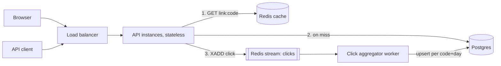

# Worked example: a URL shortener, start to finish

This is the framework from the lesson applied to one classic problem, written the way you'd present it in an interview or a short design doc. It's kept concise on purpose: in [module 31](../../31-checkpoint-url-shortener/README.md) you build this system and write your own, fuller `DESIGN.md`.

Read it once now, then use it as a model for the five designs in the challenge. Notice how every component is justified by a requirement or a number.

---

## 1. Requirements

**Functional**
- Create a short link for a long URL; optionally choose a custom alias.
- Visiting `https://sho.rt/{code}` redirects to the long URL.
- Links can expire.
- The owner can see click counts per day.
- Out of scope: user accounts UI, link editing, malware scanning (mentioned under trade-offs).

**Non-functional**
- 100M new links per month; reads are ~100x writes.
- Redirect latency p99 < 50 ms (server side). This is the hot path.
- Redirects must be highly available (99.99%); link creation can tolerate brief degradation (99.9%).
- A created link must work immediately (read-your-writes for the creator).
- Codes should be short (≤ 7 characters) and not trivially enumerable.
- Click stats can be a minute or so behind.

## 2. Estimates

```
writes:   100M/month ÷ (30 × 86,400 ≈ 2.6M s) ≈ 40/s avg   → ~200/s peak (5x)
reads:    100 × 40 = 4,000/s avg                          → ~20,000/s peak
storage:  ~500 B per link (URL avg ~100 B + code, owner, timestamps, index overhead)
          100M × 12 months × 5 years = 6B links × 500 B ≈ 3 TB over 5 years
clicks:   4,000/s × 86,400 ≈ 350M click events/day (≈ 35 GB/day raw at ~100 B each)
code space: 62^7 ≈ 3.5 trillion codes; 6B used after 5 years is ~0.2% → collisions are rare
cache:    if 20% of links get 80% of traffic and the daily-active set is ~10M links,
          10M × 500 B ≈ 5 GB → fits in one Redis node with room to spare
```

**So what?**
- Writes are tiny. One Postgres primary handles 200/s without noticing.
- 20k reads/s with a p99 of 50 ms wants a cache in front of the database. The hot set fits in RAM.
- 3 TB over five years fits on one (large) Postgres instance; sharding is a "year 3" problem, and the shard key would be the code.
- Raw clicks are the real volume (350M/day). They must not be written to Postgres one by one on the redirect path. Buffer and aggregate them.

## 3. API

```http
POST /api/links                      (X-API-Key: ...)
  { "url": "https://example.com/very/long", "alias": "spring-sale", "expiresInSeconds": 86400 }
  → 201 { "code": "spring-sale", "shortUrl": "https://sho.rt/spring-sale", "expiresAt": "..." }
  → 400 invalid URL/alias · 409 alias taken · 429 rate limited

GET /{code}
  → 302 Location: https://example.com/very/long
  → 404 unknown · 410 expired

GET    /api/links/{code}/stats   → 200 { "totalClicks": 1234, "daily": [{ "date": "2026-11-24", "clicks": 87 }] }
DELETE /api/links/{code}         → 204 (owner only)
```

## 4. Data model

Postgres is the source of truth; Redis holds a cache and a click buffer.

```sql
links (
  code        text PRIMARY KEY,           -- resolve by code: the hot access pattern
  url         text NOT NULL,
  owner_key   text NOT NULL,
  created_at  timestamptz NOT NULL DEFAULT now(),
  expires_at  timestamptz NULL
)
-- index (owner_key, created_at DESC) for "list my links"

click_daily (
  code   text REFERENCES links(code) ON DELETE CASCADE,
  day    date,
  clicks bigint NOT NULL,
  PRIMARY KEY (code, day)                 -- upsert target for the aggregator
)
```

Redis:
- `link:{code}` → `{url, expiresAt}` JSON, TTL 1 hour (cache-aside).
- `clicks` stream → one entry per click `{code, ts}`, consumed by an aggregator.

## 5. High-level design



**Redirect flow**
1. `GET /aZ3kP9q` reaches any API instance.
2. Look up `link:aZ3kP9q` in Redis. On a hit, check expiry and continue. On a miss, read Postgres by primary key and populate the cache.
3. Append `{code, ts}` to the clicks stream. This is a ~0.5 ms fire-and-forget write that never blocks on Postgres.
4. Respond `302` with `Location`.

**Create flow**
1. Validate the URL (scheme http/https, length ≤ 2,048) and the alias.
2. Generate a code (see deep dive), insert into Postgres; a unique-constraint violation on an alias means 409.
3. Return 201. Optionally write the cache entry immediately (write-through) so the first redirect is a hit.

**Click aggregation:** a worker reads the stream in batches of a few hundred, sums clicks per `(code, day)` in memory, upserts them into `click_daily` in one transaction, then acknowledges the batch.

## 6. Deep dives

### Generating codes

| Option | How | Pros | Cons |
|---|---|---|---|
| Hash the URL (MD5/SHA → first 7 base62 chars) | deterministic | same URL → same code (free dedup) | collisions must still be handled; custom expiry/owner per link is awkward |
| Counter + base62 | DB sequence → `toBase62(n)` | no collisions, short | sequential codes are enumerable; one counter is a bottleneck at very high write rates |
| Counter + scramble | sequence → bijective shuffle (e.g. multiply by a large odd constant mod 62^7) → base62 | no collisions, not obviously sequential | the scramble is security by obscurity |
| Random + retry | 7 random base62 chars, `INSERT ... ON CONFLICT DO NOTHING`, retry on conflict | unguessable, no coordination | a retry is needed occasionally (≈0.2% at 6B links), so codes must be checked against the unique index |

**Choice:** random 7-character codes with retry. At 200 writes/s the extra round trip on a collision is irrelevant, the unique index guarantees correctness, and codes aren't enumerable. If writes grew 1,000x, I'd switch to counter ranges leased per instance plus a scramble.

### The redirect path at 20k+ QPS

- Cache-aside in Redis with a 1-hour TTL plus jitter. With an 80%+ hit rate, Postgres sees < 4k reads/s at peak, which is comfortable for primary-key lookups, and read replicas can take more.
- **Expiry must be checked on every hit**, using the `expiresAt` stored in the cached value. A cached entry must never outlive the link. Set the Redis TTL to `min(1h, time until expiry)`.
- **Invalidate on delete** (delete the cache key after the database delete commits).
- For a viral link (one key at 50k/s), add a tiny in-process LRU with a few seconds of TTL in front of Redis.

### 301 or 302?

`301 Moved Permanently` lets browsers cache the redirect forever: the second visit never reaches us. That's the cheapest option, but we lose click counting and can never change or expire the link for that browser. `302 Found` (or `307`) makes every visit hit us. Because analytics and expiry are requirements, **302**, with `Cache-Control: private, max-age=0`.

## 7. Trade-offs

- **Clicks are eventually consistent** (aggregated within seconds to a minute) in exchange for a redirect path that never writes to Postgres.
- **At-least-once click processing:** if the aggregator crashes after committing but before acknowledging, a batch can be counted twice. Accepted for analytics. If exact counts mattered, store the last processed stream id in the same transaction.
- **Single Postgres primary** instead of sharding: simpler, transactional, enough for years. Shard by `code` (hash) when storage or write rate demands it.
- **302 over 301:** more traffic for us, but correct analytics and expiry.

## 8. Failure modes

| Failure | Impact | Mitigation |
|---|---|---|
| Redis down | cache misses → all reads hit Postgres; click events lost or buffered | short timeouts on Redis calls; fall through to Postgres; read replicas sized for a cold cache; click recording fails open (redirect still works) |
| Postgres primary down | creates fail; cached redirects keep working | managed failover to a sync replica; creates return 503 briefly |
| Aggregator falls behind | stats lag; stream grows | alert on consumer lag; scale consumers; cap stream length (`MAXLEN ~`) |
| Abuse (spam links) | reputation, cost | per-key rate limits, URL blocklist/malware scanning async |
| Viral link | hot key | in-process cache in front of Redis |
